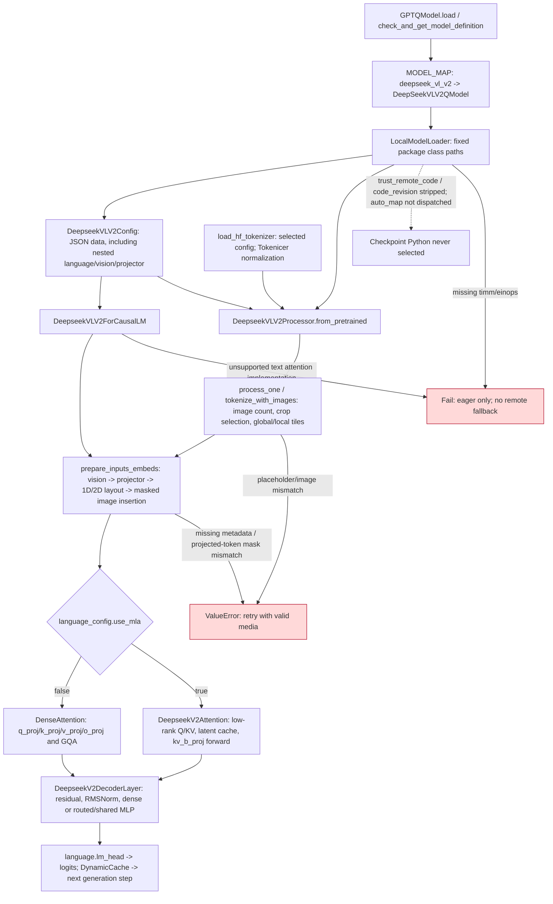

# DeepSeek-VL2 package-owned loading and inference

GPT-QModel selects this package for model type `deepseek_vl_v2`. Transformers
5.23.0 has no exact config/model mapping for that type; native DeepSeek-VL
and DeepSeek-V2 text models do not implement this multimodal checkpoint.

## Provenance and licenses

The inspected authoritative source is
[DeepSeek-AI/DeepSeek-VL2 at ef9f91e2b6426536b83294c11742c27be66361b1](https://github.com/deepseek-ai/DeepSeek-VL2/tree/ef9f91e2b6426536b83294c11742c27be66361b1).
The port adapts `deepseek_vl2/models/{configuration_deepseek,modeling_deepseek,
modeling_deepseek_vl_v2,processing_deepseek_vl_v2,siglip_vit,conversation}.py`.
The composite config was extracted
from the upstream multimodal modeling module.

The dense `use_mla=false` layout and exact checkpoint ownership were also
inspected in these pinned repositories (JSON and Python were read as source,
not dynamically imported):

| Checkpoint | Revision | Owned tensor keys |
| --- | --- | ---: |
| [Isotr0py/deepseek-vl2-tiny](https://huggingface.co/Isotr0py/deepseek-vl2-tiny/tree/cca6d50b8b5b7d1214ea76a70cdd47c8e5eaa4a6) | cca6d50b8b5b7d1214ea76a70cdd47c8e5eaa4a6 | 2582 |
| [deepseek-ai/deepseek-vl2-small](https://huggingface.co/deepseek-ai/deepseek-vl2-small/tree/6033e16432a1d771cf9fe4a6f894ff5e5e1459af) | 6033e16432a1d771cf9fe4a6f894ff5e5e1459af | 5639 |
| [deepseek-ai/deepseek-vl2](https://huggingface.co/deepseek-ai/deepseek-vl2/tree/f363772d1c47f4239dd844015b4bd53beb87951b) | f363772d1c47f4239dd844015b4bd53beb87951b | 6973 |

`checkpoint_metadata.json` stores the pinned config JSON and losslessly
grouped safetensors-index keys. The meta-model test expands the key patterns
and compares the **entire** real model `state_dict()` with each checkpoint's
index, including the vision encoder, projector, direct image-layout
parameters, router weights/correction bias, shared experts and text decoder.
No trained tensors were downloaded.

`LICENSE-CODE` preserves DeepSeek's upstream MIT license. Existing Apache-2.0
headers and FastChat/timm attribution links are retained; `LICENSE-APACHE-2.0`
and `NOTICE` cover the corresponding derived portions. Model-weight licenses
are separate and unchanged.

## Resolution and failure contract

The before locations below refer to base commit
`22bea120181e739161ee2969b260fe94f5b4e791`; current symbols refer to this port.

| Before | After |
| --- | --- |
| `definitions/deepseek_vl_v2.py:24-25`: AutoModelForCausalLM plus required remote trust | `DeepSeekVLV2QModel.loader`: package-owned config, model and processor paths in LocalModelLoader |
| `definitions/deepseek_vl_v2.py:29`: mandatory xformers/flash-attn | `require_pkgs`: timm/einops; eager Torch text attention and Torch SDPA vision attention |
| `definitions/deepseek_vl_v2.py:168-169`: AutoProcessor checkpoint discovery | `load_processor`: declared DeepseekVLV2Processor with selected config and Tokenicer-normalized tokenizer |
| Checkpoint-selected Transformers 4 cache/model APIs | Local GenerationMixin and DynamicCache; dense GQA or MLA according to language_config.use_mla |
| MLA inference reads kv_b_proj.weight directly | Calls kv_b_proj so packed quantized linears remain on the execution path |
| Undeclared latent norms and router | Explicit non-quantized q_a_layernorm, kv_a_layernorm and mlp.gate owners |
| Unqualified default AWQ groups | Explicit empty scaling policy; existing plain-quantization path, or missing-feature rejection when fallback=None |



The selected config must also reach `load_hf_tokenizer(config=...)` in the
shared loader. Without that prerequisite, the public load regression
reproduces checkpoint AutoConfig execution when both legacy trust and the
security bypass are enabled. This port does not add a security switch.

## AWQ source/consumer review

No scale-fold/search groups are qualified in any dense/MLA or routing layout.
The following actual relationships explain why matching widths/module order
alone cannot admit them:

| Source | Consumers and intervening computation | Policy |
| --- | --- | --- |
| input_layernorm output | Dense q/k/v, or MLA q_a/q and kv_a projections; RoPE, GQA/attention follow | No fold/search |
| q_a_proj / kv_a_proj latent | q_a_layernorm / kv_a_layernorm then q_b / kv_b; KV latent is cached | No fold through normalization |
| attention output | Head/position mixing then o_proj, residual addition | No inferred v/o fold |
| post_attention_layernorm output | Dense gate/up or non-quantized MoEGate plus routed/shared gate/up; nonlinear activations, token selection and weighted sum | No independently replayed expert groups |
| Vision/projector output | Dynamic image layout insertion into decoder embeddings | Vision/projector remain outside decoder quantization |

`DeepSeekVLV2QModel.awq_get_modules_for_scaling` returns an explicit empty
list. Native tiny-model tests exercise the real AWQ staging and packing
pipeline for every decoder linear in dense and MLA layouts, FP16/BF16 and
greedy/group_limited_greedy/noaux_tc routing. They compare staged versus
packed full-model logits, check packed cache/no-cache generation equality,
verify excluded norms/routers/embeddings are unchanged, and round-trip
packed tensors through safetensors. With `fallback=None` and absent
activation features they verify rejection before mutation, not a fake
successful quantization. No scale-folding, candidate-search, native fusion,
or GPU-kernel safety is implied.

## Reproducible qualification

Environment: Python 3.14.6 free-threaded, Transformers 5.23.0, Torch
2.15.0+cpu, timm 1.0.22 and einops 0.8.1. Execute with `PYTHON_GIL=0`.
Measured results: the owned runtime/model-plan and existing CPU model suite
passed 80 tests in 9.95 seconds; shared loader/security plus the fusion
inventory contract passed 30 tests in 3.24 seconds.

```sh
python -m pytest -q tests/test_deepseek_vl_v2_local_port.py \
  tests/module_tree/test_deepseek_vl_v2_local_port.py \
  tests/models/test_deepseek_vl_v2.py::test_deepseek_vl_v2_pre_quantize_hook_materializes_base_modules \
  tests/models/test_deepseek_vl_v2.py::test_prepare_deepseek_vl_v2_dataset_reuses_shared_dataset \
  tests/models/test_deepseek_vl_v2.py::test_deepseek_vl_v2_uses_package_owned_config_defaults
python -m pytest -q tests/test_local_model_loading.py \
  tests/test_trust_remote_code_isolation.py \
  tests/module_tree/test_fusable_models.py::test_registry_has_explicit_fusion_qualification_for_every_alias
ruff check gptqmodel/models/ports/deepseek_vl_v2 \
  gptqmodel/models/definitions/deepseek_vl_v2.py \
  tests/test_deepseek_vl_v2_local_port.py \
  tests/module_tree/test_deepseek_vl_v2_local_port.py \
  tests/models/test_deepseek_vl_v2.py
git diff --check
```

Numerical oracles are native Transformers Llama attention for dense GQA,
independent pinned absorbed-weight MLA equations (including nontrivial YaRN),
explicit full routed/shared expert sums, and explicit vision softmax-attention
equations. Cache/generation/save tests cover FP32/FP16/BF16, q-LoRA/direct-Q,
three routing modes, padding, greedy/beam generation, incremental prefill,
and exact safetensors reload. Media tests exercise dynamic tiling, both
1D/2D tags and head/tail global views, image-dependent logits, packaged
processor serialization, calibration and failed-media/mask retries.

Detection evidence: the initial definition-owned loader assertion failed
against AutoModelForCausalLM. The public poisoned checkpoint regression
failed by executing `poison.py` with trust+bypass before the parent tokenizer
fix and passed afterward. Tied dense/MLA output-config tests failed
because hidden states/attentions were missing; they pass after honoring
config output flags and declaring tied safetensors keys. A targeted central
registry run fails specifically on its old explicit block inventory;
the model-specific test passes with `registry_plan.json`.

## Parent-owned integration and limitations

Replace central `registered_module_plans.json` case
`DeepSeekVLV2QModel/gptq` with `registry_plan.json`; retain the existing alias.
Add `deepseek_vl_v2` to `PLAIN_QUANTIZATION_FAMILIES` in
`tests/test_awq_scaling_groups.py`. Fusion remains unqualified; replace its
reason with: “Dense/MLA attention and routed/shared-expert native fusion are
not independently qualified; fusion remains disabled.”

The parent owns central fixtures, packaging, `docs/` and `README.md`:
include this flow and comparison in the central model-port reference and
link it from the README. Preserve this package's licenses/notices and
provenance/JSON fixtures in built distributions. No shared files are changed
by this unit.

CUDA/ROCm execution, flash-attention, tensor/expert parallelism, threaded
accelerator execution and uncached trained-checkpoint load/quality are not
qualified here. Text attention explicitly supports eager only; static,
offloaded and quantized HF cache implementations are not supported.
Checkpoint keys are audited on meta models, not by loading trained tensors.
The full existing GPU quantize/evaluate test needs its real checkpoint
and GPU. This port does not claim multimodal task accuracy or complete
training support.
