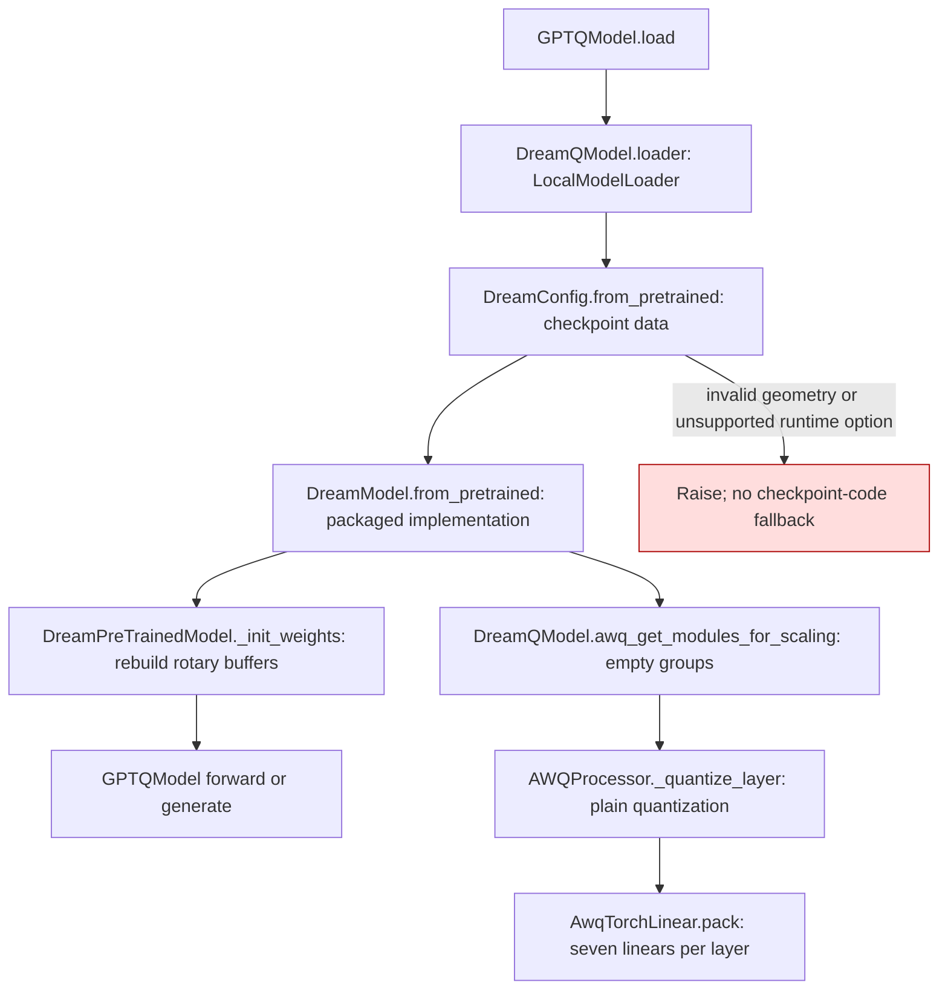
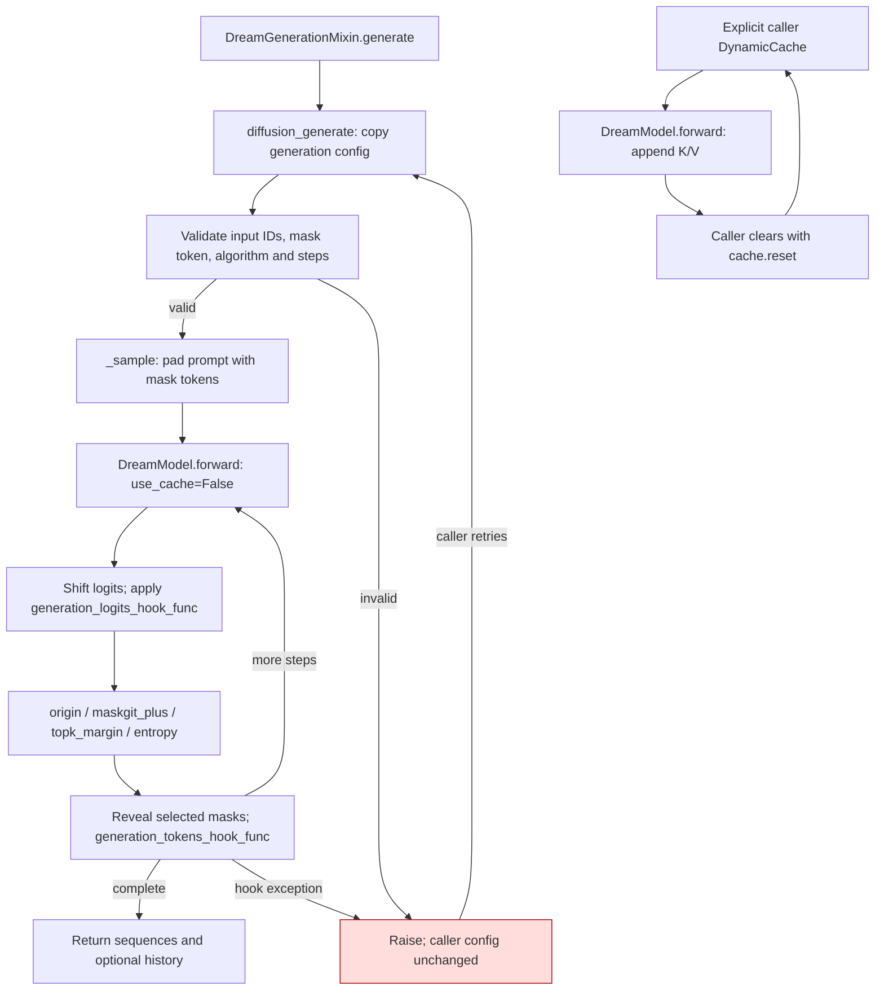

<!-- SPDX-FileCopyrightText: 2026 ModelCloud.ai -->
<!-- SPDX-License-Identifier: Apache-2.0 -->

# Dream local loading and diffusion generation

GPT-QModel selects packaged Dream classes before reading model implementation
metadata from a checkpoint. Diffusion generation then recomputes the entire
sequence at every denoising step, preserving Dream's bidirectional semantics.
This reference accompanies [PR #4620](https://github.com/ModelCloud/GPTQModel/pull/4620).

## Mechanism replacement

| Concern | Before | After |
| --- | --- | --- |
| Implementation selection | Assigned base `22bea1201:gptqmodel/models/definitions/dream.py:6,12` imported/selected `AutoModel`; checkpoint metadata supplied custom Dream code. | `DreamQModel.loader` declares package-owned `DreamConfig` and `DreamModel` through `LocalModelLoader`. No runtime Hub Python import or global Transformers registration. |
| Generation consumer | Checkpoint class supplied `diffusion_generate`; normal `generate` ownership was external. | `DreamGenerationMixin.generate` delegates to `diffusion_generate`; `_sample` retains the published schedule and shifted-logit convention. |
| Rotary tensor lifecycle | Nonpersistent buffers were normally initialized while constructing the old remote model. | `DreamPreTrainedModel._init_weights` reconstructs `DreamRotaryEmbedding` buffers after TF5 meta materialization and safetensors loading. |
| AWQ relationship selection | Inherited Llama scaling groups could assume causal replay. | `DreamQModel.awq_get_modules_for_scaling` returns no groups; existing `AWQProcessor` plain quantization handles all declared linears. |

## Loading and quantization decisions

Raw API trust and the existing security bypass cannot replace the packaged
config/model. The shared loader's tokenizer config forwarding is also required
so tokenizer discovery cannot re-import checkpoint AutoConfig.

## Diffusion and caller-owned cache lifecycles

There is no fallback from an unknown diffusion algorithm to causal generation.
Caller cache continuation is a separate forward feature: previously computed
bidirectional hidden states cannot acquire new future context from appended K/V.
Generation therefore never reuses that cache. A denoising hook failure discards
the local partial sequence; a retry copies the caller's unchanged config again.

## Regression evidence

| Test | Contract |
| --- | --- |
| `test_public_checkpoint_load_uses_packaged_model_and_diffusion_generate` | Real GPTQModel load/generate, malicious `auto_map`, all trust/bypass combinations. |
| `test_explicit_cache_continuation_matches_pinned_incremental_semantics` | Independent incremental oracle, append, reset, reuse; future-context difference remains visible. |
| `test_diffusion_generation_shift_schedule_hooks_and_retry` | Each algorithm sees independent-oracle shifted logits, recomputes without cache, preserves prompt, and retries after partial progress. |
| `test_safetensors_round_trip_and_direct_reload_equivalence` | Meta reload rebuilds rotary state; tied and untied model outputs remain equal. |
| `test_awq_empty_groups_reach_real_quantization_and_pack_every_linear` | No scale fold; every supported linear is quantized, packed and used in a real forward. |

Limits and reproducible CPU commands are in the [package provenance page](../README.md).
