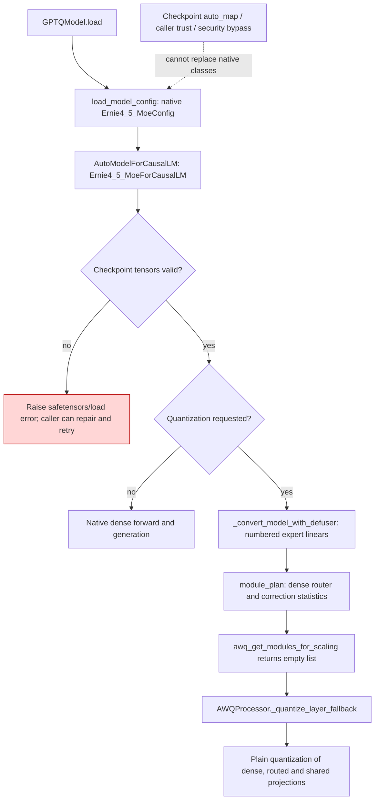

<!-- SPDX-FileCopyrightText: 2026 ModelCloud.ai -->
<!-- SPDX-License-Identifier: Apache-2.0 -->

# GPT-QModel native ERNIE 4.5 MoE qualification

`Ernie4_5_MoeQModel` uses the exact native Transformers 5 implementation,
`Ernie4_5_MoeConfig` → `Ernie4_5_MoeForCausalLM`. This directory documents that
migration; it contains no vendored configuration or modeling code. No
`LocalModelLoader`, global registration, checkpoint Python, or alternate
architecture is necessary. The definition no longer requires remote-code
permission or patches the native forward with a Transformers 4 implementation.

## Sources and checkpoint ownership

- Native dependency qualified: Transformers **5.23.0**, Apache-2.0, Hugging Face
  Transformers contributors; `transformers.models.ernie4_5_moe` and its
  `conversion_mapping.py` entry. Attribution and licenses remain in that
  dependency; no upstream modeling source is copied here.
- Authoritative checkpoint: [baidu/ERNIE-4.5-21B-A3B-PT](https://huggingface.co/baidu/ERNIE-4.5-21B-A3B-PT/tree/87db95487941cb39592ee0abca3b9155a6d19c5c),
  pinned revision `87db95487941cb39592ee0abca3b9155a6d19c5c`.
  Its config names `ernie4_5_moe` / `Ernie4_5_MoeForCausalLM`, 64 routed
  experts and two shared experts. Only config and index JSON were downloaded.
- That checkpoint index has 5,504 entries, including 12 MTP entries. Its
  numbered expert tensors are `mlp.experts.<index>.gate_proj.weight`,
  `up_proj.weight`, and `down_proj.weight`. Transformers converts these into
  native fused `mlp.experts.gate_up_proj` and `mlp.experts.down_proj` tensors.
- Transformers explicitly renames checkpoint
  `mlp.moe_statics.e_score_correction_bias` into
  `mlp.gate.moe_statics.e_score_correction_bias`. Both that statistic and
  `mlp.gate.weight` remain dense; their definition owners have explicit `:!`
  tags. Native `_keep_in_fp32_modules_strict` is `["gate.weight", "moe_statics"]`.
- Defuser **0.0.31** restores per-expert `Linear` projections for quantization,
  splitting `gate_up_proj` into gate/up along the intermediate dimension.
  Tests verify exact tensor ownership and native logits/routing before and
  after this conversion, including numbered-expert checkpoint loading with
  nonzero legacy correction statistics.

## Native selection and conservative AWQ flow

| Previous mechanism at base `22bea1201` | Native migration |
| --- | --- |
| `definitions/ernie4_5_moe.py:17`: stale remote trust requirement | Native selection without caller remote permission |
| `definitions/ernie4_5_moe.py:19,51-199`: optional old forward patch | Native causal masks, cache and forward unchanged |
| `definitions/ernie4_5_moe.py:38`: only router declared | Explicit dense router-statistics owner too |
| Inherited AWQ group inference | Explicit unqualified/plain-quantization policy |

Empty AWQ groups deliberately select the existing plain-quantization fallback;
they do **not** skip quantizing a layer. A real two-layer dense/MoE/shared fixture
packs all 23 expected projections into `AwqTorchLinear`, preserves the router,
and checks exact safetensors reload keys, dtypes, values and forward outputs for
FP16 and BF16. Scaling/folding/search/replay relationships are not claimed safe.
The reload regression also detects shared-loader violations of the native
strict-FP32 metadata rather than accepting rounded router values.

## Executable coverage and limits

`tests/test_ernie4_5_moe_local_port.py` covers the native AutoModel mapping,
public loading despite malicious config/tokenizer discovery with all four
trust/bypass combinations, exact fused/numbered expert state, optional shared
experts, biases, sparse intervals, cache continuation, deterministic cached vs
uncached generation, safetensors reload, failed-read repair/retry and actual
plain AWQ quantization/reload.

`tests/module_tree/test_ernie4_5_moe_local_port.py` builds real CPU/meta native
models, checks every decoder state-dict owner, planner roles and looper expert
group consumers, valid optional paths, unknown descendant rejection, and
unchanged native output/state when AWQ scaling is declined.

Validation environment: Python **3.14.6t**, `PYTHON_GIL=0`, Torch **2.15.0+cpu**.
These are tiny-model CPU tests, not GPU throughput or trained-checkpoint
quality measurements. Native Transformers explicitly does not support MTP and
ignores the checkpoint's MTP tensors; training/MTP is not qualified here.
GPU/Flash Attention, multi-GPU execution, non-dynamic cache implementations,
full trained weights and quantized quality evaluation remain untested.
