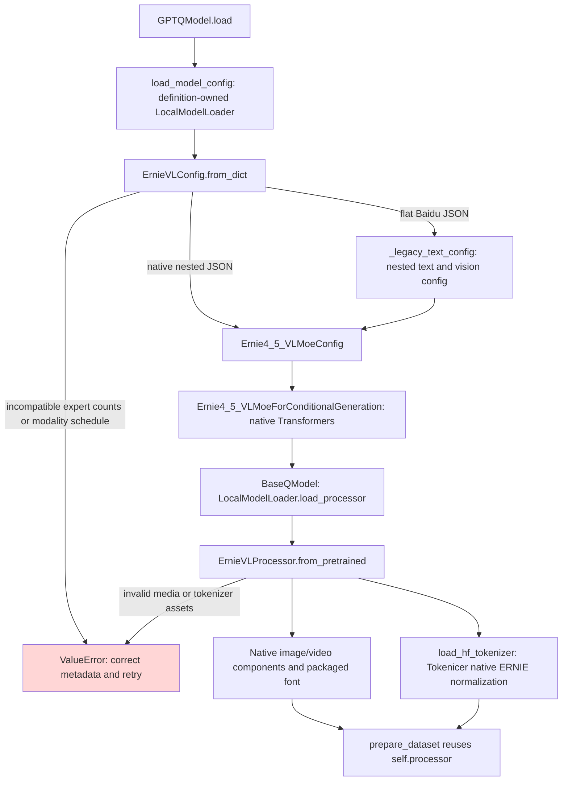

# Native ERNIE VL selection and legacy metadata

Both `ernie4_5_moe_vl` (the original Baidu spelling) and
`ernie4_5_vl_moe` select the exact Transformers 5 ERNIE VL architecture.
This package contains JSON schema and processor-component adapters, not a
copy of the model. Native Transformers owns attention, routing, cache,
generation and checkpoint weight conversion. The definition never imports
the checkpoint's decoder or processor classes, even with trust and the
existing safety bypass enabled.

## Selection flow



The loader removes `trust_remote_code` and `code_revision`; checkpoint
`auto_map` cannot replace package-selected classes. The legacy config is
translated without `AutoConfig` dispatch. Native nested configs retain their
native weight-conversion identity. Legacy modality schedules must describe
the same actual sparse layers, including end bounds beyond the decoder.
Different text/vision expert widths are retained; unequal expert counts or
different per-modality sparse schedules are explicitly rejected rather than
silently interpreted as another architecture. No such incompatible variant
is present in the pinned official checkpoint.

| Mechanism | Before at base `22bea120181e739161ee2969b260fe94f5b4e791` | After |
| --- | --- | --- |
| Model selection | Definition line 28 used `AutoModelForImageTextToText`; legacy alias lacked native config mapping | `LocalModelLoader` selects the exact native class through a package re-export |
| Decoder hook | Definition lines 419–427 called `get_class_from_dynamic_module` on checkpoint `Ernie4_5_DecoderLayer` and caught failures | No remote hook; native decoder is not monkey-patched |
| Processor selection | Definition lines 397–398 called `AutoProcessor.from_pretrained` again during dataset preparation | Package-selected native components are created once; calibration reuses the instance |
| Metadata | Official flat config and image-only placeholder names | Explicit nested schema conversion and upstream Tokenicer normalization |
| AWQ | Generic grouping could treat modality experts as a dense MLP | Definition returns no scaling groups; tested direct plain quantization |

## Provenance and licenses

- Official checkpoint metadata and inspected legacy source:
  [baidu/ERNIE-4.5-VL-28B-A3B-PT at
  e3815e65c607ea211bfe21b46ab0cd264b76731c](https://huggingface.co/baidu/ERNIE-4.5-VL-28B-A3B-PT/tree/e3815e65c607ea211bfe21b46ab0cd264b76731c),
  Apache-2.0. `config.json`, `preprocessor_config.json`, tokenizer assets and
  `model.safetensors.index.json` are read as data; checkpoint Python is not
  copied or executed.
- Native implementation: Transformers
  [5.23.0, commit 52b080b6416a7897e2af90febeb4dfad22b84d19](https://github.com/huggingface/transformers/tree/52b080b6416a7897e2af90febeb4dfad22b84d19/src/transformers/models/ernie4_5_vl_moe),
  Apache-2.0. Native `ErnieFuseAndSplitTextVisionExperts` and the weight
  conversion mapping preserve the original fused text/vision router and
  expert checkpoint names. No native implementation is vendored here.
- Roboto font for native video timestamp drawing:
  [googlefonts/roboto-2 at
  38062f4b4a0be4346d07a928408da21602545e9e](https://github.com/googlefonts/roboto-2/tree/38062f4b4a0be4346d07a928408da21602545e9e),
  `src/hinted/Roboto-Regular.ttf`, Apache-2.0; original license is preserved
  as `LICENSE-Roboto.txt`. Font SHA256:
  `56a45233d29f11b4dfb86d248e921939d115778f87325e7ae8cc108383d6664d`.
  The font is packaged, never fetched during processor construction.

The adapter and package re-export are original Apache-2.0 code. Reusable
tokenizer fixes belong to [Tokenicer PR 64](https://github.com/ModelCloud/Tokenicer/pull/64),
version `0.0.17`, not GPT-QModel. The parent migration owns the shared
dependency minimum. Tests use that implementation, including exact ordinary
text IDs and image/video token IDs from the pinned public bundle.

## Qualification and limits

Owned tests are `tests/test_ernie4_5_vl_moe_local_port.py` and
`tests/module_tree/test_ernie4_5_vl_moe_local_port.py`.

| Test | Invariant |
| --- | --- |
| `test_before_model_load_never_imports_checkpoint` | Red on the original remote-hook definition; green without the hook |
| `test_native_loading_ignores_hostile_automap` | Both aliases, both trust settings and both bypass settings; safetensors numerical reload |
| `test_public_gptqmodel_dispatch_and_processor_reuse` | Actual `GPTQModel.load`, native model/processor ownership, normalized tokenizer identity and calibration processor reuse |
| `test_native_forward_cache_generation_and_reload` | Eager/SDPA forward, continuation versus complete sequence, greedy generation and safetensors equivalence |
| `test_pinned_checkpoint_key_inventory_and_real_meta_layout` | Real full public config on meta; tied embeddings; reverse-converted dense/sparse decoder key families match the public index |
| `test_public_tokenizer_processor_with_hostile_metadata` | Real public SentencePiece metadata, hostile maps, exact text/image IDs and image/video preprocessing |
| `test_native_real_media_forward_and_cache` | Actual native image/video forwards and cache continuation |
| `test_invalid_legacy_layout_rejected_then_retried` | Unsupported metadata raises, and corrected metadata loads in the same process |
| `test_real_weight_ownership_and_plan_tags` | Both aliases; dense/sparse/mixed and bias variants; real post-Defuser state ownership through `ModulePlan.find` |
| `test_plain_awq_quantizes_all_real_dense_and_modality_expert_linears` | Real AWQ plain path quantizes 7 dense and 19 sparse declared linears; no guessed expert folds |

AWQ scale-search/folding is deliberately unqualified: modality routers and
shared/routed experts need a joint replay/consumer audit. Plain quantization
is tested, not a claim of AWQ fold or accuracy qualification. Routers and
score-correction bias tensors remain explicitly non-quantized. Existing QKV
fusion qualification is unchanged for the canonical native spelling; the
legacy spelling remains explicitly unqualified for fusion.

Validated on CPU Torch 2.15.0, Transformers 5.23.0 and Python 3.14t with
`PYTHON_GIL=0 OMP_NUM_THREADS=1`. No trained multi-GB weights, real checkpoint
accuracy/perplexity, GPU kernels, GPU quantization, FlashAttention, distributed
expert dispatch, or full video task quality was validated. Public metadata
tests need the pinned Hugging Face assets or their existing cache.

Validation commands (the Python executable was
`/home/ubuntu/.venvs/gptqmodel-tf5/bin/python -s`):

```bash
PYTHON_GIL=0 OMP_NUM_THREADS=1 python -s -m pytest -q \
  tests/test_ernie4_5_vl_moe_local_port.py \
  tests/module_tree/test_ernie4_5_vl_moe_local_port.py --tb=short
# 45 passed; 12 upstream NumPy conversion deprecation warnings.

PYTHON_GIL=0 OMP_NUM_THREADS=1 python -s -m pytest -q \
  tests/test_ernie4_5_vl_moe_local_port.py \
  tests/module_tree/test_ernie4_5_vl_moe_local_port.py \
  tests/test_ernie4_5_vl_moe_offload_hook.py \
  tests/module_tree/test_ernie_expert_projections.py \
  tests/module_tree/test_ernie_vl_moe_expert_coverage.py \
  tests/module_tree/test_registered_module_plans.py \
  tests/module_tree/test_fusable_models.py tests/test_awq_empty_groups.py --tb=short
# 606 passed, 468 skipped (NVIDIA-only native fusion), 17 upstream warnings.
```

Red/green remote-hook evidence: restoring only `before_model_load` from the
base definition and running
`tests/test_ernie4_5_vl_moe_local_port.py::test_before_model_load_never_imports_checkpoint`
produces one assertion failure because the dynamic-import spy was called.
The same node passes with the shipped definition. This uses a throwing spy,
not checkpoint Python execution. The actual public loader/processor tests
separately exercise malicious checkpoint maps and marker files.

Ruff passes the definition, port package and owned tests; `git diff --check`
is clean. The existing trained-checkpoint test was correctly renamed for
ERNIE but was not run because its private checkpoint and GPU are unavailable.

The parent-owned central docs should link this mechanism from the README and
include the same selection diagram in the shared Transformers 5 reference.
The existing migration is [GPT-QModel PR 4620](https://github.com/ModelCloud/GPTQModel/pull/4620).
