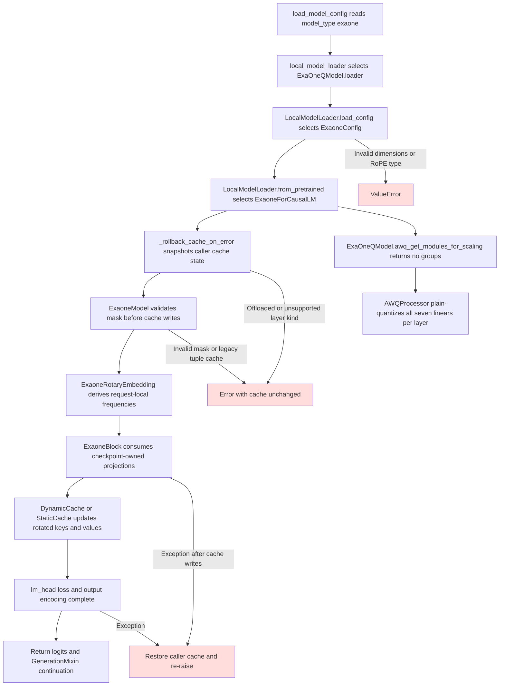

# GPT-QModel EXAONE 3 configuration and modeling

`ExaOneQModel.loader` selects this package directly for `model_type=exaone`.
Transformers **5.23.0** contains native `exaone4`, `exaone4_5`,
`exaone4_5_vision` and `exaone_moe` mappings, but no `exaone` config or causal-LM
mapping. Native EXAONE 4 is not a compatible substitute for EXAONE 3.0/3.5.
No global AutoConfig registration, checkpoint Python import, kernel download
or checkpoint `auto_map` lookup is used by this implementation.

## Pinned inspected sources

| Snapshot | Revision | Purpose |
| --- | --- | --- |
| [Official EXAONE 3.0 7.8B](https://huggingface.co/LGAI-EXAONE/EXAONE-3.0-7.8B-Instruct/tree/7f15baedd46858153d817445aff032f4d6cf4939) | `7f15baedd46858153d817445aff032f4d6cf4939` | Original configuration, architecture and six RoPE equations |
| [ModelCloud EXAONE 3.0 mirror](https://huggingface.co/ModelCloud/EXAONE-3.0-7.8B-Instruct-gptq-4bit/tree/d0fb2f780279089238cdfedbcd0fb48bbca38cbf) | `d0fb2f780279089238cdfedbcd0fb48bbca38cbf` | Byte-identical original modeling/config source, verified as below |
| [EXAONE 3.0 BF16 mirror](https://huggingface.co/heegyu/EXAONE-3.0-7.8B-Instruct-bf16/tree/d0c610e8b29096f20beb91433d8cd2e490e05a78) | `d0c610e8b29096f20beb91433d8cd2e490e05a78` | Unquantized safetensors index and config; official 3.0 weight access remains gated |
| [Official EXAONE 3.5 2.4B](https://huggingface.co/LGAI-EXAONE/EXAONE-3.5-2.4B-Instruct/tree/ccce25bd39c141fe053e0bc75818a8f5fe962802) | `ccce25bd39c141fe053e0bc75818a8f5fe962802` | Current config aliases and tied-weight Transformers 5 metadata |
| [Official EXAONE 3.5 7.8B](https://huggingface.co/LGAI-EXAONE/EXAONE-3.5-7.8B-Instruct/tree/553ea250b9a5317231459279d5847d6cf955b9aa) | `553ea250b9a5317231459279d5847d6cf955b9aa` | Untied 32-layer config and safetensors index |
| [Official EXAONE 3.5 32B](https://huggingface.co/LGAI-EXAONE/EXAONE-3.5-32B-Instruct/tree/3d27aab477c042df2e174d36eea47b77c8871ef0) | `3d27aab477c042df2e174d36eea47b77c8871ef0` | Untied 64-layer config and safetensors index |

The official EXAONE 3.0 file download returned HTTP 401 (gated), but the
official tree API exposed its Git blob IDs. The public ModelCloud mirror's
downloaded source exactly matches both official blobs, not just their names:

| File | Verified Git blob SHA-1 | SHA-256 of inspected bytes |
| --- | --- | --- |
| `modeling_exaone.py` | `2a0363cead3947ae596287ba98dbc5a540e269f8` | `c3d748dca484bda75da000aaf3c0327752c58e303c0aeab7054dc1d4a18bcec5` |
| `configuration_exaone.py` | `724da7be0e8bde9cf464a42ac10fe8f63329cb8c` | `1d7186274cacc741bb263c24fca7e4de3787979ccf7b00efab450dfb50a54e06` |

EXAONE 3.5 2.4B's current `modeling_exaone.py` SHA-256 is
`717d183af5a476300e1518d43db22bf5c6ae93090a7f24c9c4d9eb9404f01e9c`;
its `configuration_exaone.py` SHA-256 is
`239257e77b363ee7efd8b5879928cf40475ccc8b53ecf17744b32f662caf7be4`.
All downloaded Python was inspected as text, never imported or executed.
`NOTICE` preserves source authorship and Apache-2.0 attribution. No weights
or tokenizers are redistributed; the separate EXAONE model licenses remain
applicable to those artifacts.

## Checkpoint and equation preservation

`checkpoint_contracts.json` records each inspected config, pinned revision,
safetensors-index Git blob SHA-1, normalized checkpoint-key set, full key-set
SHA-256 and tensor count. EXAONE 3.0 and EXAONE 3.5 7.8B each contain 291 tensors;
EXAONE 3.5 32B contains 579. EXAONE 3.5 2.4B contains 272, omitting the tied
`lm_head.weight` alias. No checkpoint-key conversion is applied. Exact real
meta-model `state_dict()` sets are compared against these index contracts.

Each decoder keeps `ln_1`, `attn.attention.{q,k,v}_proj`,
`attn.attention.out_proj`, `ln_2`, and `mlp.{c_fc_0,c_fc_1,c_proj}`.
Only the seven bias-free linear projections are quantized. Both RMSNorm
owners have explicit `:!` tags; outer owners remain `transformer.wte`,
`transformer.ln_f` and `lm_head`. Rotary frequency tensors are derived state,
not persistent checkpoint obligations.

Computation retains pre-norm residuals, FP32 RMSNorm accumulation, GQA/MQA/MHA,
split-half rotary pairing, SiLU(gate) times up projection, FP32 attention
softmax, and original logits/loss output dtypes. Legacy config spellings
`num_layers`, `activation_function`, `layer_norm_epsilon` and `rope_scaling`
coexist with their current aliases and `rope_parameters`. The original
EXAONE 3.0 default, linear, dynamic, YaRN, LongRoPE and Llama 3 equations are
tested independently. EXAONE 3.0 YaRN's original length basis is retained,
rather than silently adopting a newer generic helper's different basis.

Transformers 5 `Cache`, `DynamicCache`, `StaticCache`, causal masks,
`GenerationMixin`, gradient checkpointing, eager attention and SDPA replace
obsolete Transformers 4 helpers. No FlashAttention or optional CUDA import is
required. Position-dependent frequencies remain local to each call rather
than mutating a model-global growing rotary cache. Masks are validated before
any KV-cache mutation, so malformed-context retry preserves a warm cache.
`_rollback_cache_on_error` also restores caller state after decoder, final
norm, head, loss or output-encoding failures. Dynamic layers retain previous
tensor references; static layers snapshot only this call's write window and
counter, preserving static storage addresses without copying full KV history.
Both empty and populated caches retry against fresh full-forward results.
Legacy tuple, sliding/quantized and offloaded caches fail explicitly; standard
non-offloaded Transformers 5 DynamicCache/StaticCache layers are supported.

## Selection and failure flow

| Previous mechanism at base `22bea1201` | Package-owned mechanism |
| --- | --- |
| `definitions/exaone.py:10-11` sets `require_trust_remote_code=True` and inherits AutoModel dispatch | `definitions/exaone.py:11-14` binds package-owned config/model classes; trust and bypass values cannot replace them |
| `tests/models/test_exaone.py:25-31` skips on Transformers 5 when `DynamicCache.from_legacy_cache` is absent | Standard Transformers 5 Cache generation; obsolete skip removed and API trust disabled |
| Inherited AWQ scale inference has no EXAONE 3 source/consumer qualification | `definitions/exaone.py:38-41` deliberately returns `[]`, forcing plain weight quantization |
| Legacy checkpoint code relies on old mask/cache helpers and mutable rotary state | Current causal-mask/cache APIs, request-local RoPE, pre-write mask validation and post-write exception rollback |

## AWQ policy and limits

All EXAONE 3 variants use **plain AWQ weight quantization**; source folding,
scale search and attention replay remain unqualified. No shape/order inference
is used as evidence of fold safety. Live CPU tests exercise the actual public
load, calibration, AWQProcessor, all 14 packed projections of a two-layer
model, safetensors save and quantized reload. Nontrivial RMSNorm gains remain
unchanged. Both tied and untied layouts are covered with `fallback=None`,
including Llama 3 scaled RoPE. No shared AWQ algorithm is changed.

CPU tests qualify tiny functional FP32/FP16/BF16 forward/cache equivalence,
real meta checkpoint ownership, greedy/beam generation, static/dynamic cache,
safetensors round trips and every API-trust/security-bypass combination.
They are not trained-model quality evidence. GPU kernels/quantization,
concurrent multi-GPU execution, compilation, FlashAttention, and full trained-checkpoint
generation/evaluation remain untested. The official EXAONE 3.0 trained model
still needs gated access; no multi-GB payload was downloaded. No new threaded
Torch call or GIL=0 concurrency guarantee is introduced.

Parent integration owns central README/docs and shared fixture edits. This
port-local diagram is the EXAONE reference for that shared documentation.
See `VALIDATION.md` for exact test evidence and central integration requests.
