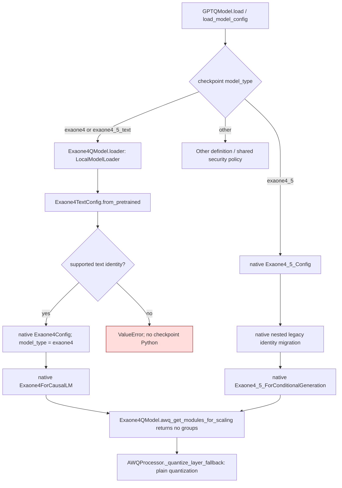

<!-- SPDX-FileCopyrightText: 2026 ModelCloud.ai
SPDX-License-Identifier: Apache-2.0 -->

# EXAONE native text identity and loading

EXAONE 4 and 4.5 already have exact native Transformers 5 implementations.
This package does **not** vendor modeling code. It binds the text definition
directly to native `Exaone4ForCausalLM` and canonicalizes the released standalone
`exaone4_5_text` config identity to `exaone4`. The multimodal definition retains
native `AutoModelForImageTextToText` / `Exaone4_5_ForConditionalGeneration` and
native `Exaone4_5_Processor`, Qwen2VL image and video processors.

## Source and provenance

Inspected native source is Transformers **5.23.0**, tag commit
[`52b080b6416a7897e2af90febeb4dfad22b84d19`](https://github.com/huggingface/transformers/tree/52b080b6416a7897e2af90febeb4dfad22b84d19).
Native implementation attribution remains with LG AI Research and Hugging Face
(2025/2026), Apache-2.0. This package's original binding is Apache-2.0; no
checkpoint Python, upstream implementation, or tokenizer correction is copied.

- [Native EXAONE 4 config/model](https://github.com/huggingface/transformers/tree/52b080b6416a7897e2af90febeb4dfad22b84d19/src/transformers/models/exaone4)
- [Native EXAONE 4.5 config/model/processor](https://github.com/huggingface/transformers/tree/52b080b6416a7897e2af90febeb4dfad22b84d19/src/transformers/models/exaone4_5)
- [EXAONE 4 checkpoint metadata](https://huggingface.co/LGAI-EXAONE/EXAONE-4.0-32B/tree/a1d54d1c148c30881ed27e035b650da489b51b92)
- [EXAONE 4.5 checkpoint metadata](https://huggingface.co/LGAI-EXAONE/EXAONE-4.5-33B/tree/570aa4b15a4f45ba1133072b45f50198f6e3b4fd)

`Exaone4_5_Config.__post_init__` explicitly migrates its nested
`text_config.model_type=exaone4_5_text` to `exaone4`; its sub-config default is
`Exaone4Config`. The published 4.5 config uses that legacy name and declares
`architectures=["Exaone4ForCausalLM"]`. This is the architecture identity evidence,
not an inference from similar projection shapes.

`checkpoint_contract.json` contains reduced key schemas from the pinned
published safetensors indices, their SHA-256 hashes and observed key counts:
707 keys for EXAONE 4 and 1064 keys for EXAONE 4.5. Each decoder owns exactly
seven linear weights and four norm weights. Real CPU/meta tests compare all
native state keys against this independent header-derived schema.
EXAONE 4.5's 15 checkpoint-only `mtp.*` weights remain under the existing
`out_of_model_tensors={"prefixes": ["mtp"]}` policy; native generation does not
instantiate the training/speculative MTP branch. Vision keys remain unchanged
and outside language-layer quantization.

## Resolution and failure contract

| Mechanism | Before (base `22bea1201`) | After |
| --- | --- | --- |
| Text loader | `BaseQModel.loader=AutoModelForCausalLM`, inherited at `definitions/exaone4.py:8` | Definition-owned `LocalModelLoader` at `definitions/exaone4.py:11-14` |
| Legacy alias | Registry entry existed, but AutoConfig had no `exaone4_5_text` mapping | `Exaone4TextConfig.from_pretrained` canonicalizes only the two supported text identities |
| Explicit trust + bypass | Unknown standalone alias could import checkpoint AutoConfig | Local config/model selection ignores `auto_map` and remote flags |
| Native 4.5 wrapper | Exact native multimodal implementation | Unchanged; native nested legacy migration also tested |
| Unknown text identity | No explicit native text contract | Binding raises `ValueError`; valid subsequent selection succeeds |
| AWQ optimization | Inherited generic scale-group inference | No fold/search groups; existing plain quantizer processes all seven linears |



The loader uses only package-declared class paths; it does not globally
register the legacy alias, dynamically import checkpoint code, or alter native
cache/numerical behavior. Serialization emits canonical `exaone4` text identity.
Invalid placeholder counts fail, then a valid image/video call can reuse the
same native model. Selected subfolders control identity and config data even
when the repository root contains a decoy config.

## AWQ policy

All three registered identities use **plain quantization only**, for both MHA
and GQA. Native `Exaone4DecoderLayer.forward` normalizes the attention/MLP output
before adding the residual; these post-norms are not input producers for the
next branch. Attention also applies Q/K normalization between projections and
the attention operation. These facts do not qualify generic folds. This change
does not claim source/consumer compensation, scale search, or replay safety.

Tests run real `AWQProcessor._quantize_layer` and `apply_quant` on every decoder
linear with both `fallback=None` and configured fallback. Quantized weights and
scale/zero payloads must change/exist, while all four norm weights remain exact.
The empty-group path is intentional plain quantization, not an error suppressed
by fallback. Shared AWQ algorithms are unchanged.

## Runtime validation

Python 3.14.6 free-threaded, `PYTHON_GIL=0`, Transformers 5.23.0 and
Torch 2.15.0+cpu. All tests are tiny and offline; no trained tensor payloads are
downloaded. No new worker-thread code or concurrency-safety claim is introduced.

```bash
PYTHON_GIL=0 OMP_NUM_THREADS=1 /home/ubuntu/.venvs/gptqmodel-tf5/bin/python -s -m pytest -q \
  tests/test_exaone4_local_port.py tests/module_tree/test_exaone4_local_port.py
```

48 focused tests passed as part of the final combined run below.
Coverage includes both text identities and the native multimodal definition;
CPU/meta exact state ownership; GQA/MHA and sliding/full attention; full versus
cached continuation across the sliding window; deterministic cached/uncached
generation; two safetensors save/reload cycles; all trust/bypass combinations;
nested hostile auto-map metadata; real native image/video preprocessing, media
influence on logits, cache continuation, placeholder-error/retry and media
save/reload equivalence.

Red evidence on the original base, before the binding existed:

```bash
PYTHON_GIL=0 /home/ubuntu/.venvs/gptqmodel-tf5/bin/python -s -m pytest -q \
  tests/test_exaone4_local_port.py \
  -k 'text_alias and True-True-exaone4_5_text' --tb=short
```

The test failed with `RuntimeError: checkpoint code executed`, through
`AutoConfig.from_pretrained` importing the test-authored hostile config.
The same node passes after the binding. The full public loading matrix also
detected the independent tokenizer AutoConfig re-import on the original base;
it passes with the existing shared parent fix `5423ad629`. That shared fix is
required and is not part of this model unit's owned commit.

Additional native shared-input/fusion topology suite: 6 passed, 8 skipped;
skips are NVIDIA Marlin numerical qualification, not CPU model qualification.

Final combined native model, shared loader, module-plan and AWQ regression run:

```bash
PYTHON_GIL=0 OMP_NUM_THREADS=1 /home/ubuntu/.venvs/gptqmodel-tf5/bin/python -s -m pytest -q \
  tests/test_exaone4_local_port.py tests/module_tree/test_exaone4_local_port.py \
  tests/test_awq_scale_search_safety.py tests/test_awq_moe_router_scaling.py \
  tests/test_awq_empty_groups.py tests/test_awq_position_kwargs.py \
  tests/test_awq_scale_search_memory.py tests/test_bloom_awq_replay.py \
  tests/module_tree/test_awq_relationships.py tests/module_tree/test_bloom_awq_relationships.py \
  tests/module_tree/test_registered_module_plans.py \
  tests/module_tree/test_definition_subset_ordering.py tests/test_local_model_loading.py --tb=short
```

643 passed, 3 skipped in 19.07 s. The three skips are existing remote-family
AWQ replay cases requiring absent local DeciLM/EXAONE-3/Nanbeige checkpoint
directories; all EXAONE 4/4.5-owned cases ran.

```bash
PYTHON_GIL=0 OMP_NUM_THREADS=1 /home/ubuntu/.venvs/gptqmodel-tf5/bin/python -s -m pytest -q \
  tests/module_tree/test_fusable_models.py tests/module_tree/test_shared_input_cpu_forward.py \
  -k exaone4 --tb=short
```

### Integration notes and limits

- Registry model/definition names, module-tree layouts, tags, and fusion admission
  remain unchanged; existing registry JSON entries need no replacement.
- Add `exaone4` to shared `tests/test_awq_scaling_groups.py`
  `PLAIN_QUANTIZATION_FAMILIES`; alias-specific plain-AWQ tests already exist here.
- Link this native-resolution page from the parent-owned central ports docs and
  README documentation chain; this unit intentionally does not edit those files.
- The old `tests/test_exaone4_5_support.py` AutoConfig-only dispatch mock must be
  migrated to real local config metadata after the shared config preflight.
- Trained-checkpoint evaluation, MTP execution, GPU quantized kernels and
  FP16/BF16 hardware numerics remain unvalidated. CPU structural/native checks
  do not qualify GPU fusion or an AWQ scale optimization.
