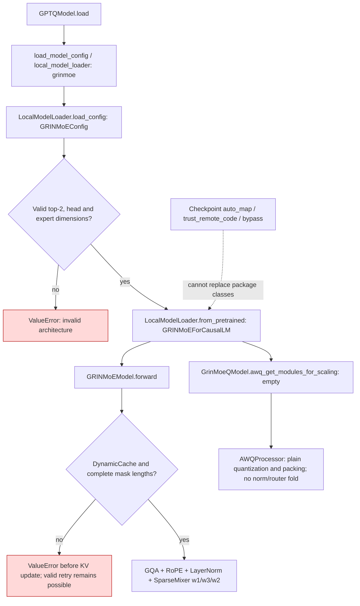

# GRIN-MoE package-owned modeling in GPT-QModel

## Source and attribution

The authoritative checkpoint is
[`microsoft/GRIN-MoE`](https://huggingface.co/microsoft/GRIN-MoE), pinned at
[`9322db36d650fe705bd0af245e1f3d9c52bd07d0`](https://huggingface.co/microsoft/GRIN-MoE/tree/9322db36d650fe705bd0af245e1f3d9c52bd07d0).
The inspected checkpoint's `model_type` is `grinmoe`; its display architecture
string is `GRIN-MoE`. Transformers 5.23.0 has neither a `grinmoe` config mapping
nor a causal-LM mapping. PhiMoE/Mixtral classes are not substitutes.

| Upstream file | SHA-256 |
| --- | --- |
| `configuration_grinmoe.py` | `2590427323c5c0a6ddfb36549ff472c166c9056844797c2de692fffce70db989` |
| `modeling_grinmoe.py` | `0c172b8beb229459269295aad5291ccb499dd8119319be75bec48dcc79f6a05f` |
| `config.json` | `6e5e174897723c6c95b43ceb854751a6d83e34fd707f6cb39f4a0adf7adefcbf` |
| `model.safetensors.index.json` | `fee8fc7ca164fbf1c4b82e307f6c06280f1d0d2ce4ce6d023544d454d59bf5fa` |
| `LICENSE` | `fa8235e5b48faca34e3ca98cf4f694ef08bd216d28b58071a1f85b1d50cb814d` |
| `NOTICE.md` | `ddba83d6812795c2305c7b29eac32c2374e1be924efa4fcddefc5a5d287a5639` |

The configuration/modeling source files carry Apache-2.0 headers, copyright
2024 Microsoft and the HuggingFace Inc. team. Those headers are retained.
Upstream modeling also credits Phi-3.5-MoE for the derived attention/MoE
components. The checkpoint's repository-level MIT license is preserved verbatim
as `LICENSE.upstream`; its notice is preserved verbatim as `NOTICE.md`. The
repository's root `LICENSE` contains Apache-2.0. These are source attributions,
not a claim that GPT-QModel owns the upstream checkpoint or weights.

## Architecture and adaptation

The port retains upstream configuration fields, LayerNorm (not RMSNorm), GQA,
RoPE, gated `w1`/`w3`/`w2` experts, and the actual SparseMixer algorithm. In
evaluation it uses two separately masked softmax distributions, not normalized
top-2 softmax. The custom training estimator and auxiliary router loss are
retained. No checkpoint Python, global HF registration, runtime download,
optional CUDA import, or architecture substitution is involved.

Transformers 4 cache/model/generation scaffolding is replaced by Transformers 5
`PreTrainedModel`, `GenerationMixin`, and `DynamicCache` APIs. The rotary tables
are calculated per call rather than extending shared cosine/sine caches. The
nonpersistent `inv_freq` buffer is initialized for meta/from-pretrained loads.
After a low-precision model cast, frequencies are rebuilt in FP32 instead of
upcasting rounded FP16/BF16 values; this retains the upstream table phases.

Upstream attention backends have **different semantics**, deliberately retained:

| Path | Context and cache |
| --- | --- |
| Eager, or SDPA with `output_attentions=True` | Causal window includes the current query and `sliding_window` preceding keys. |
| SDPA without attention outputs | Full causal context; the upstream SDPA model path does not apply `sliding_window`. |
| Both paths | Full dynamic KV cache, even if eager masks a window; `layer_types` explicitly declares full attention to prevent Transformers generation from truncating it. |

Two-dimensional padding masks cover the complete KV length. Explicit 4D masks
use the Transformers 5 additive-mask convention. Position IDs may differ per
sample. Legacy tuple and static caches fail explicitly rather than silently
returning an incompatible cache. FlashAttention is not advertised by this port;
use eager or SDPA.

The published layout (32 layers, width 4096, MLP 6400, 32 query/8 KV heads,
16 experts, attention and LM-head biases, vocabulary 32064) produces exactly
1,957 state-dict keys on a real meta model. The SHA-256 of sorted checkpoint
keys joined by `\n`, with no trailing newline, is
`cb4174bff210a863ec9a8ff743a76ea0644028479518382eef6a5ad8347e2675`.
The model-specific ownership test pins that independent upstream index digest.

## Definition-owned selection and failure flow

Before/after evidence uses repository-relative paths. Before line numbers refer
to base `22bea120181e739161ee2969b260fe94f5b4e791`; after numbers refer to this port.

| Mechanism | Before | After |
| --- | --- | --- |
| Modeling authority | `definitions/grinmoe.py:11-12`, `require_trust_remote_code=True`; inherited HF auto loader could require checkpoint Python. | `definitions/grinmoe.py:12-15`, package class paths in `LocalModelLoader`. |
| Config/model lookup | Checkpoint `auto_map` and caller trust selected remote implementation. | `models/local.py:37-52`, direct package config/model; trust and `code_revision` stripped. |
| AWQ groups | Inherited inference could propose norm/expert folds. | `definitions/grinmoe.py:24-26`, explicitly returns no groups. |

The parent-owned reference page `docs/transformers5-model-ports.md` and its
README link describe the shared loader mechanism. This port-local diagram
provides the GRIN-specific cache and AWQ branches without editing shared docs.

## AWQ policy

**Plain quantization only** for all tested GRIN-MoE layouts. Scaling relationships
through SparseMixer and multiple routed expert consumers are not claimed safe.
Returning no scaling groups is an architecture policy, not an error fallback:
both `fallback=None` and `fallback="quantize"` quantize and pack every supported
projection. The tiny real one-layer test packs all 13 attention/expert linears,
preserves norms/router exactly, saves safetensors, reloads through
`GPTQModel.load`, and checks exact packed words/scales and output equality.

## Qualification and limits

See `VALIDATION.md` for exact commands and red/green evidence. Qualified on CPU
with Transformers 5.23.0, Torch 2.15.0+cpu and Python 3.14t with `PYTHON_GIL=0`:
real dense/public loading, numerical equations, GQA/bias/expert variants, meta
ownership, dynamic-cache continuation, generation, training router gradients,
safe dense/packed serialization, and AWQ plain quantization. The only registered
alias is `grinmoe`; no additional checkpoint variant was removed.

GPU/ROCm kernels, FlashAttention, GPU activation precision, multi-GPU concurrent
execution, and quality/perplexity on trained weights are **unverified**. The full
published key inventory was inspected without downloading tensor shards. A
separate uncached checkpoint-weight load/generation check is still needed;
tiny randomly initialized models and key/shape equality do not prove it.
