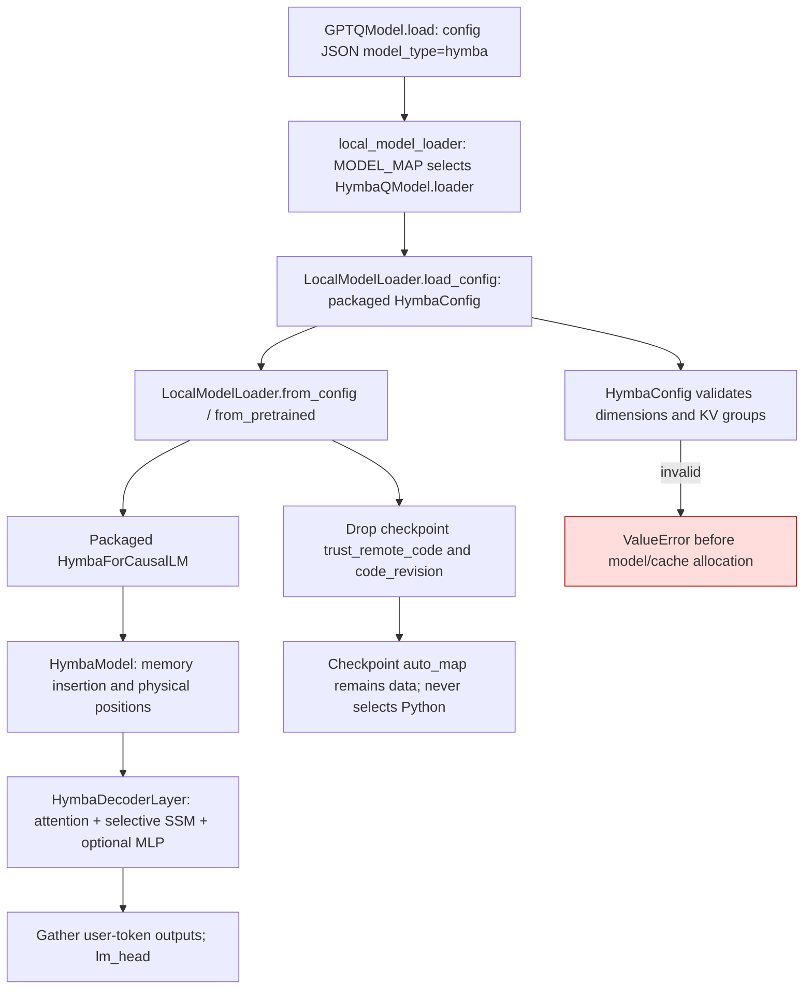
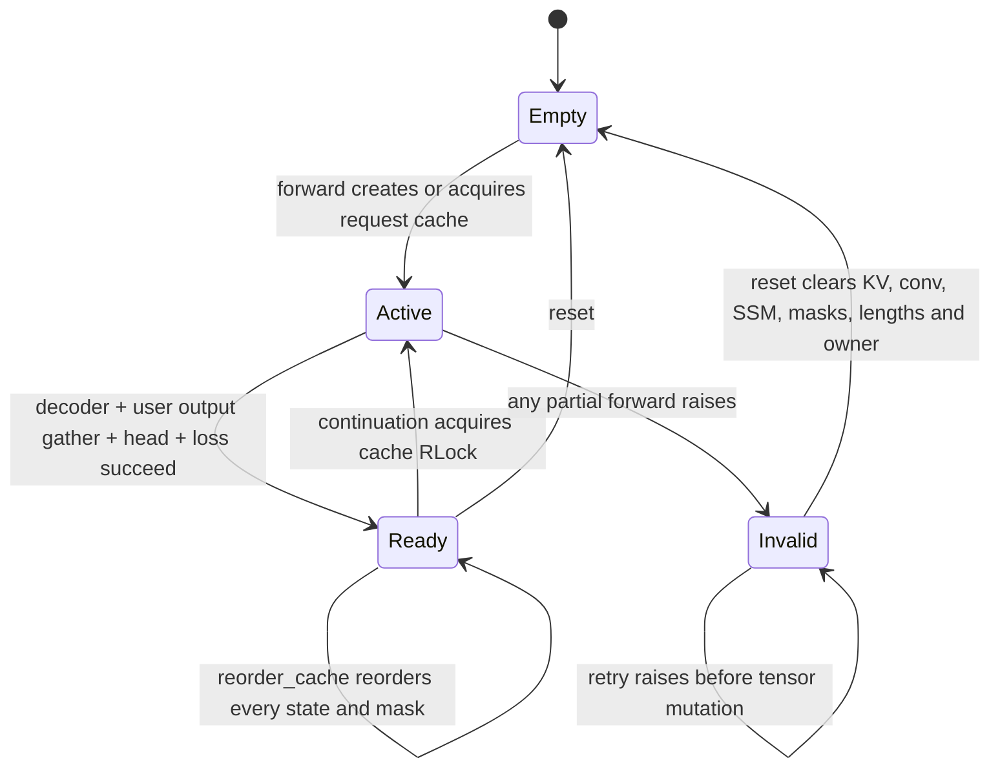
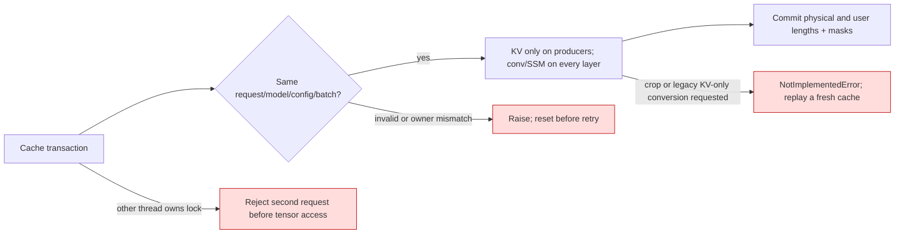
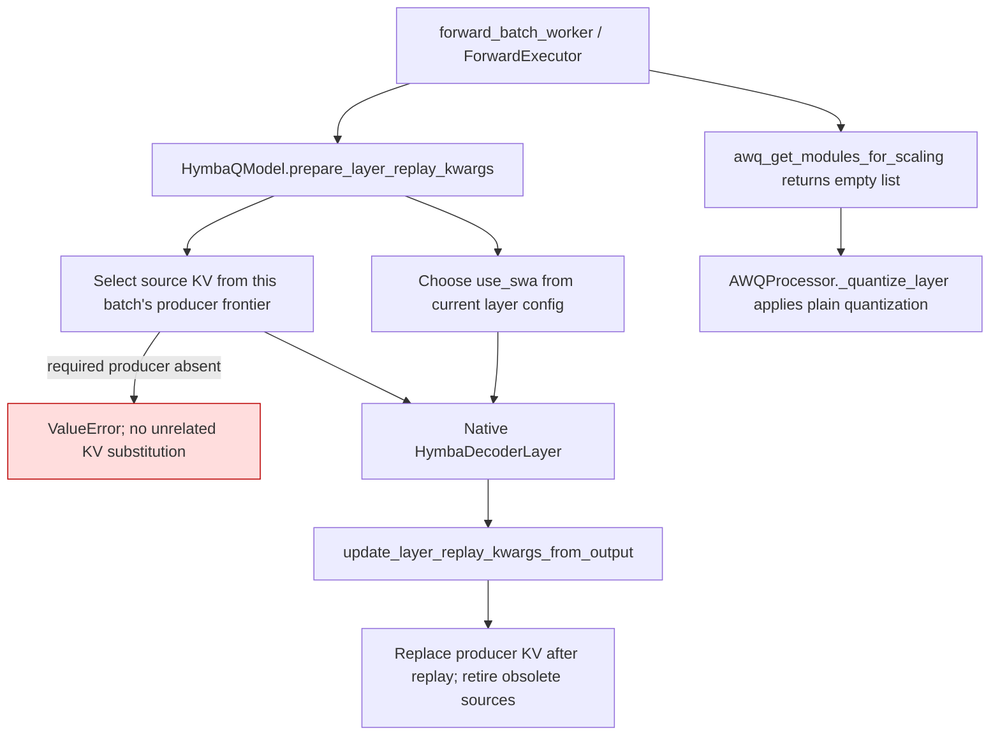

# Hymba local loading and hybrid state

GPT-QModel selects its packaged Hymba classes directly. Transformers 5.23.0 has
no native Hymba mapping. The implementation preserves NVIDIA's parallel
attention/SSM branches, fused projection layout, per-layer recurrent states,
shared KV producers and memory registers. CPU execution uses Torch SDPA and a
reference selective-scan recurrence; compiled NVIDIA/Mamba kernels are not
required or selected. See [provenance and licensing](PROVENANCE.md) and
[measured coverage and limits](COVERAGE.md).

## Definition-owned loading

The shared loader's trust policy precedes tokenizer initialization as well.
The policy-selected config must reach both Tokenicer's `model_config` and HF's
`config`, so `AutoTokenizer` cannot independently import a malicious checkpoint
`AutoConfig`, even when trust and the existing bypass are both enabled.

| Mechanism | Before | After |
| --- | --- | --- |
| Architecture selection | BASE `22bea1201`, `gptqmodel/models/definitions/hymba.py:12-22`: remote trust, monkey patch, mandatory CUDA dependencies | `gptqmodel/models/definitions/hymba.py:13-19`: immutable package-qualified `LocalModelLoader`; portable runtime |
| Legacy config repair | BASE `gptqmodel/models/definitions/hymba.py:45-55`: mutate `conv_dim` keys after loading | `configuration_hymba.py:42-52`: validate checkpoint data, derive dimensions before construction |
| Tensor ownership | BASE `gptqmodel/models/definitions/hymba.py:34-39`: only two mixer projections; nonexistent norm; expert 0 | `gptqmodel/models/definitions/hymba.py:26-45`: SSM tensors/norms excluded explicitly, actual `pre_moe_layernorm`, wildcard experts |
| Attention execution | Pinned NVIDIA `modeling_hymba.py:1179-1245`: Flex-specific mask construction | `modeling_hymba.py:204-270`: equivalent causal/local/memory masks passed to Torch SDPA |
| SSM continuation | Pinned NVIDIA `modeling_hymba.py:1578-1728`: mandatory compiled fast path and temporary bias mutation | `modeling_hymba.py:273-370`: checkpoint-compatible recurrence, real `dt_proj` call, short/multi-token continuation |
| Mutable cache failure | Pinned NVIDIA `modeling_hymba.py:365-492`: no transactional failure marker | `modeling_hymba.py:80-201,634-678`: request lock surrounds decoder, head and loss; failed request requires reset |
| Calibration context | First-layer kwargs and immediately previous KV alone | `gptqmodel/models/definitions/hymba.py:54-80`: refresh layer mask policy; batch-owned producer frontier supports gapped groups |
| AWQ scaling | Generic relationships unqualified for Hymba's parallel mixer | `gptqmodel/models/definitions/hymba.py:47-52`: explicit plain quantization; no guessed scale folds |

Paths without a repository prefix are relative to this port directory. Before
line references are from the pinned checkpoint source or the indicated BASE;
after references are from the shipped implementation.

## Hybrid cache lifecycle

`HymbaForCausalLM.forward` and `HymbaModel.forward` deliberately nest the same
cache's reentrant transaction. This covers standalone decoder calls and keeps
the head/loss inside the outer transaction. A head/loss exception invalidates
already-updated recurrent state just as a middle-layer exception does.
Different requests must own different caches. The port does not mutate model
parameters or rotary buffers during forward.

KV is retained in full, including for local attention, because shared consumers
can have a different global/local policy. Sliding windows are masks, not
eviction. Physical length counts inserted memory tokens; user length drives
generation slicing and interspersed-memory boundaries. No legacy KV-only cache,
crop/rollback, static cache, speculative rollback, or compiled-graph support is
advertised.

## Calibration and AWQ

`in_proj` packs Q/K/V, SSM input and gate rows; `out_proj` consumes an average of
two independently normalized branches. Shared KV can reach other layers.
Generic sequential folding would not compensate those consumers. Therefore
all declared projections remain quantizable while AWQ performs no scale
search, fold or compensation. SSM-owned projections, convolution, A/D tensors,
norms and routers remain unquantized. The actual CPU AWQ processor path is
tested across SiLU, ReLU2, MoE and no-MLP variants.

This mechanism is introduced with [PR 4620](https://github.com/ModelCloud/GPTQModel/pull/4620).
