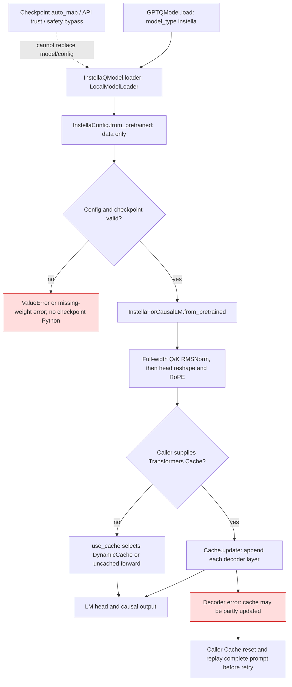

# GPT-QModel Instella loading and cache ownership

`InstellaQModel.loader` selects `InstellaConfig` and `InstellaForCausalLM`
through `LocalModelLoader`. Model/config checkpoint `auto_map` and remote trust
cannot replace them. This is the same definition-owned dispatch contract as
the central [loading policy](../../../../docs/trust-remote-code-isolation.md).



| Mechanism | Previous behavior and evidence | Current behavior and evidence |
| --- | --- | --- |
| Implementation selection | Base `22bea1201`, `definitions/instella.py:12`: required remote trust and inherited auto loader | `definitions/instella.py:13–16`: package-owned config/model paths |
| Checkpoint norm ownership | Base `22bea1201`, `definitions/instella.py:25`: Q/K norms absent from tree | `definitions/instella.py:29–31`: Q/K norm exclusions, seven tagged decoder linears |
| AWQ scaling | Base `22bea1201`, `definitions/instella.py:9`: inherited Llama fold/search relationships | `definitions/instella.py:38–41`: explicit empty groups, plain quantization |

## CPU/meta qualification

Run from the repository root, using the existing isolated environment:

```sh
PYTHON_GIL=0 OMP_NUM_THREADS=1 /home/ubuntu/.venvs/gptqmodel-tf5/bin/python -s -m pytest -q tests/test_instella_local_port.py tests/module_tree/test_instella_local_port.py --import-mode=importlib
```

The tests execute real tiny models on Torch 2.15.0 CPU, Transformers 5.23.0,
Python 3.14.6 free-threaded: **72 passed in 3.21s**, no skips. They cover:

- Malicious config/model auto maps with all API trust and security bypass
  combinations; public `GPTQModel.load` with a real native tokenizer and both
  trust settings; nondefault rotary metadata reaching the loaded model.
- Independent AMD equation oracle for full-width Q/K normalization and
  original/linear/dynamic rotary, MHA/GQA/MQA, attention bias and padding.
- Eager/SDPA, FP32/FP16/BF16, dynamic/static cache continuation and padding,
  greedy generation with/without cache; beam generation/cache reorder.
- Exact causal attention output, hidden states, next-token loss, tuple returns,
  logits slicing; invalid cache rejection followed by valid retry.
- Dynamic NTK threshold extension retains old rotated keys. Its per-layer warm
  frequency buffer persists into short subsequent requests, matching AMD's
  source, and resets on save/reload because it is nonpersistent. A deterministic
  publication-boundary replacement checks call-local frequency ownership.
- Mid-decoder failure after the first cache mutation, explicit caller reset,
  and retry matching a fresh cache. Cache mutation is incremental, not
  transactional; sharing a live Cache between requests is unsupported.
- Repeated safetensors save/load, missing weights followed by successful retry,
  linear/dynamic scaling and nondefault theta preservation, fresh and warmed
  `load_state_dict(assign=False/True)`, tied/untied embedding storage.
- Real CPU/meta models and the production 399-key checkpoint schema. Every
  checkpoint-owned decoder entry resolves through `ModulePlan.find`; norms
  carry `:!`, and all seven linears retain q/k/v/o/gate/up/down role tags.
- Actual CPU plain AWQ quantization and INT4 packing of all seven linears,
  including unequal Q/K/V widths and attention biases, with default and empty
  fallback settings. Scale folding/search remains unqualified and disabled.

### Regression sensitivity

The two nodes below were run with their corresponding fixes temporarily
removed, then restored for the complete green suite. Both failed for the
intended observable behavior (not collection/import errors):

| Node in `tests/test_instella_local_port.py` | Broken behavior detected |
| --- | --- |
| `test_public_dense_load_uses_packaged_model[False]` | Public safetensors reload lost nondefault linear scaling (`KeyError: factor`) without `rope_parameters` recovery |
| `test_dynamic_rotary_uses_call_snapshot_after_buffer_replacement` | Reading the shared buffer after another publication corrupted rotary cosines (maximum absolute difference 1.415) |

The common AWQ/model-plan baseline completed with **573 passed, 3 skipped**
and one expected failure for the parent-owned Instella registry fixture's old
blocks. The integrating change must replace `cases["InstellaQModel/gptq"]` in
`tests/module_tree/fixtures/registered_module_plans.json` with:

```json
{
  "layers": ["model.layers"],
  "blocks": [
    ["pre_attention_layernorm:!"],
    ["self_attn.q_norm:!", "self_attn.k_norm:!", "self_attn.q_proj", "self_attn.k_proj", "self_attn.v_proj"],
    ["self_attn.o_proj"],
    ["pre_feedforward_layernorm:!"],
    ["mlp.gate_proj", "mlp.up_proj"],
    ["mlp.down_proj"]
  ]
}
```

`tests/test_awq_scaling_groups.py:PLAIN_QUANTIZATION_FAMILIES` must also include
`"instella"`. Model-specific tests already assert the ordered blocks and actual
plain quantization; these shared fixtures remain owned by the integrator.
The central ports page/README and PR description should link this page and
include the loading diagram above.

## Limits

The trained checkpoint path `/monster/data/model/Instella-3B-Instruct/` is absent
on the qualification machine. No trained 3B numerical/perplexity quality, GPU
kernel, multi-device execution, or FlashAttention qualification is claimed.
FlashAttention 2 fails explicitly; eager and SDPA are supported. Legacy tuple
caches are rejected in favor of Transformers Cache. Quantized/sliding/offloaded
caches, gradient checkpointing/training, long-context trained behavior and full
packed GPT-QModel export/reload remain unqualified. CPU `PYTHON_GIL=0` runs and
the deterministic snapshot test do not establish accelerator stream safety or
concurrent shared-model inference qualification.

The port keeps AMD's dynamic scaling contract; extending the context does not
re-rotate existing keys. A fresh full forward beyond the threshold and an
incremental run that crossed it at different times can therefore differ.
See the [source license](PROVENANCE.md#license-and-attribution) before distribution.
