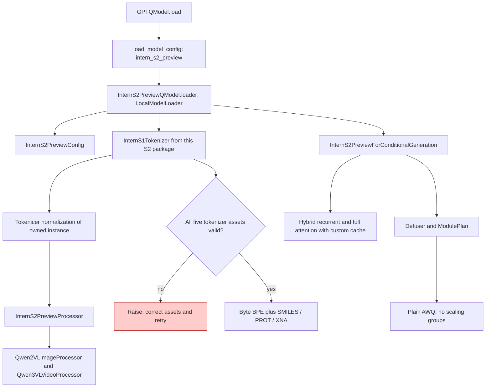

# Intern-S2 Preview local loading in GPT-QModel

`InternS2PreviewQModel` selects package-owned config, conditional generation,
processor and scientific tokenizer classes through `LocalModelLoader`.
Checkpoint `auto_map`, API trust flags and the security bypass do not change
that selection. See [source provenance](PROVENANCE.md).



| Previous mechanism | Package-owned replacement |
| --- | --- |
| `definitions/intern_s2_preview.py:25-29` at the migration base: AutoModel, required checkpoint trust and monkeypatch | Definition-owned `LocalModelLoader` selects exact classes |
| Definition `monkey_patch` inspected the loaded checkpoint module for a cache class and rewrote causal masking | The local model implements the current mask/cache interface directly |
| AutoProcessor/checkpoint component discovery | `InternS2PreviewProcessor.from_pretrained` chooses native image/video classes and the shared owned-tokenizer loader |
| Checkpoint `InternS1Tokenizer` name could imply the S1-mini implementation | Full per-definition S2 package path preserves different PROT/XNA semantics |
| Linear-attention state parameters had no root exclusion | `linear_attn:!` owns `dt_bias` and `A_log`; projection descendants remain quantizable |

The actual checkpoint inventory is 2,098 tensors: 785 MTP tensors excluded
by the established definition and exactly 1,313 owned state-dict keys. Both
linear/full attention orders, all-linear, all-full, attention bias/no-bias,
packed-to-Defuser experts, routed/shared roles and invalid descendants are
covered by live CPU/meta model tests.

AWQ uses plain quantization: `awq_get_modules_for_scaling` returns `[]`.
Layernorm output feeds attention projections plus their non-quantized gates;
hybrid recurrence and gated full attention introduce state/nonlinearities,
and MLP output combines routed and shared experts plus a shared gate.
Complete source compensation, candidate search and native replay have not
been qualified for these relationships. Tests quantize every declared linear
while proving that routers, state parameters, norms and other excluded tensors
remain unchanged. This is not qualification for AWQ folding/search/replay.

The focused suites are:

```sh
OMP_NUM_THREADS=1 python -s -m pytest tests/test_intern_s2_preview_local_port.py tests/module_tree/test_intern_s2_preview_local_port.py tests/models/test_intern_s2_preview.py -q
```

They cover real CPU forward, independent float64 delta recurrence, one- and
multi-token cache continuation, image/video processor execution and greedy
generation parity, time-series FP32/BF16 and placeholder failure/retry,
safetensors load/save, malicious outer/nested maps, both trust values and
unset/false/true security bypass. Scientific tokenization checks compare public
IDs with independent SentencePiece IDs plus domain offsets, rendered chat,
exact decode, saved five-asset reload and public missing-XNA repair/retry even
when a valid generic `tokenizer.json` exists. Public AWQ quantization checks
all 31 decoder linears (15 linear-attention layer, 16 full-attention layer),
exact packed state, dense-state parity after requested dtype conversion, and
FP16 time-series features before and after safetensors reload.

Regression probes restoring the old one-token-only cache reuse fail on
multi-token continuation (383/384 logit elements differ). Restoring the forced
BF16 time-series cast fails the FP32 encoder, and removing the `linear_attn:!`
root fails live checkpoint-state ownership. A public FP16 AWQ time-series
forward also fails with mixed FP32 positional buffers before activation dtype
restoration; it succeeds with the local fix. These probes test actual native
CPU computation rather than mocked architecture behavior.

Validation uses Transformers 5.23.0, Torch 2.15 CPU and free-threaded Python
3.14 with the GIL disabled. It does not qualify trained full-checkpoint
quality, GPU/fused kernels, FlashAttention, multi-GPU concurrent execution,
static/offloaded caches, arbitrary beam/cache operations, or MTP generation.
The existing full-checkpoint accelerator integration test retains its normal
hardware/asset prerequisites. New checkpoints use safetensors.

Central integration must add `['linear_attn:!']` at block index 3 of
`InternS2PreviewQModel/gptq` in the shared registry fixture and update the
fusable-model reason to identify the package-owned implementation while
leaving fusion unqualified. Shared docs and the top-level README are owned by
the integrator; this flow is the model-specific source for their reference.
