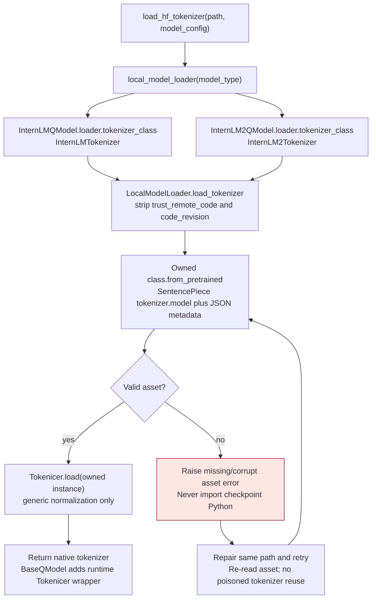
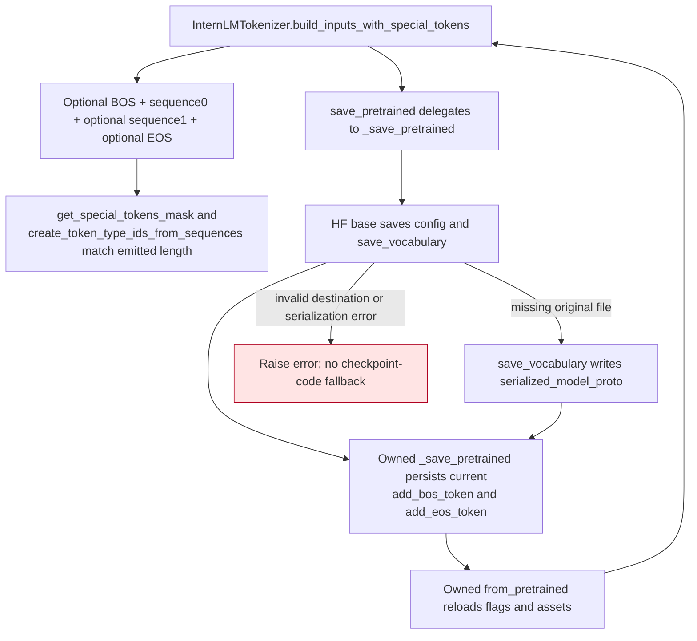

# InternLM tokenizer selection and serialization

GPT-QModel's InternLM1 and InternLM2/2.5 definitions select their packaged
SentencePiece tokenizer classes through `LocalModelLoader.tokenizer_class`.
Checkpoint `auto_map`, API trust and the security bypass never select Python for
these families. Tokenicer remains the sole owner of generic normalization;
this port implements the source tokenizer algorithm and its serialization.

## Inspected releases and licensing

The following public repositories were inspected at immutable revisions.
Tests download only three data files per release, hash-check them, then load
them through the packaged class. They never download or execute checkpoint
Python. The source files were inspected separately before porting.

| Repository | Revision | Data/source family |
| --- | --- | --- |
| [internlm/internlm-chat-7b](https://huggingface.co/internlm/internlm-chat-7b/tree/4e2d2e185058a4cbaa2377ba1bb993eb599ce492) | `4e2d2e185058a4cbaa2377ba1bb993eb599ce492` | InternLM1 |
| [internlm/internlm2_5-7b-chat](https://huggingface.co/internlm/internlm2_5-7b-chat/tree/eb72b541689b0432dade0435feb339b89fdd39ff) | `eb72b541689b0432dade0435feb339b89fdd39ff` | InternLM2 |
| [internlm/internlm2_5-1_8b-chat](https://huggingface.co/internlm/internlm2_5-1_8b-chat/tree/57dcbc5455bf050d27a80f0ebd7808387caa714d) | `57dcbc5455bf050d27a80f0ebd7808387caa714d` | InternLM2 |
| [internlm/internlm2-chat-7b](https://huggingface.co/internlm/internlm2-chat-7b/tree/c2ba64483dc50b3f8eb2d8271c4b9877a79ed2e2) | `c2ba64483dc50b3f8eb2d8271c4b9877a79ed2e2` | InternLM2 |

All inspected InternLM2 data/source files below are byte-identical across those
three revisions. Both source implementations have the same SentencePiece
algorithm, but the InternLM1 and InternLM2 vocabularies differ. In particular,
the latter adds chat/tool control tokens and encodes CJK/emoji differently.
`InternLM2Tokenizer` subclasses the owned `InternLMTokenizer` via a relative
import, preserving the distinct class path and checkpoint metadata.

| Family | File | SHA-256 |
| --- | --- | --- |
| InternLM1 | `tokenization_internlm.py` | `8bb3bd087d434ebb6d99fb432a641b0e37ed784aabe262698330d1afb54d8451` |
| InternLM1 | `tokenizer.model` | `aab622d98c98677a1a51f969e25765154487bf3e85c7819db105db2fcacba83f` |
| InternLM1 | `tokenizer_config.json` | `f447aaf3b5e4868df7eef513b7a638c5684cfabf2922b6eda7c9cbd01805638f` |
| InternLM1 | `special_tokens_map.json` | `833c7a70faf348f64bc7e62aa070b575205b5acc47201e109ec37a3516e0eba8` |
| InternLM2 | `tokenization_internlm2.py` | `444d4c2b0da158e61c34b3c727943f0ad454770c74b307f4d881f03603335eef` |
| InternLM2 | `tokenizer.model` | `f868398fc4e05ee1e8aeba95ddf18ddcc45b8bce55d5093bead5bbf80429b48b` |
| InternLM2 | `tokenizer_config.json` | `3ad60a8ee8a0a63a1f1d51884787d557eb6a312e5689148b4d599639ac42801b` |
| InternLM2 | `special_tokens_map.json` | `e636e880c43a263dc00724686c9ad90e2d23bd1467fe9ed1b95740cd9f387202` |

Copyright (c) The InternLM team and The HuggingFace Inc. team. All rights
reserved. The source headers license tokenizer code under Apache-2.0 and
attribute Hugging Face Llama. See [LICENSE](LICENSE), [NOTICE](NOTICE), and
[InternLM2 NOTICE](../internlm2/NOTICE). The vocabulary and trained weights are
not redistributed, nor relicensed by this source-code port.

## Selection flow



| Mechanism | Before | After |
| --- | --- | --- |
| Class selection | Both local definitions omitted `tokenizer_class`; `load_hf_tokenizer` entered Tokenicer path discovery and rejected the remote-only release class | `definitions/internlm.py:13-17` and `definitions/internlm2.py:12-16` declare the package-owned class |
| Checkpoint authority | Release `tokenizer_config.json` names an unavailable `InternLMTokenizer` or `InternLM2Tokenizer` and advertises remote `auto_map` | Class paths come only from the two definitions; JSON supplies tokenizer data, not executable class selection |
| Generic normalization | Parent `utils/hf.py:2809-2846` dispatches to Tokenicer and disables remote code for local models | Same shared code, now receiving an owned instance; no GPT-QModel normalization shim |
| Synthetic-only tests | Owned model fixtures wrote a generic WordLevel vocabulary, hiding release incompatibility | InternLM1/2 public model/AWQ tests now copy hash-pinned real release data; the generic helper is retained for its unrelated MPT consumer |

Line references describe the implementation based on `0fdfd2396`, before this
tokenizer binding addition; the shared parent may move them during integration.
The parent owns the corresponding central `docs/`, root README and PR diagrams.

## Input construction and serialization

The source uses one optional BOS before both sequences and one optional EOS
after both sequences; it does not wrap each sequence independently. BOS/EOS IDs
come from SentencePiece, as upstream. The copied upstream masks/type IDs had
lengths inconsistent with that actual construction; this port derives them
from the emitted layout. Decode retains upstream cleanup and special-token
spacing. The old prefix-space helper compares a string token with an integer
ID set and always adds then removes one space; the equivalent result is used
without rebuilding the entire vocabulary per tokenizer.

SentencePiece imports lazily inside construction. Its assets are loaded by HF's
data-file resolver; no global AutoTokenizer registration or `_auto_class`
checkpoint-source export is enabled. `save_vocabulary` supports filename
prefixes and serializes the in-memory model if the original file was deleted.

Transformers 5.23's base `save_pretrained` discards `add_bos_token` and
`add_eos_token` for native tokenizer.json post-processors. This Python
SentencePiece backend owns those flags, so `_save_pretrained` restores them
in the standard tokenizer config after saving the vocabulary, before the
base method's optional Hub upload. It does not mutate source assets.



## Real-asset qualification and regression evidence

The dedicated suite is `tests/test_internlm_tokenizers_local_port.py`. It pins
exact text/code/whitespace/CJK/emoji IDs and decode strings, InternLM1's
User/Bot prompt, InternLM2's Jinja chat prompt and six tool/chat special IDs.
It covers BOS/EOS/unknown/pad behavior, both-sequence masks/type IDs, four flag
combinations, save/reload with no exported Python, vocabulary hashes, prefixed
vocabulary saves, deleted-source recovery, and missing/corrupt asset repair.

Both public tokenizer and actual dense GPTQModel loading/generation are tested
with malicious config/tokenizer `auto_map`, `trust_remote_code=None/False/True`
and bypass unset/1. The failure/repair path uses that same full matrix. Release
pad ID is 2; Tokenicer 0.0.17 intentionally normalizes public-load pad ID to 0,
which is tested separately from source-class behavior. The release InternLM1
has no HF chat template; no replacement template is invented.

Measured environment: Python 3.14.6t, `PYTHON_GIL=0`, Transformers 5.23.0,
Torch 2.15.0+cpu, Tokenicer 0.0.17, SentencePiece 0.2.1. No tests skip on
download failure; a cold environment needs access to the pinned small assets.

```bash
PYTHON_GIL=0 /home/ubuntu/.venvs/gptqmodel-tf5/bin/python -s -m pytest -q -o addopts='' \
  tests/test_internlm_tokenizers_local_port.py \
  tests/test_internlm_local_port.py tests/test_internlm2_local_port.py \
  tests/module_tree/test_internlm_local_port.py tests/module_tree/test_internlm2_local_port.py \
  tests/test_local_model_loading.py
```

Result: **216 passed, no skips, 14 warnings in 40.01 seconds**. The existing
model suites exercise actual plain-AWQ pack/save/reload with the real assets;
the original model numerics, caches and module plans remain unchanged.

The intended old-binding red probe changes only the two definition loader
metadata objects in the test process, leaving all production files untouched:

```python
from dataclasses import replace
import pytest
from gptqmodel.models.definitions.internlm import InternLMQModel
from gptqmodel.models.definitions.internlm2 import InternLM2QModel

for definition in (InternLMQModel, InternLM2QModel):
    definition.loader = replace(definition.loader, tokenizer_class=None)
raise SystemExit(pytest.main([
    "-q", "-o", "addopts=", "tests/test_internlm_tokenizers_local_port.py",
    "-k", "public_tokenizer_security_and_reload",
]))
```

With released Tokenicer 0.0.17: **24 failed, 42 deselected in 1.66 seconds**
before adding the later 12 public failure/repair cases. Each failure reaches
Tokenicer's intended `Checkpoint tokenizer class ... is not available natively`
guard, not an import/collection error. Restoring the owned binding makes those
same public consumers green. The committed
`test_old_binding_reproduces_release_failure_then_retry` also checks the broken
binding and recovery within one process for both families.

The serializer red probe independently replaces only
`InternLMTokenizer._save_pretrained` with
`PreTrainedTokenizerBase._save_pretrained` in the test process and runs
`-k flags_pair_masks_and_save_reload`: **6 failed, 2 passed, 70 deselected in
6.75 seconds**. Non-default flags lose their values on reload while both
default-flag controls remain green. The owned serializer fixes the same
consumers in the combined green run. These are tokenizer lifecycle fixes,
not generic Tokenicer normalization changes.

Static validation: pinned Ruff 0.14.2 full gate (`ruff check gptqmodel docs/eora
tests setup.py`), `compileall` on both ports and the tokenizer suite, and
`git diff --check` passed. Both Mermaid blocks have balanced fences and marked
failure paths; each port README links this reference.

## Limits and integration

This qualifies **actual tokenizer data** with tiny freshly initialized model
weights, not trained-weight quality. It does not claim GPU kernels,
FlashAttention, multi-GPU, concurrent tokenizer/model execution, training,
compile, or new fused AWQ behavior. Existing model-port limits still apply.
No registry fixture, shared loader/security code, dependency declaration,
central documentation or PR state is changed by this owned follow-up. The
parent must preserve license/notice/provenance package data and expose these
flows in its central documentation; SentencePiece must be installed.
