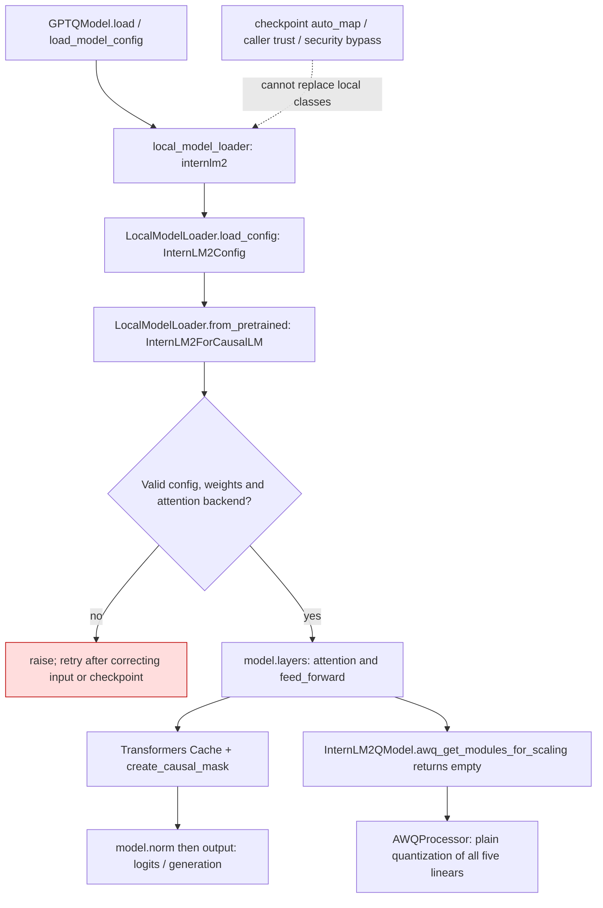

# Package-owned InternLM2 / InternLM2.5 modeling

GPT-QModel selects this package directly for `model_type=internlm2`, including
InternLM2/2.5 base, chat and math checkpoint layouts. Transformers 5.23.0 has
neither an InternLM2 config nor causal-LM mapping (InternLM3 is not this model).
The parent definition owns InternLM1 separately.

## Source and license

Authoritative implementation referenced by `tests/models/test_internlm2_5.py`:
[internlm/internlm2_5-1_8b-chat at 57dcbc5455bf050d27a80f0ebd7808387caa714d](https://huggingface.co/internlm/internlm2_5-1_8b-chat/tree/57dcbc5455bf050d27a80f0ebd7808387caa714d).
Inspected checkpoint Python as text before adapting it; no uninspected checkpoint
Python was executed. The source headers and model card license the **code** under
Apache-2.0. Copyright/attribution is retained in the port and NOTICE; LICENSE
contains Apache-2.0. No weights or vocabulary assets are vendored.

`InternLM2QModel.loader.tokenizer_class` directly selects the package-owned
`InternLM2Tokenizer`, not checkpoint Python. The inspected source algorithm
matches InternLM1, so the implementation is reused through a package-local import
while each checkpoint supplies its distinct vocabulary and special tokens.
See [tokenizer selection, serialization and real-release qualification](../internlm/TOKENIZERS.md)
for the source pins/licenses, hashes, flows, exact commands and support limits.

| Source file | SHA-256 |
| --- | --- |
| `configuration_internlm2.py` | `bd507289e9307cd1cec8e44eb483cff2b47d786111cb4070bd82e10c55563f25` |
| `modeling_internlm2.py` | `415a9cb54262d0c4616b6ce2c75f39ab209acb2e33fbc05445661c7015a1b2df` |

The config/modeling files are byte-identical in the inspected authoritative
InternLM2 chat, InternLM2 base and InternLM2.5 20B checkpoints:

| Checkpoint | Pinned revision | Config distinction |
| --- | --- | --- |
| `internlm/internlm2-chat-7b` | `c2ba64483dc50b3f8eb2d8271c4b9877a79ed2e2` | GQA, dynamic NTK factor 2 |
| `internlm/internlm2-7b` | `8fbef1b948aa2f021030c942308f123e9ffe58bf` | No RoPE scaling |
| `internlm/internlm2_5-20b-chat` | `13741228cfb01d3a69c8f83169a105de77286b8a` | Six Q heads per KV head, theta 50M, dynamic factor 2.5 |

Additional metadata inspection: `internlm/internlm2_5-7b-chat` at
`eb72b541689b0432dade0435feb339b89fdd39ff` and
`internlm/internlm2-math-7b` at `2e9e07ca1436918bdd3183e76c1f4d0ea67e5aa0`
use the same `internlm2` checkpoint naming/layout; this is not trained-weight validation.

## Preserved layout and computation

`model.tok_embeddings`, `model.layers.N.attention.wqkv/wo`,
`attention_norm`, `ffn_norm`, `feed_forward.w1/w3/w2`, `model.norm` and
`output` retain their original state keys. The pinned 1.8B safetensors index has
exactly those seven decoder weights per layer plus the embedding, final norm
and output head. RoPE frequencies are non-persistent buffers, not checkpoint
obligations. Bias variants add only `attention.wqkv.bias`/`attention.wo.bias`.
The GPT-QModel definition now explicitly names `lm_head="output"`.

QKV rows are **interleaved per KV group**: `[Q_0, ..., Q_group, K, V]`,
not contiguous global Q/K/V blocks. Attention preserves MHA/GQA/MQA, eager
FP32 softmax, SDPA, pre-norm residuals, SwiGLU and default/linear/dynamic NTK
RoPE. The legacy eager `pretraining_tp>1` simulation omits attention biases
as upstream does; normal eager/SDPA uses checkpoint attention biases.

Transformers 5 adaptations: explicit `GenerationMixin`, current `Cache` objects
and mask builder, dict-form weight-tying metadata, current config RoPE metadata,
safe non-persistent buffer initialization during meta loading, optional logits
slicing, and current tuple/model-output contracts. No AutoConfig/AutoModel global
registration, checkpoint import, dynamic download, CUDA import or einops is
needed at runtime. Only package-relative modeling imports are used.

Dynamic NTK frequency calculations are request-local instead of mutating
`inv_freq`: a long request must not contaminate a subsequent short request.
Like the pinned upstream model, already-cached keys are not rerotated when the
dynamic NTK base grows. Thus full-sequence and cached decoding across the
original context-length boundary are not claimed equivalent.

## Selection and failure flow

| Before (assigned baseline) | After |
| --- | --- |
| `definitions/internlm2.py:11` pins `transformers<=4.44.2`; inherited HF Auto loader needs checkpoint Python | Definition owns `LocalModelLoader` for packaged config/model |
| `definitions/internlm2.py:12` declares final norm but inherits nonexistent `lm_head` | Explicit native `output` head |
| Remote model advertises optional FlashAttention imports | Local port admits eager/SDPA; unsupported attention backends fail |
| Inherited AWQ group inference has no native replay qualification | Explicit empty scaling groups; all five linears still quantize plainly |

The shared tokenizer loader must supply the already policy-selected config to
HF AutoTokenizer as well as Tokenicer. This is parent commit `5423ad629`, not
a model-specific tokenizer shim. Central docs/README and fixture integration
belong to the parent of this port.

## Qualification and limits

Own suites: `tests/test_internlm2_local_port.py` and
`tests/module_tree/test_internlm2_local_port.py` run on tiny real CPU/meta models.
They cover exact state keys and plans after the normal Defuser pass, all five
linears, norm exclusions, MHA/GQA/MQA, ratio-six heads, biases, all three RoPE
modes, independent full-model tensor oracle, padding/causality, explicit positions,
dynamic/static cache continuation/reset, greedy/beam generation with/without
cache, loss/backward, embeds, failure/retry, and safetensors save/load/resave
with tied/untied embeddings in FP32/FP16/BF16. Public `GPTQModel.load` exercises
the full true/false trust and security bypass matrix with malicious `auto_map`.

AWQ policy for **every** layout is **plain quantization only**: no inferred
folds, candidate scaling search, or replay claims. Actual `AWQProcessor` tests
verify all five linears change and acquire scales/zeros while both norms stay
bitwise unchanged, including `fallback=None`. Fused execution is unqualified.
Public quantize/pack/save/reload tests additionally exercise MHA/GQA/MQA with
and without biases using the Torch AWQ CPU backend: ten packed linears across
two real decoder layers, safetensors-only output, finite inference and reload
logit equivalence. This does not qualify any GPU kernel or AWQ scaling search.

Runtime evidence: Python 3.14.6t, `PYTHON_GIL=0`, Torch 2.15.0+cpu,
Transformers 5.23.0. No multi-threaded safety claim follows from serial GIL=0
tests. No GPU/FlashAttention kernel, quantized packed GPU inference,
multi-GPU, trained-weight evaluation, long-context quality, compile/export,
gradient-checkpointing, quantized cache, or tokenizer/chat-template qualification
is claimed. Legacy tuple KV caches are explicitly rejected; use current HF
DynamicCache/StaticCache. Upstream chat/stream_chat convenience wrappers and
classification/QA heads are not part of GPT-QModel's causal-LM loader contract;
HF `generate` remains supported. The large checkpoint evaluation test no longer
skips for Transformers 4 and no longer requests remote trust; it was not run here.

## Regression evidence

- Replacing only the definition's loader with the old `AutoModelForCausalLM`
  reproduces four config-selection assertion failures (all trust/bypass pairs).
- Restoring upstream's mutable dynamic NTK frequencies reproduces the
  long-to-short test failure: 96/144 logits differ, maximum absolute drift
  `3.8973987102508545e-05` for the seeded tiny fixture.
- Public loading before parent `5423ad629` reproduces checkpoint config import
  through AutoTokenizer only when both trust and the bypass are enabled;
  the same full public loader matrix passes with the shared prerequisite.

Exact final commands/results are returned to the parent for the existing PR.
