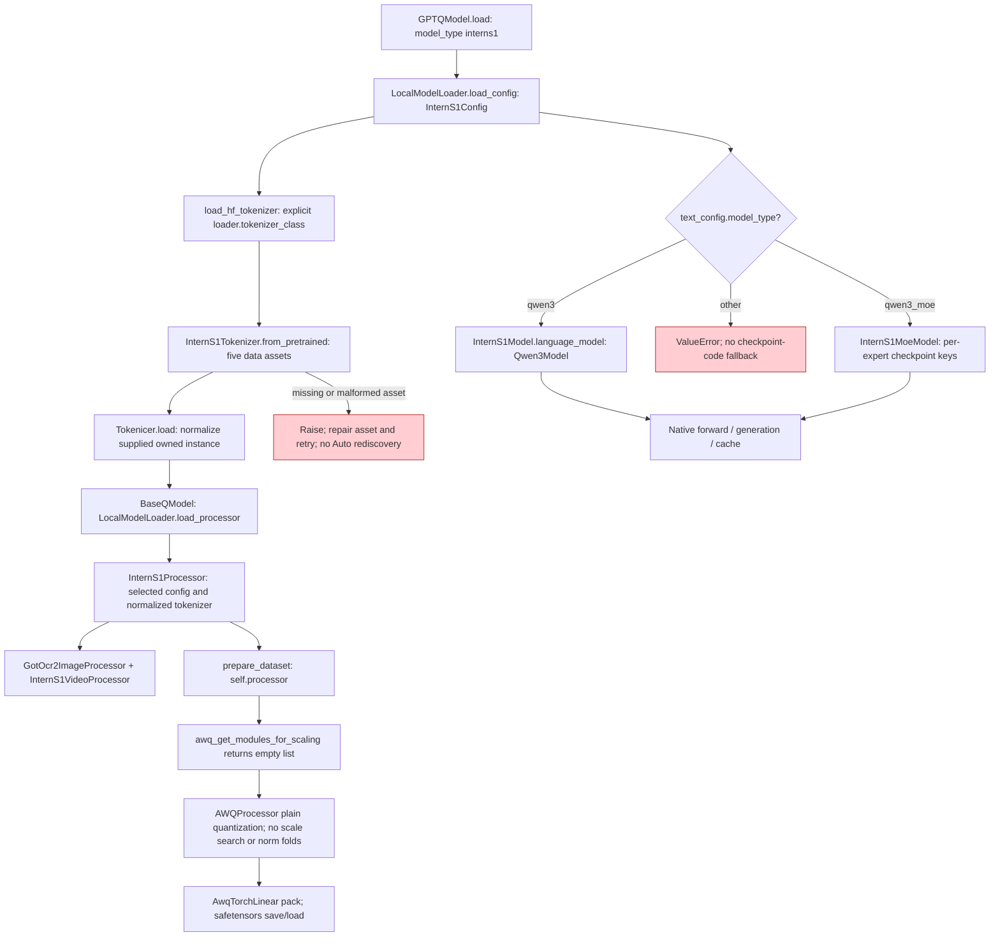

# Intern-S1 implementation selection and checkpoint layout

GPT-QModel owns the Intern-S1 config, conditional-generation model, scientific
tokenizer, processor and video processor. Transformers 5.23.0 has no exact
`interns1` configuration, causal-LM or image-text generation mapping. Native
InternVL is not this architecture: the original checkpoint roots remain
`model.language_model`, `model.vision_tower`, `model.multi_modal_projector` and
`lm_head`.

## Provenance and adaptations

| Published checkpoint | Pinned revision | Exact tensor-key count |
| --- | --- | ---: |
| [internlm/Intern-S1-mini](https://huggingface.co/internlm/Intern-S1-mini/tree/0f25c8f60f4190a18dd6620c94bdccedbebc208d) | `0f25c8f60f4190a18dd6620c94bdccedbebc208d` | 841 |
| [internlm/Intern-S1](https://huggingface.co/internlm/Intern-S1/tree/4ecad381e28293c4825793f113327cc016cdcbda) | `4ecad381e28293c4825793f113327cc016cdcbda` | 37,630 |

The mini config/model/processor/tokenizer/video sources are the primary source;
the larger config, model, tokenizer and safetensors index were inspected for
MoE, norm, attention-bias and ownership differences. Source copyright headers
are retained; see [LICENSE](LICENSE) and [NOTICE](NOTICE).

| Pinned mini source | SHA256 |
| --- | --- |
| `configuration_interns1.py` | `9c65a989777c524636a1280343cb5992bcd583a9aa893746788465e086b07787` |
| `modeling_interns1.py` | `61dcbcac2aecc6d17ad388c9a24800fdafe177bab44f0aaab18331933ae4e0ee` |
| `processing_interns1.py` | `858a72670c52c5fe35d570d02f3d44f0561bbf79107b97cafa53d6bd7c463e0f` |
| `video_processing_interns1.py` | `6ed7cef081abaed7ec3275805e4994a6d2882f9ee8aca8a05a5e254908976507` |
| `tokenization_interns1.py` | `0695012185b0e257b9352b333121d95e4e2336fc9331c56ec6d06dea54e60af5` |

Adaptations use current Transformers attention, generation, cache and video
APIs without registering global auto classes. Dense text uses native Qwen3;
MoE uses native Qwen3-MoE computation with package-owned per-expert modules to
preserve `mlp.experts.<n>.{gate_proj,up_proj,down_proj}.weight`. Native packed
three-dimensional expert tensors are not checkpoint destinations. The outer
model is not replaced by a text-only model. Vision LayerNorm/RMSNorm, Q/K
normalization, projection bias, layer scaling and pixel-shuffle computation
remain checkpoint-controlled.

The tokenizer requires `vocab.json`, `merges.txt`, `tokenizer_SMILES.model`,
`tokenizer_IUPAC.model` and `tokenizer_FASTA.model`. RDKit is imported lazily;
the upstream rule-based fallback remains when it is absent. Training-only
stochastic depth imports `timm` lazily. Normalization remains Tokenicer's job.
Intern-S2 is **not** dispatched to this class merely because its checkpoint
also calls its tokenizer `InternS1Tokenizer`; it has different domain assets.

## Selection and failure flow

| Mechanism | Before at base `22bea1201` | After |
| --- | --- | --- |
| Model/config selection | `definitions/interns1.py:21,49`: `AutoModelForCausalLM` plus required remote trust | `definitions/interns1.py:23-28`: explicit four-class `LocalModelLoader` |
| Processor construction | `definitions/interns1.py:91-92`: checkpoint `AutoProcessor` rediscovery | `processing_interns1.py:71-99`: direct packaged/native components and selected config/tokenizer |
| Calibration | Fresh checkpoint processor lookup | Reuse the wrapper's normalized `self.processor` |
| MoE ownership | Dense MLP tree only | Config-selected routed/dense MLP branches, excluded router and explicit expert leaves |
| AWQ | Inferred default relationships | Explicit empty scaling-group policy: plain quantization only |



Root/nested `auto_map`, API trust, `code_revision` and the existing security
bypass cannot change these package-owned classes. Unknown text architectures
fail closed. Mixed routed/dense layers use the standard non-strict per-layer
spec resolution; tests independently require every real state owner and every
quantizable linear, so absent alternate branches do not hide live weights.
The default dense registry plan is unchanged. Fusion is not admitted.

## CPU qualification

Environment: free-threaded Python 3.14.6, `PYTHON_GIL=0`, Transformers 5.23.0,
Torch 2.15.0+cpu, SentencePiece 0.2.3 and Tokenicer 0.0.14. No trained model
weights are downloaded by the suites.

```bash
PYTHON_GIL=0 /home/ubuntu/.venvs/gptqmodel-tf5/bin/python -s -m pytest -q \
  tests/test_interns1_local_port.py \
  tests/module_tree/test_interns1_local_port.py
```

55 cases pass, without skips. Coverage includes real public loads with hostile
root/text/vision/tokenizer/processor metadata for all trust/bypass combinations;
exact full-config meta key templates/counts against both published indexes;
FP32/FP16/BF16 native text-reference logits; dense, routed, `mlp_only_layers`,
`decoder_sparse_step` and all-dense MoE layouts; dynamic/static caches;
cached/uncached generation; repeated exact safetensors state round trips;
independent functional vision/attention/pixel-shuffle output oracles; eager and
SDPA; image mismatch and missing-domain-asset failure/repair/retry; real
image/video processing, variable-length interleaved videos and processor
serialization. Seven additional pinned **actual-asset** scientific probes were
compared against the inspected upstream tokenizer: all token IDs and decoded
strings match exactly (BPE, SMILES, SELFIES, IUPAC, FASTA and protected formula).

Public AWQ tests use `fallback=None`, real chat calibration, CPU Torch packing
and multimodal inference. Dense/routed/hybrid/all-dense-MoE cases pack
14/26/20/14 linears respectively; complete packed and non-quantized state is
identical after save/load/re-save/reload, and the restored processor produces
identical media inputs. Norms and router weights are explicitly excluded. The
private consumer tests additionally inject a first-tensor failure, verify no
mutation, retry and ensure repeated finalization does not requantize weights.
No scale-search or fold optimization is claimed for any layout.

Detection evidence: reverting only loader ownership makes the public hostile
metadata test fail at forbidden AutoConfig rediscovery. The public AWQ test
exposed and then verified repair of stale calibration processor rediscovery;
its hybrid case failed on a nonexistent expert in a dense layer until alternate
branch resolution was enabled. The mixed-video regression exposed mixed
container concatenation and the later-video frame offset; the repaired path
matches separately processed image/frame values exactly.

The shared loader/config/processor/tokenizer/registry baseline passed 557
cases (including the owned cases), with two unrelated skips for
Tokenicer's serialized-tokenizer preference feature unavailable in 0.0.14.
The required AWQ safety baseline passed 574 cases, with three unavailable
trained DeciLM/EXAONE/Nanbeige fixture skips. Ruff and `git diff --check` pass.

## Explicit limits

No trained-weight end-to-end caption/evaluation claim, including the existing
`./tmp/Intern-S1-mini` snow-caption integration test. No CUDA/ROCm,
FlashAttention, FlexAttention, multi-GPU, compiled execution, threaded PyTorch
concurrency, training/backward, RDKit-specific chemistry validation, or
video-file decoding qualification. Video tests use in-memory frame tensors.
Full-size model validation is structural/meta, not full trained numerical
validation. GPU kernels, GPTQ/other quantizers and AWQ scaling optimizations
remain outside this port's measured qualification.
