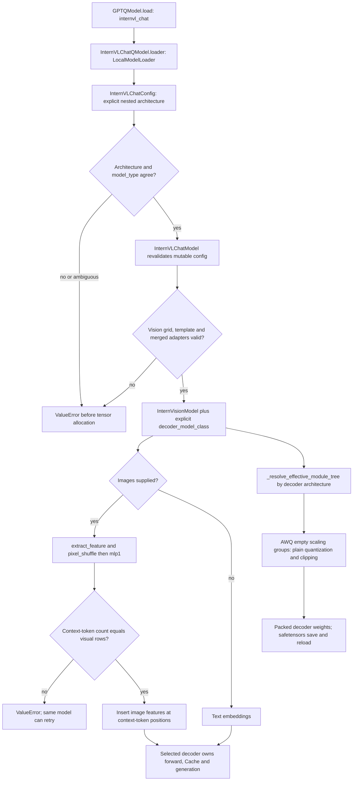
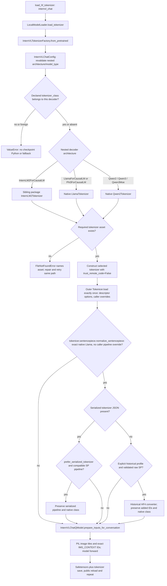

# GPT-QModel legacy InternVL chat modeling

This package owns the `internvl_chat` wrapper and InternVision computation for
Transformers 5.23.0. Transformers' native `internvl` has a different config and
checkpoint wrapper contract; it is not used as a name-based replacement.
`InternVLChatQModel.loader` selects these classes directly. Checkpoint `auto_map`,
API trust flags and the existing security bypass cannot substitute checkpoint
Python for this package.

## Sources and attribution

Inspected checkpoint sources and config:
[OpenGVLab/InternVL3_5-1B-Instruct at
5648fa26ff23acaba53588936d9f1dfaf305f522](https://huggingface.co/OpenGVLab/InternVL3_5-1B-Instruct/tree/5648fa26ff23acaba53588936d9f1dfaf305f522).
OpenGVLab's corresponding repository source and MIT license were inspected at
[2410d1dbf208f0e799459aff9376e5747dbf41a2](https://github.com/OpenGVLab/InternVL/tree/2410d1dbf208f0e799459aff9376e5747dbf41a2).
Source headers and the MIT license are retained in `LICENSE`.
The separately attributed FastChat-derived `conversation.py` retains its source
notice and Apache-2.0 license in `LICENSE-FASTCHAT`. Checkpoint weights have their
own model-card license; this package does not redistribute those weights.
Package and tokenizer-selection attributions are summarized in [NOTICE](NOTICE).

SHA-256 of the inspected, unmodified checkpoint source files:

| Source | SHA-256 |
| --- | --- |
| `configuration_intern_vit.py` | `6530df52748e4f7766568825e1d11f55dfa6cc421990020a640c548dc6cd2646` |
| `modeling_intern_vit.py` | `a33ec11c517041c7fcbaaff3d736d846498468efaf4a64400a89d55132d5f638` |
| `configuration_internvl_chat.py` | `e9fdff47225fd380d940a4a2b6818b303fd2a5fdddf44fce0a75b05a4beb1539` |
| `modeling_internvl_chat.py` | `ec972dd3d1c7f5da06455034d5cfe54968a9555dff60804edee9a7fb5759db34` |
| `conversation.py` | `b1b9f280e9cb9211e519e2b8071002b57cc742aadb2f49b05fa674ee3c7d83ee` |
| `config.json` | `cdc9fd1253691f3ce2bb350eb1d99f05f3dc274fe717343bcf7d4dcc34502130` |

`checkpoint_config.json` is that pinned config. `checkpoint_manifest.json`
contains all **657** tensor names/shapes/dtypes parsed from the pinned
`model.safetensors` header using HTTP range requests. No full trained weight file
was downloaded. The real meta model's complete tensor names and shapes match
this manifest exactly, including the vision stack, bridge, Q/K norms and decoder.

## Decoder and media coverage

| Nested architecture | Implementation | Checkpoint layout |
| --- | --- | --- |
| `LlamaForCausalLM` | Transformers 5 native | Separate Q/K/V, gate/up/down |
| `Qwen2ForCausalLM` | Transformers 5 native | Separate Q/K/V and attention biases |
| `Qwen3ForCausalLM` | Transformers 5 native | Separate Q/K/V, Q/K head norms |
| `Qwen3MoeForCausalLM` | Transformers 5 native plus normal Defuser conversion | Non-quantized router and explicit expert projections |
| `Phi3ForCausalLM` | Transformers 5 native | Fused QKV and gate/up; normal Defuser conversion |
| `InternLM2ForCausalLM` | Sibling package `../internlm2` | `tok_embeddings`, interleaved `attention.wqkv`, `attention.wo`, `feed_forward.w1/w3/w2`, `output` |

The InternLM2 alias exposes `lm_head` as a property without registering another
module or renaming `output.*` checkpoint tensors. Its per-layer rotary modules
and embedding owner are preserved by pre-quantization hooks. Legacy Phi3 `su`
and `yarn` scaling convert to native LongRoPE with the original attention factor;
independent equations verify short, extended and reset contexts.

Vision keeps patch/class/position embeddings, bicubic position interpolation,
eager attention, optional Q/K normalization, LayerNorm/RMSNorm, layer scales,
both pixel-shuffle orders, hidden-layer selection and the original `mlp1`
bridge. Optional flash-attn, apex, timm and einops imports are removed from the
runtime path. Actual PIL conversation preparation exercises dynamic tiles,
thumbnail, image placeholders, image normalization and image capture for all
six decoder variants. Conversation templates are packaged locally.

AWQ **uses plain weight quantization and clipping**: no scaling groups or fusion
qualification are claimed. Widths do not prove safe fold consumers across these
layouts and their vision bridge. Public CPU AWQ tests use `fallback=None` and
verify actual packing and safetensors save/reload for every decoder: 14 packed
linears for dense Llama/Qwen, 10 for Phi3/InternLM2, and 20 for the tiny
two-expert Qwen3 MoE. Vision weights remain exactly unchanged at the selected
loading dtype. Router and norm owners carry explicit non-quantized plan tags.

## Selection and failure flow

| Mechanism | Before | After |
| --- | --- | --- |
| Definition ownership | Base `22bea1201`, `definitions/internvl_chat.py:13,33,60`: `AutoModel`, required remote trust | `definitions/internvl_chat.py:35`: `LocalModelLoader` with package-owned paths |
| Nested decoder | Checkpoint Python selected the modeling classes | `configuration_internvl_chat.py:14` and `modeling_internvl_chat.py:24`: explicit config/model class dispatch |
| Invalid or ambiguous layout | Failure could occur after allocation in remote code | `InternVLChatConfig` and `InternVLChatModel.__init__` validate architecture, model type, vision grid, template and adapters before allocating tensors |
| AWQ consumers | Inherited decoder assumptions | `InternVLChatQModel.awq_get_modules_for_scaling` returns no fold groups; real public pack/reload qualifies plain quantization |



The parent integration owns the matching central `docs/` reference and README
link, registry fixtures and packaging of this directory's notices.

## Reproduction and limits

From the repository root, in the isolated Transformers 5 environment:

```sh
PYTHON_GIL=0 OMP_NUM_THREADS=1 /home/ubuntu/.venvs/gptqmodel-tf5/bin/python -m pytest tests/test_internvl_chat_local_port.py tests/module_tree/test_internvl_chat_local_port.py -xq --disable-warnings
```

Real tiny CPU/meta qualification covers all six decoders, multimodal decoder
oracles, independent vision equations, dynamic/static cache continuation/reset,
greedy/beam generation, labels/loss, tied/untied checkpoint aliases,
safetensors reload, malicious `auto_map` with API trust and bypass true/false,
public GPTQModel loading, invalid-config preallocation failure, image
failure/retry, module ownership after Defuser, hook lifecycle, real PIL inputs,
and public plain-AWQ packing/reload. Red evidence includes undeclared fused MoE
owners before nested Defuser conversion and `KeyError: img_context_token_id`
in public text AWQ calibration before the text-capture path was added.
The InternLM2 hook node also reproduces
`AttributeError: InternLM2Model has no attribute rotary_emb` on the earlier
core-rotary hook, and passes with per-layer rotary ownership.

Measured with Python 3.14t, `PYTHON_GIL=0`, Transformers 5.23.0 and Torch 2.15 CPU:
the 62 owned tests plus existing InternLM2, local-loading, registered-plan and
AWQ-empty-group suites pass together: **564 passed, zero skips, 10.41 seconds**.
The existing trained-checkpoint image-answer test is not included in that CPU
qualification; it requires the configured full checkpoint and appropriate
hardware. Ruff and `git diff --check` pass for the owned change.

This is inference/quantization qualification with random tiny weights. GPU
kernels, FlashAttention, multi-GPU placement/offload, full trained checkpoint
numerical parity and task accuracy require separate hardware/checkpoint runs.
Only eager vision attention is provided. Unmerged LoRA checkpoints explicitly
require merging adapters first; their adapter creation/training is not ported.
No alternate remote-code route is provided for unsupported architectures.

## Tokenizer selection and released assets

The legacy wrapper's `llm_config` owns tokenizer selection as well as its
decoder. `InternVLTokenizerFactory.from_pretrained` selects the package-owned
`InternLM2Tokenizer` from the sibling InternLM2 port for
`InternLM2ForCausalLM`; it does not copy that tokenizer implementation.
Llama/Phi3 use native `LlamaTokenizer`, and Qwen2/Qwen3/Qwen3 MoE use native
`Qwen2Tokenizer`. The exact architecture/model-type pair is revalidated before
selection. Checkpoint `auto_map`, `trust_remote_code` and `code_revision` cannot
change this selection. Unknown tokenizer class metadata, including a known
tokenizer from the wrong decoder family, fails before construction.
Only the inspected `InternLM2Tokenizer` implementation is admitted for that
decoder; unqualified `InternLM2TokenizerFast` metadata fails closed. Native
Llama/Qwen Fast aliases remain supported.

The real `OpenGVLab/InternVL2_5-8B` checkpoint declares `InternLM2Tokenizer`,
ships only `tokenizer.model`, and has no Transformers 5 native tokenizer
mapping. At parent base `0fdfd2396`, `InternVLChatQModel.loader` did not declare
`tokenizer_class`, so the policy-correct public loader rejected this tokenizer.
The owned factory supplies an already constructed package/native tokenizer to
the existing outer `Tokenicer.load` normalization boundary. Reusable metadata,
special-token and SentencePiece conversion corrections remain in Tokenicer.

| Mechanism | Before (`0fdfd2396`) | After |
| --- | --- | --- |
| Public tokenizer ownership | `definitions/internvl_chat.py:35-38` declared only config/model classes; the custom InternLM2 tokenizer reached native discovery and failed closed. | The same descriptor additionally declares `InternVLTokenizerFactory`; `load_hf_tokenizer` delegates to `LocalModelLoader.load_tokenizer`. |
| Nested decoder selection | No wrapper-owned tokenizer selector. | `ports/internvl_chat/tokenization_internvl_chat.py:39-65` validates the package config and class metadata, then selects only the inspected implementation for its decoder family. |
| Source asset failure | Native discovery could not construct the custom tokenizer. | `_asset` names missing `tokenizer.model`, `vocab.json` or `merges.txt`; restoring assets and metadata permits a fresh public retry. |
| Normalization | Existing outer Tokenicer boundary. | The same shared normalization boundary; no port-local corrective normalization or checkpoint Python. |
| Historical SP profile | Native Transformers 5 conversion differs from the inspected HF4 fast converter for six retained whitespace/BPE vectors. | This definition explicitly requests the upstream profile; explicit caller false opts out, and saved authoritative pipelines remain data owned. |



`tokenizer_assets.json` pins six public release revisions and SHA-256 hashes
for every config/tokenizer asset consumed by the tests. No checkpoint Python,
trained tensor payload or unpinned asset is downloaded. The tests populate the
ordinary Hugging Face cache on first use and check the exact cached bytes;
network/cache failures are failures, not skipped qualification.

| Nested decoder | Pinned real release |
| --- | --- |
| InternLM2 | `OpenGVLab/InternVL2_5-8B` at `e9e4c0dc1db56bfab10458671519b7fa3dd29463` |
| Llama / Yi | `OpenGVLab/InternVL-Chat-V1-2` at `60f4206a208ef1eedb1566e4a3039450a283703b` |
| Phi3 | `OpenGVLab/InternVL2-4B` at `6eb21ec278fbdb03b751a3d48d8dfc9724e05608` |
| Qwen2 | `OpenGVLab/InternVL2_5-4B` at `2cf4a8158bbc40d35015e7c63b527890de4d27b3` |
| Qwen3 | `OpenGVLab/InternVL3_5-1B-Instruct` at `5648fa26ff23acaba53588936d9f1dfaf305f522` |
| Qwen3 MoE | `OpenGVLab/InternVL3_5-30B-A3B` at `ba1762d830e2aeddb3272b66ba9e0abf7e69f626` |

Public model/image/AWQ tests use these actual vocabularies and special tokens
with tiny random model dimensions; they no longer use WordLevel tokenizer
stand-ins. The released wrapper processes images in the definition's PIL
pipeline (`prepare_inputs_for_conversation`), rather than an AutoProcessor
checkpoint import. Tests compare this pipeline's tokens and pixel tensors
before and after a safetensors model round trip with its tokenizer assets.

The independent custom InternLM2 oracle uses its pinned SentencePiece model,
explicit BOS/EOS flags and declared added-token IDs. Qwen uses an independent
TikToken byte-BPE reference with the source Qwen regex. Native Llama/Phi3
references must account for the fast converter's prefix-space semantics and
the metadata's added-token whitespace flags; raw slow SentencePiece IDs alone
are not a valid fast-tokenizer oracle.
`tokenizer_source_reference.json` retains the full eight-case Llama/Phi3
historical fast-tokenizer ID corpus, provider version/class, exact release
pins and SentencePiece normalizer flags. The independent SentencePiece
equations exactly matched all 16 captured source cases before using those
vectors to qualify the current public tokenizer load and serialized reload.

The shared `LocalModelLoader` preloader uses the public
`Tokenicer.prepare_load_kwargs` API from the 0.0.19 development line. The
InternVL factory contains no replacement for that API. Source-qualified
SentencePiece whitespace/BPE/pipeline corrections and malformed metadata
guards belong to Tokenicer; the parent integration owns its dependency pin
and the shared loader wiring.

This definition explicitly opts into the historical SentencePiece fast
converter profile with
`tokenicer_options=(("normalize_sentencepiece", True),)`. The generic loader
forwards these defaults only at `Tokenicer.load`; a caller's explicit
`normalize_sentencepiece=False` wins. Tokenicer's option defaults to false
globally. Its exact native-Llama/BPE identity gate applies the profile only
to this wrapper's Llama/Yi and Phi3 providers; the package-owned InternLM2
and native Qwen providers remain unchanged. The profile chooses the inspected
Transformers 4.37.2 converter semantics proven by the 16 retained source
vectors, rather than guessing a historical converter version for every native
Llama checkpoint. Existing authoritative serialized tokenizer pipelines are
preserved upstream, subject to explicit caller pipeline options.

The tokenizer implementation is reused under the sibling port's preserved
Apache-2.0 license/provenance. The wrapper factory is newly written package
glue under Apache-2.0; native tokenizer implementations remain owned by
Transformers. Downloaded model/tokenizer data retains each source release's
license; this port does not redistribute tokenizer model files or trained
weights.

The binding-removal red probe ran
`test_real_tokenizer_public_security_and_model_image_reload[None-False-InternLM2ForCausalLM]`
against the same real-asset fixture. Removing only the definition's
`tokenizer_class` declaration produces the intended `Tokenicer` unavailable
native `InternLM2Tokenizer` error (**1 failed, 3.72 seconds**); restoring it
passes the public image/model/tokenizer save/reload flow (**1 passed,
4.18 seconds**). This probe reaches `GPTQModel.load`, not a missing new import
or test-collection error.

## Tokenizer follow-up qualification

The measured Tokenicer runtime is the **unreleased 0.0.19** source commit
[`4f23746c7aeac3bf054d1d0dd7dc66e951468989`](https://github.com/ModelCloud/Tokenicer/commit/4f23746c7aeac3bf054d1d0dd7dc66e951468989),
submitted in [Tokenicer PR 66](https://github.com/ModelCloud/Tokenicer/pull/66).
It includes the selected-asset preloader, malformed class guard, explicit
historical profile and automatic authoritative-SP-JSON preservation. Released
0.0.17/0.0.18 are not substitutes for this follow-up's shared API contract.

The exact final combined command is:

```sh
PYTHON_GIL=0 OMP_NUM_THREADS=1 /home/ubuntu/.venvs/gptqmodel-tf5/bin/python -m pytest -q tests/test_internvl_chat_local_port.py tests/module_tree/test_internvl_chat_local_port.py tests/test_internlm2_local_port.py tests/module_tree/test_internlm2_local_port.py tests/test_local_model_loading.py tests/test_local_processor_loading.py tests/test_local_tokenizer_loading.py tests/test_local_tokenicer_options.py tests/module_tree/test_registered_module_plans.py tests/test_awq_empty_groups.py tests/test_awq_scaling_groups.py --tb=short -ra
```

With Python 3.14.6t/GIL disabled, Transformers 5.23.0, Torch 2.15.0 CPU,
SentencePiece 0.2.3 and TikToken 0.12.0: **908 passed, 5 skipped, 18 warnings
in 216.38 seconds**. The five skips are three absent Pangu fixtures and the
existing non-buildable `opt350`/`muse_glimmer` CausalLM controls. The **150
InternVL-owned model and module-plan cases all passed without skips**.
The shared fixture alias repair was independently rechecked: **18 passed in
3.74 seconds**. Full `format/check.sh` with Ruff 0.14.2, compileall and
`git diff --check` also pass.

The focused source/profile/opt-out/serialized-pipeline/provider/subfolder
command uses the same interpreter and GIL settings with
`tests/test_internvl_chat_local_port.py -k 'source_fast_sentencepiece or historical_sentencepiece or historical_profile or selected_subfolder' --tb=short`:
**28 passed, 110 deselected in 54.12 seconds**. Before the upstream historical
profile, six of the 16 fixed source vectors failed under the native converter.
The option-specific public regression
`-k historical_sentencepiece_profile_explicit_caller_optout` recorded **2
failed in 7.33 seconds** against Tokenicer `cc9153d`: caller false correctly
matched native behavior, but default true lacked the historical conversion.
Both cases pass in the final 28-case and 908-case runs, including preservation
of a deliberately native-authored JSON pipeline under a subsequent default
profile load.

The 36 public hostile-map cases cover all six decoders with API trust
false/true and bypass absent/zero/one. Each actual dense load and saved reload
calls `Tokenicer.load` exactly once. All six selected-subfolder cases ignore
forbidden root metadata; all six asset/class failure cases repair and retry.
The six real-vocabulary plain-AWQ cases still pack and reload actual decoder
weights. These measurements use tiny random tensors and real released
tokenizer data; they do not qualify trained-weight quality, GPU kernels,
FlashAttention, concurrent PyTorch execution or full production checkpoints.
