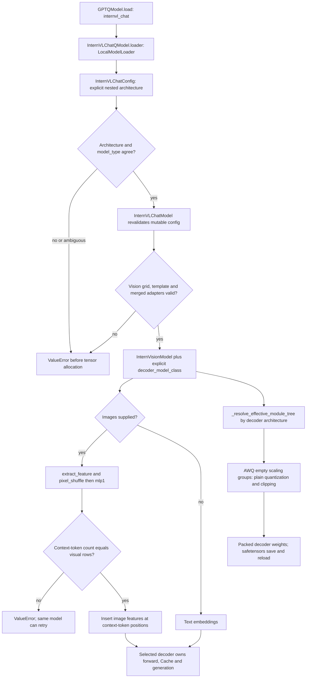

# GPT-QModel legacy InternVL chat modeling

This package owns the `internvl_chat` wrapper and InternVision computation for
Transformers 5.23.0. Transformers' native `internvl` has a different config and
checkpoint wrapper contract; it is not used as a name-based replacement.
`InternVLChatQModel.loader` selects these classes directly. Checkpoint `auto_map`,
API trust flags and the existing security bypass cannot substitute checkpoint
Python for this package.

## Sources and attribution

Inspected checkpoint sources and config:
[OpenGVLab/InternVL3_5-1B-Instruct at
5648fa26ff23acaba53588936d9f1dfaf305f522](https://huggingface.co/OpenGVLab/InternVL3_5-1B-Instruct/tree/5648fa26ff23acaba53588936d9f1dfaf305f522).
OpenGVLab's corresponding repository source and MIT license were inspected at
[2410d1dbf208f0e799459aff9376e5747dbf41a2](https://github.com/OpenGVLab/InternVL/tree/2410d1dbf208f0e799459aff9376e5747dbf41a2).
Source headers and the MIT license are retained in `LICENSE`.
The separately attributed FastChat-derived `conversation.py` retains its source
notice and Apache-2.0 license in `LICENSE-FASTCHAT`. Checkpoint weights have their
own model-card license; this package does not redistribute those weights.

SHA-256 of the inspected, unmodified checkpoint source files:

| Source | SHA-256 |
| --- | --- |
| `configuration_intern_vit.py` | `6530df52748e4f7766568825e1d11f55dfa6cc421990020a640c548dc6cd2646` |
| `modeling_intern_vit.py` | `a33ec11c517041c7fcbaaff3d736d846498468efaf4a64400a89d55132d5f638` |
| `configuration_internvl_chat.py` | `e9fdff47225fd380d940a4a2b6818b303fd2a5fdddf44fce0a75b05a4beb1539` |
| `modeling_internvl_chat.py` | `ec972dd3d1c7f5da06455034d5cfe54968a9555dff60804edee9a7fb5759db34` |
| `conversation.py` | `b1b9f280e9cb9211e519e2b8071002b57cc742aadb2f49b05fa674ee3c7d83ee` |
| `config.json` | `cdc9fd1253691f3ce2bb350eb1d99f05f3dc274fe717343bcf7d4dcc34502130` |

`checkpoint_config.json` is that pinned config. `checkpoint_manifest.json`
contains all **657** tensor names/shapes/dtypes parsed from the pinned
`model.safetensors` header using HTTP range requests. No full trained weight file
was downloaded. The real meta model's complete tensor names and shapes match
this manifest exactly, including the vision stack, bridge, Q/K norms and decoder.

## Decoder and media coverage

| Nested architecture | Implementation | Checkpoint layout |
| --- | --- | --- |
| `LlamaForCausalLM` | Transformers 5 native | Separate Q/K/V, gate/up/down |
| `Qwen2ForCausalLM` | Transformers 5 native | Separate Q/K/V and attention biases |
| `Qwen3ForCausalLM` | Transformers 5 native | Separate Q/K/V, Q/K head norms |
| `Qwen3MoeForCausalLM` | Transformers 5 native plus normal Defuser conversion | Non-quantized router and explicit expert projections |
| `Phi3ForCausalLM` | Transformers 5 native | Fused QKV and gate/up; normal Defuser conversion |
| `InternLM2ForCausalLM` | Sibling package `../internlm2` | `tok_embeddings`, interleaved `attention.wqkv`, `attention.wo`, `feed_forward.w1/w3/w2`, `output` |

The InternLM2 alias exposes `lm_head` as a property without registering another
module or renaming `output.*` checkpoint tensors. Its per-layer rotary modules
and embedding owner are preserved by pre-quantization hooks. Legacy Phi3 `su`
and `yarn` scaling convert to native LongRoPE with the original attention factor;
independent equations verify short, extended and reset contexts.

Vision keeps patch/class/position embeddings, bicubic position interpolation,
eager attention, optional Q/K normalization, LayerNorm/RMSNorm, layer scales,
both pixel-shuffle orders, hidden-layer selection and the original `mlp1`
bridge. Optional flash-attn, apex, timm and einops imports are removed from the
runtime path. Actual PIL conversation preparation exercises dynamic tiles,
thumbnail, image placeholders, image normalization and image capture for all
six decoder variants. Conversation templates are packaged locally.

AWQ **uses plain weight quantization and clipping**: no scaling groups or fusion
qualification are claimed. Widths do not prove safe fold consumers across these
layouts and their vision bridge. Public CPU AWQ tests use `fallback=None` and
verify actual packing and safetensors save/reload for every decoder: 14 packed
linears for dense Llama/Qwen, 10 for Phi3/InternLM2, and 20 for the tiny
two-expert Qwen3 MoE. Vision weights remain exactly unchanged at the selected
loading dtype. Router and norm owners carry explicit non-quantized plan tags.

## Selection and failure flow

| Mechanism | Before | After |
| --- | --- | --- |
| Definition ownership | Base `22bea1201`, `definitions/internvl_chat.py:13,33,60`: `AutoModel`, required remote trust | `definitions/internvl_chat.py:35`: `LocalModelLoader` with package-owned paths |
| Nested decoder | Checkpoint Python selected the modeling classes | `configuration_internvl_chat.py:14` and `modeling_internvl_chat.py:24`: explicit config/model class dispatch |
| Invalid or ambiguous layout | Failure could occur after allocation in remote code | `InternVLChatConfig` and `InternVLChatModel.__init__` validate architecture, model type, vision grid, template and adapters before allocating tensors |
| AWQ consumers | Inherited decoder assumptions | `InternVLChatQModel.awq_get_modules_for_scaling` returns no fold groups; real public pack/reload qualifies plain quantization |



The parent integration owns the matching central `docs/` reference and README
link, registry fixtures and packaging of this directory's notices.

## Reproduction and limits

From the repository root, in the isolated Transformers 5 environment:

```sh
PYTHON_GIL=0 OMP_NUM_THREADS=1 /home/ubuntu/.venvs/gptqmodel-tf5/bin/python -m pytest tests/test_internvl_chat_local_port.py tests/module_tree/test_internvl_chat_local_port.py -xq --disable-warnings
```

Real tiny CPU/meta qualification covers all six decoders, multimodal decoder
oracles, independent vision equations, dynamic/static cache continuation/reset,
greedy/beam generation, labels/loss, tied/untied checkpoint aliases,
safetensors reload, malicious `auto_map` with API trust and bypass true/false,
public GPTQModel loading, invalid-config preallocation failure, image
failure/retry, module ownership after Defuser, hook lifecycle, real PIL inputs,
and public plain-AWQ packing/reload. Red evidence includes undeclared fused MoE
owners before nested Defuser conversion and `KeyError: img_context_token_id`
in public text AWQ calibration before the text-capture path was added.
The InternLM2 hook node also reproduces
`AttributeError: InternLM2Model has no attribute rotary_emb` on the earlier
core-rotary hook, and passes with per-layer rotary ownership.

Measured with Python 3.14t, `PYTHON_GIL=0`, Transformers 5.23.0 and Torch 2.15 CPU:
the 62 owned tests plus existing InternLM2, local-loading, registered-plan and
AWQ-empty-group suites pass together: **564 passed, zero skips, 10.41 seconds**.
The existing trained-checkpoint image-answer test is not included in that CPU
qualification; it requires the configured full checkpoint and appropriate
hardware. Ruff and `git diff --check` pass for the owned change.

This is inference/quantization qualification with random tiny weights. GPU
kernels, FlashAttention, multi-GPU placement/offload, full trained checkpoint
numerical parity and task accuracy require separate hardware/checkpoint runs.
Only eager vision attention is provided. Unmerged LoRA checkpoints explicitly
require merging adapters first; their adapter creation/training is not ported.
No alternate remote-code route is provided for unsupported architectures.
