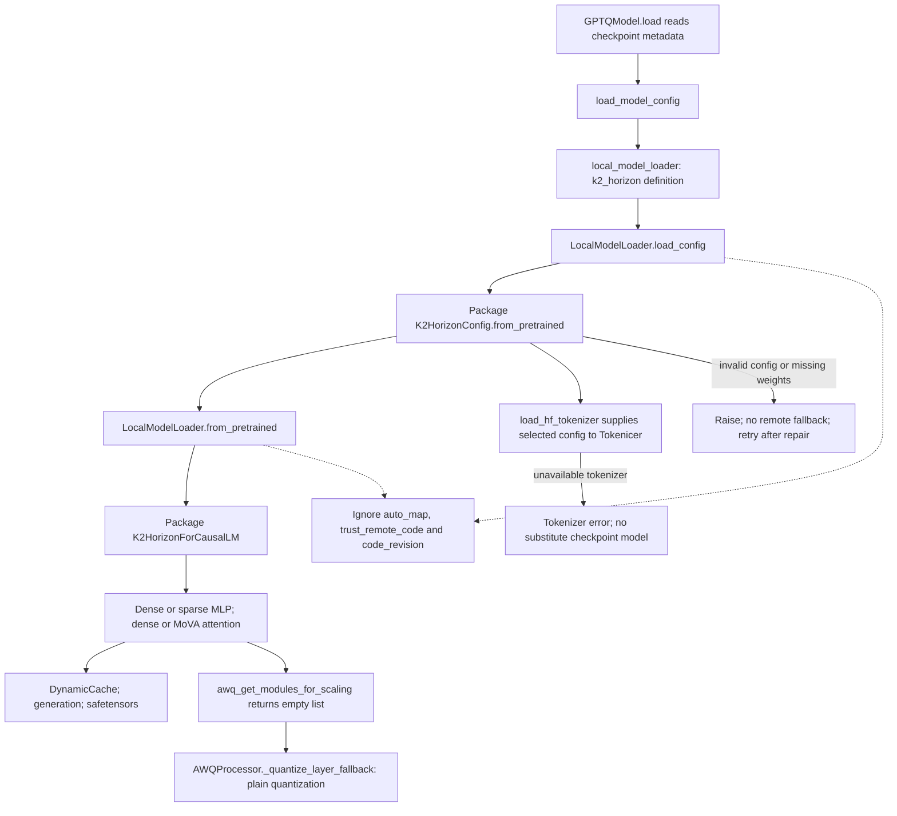

# GPT-QModel K2-Horizon Transformers 5 port

Package-owned inference for IFM K2-Horizon dense, sparse-MoE and MoVA checkpoints.
The `k2_horizon` definition selects these classes directly with
`LocalModelLoader`; neither API trust nor the existing security bypass selects
checkpoint Python. No global Transformers registration or checkpoint-key
conversion is needed. `K2HorizonGPTQ` remains an alias of `K2HorizonQModel`.

## Provenance and license

Authoritative sources inspected without importing checkpoint Python:

| Checkpoint | Pinned upstream revision | Full checkpoint tensor keys |
|---|---|---:|
| [IFM/K2-Horizon-0.9B](https://huggingface.co/IFM/K2-Horizon-0.9B/tree/fc5c9dc7c13df2360acee789fca2cd55d439e644) | `fc5c9dc7c13df2360acee789fca2cd55d439e644` | 255 |
| [IFM/K2-Horizon-MoVA-36B-A4B](https://huggingface.co/IFM/K2-Horizon-MoVA-36B-A4B/tree/cf253b232c10a938cd587c50035ccfb50b7864f3) | `cf253b232c10a938cd587c50035ccfb50b7864f3` | 16998 |
| [IFM/K2-Horizon-375B-A23B](https://huggingface.co/IFM/K2-Horizon-375B-A23B/tree/bb3bfb4b532488c05e84a090301f8259c68b319c) | `bb3bfb4b532488c05e84a090301f8259c68b319c` | 34076 |

`configuration_k2_horizon.py` is identical across these revisions. Modeling is
adapted from the pinned MoVA source, with the dense source's MoVA-aware output
recording retained. The three pinned `config.json` and
`model.safetensors.index.json` files determine `checkpoint_layouts.json`: exact
configs, index/key-set SHA256 hashes and source hashes. Tests construct each full
model on `meta` and compare the *entire* sorted `state_dict()` key-set hash,
including top-level weights, against these independent checkpoint indices.

Upstream configuration credits the 2024 Qwen team, Alibaba Group and HuggingFace
Inc.; modeling credits the same teams in 2025. Original Apache-2.0 headers are
preserved. IFM's three pinned model cards declare Apache-2.0. See
[LICENSE](LICENSE) and [NOTICE.md](NOTICE.md).

GPT-QModel adaptations: relative package imports, current Transformers 5 output
capture/config defaults, tuple outputs, RoPE buffer initialization using the
actual rotary dimensions, and a zero auxiliary routing loss for dense layers.
The MoVA and sparse-MoE routers preserve selection-only bias, score functions,
top-k normalization and scaling; MoVA value experts retain their SiLU activation.
Grouped RMSNorm, optional q/k norms, softplus/SiLU attention gates and partial
rotary interleaving preserve upstream computation and parameter names.

## Definition-owned selection

| Mechanism | Before | Now |
|---|---|---|
| Model owner | `require_trust_remote_code=True`; checkpoint `auto_map` | `K2HorizonQModel.loader` in `gptqmodel/models/definitions/k2_horizon.py:124-127` |
| Config dispatch | AutoConfig's unknown model type required checkpoint Python | `load_model_config` in `gptqmodel/utils/hf.py:1017` selects `LocalModelLoader.load_config` |
| Model dispatch | AutoModelForCausalLM plus remote permission | `LocalModelLoader.from_pretrained` in `gptqmodel/models/local.py:43` |
| Tokenizer config | AutoTokenizer could rediscover checkpoint AutoConfig | `load_hf_tokenizer` in `gptqmodel/utils/hf.py:2958` forwards policy-selected config |
| AWQ | Generic inferred folding groups | Explicit empty groups, real plain quantization; no guessed folds |

The before column is the definition at base `22bea120181e739161ee2969b260fe94f5b4e791`.
Line references describe this implementation baseline; use the named symbols
when integrating alongside other ports.



Malformed configs and missing weights fail in package code; they never trigger a
remote fallback. Other, unported model types retain the central trust-plus-bypass
security policy. Tokenizer normalization belongs to Tokenicer, not this port.

## Qualification and limits

`tests/test_k2_horizon_local_port.py` exercises real CPU models: dense, YaRN
dense, sparse-MoE, MoVA, q/k normalization, both attention gates and grouped
norms. Eager and SDPA logits match a source-derived functional oracle with
token-wise routing, explicit causal attention and complex-number rotary
rotation; the oracle does not call the model's helpers. Checks include padded
cache continuation, generation with/without cache, FP32 safetensors repeated
roundtrips, FP16/BF16 dtype/cache roundtrips, output capture, failed-input retry,
and missing-weight failure/retry. Public `GPTQModel.load` covers malicious config
and model `auto_map` with both values of trust and bypass.

`tests/module_tree/test_k2_horizon_local_port.py` covers the actual CPU/meta
models, all three full checkpoint key sets, exact module-plan ownership,
quantized leaves, explicit norm/router exclusions, separate MLP/MoVA expert
counts, lifecycle hooks, aliases and both looper consumers.

**AWQ policy: plain quantization only for every variant.** Scale search/folding
is unqualified for grouped norms, selection-only biased routers, and nonlinear
attention gates/value experts. Tests exercise the real AWQ processor and verify
every selected weight changes, q-scales/zeros are generated and excluded
norms/routers stay identical. Public dense and MoVA CPU tests additionally
quantize, pack into `AwqTorchLinear`, forward, save safetensors, reload and compare
outputs. This is not a claim of AWQ scale-search/replay/folding safety or trained
model quality.

No trained checkpoint weights were downloaded. Full pretrained evaluation,
uncached trained-weight checkpoint loading, NVIDIA/AMD/Apple accelerators, FlashAttention,
FlexAttention, non-DynamicCache implementations, sliding-window attention,
distributed/tensor-parallel execution and multi-GPU/GIL=0 concurrency are not
qualified. CPU tests use free-threaded Python with `PYTHON_GIL=0`; that is not a
multi-device safety claim. The upstream sequence/token/QA heads remain available
internally but are outside this causal-LM port's qualification. No MTP or chat
helper claim is made.

Run from the repository root:

```sh
PYTHON_GIL=0 /home/ubuntu/.venvs/gptqmodel-tf5/bin/python -m pytest -q \
  tests/test_k2_horizon_local_port.py \
  tests/module_tree/test_k2_horizon_local_port.py
```
