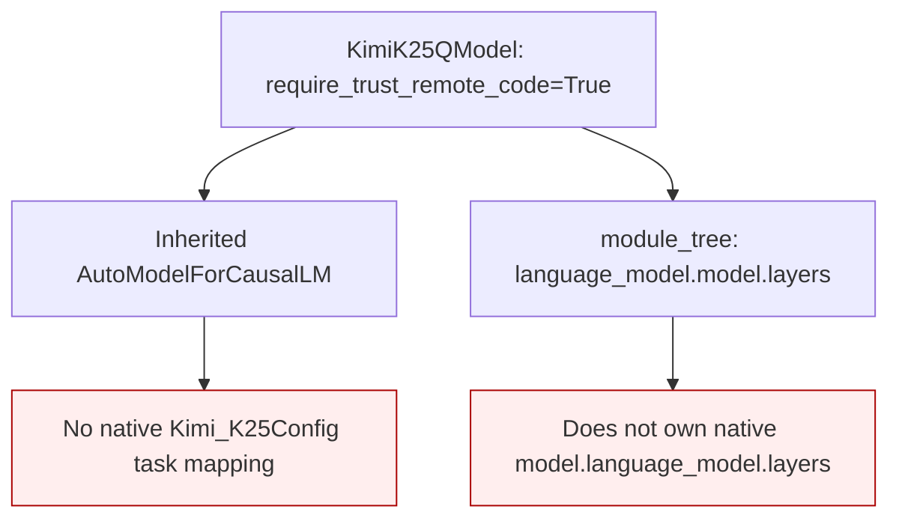
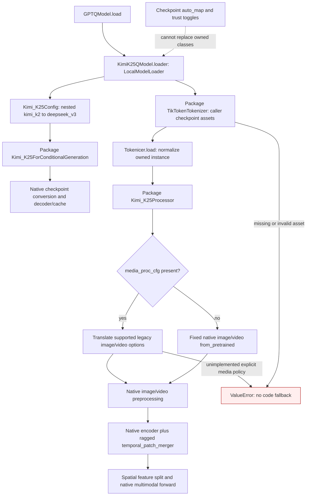
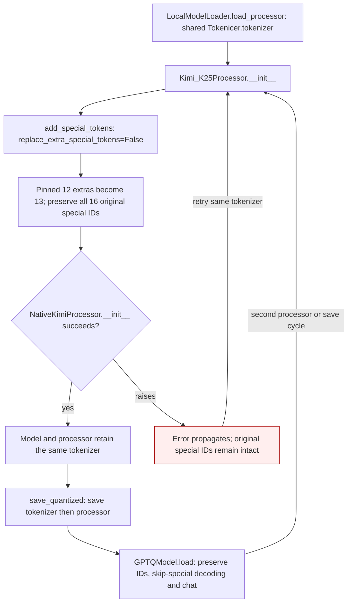

# GPT-QModel native Kimi-K2.5 ownership

## Provenance and scope

The sole registered model type is `kimi_k25`. Transformers **5.23.0** provides
the exact `Kimi_K25Config` and multimodal `Kimi_K25ForConditionalGeneration`;
the causal-LM AutoModel mapping is not applicable. This adapter does not port
an unrelated architecture or duplicate the decoder. Native conversion rules
own released `language_model.model.*` -> `model.language_model.*`,
`language_model.lm_head.*` -> `lm_head.*`, vision QKV/RoPE transforms, projector
names, and per-expert -> native fused expert conversion.

Checkpoint metadata, tokenizer and tool rendering come from
[moonshotai/Kimi-K2.5@4d01dfe0332d63057c186e0b262165819efb6611](https://huggingface.co/moonshotai/Kimi-K2.5/tree/4d01dfe0332d63057c186e0b262165819efb6611).
Moonshot's **Modified MIT License**, including its commercial-display clause,
is preserved in `LICENSE`; `NOTICE` identifies derived files. No trained
weight shard is included or required by these tests.

| Pinned upstream file | SHA256 |
| --- | --- |
| `tokenization_kimi.py` | `56aae6f32aa6d8604a119ed6097fd07968c3bc2fbbe225f151acbed9141add6f` |
| `tool_declaration_ts.py` | `97e09ed262f1cd38f87584eaa46c5d4d5b3c9725dd299b21642f389040794ebc` |
| `tiktoken.model` | `b6c497a7469b33ced9c38afb1ad6e47f03f5e5dc05f15930799210ec050c5103` |
| `tokenizer_config.json` | `12fcab43d2b6068f46769f5ff373960bf7c17a94d7abbc50e2491306b2f6cf58` |
| `chat_template.jinja` | `7c91e4b3578b518bfb388d2e3dc645daf0fbf843656e887db75d12891e0030ff` |
| `config.json` | `acd5bb01a16f64b309599cd6ed196be056f613c99d6bc9300692b82cd10882f6` |
| `model.safetensors.index.json` | `bdba19b127c4d1dc57dc3b6f3366c10739c7e7f13baf3f5424b556469a4dbc1b` |
| `LICENSE` | `c524b41658421b8b143c5b50637ef008909da56013ad12ccaba0536139ee35b0` |
| `preprocessor_config.json` | `06ee9996113839992964e1ab2b186861f93888dd655dcb3a7264b5dbb2d4e548` |

The native distribution reference is Transformers `5.23.0`, Apache-2.0:

| Native `transformers/models/kimi_k25/` source | SHA256 |
| --- | --- |
| `configuration_kimi_k25.py` | `e29ee8b785497c56de409ee9dba1baff7f4f976105765446d6b3efb6fa3903a9` |
| `modeling_kimi_k25.py` | `91aeaa95edb64d3c25bc0accd127c3c31f55f71df97f04e867bb4d9bc60602f4` |
| `processing_kimi_k25.py` | `f6c18f22793e27ac6540116182031f5e53f45f7bc06a93ea60380e32c43be902` |
| `image_processing_kimi_k25.py` | `a39eb6c98c8a7e0d09c58e7d383c165a125ab165bc518469dd74a9e72c691a4e` |
| `video_processing_kimi_k25.py` | `a64872ddc2e3939746d438c35c29c4299164a2590ca537bc23ec876f56f0ae5b` |

`checkpoint_ownership.json` losslessly expands the pinned index's **208,550**
key names. It records compressed-tensors payload ownership separately from
runtime-only tensors. Qualification reduces the actual released layer/expert
inventory to the tiny model, then compares its complete converted state keys.
Router `e_score_correction_bias` belongs to the explicitly excluded `mlp.gate`.
`registry_plan.json` is the exact central fixture replacement for the integrator.

The tokenizer preserves the checkpoint's 256 reserved tokens, UTF-8 byte
alphabet, long-input splitting, custom encode/decode, `thinking: bool`, sorted
tool dictionaries, and TypeScript `tools_ts_str`. Compatibility changes are
the explicit Transformers `PythonBackend` base, local canonical byte-alphabet
helper, import/whitespace cleanup, and an asset-content hash passed to
`load_tiktoken_bpe` so a repaired local file cannot reuse stale cached bytes.
The helper lives in the separately Apache-2.0 licensed `tokenization_utils.py`.
It adapts Hugging Face Transformers `bytes_to_unicode`, pinned at
[`47b0e478f324b54f177ea7998a0791870fdd0324`](https://github.com/huggingface/transformers/blob/47b0e478f324b54f177ea7998a0791870fdd0324/src/transformers/models/gpt2/tokenization_gpt2.py)
(v4.57.3). Source SHA256 is
`ddb2e0c5a6a9fba6297a1cd923e0d1e6cd0553c3ccd2b8898ec99a8aa287ff74`;
copyright, attribution and modifications are recorded in `NOTICE`, and the full
upstream [Apache-2.0 license](LICENSE-APACHE-2.0) ships alongside the Moonshot
Modified MIT `LICENSE`. Moving this helper does not change its byte mapping.
The pinned mapping does not introduce a Transformers 4 runtime dependency.
The K2 and K3 tokenizer sources/chat semantics differ, despite sharing the same
vocabulary asset; neither class substitutes for K2.5. Requires `tiktoken>=0.12.0`
and Tokenicer's published owned-instance normalization (`0.0.17` tested).

The native processor binding translates released `media_proc_cfg` into fixed
native image/video components. It adds the native video marker at ID **163840**
to the package-owned tokenizer shared by the model and processor; native forward
masks modality IDs before embedding, so no checkpoint embedding row is invented.
Registration uses `replace_extra_special_tokens=False`: the pinned 12 extra
special tokens and all 16 original special IDs survive, and the video marker is
appended exactly once. Ordinary tokenizer loading preserves the pinned vocabulary
unchanged. Tokenicer remains the normalization owner and receives an instantiated
package tokenizer; this adapter only registers its native video placeholder.

## Native adaptation and flow

The decoder, language attention/RoPE, generation and cache methods are inherited.
`native.py` uses the native vision encoder but restores its existing
`temporal_patch_merger` for ragged temporal chunks: Transformers 5.23's newer
rectangular gather cannot concatenate a full four-frame chunk and a partial
final chunk. Feature split lengths then use **spatial** grid area, because time
is already pooled. Both changes preserve native state keys and are tested
against separate native clip forwards, including hidden-state outputs.

Saving defaults to native-format safetensors (`save_original_format=False`)
because 5.23's reverse vision conversion also matches dense language `q_proj`.
Native loading still accepts both released and native names.

The previous definition delegated to the wrong task family and described the
released rather than the converted decoder tree:





| Before (baseline `abb4b6afc`) | After |
| --- | --- |
| `definitions/kimi_k25.py:14`: remote code required | Explicit package config/model/processor/tokenizer loader; trust requirement false |
| `definitions/kimi_k25.py:18,26-40`: remote decoder paths and omitted state owners | Native `model.language_model.layers`, latent norm and router exclusions |
| Generic processor discovery and ignored legacy metadata | Fixed component classes and data-only `media_proc_cfg` translation |
| Native `modeling_kimi_k25.py:445-465,545-546`: rectangular temporal gather | Native ragged temporal merger in local vision forward |
| Native `modeling_kimi_k25.py:601-604`: temporal dimension counted twice | Spatial split after temporal pooling |
| Native reverse conversion on save | Native-format safetensors by default |

### Shared tokenizer lifecycle

The model wrapper and processor intentionally hold the **same** tokenizer.
Replacing its extra-special-token list broke both consumers and persisted the
damage through `save_quantized`, even though ordinary encode IDs remained equal.
Append-only placeholder registration preserves role/media decoding, templates,
and repeated construction without copying or normalizing the tokenizer again.



| Before (`38c562761`) | After |
| --- | --- |
| `processing_kimi_k25.py:35`: default replacement removes 12 extra special tokens; all-special IDs shrink from 16 to 5 | Append-only registration preserves the original IDs; 13 extras and 17 special IDs include the video marker |
| Shared model decoding leaks role/media markers with `skip_special_tokens=True` | Model, processor and reloaded quantized tokenizer skip all original markers and the video marker |
| Repeated processor construction repeats replacement; saving persists the corrupted list | Same-object failure/retry, two live processors and two quantized save/reload cycles preserve the contract |

## Qualification

Environment: CPython 3.14.6 free-threaded with `PYTHON_GIL=0`, Torch
`2.15.0+cpu`, Transformers `5.23.0`, Tokenicer `0.0.17`, tiktoken `0.14.0`.
The owned and shared suite also passes at the dependency floor `0.12.0`:

| Scope | Result |
| --- | --- |
| Two owned Kimi suites | 38 passed in 19.34s |
| Owned + shared loaders/tokenizer/processor/AWQ, tiktoken 0.14.0 | 175 passed in 20.36s |
| Same suite, tiktoken 0.12.0 | 175 passed in 30.42s |
| Added real image/video/mixed generation decoding assertions, 0.12.0 | 3 passed in 5.91s |
| Full pinned real index vs compressed ownership fixture | All 208,550 keys equal |
| Shared registered-model consumer contract with proposed case supplied in memory | Passed; no shared-file edits |
| Owned suites after shared-tokenizer lifecycle regression, tiktoken 0.12.0 | 41 passed in 39.68s |
| Public plain-AWQ dense/split-Q, two save/reload cycles each | 2 passed in 21.08s |
| Final owned + shared loaders/tokenizer/processor/AWQ after fixture relocation, tiktoken 0.12.0 | 198 passed in 41.51s; 42 owned cases included |
| Shared AWQ onboarding + registry/subset baseline | 574 passed, 3 skipped in 13.05s |

The three baseline skips are absent local DeciLM, EXAONE and Nanbeige remote-family
fixtures, not Kimi-K2.5 cases. No Kimi-K2.5 case is skipped in the final suite.

All tokenizer fixtures are pinned, local, non-weight data; the tests run offline.
The three test assets total **2,803,907 bytes**, now under
[`tests/fixtures/kimi_k25`](../../../../tests/fixtures/kimi_k25/README.md), not
the runtime port. Their exact bytes/hashes and Moonshot Modified MIT license
remain unchanged. That directory has its own license and notice; its scoped
attributes retain upstream template whitespace and suppress the vocabulary
diff. Tests copy only the vocabulary, template and tokenizer config to their
temporary checkpoints. Runtime code reads caller checkpoint assets, never the
fixtures. Existing `setup.py` package exclusions and `MANIFEST.in`'s `prune
tests/` keep test data out of distributions without a shared packaging edit.

| Before (`def4a3804`) | After |
| --- | --- |
| Three qualification assets under `gptqmodel/models/ports/kimi_k25/qualification_assets/` matched runtime package-data patterns | Identical licensed data under `tests/fixtures/kimi_k25/`; excluded by existing test-package and manifest rules |
| `tokenization_kimi.py:24-35`: local byte helper without its upstream Apache attribution | Package-relative import of separately attributed `tokenization_utils.py`, pinned source notice and complete upstream Apache license |

A locally built wheel contains neither `tests/` nor any Kimi-K2.5 vocabulary,
template or tokenizer-config fixture. Its runtime `LICENSE`, `LICENSE-APACHE-2.0`,
`NOTICE`, `README.md` and `tokenization_utils.py` are present and byte-identical
to the source. All **256** byte-alphabet entries match the inspected pinned
Transformers function; moving the helper changes attribution, not tokenization.
An unpacked-wheel smoke check, run outside the checkout with imports verified
under the extracted wheel, also loads the public quantized checkpoint, preserves
shared processor/tokenizer identity, all 17 special IDs and skip-special decoding,
and produces finite logits with all 26 dense-Q Torch-AWQ projections loaded.

```bash
PYTHON_GIL=0 /home/ubuntu/.venvs/gptqmodel-tf5/bin/python -s -m pytest \
  tests/test_kimi_k25_local_port.py \
  tests/module_tree/test_kimi_k25_local_port.py -q

PYTHON_GIL=0 /home/ubuntu/.venvs/gptqmodel-tf5/bin/python -s -m pytest \
  tests/test_kimi_k25_local_port.py \
  tests/module_tree/test_kimi_k25_local_port.py \
  tests/test_local_model_loading.py tests/test_local_model_paths.py \
  tests/test_local_processor_loading.py tests/test_local_tokenizer_loading.py \
  tests/test_awq_empty_groups.py tests/test_awq_scale_search_safety.py -q

PYTHON_GIL=0 /home/ubuntu/.venvs/gptqmodel-tf5/bin/python -s -m pytest -q \
  tests/test_awq_scale_search_safety.py tests/test_awq_moe_router_scaling.py \
  tests/test_awq_empty_groups.py tests/test_awq_position_kwargs.py \
  tests/test_awq_scale_search_memory.py tests/test_bloom_awq_replay.py \
  tests/module_tree/test_awq_relationships.py \
  tests/module_tree/test_bloom_awq_relationships.py \
  tests/module_tree/test_registered_module_plans.py \
  tests/module_tree/test_definition_subset_ordering.py

/home/ubuntu/.venvs/gptqmodel-tf5/bin/python -s setup.py bdist_wheel \
  --dist-dir /home/ubuntu/kimi-k25-review-dist
```

Coverage includes public default-deny loading with all four API trust/bypass
combinations and malicious config/processor/tokenizer metadata; exact real token
IDs and UTF-8/tool/thinking templates; repaired-asset retry; legacy patch sizes
2 and 14 with processor save/reload; image, five-frame video and mixed-media
native-logit/cache-generation equivalence; four ragged-tail lengths; dense and
split-Q layouts; hybrid/all-MoE ownership; Defuser; cache continuation;
safetensors save/load/save/load; malformed expert retry; and plain AWQ.

Red/green checks:

- Before append-only registration, the seven selected public trust/bypass,
  failed-processor/retry, and public plain-AWQ cases fail on the intended
  12-to-1 extra-special-token replacement (13.49s). After the fix, both owned
  suites pass, including two live processors sharing the same tokenizer,
  original ID preservation, skip-special batch decoding, identical chat/tool
  rendering and IDs, and two public quantized save/reload cycles per Q layout.
  The public AWQ fixture uses diverse multilingual inputs and a small nonzero
  router bias so every expert is observed: all 26 dense-Q or 28 split-Q selected
  projections pack, without dynamic exclusion or weakening the complete-count
  assertion. Existing direct-processor tests still cover unsampled experts.
- Ignoring legacy media options reproduces `patch_size == 14` rather than `2`
  in `test_legacy_media_metadata_owns_native_components_and_overrides[2]`.
- Native two-frame video splitting fails with `split_sizes=[2]` for one pooled
  output; the native-backed split adapter makes the media/cache retry test pass.
- Native mixed four/one-frame gather raises a tensor-size mismatch; independent
  single-clip native forward oracles agree with the ragged adapter. Restoring
  `NativeVision.forward` on the owned subclass makes
  `test_native_ragged_video_pooling_matches_independent_clip_forwards[1]` fail
  at native `torch.cat(rows, dim=0)`: expected size 4, got size 1.
- Corrupting `tiktoken.model`, failing a public tokenizer load, repairing that
  same path, then retrying exposed stale tiktoken cache bytes; content-validated
  reading passes without a code fallback.

### AWQ policy

`awq_get_modules_for_scaling` returns `[]`: no MLA latent norm, routed/shared
source folding or candidate search is qualified. `AWQProcessor._quantize_layer`
plain-quantizes all selected projections, including unsampled routed experts,
with `fallback=None` as well as the enabled fallback setting. Dense-Q has 26
and split-Q 28 packed projections in the tiny hybrid model. Actual Torch AWQ
packing/inference and safetensors state retry/reload preserve outputs and
non-quantized router/norm tensors. Fusion remains unqualified (`fusable=None`).

## Explicit limits

No trained-weight quality/evaluation, released compressed-weight payload,
GPU/FlashAttention/Marlin, multi-GPU, compile/export or concurrent/threaded
execution qualification is claimed. The existing trained model support test
requires `/monster/data/model/Kimi-K2.5` and is not a tiny CPU test.

The released media policy is covered. Non-null `fixed_output_tokens`,
`in_patch_limit_video`, or `max_num_frames_each_video`, and alternate
`timestamp_mode`, have no equivalent in this native binding and fail explicitly
rather than silently ignoring a requested constraint. These extended policies
are not claimed supported; no fallback executes checkpoint code.
