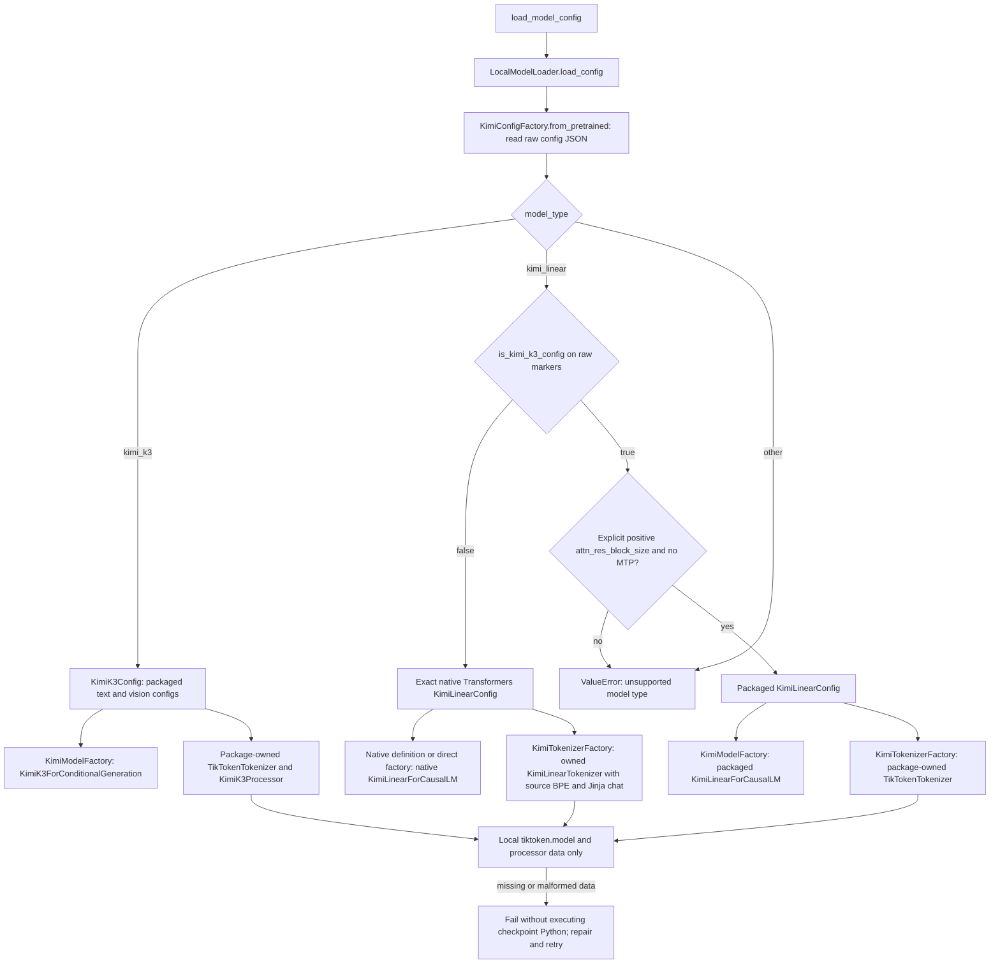
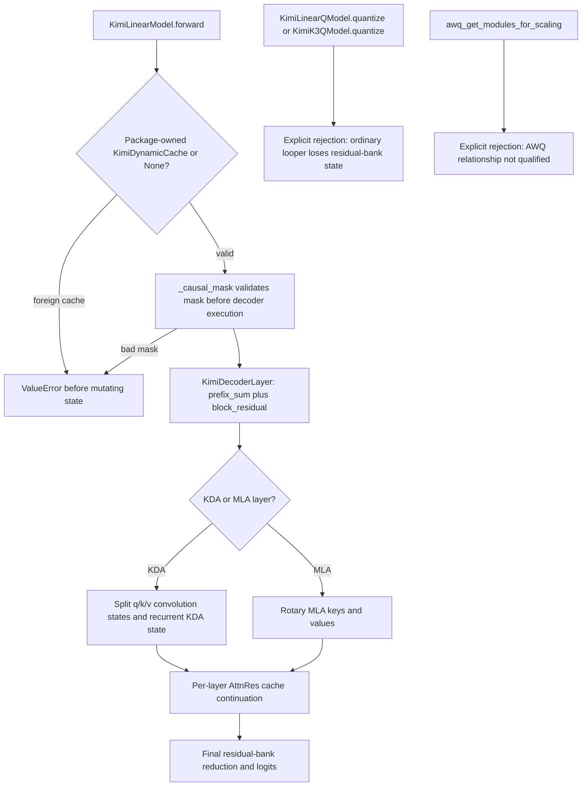
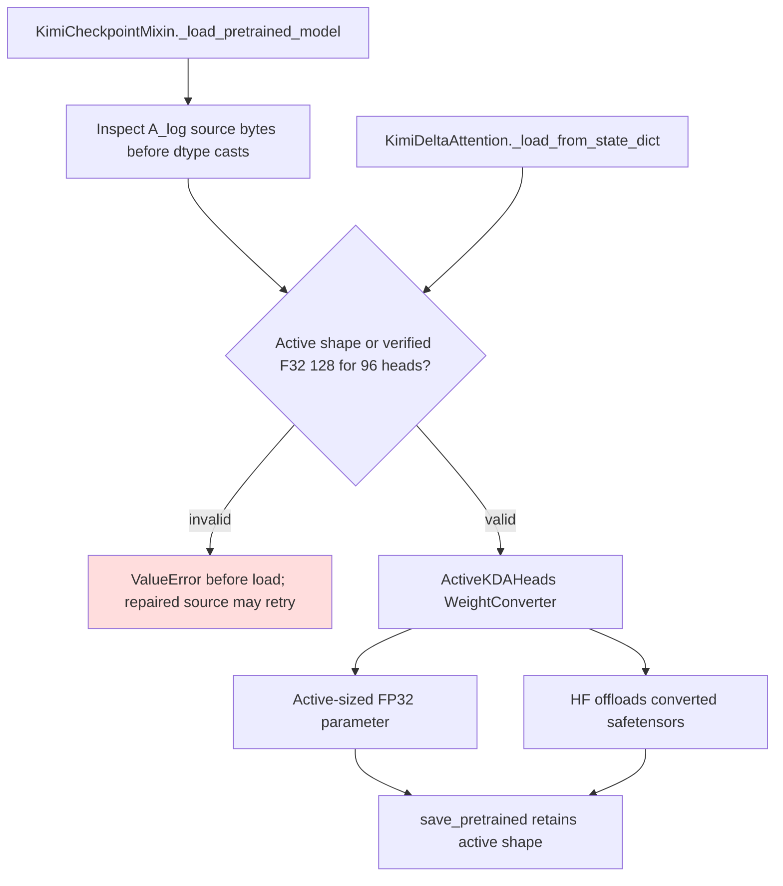
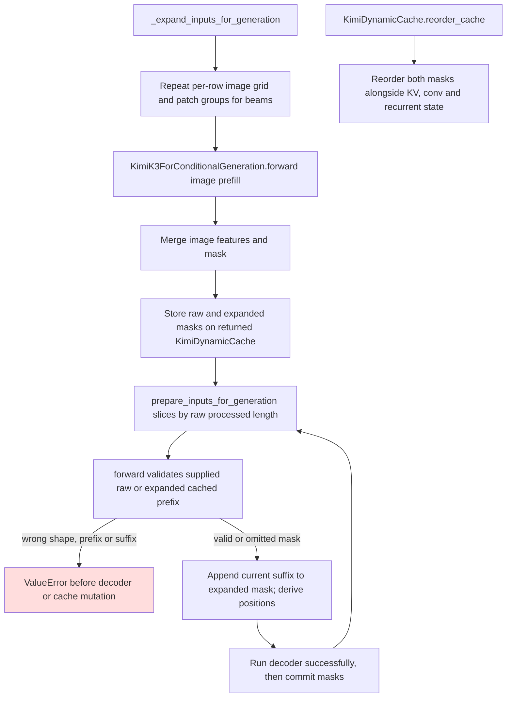

# GPT-QModel Kimi K3 / AttnRes local inference

## Ownership and provenance

This package owns the `kimi_k3` multimodal model and the AttnRes layout of
`kimi_linear`. It is adapted from
[`moonshotai/Kimi-K3@f831ab66814297da540d832a5235f8e904f29d06`](https://huggingface.co/moonshotai/Kimi-K3/tree/f831ab66814297da540d832a5235f8e904f29d06).
See [NOTICE.md](NOTICE.md) for file attribution, tokenizer hashes and licenses.
The ordinary **non-AttnRes** `kimi_linear` architecture remains the exact native
Transformers 5 `KimiLinearConfig` / `KimiLinearForCausalLM`, not this decoder.

Transformers 5.23 has that native ordinary Kimi-Linear implementation but no
native K3/AttnRes config/task mapping. K3 has a different residual-bank protocol,
split convolution owners and latent `block_sparse_moe.experts.*.w1/w3/w2` weights.
Substituting the native ordinary model would silently change the architecture.

## Raw-config local dispatch



The selected package loader strips `trust_remote_code` and `code_revision`.
Checkpoint `auto_map` remains ordinary data, including when caller trust and the
existing security bypass are both enabled. No global HF registration, downloaded
Python, checkpoint class imports, or new environment switches are involved.
Tokenizer selection does not normalize generic inputs here: Tokenicer retains
ownership of shared tokenizer normalization.

| Before | After |
| --- | --- |
| Base `22bea1201`, `definitions/kimi_k3.py:26`: `require_trust_remote_code = True`; inherited Auto loader | `definitions/kimi_k3.py:58,93`: definition-owned `LocalModelLoader` descriptors |
| Raw `kimi_linear` could be mistaken for K3 after injecting AttnRes defaults | `configuration_kimi_k3.py:291`: `KimiConfigFactory` inspects raw JSON before any K3 defaults |
| Checkpoint tokenizer selected `tokenization_kimi.TikTokenTokenizer` through `auto_map` | `tokenization_kimi.py`: package-owned PythonBackend subclass; K3 XTML segments retained |
| FLA/Triton and FlashAttention imports prevented portable execution | `eager_kda.py`: Torch reference recurrence/convolution; vision eager/SDPA paths available without those imports |
| Gate parameters could be mistaken for corrupt mixed-dtype state | `modeling_kimi_linear.py:982`: strict FP32 `A_log`/`dt_bias` metadata matches the model's native ownership |

The parent integration owns the central `docs/` reference page, README link and
PR diagram; this port-local page supplies their mechanism and evidence.

## Cache and quantization boundaries



Only routed `w1/w3/w2` leaves are declared quantizable. Norms, residual projection
owners, attention, routers, latent adapters and shared experts carry explicit
exclusion tags. The standard GPT-QModel looper and AWQ still reject this layout
before capture/mutation; declaring its experts does **not** qualify AWQ folding,
search, replay, packing, or fused execution. The existing bounded
`KimiK3Source` calibration runner is unchanged. No new fusion admission is made.

`module_plan_cases.json` holds the exact proposed replacements for the parent
registry's `KimiK3QModel/gptq` and `KimiLinearQModel/gptq` cases. It adds nine
explicit exclusion groups, leaving the expert groups and their order unchanged.
The shared `fusable_models.json` entries need no structural change.

## Runtime and measured qualification

Validated environment: CPython 3.14t with the GIL disabled, Transformers 5.23.0,
Torch 2.15.0 CPU, and **tiktoken 0.12.0**. K3 needs `tiktoken>=0.12.0` and Pillow
for the qualified image path. There is no FLA, FlashAttention, Triton, or einops
requirement for the portable execution path.

From `tests/`:

```sh
PYTHON_GIL=0 /home/ubuntu/.venvs/gptqmodel-tf5/bin/python -s -m pytest \
  test_kimi_k3_local_port.py module_tree/test_kimi_k3_local_port.py \
  test_kimi_k3_support.py module_tree/test_kimi_linear_native_tree.py \
  module_tree/test_kimi_k3_fork_plan.py module_tree/test_kimi_linear_fork_plan.py \
  -q --disable-warnings
```

Measured with the processor trust/bypass matrix: **113 passed, no skips, 10.17s**.
Tests use tiny real CPU models, not mocked modeling kernels. In particular:

- Hostile config/model/tokenizer/processor maps across trust and bypass values.
- Exact native ordinary Kimi-Linear dispatch and raw metadata preservation.
- CPU/meta checkpoint-key ownership for text/multimodal MLA, hybrid and KDA.
- FP32/BF16/FP16 logits and chunked cache parity, padding and cache reorder.
- Independent float64 MLA and KDA transition-matrix oracles, plus MoE oracle.
- Full/low-rank KDA gates, bounded/unbounded decay and MLA projection variants.
- Real image preprocessing, image-conditioned forward, continuation and generation.
- Public GPT-QModel FP32/BF16 loading and exact matched-dtype safetensors reload.
- Real pinned TikToken vocabulary, IDs, UTF-8 decode, XTML and mutable-asset retry.

The real-vocabulary test uses only a locally cached, hash-checked pinned asset;
it explicitly skips if unavailable rather than downloading code or weights.
Here it ran without skips. Base vocabulary size is 163584, with 256 reserved
special IDs. `Hello, 世界!` encodes to `[19180, 11, 220, 2243, 0]`; `[BOS]`, `[EOS]`
and `<|media_pad|>` are 163584, 163585 and 163605. Structural XTML segments use
special tokens while marker-like ordinary user text stays escaped text.

### Red/green evidence

1. `test_public_config_ignores_checkpoint_code` failed for both aliases before
   definition-owned loading; both now select packaged config with trust false.
2. Vision `sdpa` selection raised `KeyError` before adding its portable mapping;
   the real-pixel test now executes vision, text continuation and safetensors
   reload; packed unequal-length SDPA also matches independent eager attention.
3. The public BF16 load had undeclared FP32 gate parameters; the explicit strict
   metadata now permits those parameters and asserts every loaded dtype.
4. Mutable `tiktoken.model` repair could reuse a stale tiktoken cache. Supplying
   the actual local file's SHA-256 as reader cache integrity metadata now makes
   corruption fail and a repaired file succeed at the same path, including the
   real pinned vocabulary. This hash is not a hardcoded vocabulary allowlist.
5. Malformed attention masks and foreign caches fail before state mutation;
   retrying the same valid continuation matches a clean full forward.

The old `test_kimi_k3_support.py` fixture now imports the packaged model rather
than executing checkpoint Python. Its original independent MoE tensor oracle
is retained; separate MLA/KDA float64 oracles avoid self-comparison as numerical
evidence. The native dispatch unit mocks the current `load_model_config` boundary
instead of the obsolete `AutoConfig` boundary.

## Explicit limits

No complete trained K3 checkpoint, accelerator backend, fused FLA/FlashAttention, multi-GPU,
threaded execution, compilation, long-context accuracy, training, MTP, or video
qualification is claimed. CPU eager KDA is a correctness-oriented Python loop,
not a high-throughput replacement for fused kernels. Only the package-owned
dynamic cache is supported; foreign/static/offloaded cache implementations and
speculative rollback are not qualified. Tiny cache/generation/beam checks are
not a claim of arbitrary beam/search compatibility or trained-model quality.
Accelerator paths retained from upstream require separate actual-device checks.

## Tokenizer, padded-checkpoint and multimodal continuation repairs

Ordinary non-AttnRes model/config classes remain native Transformers. The owned
`KimiLinearTokenizer` shares K3's source BPE but has 258 reserved tokens and the
ordinary sorted-tools Jinja chat contract, not XTML. Outer Tokenicer still owns
generic normalization. Its authoritative source is
[`Kimi-Linear-48B-A3B-Instruct@e1df551a447157d4658b573f9a695d57658590e9`](https://huggingface.co/moonshotai/Kimi-Linear-48B-A3B-Instruct/tree/e1df551a447157d4658b573f9a695d57658590e9).
Tests parse its literal regex without importing checkpoint Python and build an
independent TikToken oracle. `I'm sure we'll see it's fine` must produce
`[17172, 3287, 20944, 2050, 4643, 8201]`; `it's` alone is `[64072]`.

`a_log_reference.json` contains a pinned 512-byte K3 tensor fragment, **not** a
complete trained checkpoint. Its metadata identifies shard 13, byte range and
SHA-256. Published `language_model.model.layers.12.self_attn.A_log` has 128 F32
entries while the config has 96 active heads; the last 32 entries are positive
zero bytes. Only this padded geometry is admitted. Exact active-head tensors
remain valid. Wrong rank/size, non-F32 padded data, negative-zero/nonzero tails,
or padding for other head counts fail even with `ignore_mismatched_sizes=True`.



Converters are attached per load without global registration. HF retains shard
streaming and device placement; preflight reads only the small A_log vectors.
Direct state loading covers fresh/existing modules and both assignment modes.
Ordinary native Linear's loading implementation is not changed.



Masks belong to each cache, not model-global state; they are not checkpoint
tensors. Beam expansion repeats whole image groups, including zero/two-image
rows. Repeating individual patches changes nonuniform image content.

| Before at parent `0fdfd2396` | After |
| --- | --- |
| `tokenization_kimi.py:430-432`: ordinary fallback used AutoTokenizer | Source BPE and separate ordinary Jinja chat |
| `modeling_kimi_linear.py:475`: active96 mismatched published128 | Pre-cast validation/conversion and canonical96 saves |
| `modeling_kimi_k3.py:1126-1138`: raw mask sliced against expanded cache | Per-cache raw/expanded masks and aligned positions |
| Generation repeated each patch for beams | Repeat whole per-row image groups |

### Follow-up validation

On Python3.14.6t/GIL0, TF5.23.0, Torch2.15CPU, released Tokenicer0.0.17,
tiktoken0.12.0 and safetensors0.8.0, the owned/native sibling and shared
loader/processor/tokenizer/config/registry suites pass **742 tests**, with one
existing shared fixture skip, in 43.28s. Real tokenizer assets ran without
skipping. From `tests/`, prepend `PYTHON_GIL=0` and use the isolated environment:

```sh
python -s -m pytest test_kimi_k3_local_port.py \
  module_tree/test_kimi_k3_local_port.py test_kimi_k3_support.py \
  module_tree/test_kimi_linear_native_tree.py test_local_model_loading.py \
  test_local_processor_loading.py test_local_tokenizer_loading.py \
  test_hf_config_compat.py module_tree/test_registered_module_plans.py \
  -q --disable-warnings
```

Intended red evidence before these repairs:

| Test node (under `test_kimi_k3_local_port.py`) | Failure before repair |
| --- | --- |
| `test_native_linear_real_tokenizer_contractions_match_pinned_source` | All six trust/bypass cases: `[277,1048]` for `it's`, source expected `[64072]` |
| `test_published_padded_a_log_first_load_and_two_safetensors_roundtrips[dtype0-k3]` | Checkpoint size mismatch: published128 versus active96 |
| `test_padded_mixed_images_generate_matches_independent_merge_and_text_oracle[hybrid-1]` (before dtype/text-only parameters) | Step2 raw mask versus expanded cache prefix: `cached prefix` ValueError |

Green regressions cover real hashes/IDs/chat/tools and asset repair, public
hostile-map load/retry/reload across all six trust/bypass cases, exact full
state, FP32/BF16/FP16 two-cycle safetensors reload, invalid-padding rejection,
direct assignment and actual KDA-submodule disk-offload/restore/resave in text
and multimodal wrappers. Mixed-image/text-only batch generation checks every
step's mask, positions, tokens and logits against independent placeholder
substitution/left-padding plus text-decoder generation for MLA/hybrid/KDA,
all three dtypes, greedy and three beams. Rejected-mask retry checks every
KV/convolution/recurrence tensor stays unchanged; tuple/dict returns both work.

Whole AttnRes-layer disk dispatch is **not** qualified: its source residual
reducer reads child weights directly, needing preload support for whole-layer
disk placement. Tested placement is the KDA submodule, including A_log and its
consuming computation. AWQ, ordinary looper and LazyTurtle quantization remain
unsupported for AttnRes. No complete trained checkpoint/quality, GPU/fused FLA,
FlashAttention, multi-GPU, compilation, concurrent model execution, MTP/video
or foreign-cache qualification is added. Parent owns central docs/README links
and PR diagrams; this port-local reference supplies the exact flow and evidence.

Static validation: repository `format/check.sh` with Ruff0.14.2, compileall and
`git diff --check` pass. Pyright1.1.407 on all four changed runtime files reports
154 diagnostics (HF API/type signatures and optional imports included); it is
**not** a clean whole-port type check. The new `checkpoint.py` alone has zero
errors/warnings. Shared fixture skip: PEFT AWQ compatibility probe dependency
absent in `test_prepare_remote_model_init_compat_tightens_peft_awq_probe`.
