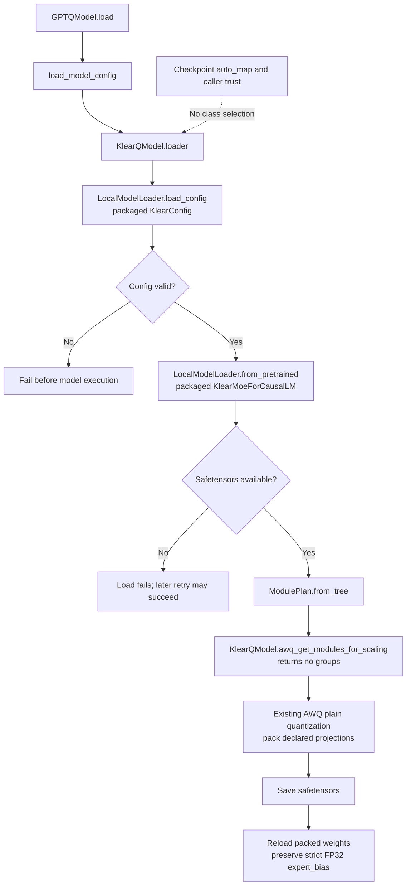

<!-- SPDX-FileCopyrightText: 2026 ModelCloud.ai -->
<!-- SPDX-License-Identifier: Apache-2.0 -->

# GPT-QModel Klear definition-owned modeling

## Provenance and scope

Transformers 5.23.0 has neither a `Klear` config mapping nor a causal-LM
mapping (including casefolded `klear`). This package implements the actual
Klear architecture rather than substituting a similarly shaped native model.

| Source | Pinned revision |
| --- | --- |
| [Kwai-Klear/Klear-46B-A2.5B-Base](https://huggingface.co/Kwai-Klear/Klear-46B-A2.5B-Base/tree/ffbbb37654c817052a9c0903747b6fdba1678dc9) | `ffbbb37654c817052a9c0903747b6fdba1678dc9` |
| [Kwai-Klear/Klear-46B-A2.5B-Instruct](https://huggingface.co/Kwai-Klear/Klear-46B-A2.5B-Instruct/tree/ebb784451bc3981a46ea3c6a865c4eb2a6cf63d6) | `ebb784451bc3981a46ea3c6a865c4eb2a6cf63d6` |

Both sources were read before adaptation; checkpoint Python was not executed.
Their config JSON and safetensors indices are identical. Modeling/config Python
differs in documentation/comments, not the inspected architecture. Each model
card declares `apache-2.0`; neither pinned tree supplied a standalone LICENSE.
The included unmodified Apache-2.0 license is from
<https://www.apache.org/licenses/LICENSE-2.0.txt>. See NOTICE for attribution.

SHA-256 digests of the original inspected files:

| File | Base | Instruct |
| --- | --- | --- |
| `configuration_klear.py` | `4cfdb3643e8b25d8fefe6cabd1211752931569010ea3ae0666a1009951fa3c25` | `040ab8d51cfdff8364be22eed659a6e0a21a5366a9e7ece161f81e431e6ae244` |
| `modeling_klear.py` | `24c3700296a7ce63aab512d43c4f3cf2ad2b112d8d792d6a4a4272c57b1c1d68` | `8f78a8813caa4425d8b7220d9018aada3844000f8119470e40da402187473873` |
| `config.json` | `33efb9ea988b94f86cbf440dc6f527a1a81d09bbee09d1e0cb08fb996dd4059e` | Same |
| `model.safetensors.index.json` | `7d96c844fd0faef42f9e02c3ddd18617106e8c7f4a3ad4ff2511faa3c3ef0b3d` | Same |

The checkpoint index has **25,059 tensor keys**, independently transcribed as
21 normalized path patterns in the module-plan test: three outer tensors and
32 layers, each with 15 non-expert tensors and three projections per expert
across 256 routed experts. The persistent `mlp.expert_bias` belongs to the MoE
block; ephemeral RoPE buffers do not belong to the checkpoint.
The published Base/Instruct architecture dimensions are also instantiated on meta and
its state-dict key set checked against all independently expanded index paths,
including the checkpoints' omitted optional special-token IDs.

## Preserved computation and API adaptation

Preserves Q/K per-head RMS norms; MHA/GQA/MQA and optional attention bias;
sigmoid routing with bias only for top-k selection; optional probability
renormalization; routed and shared expert MLPs; learned two-way coefficient
mixing; and dense, mixed and periodic sparse layers. Upstream stores but does
not apply `routed_scaling_factor`; the port likewise does not apply it.
Router logits are FP32; no auxiliary routing loss is invented.

Transformers 5 adaptations replace obsolete recorder/decorator imports with
explicit output collection, use current Cache/masking/RoPE APIs, preserve cache
continuation and generation, and use the current tied-weight declaration.
The original Transformers 4.56 recorder supplies initial plus final-normalized
hidden states and filters mixed-layer router outputs to sparse layers; explicit
collection preserves those public results without per-forward monkeypatching.
Checkpoint class names and tensor paths remain unchanged. `expert_bias` is
strict FP32 routing metadata, including quantized reload through GPT-QModel's
shared native-FP32 checkpoint policy. There is no global Auto-class registration,
remote import dispatch, hub-kernel decorator or model-specific tokenizer shim.

## Definition-owned loading and quantization flow

| Mechanism | Before at base `22bea120181e739161ee2969b260fe94f5b4e791` | Package-owned replacement |
| --- | --- | --- |
| Config/model selection | `definitions/klear.py:10-17`: no loader; inherited AutoModel lookup cannot construct Klear without checkpoint code | `KlearQModel.loader` selects local `KlearConfig` and `KlearMoeForCausalLM` |
| Checkpoint ownership | `definitions/klear.py:25-31`: Q/K norms, router, coefficient, expert bias and dense MLP variants undeclared | Explicit exclusions, capture-only MoE root, expert/shared and dense projections |
| AWQ relationships | No Klear-specific scale-search qualification | `awq_get_modules_for_scaling` returns no groups; existing plain quantization consumes all declared linears |



Ambiguous or invalid inputs fail explicitly (exactly one of IDs/embeddings;
Cache instances rather than legacy tuples; valid head/top-k/layout config).
The malicious `auto_map` sentinel remains unexecuted with both API trust values
and both values of the existing security bypass, including failed-load/retry.

## Qualification

The local tests use real tiny CPU/meta models and an independent tensor-equation
oracle, not fake trees. They cover casefolded Klear selection, checkpoint owners,
module roles, exclusions, routed/shared lifecycle consumers, dense/MoE/mixed/
periodic/no-shared layouts, nontrivial routing bias and coefficient mixing,
MHA/GQA/MQA, eager/SDPA cached continuation and greedy generation, causal and
padding masks, sliding-window attention, RoPE/config variants, FP32/FP16/BF16
safetensors round trips, tied/untied heads, direct weight replacement and retry.

Public AWQ tests use `GPTQModel.load`, `quantize`, packed Torch inference and
two save/reload cycles for dense, MoE and mixed layouts with `fallback=None`.
They check every declared projection was packed, non-quantized tensors stayed
unchanged, strict FP32 nonzero routing bias and all packed state survived, and
reloaded logits match exactly. This qualifies **plain AWQ only**, not folding,
source/consumer scale search or fusion. Fusion remains unadmitted.
The MoE/mixed public roundtrips remove a required routing-bias tensor, assert
failure without leaked dtype/remap state, restore the safetensors payload and
retry the same path successfully.

Run from `tests/` with the isolated environment and GIL disabled:

```sh
PYTHON_GIL=0 /home/ubuntu/.venvs/gptqmodel-tf5/bin/python -m pytest \
  test_klear_local_port.py module_tree/test_klear_local_port.py -x -q
```

The shared FP32 helper is a parent-owned prerequisite, not part of this port's
owned implementation. Red evidence: before local loader assignment, the
malicious Klear fixture reaches remote AutoConfig trust resolution instead of
the package model. Before the shared FP32 helper, the public MoE AWQ roundtrip
fails on `model.layers.0.mlp.expert_bias`; the strict routing-bias declaration
alone is insufficient in the older shared quantized loader.
The public trust/bypass matrix also detects the older Tokenicer handoff
re-importing checkpoint AutoConfig when both trust and bypass are true; the
parent’s selected-config forwarding fix is required, not a port-local shim.
The shared helper suite's ERNIE-specific public cases require that independently
owned port in the integration checkout; Klear supplies its own public regression.

Not qualified: trained Base/Instruct weight numerical parity or quality,
GPU/ROCm/FlashAttention, multi-GPU, concurrent model execution, compile,
gradient-checkpointed training, static/offloaded/quantized caches, or dynamic
RoPE cache continuation across its original-context boundary. No claim that
tiny random-weight tests replace those checks.

## Parent integration

The parent owns central docs, README, fixtures and packaging. Copy the flow into
the central local-model reference page and link this page from the related
README section. Include this directory's LICENSE/NOTICE/README in distribution
data, alongside the shared `ports/__init__.py` supplied by the parent.
Replace `registered_module_plans.cases["KlearQModel/gptq"]` with `EXPECTED_PLAN`
from `tests/module_tree/test_klear_local_port.py` (independently pinned here),
and change `fusable_models.models.klear.reason` to:

> Package-owned Klear MoE with per-head Q/K norms and learned routed/shared expert mixing; fusion executor has not been qualified.
