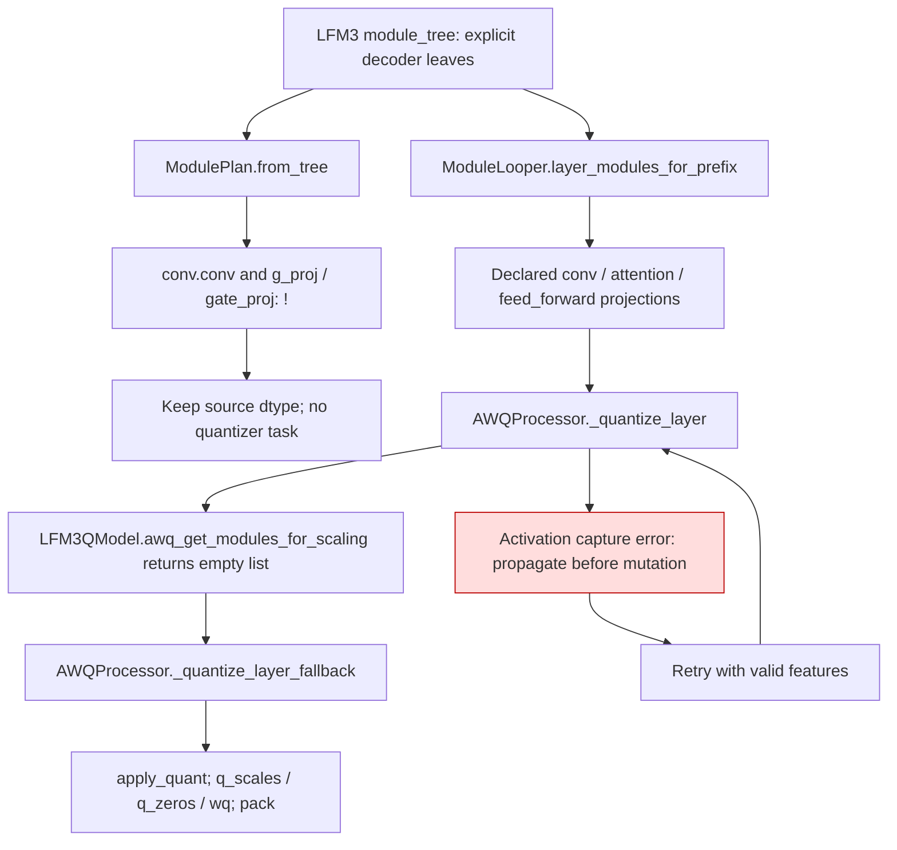

<!-- SPDX-FileCopyrightText: 2026 ModelCloud.ai -->
<!-- SPDX-License-Identifier: Apache-2.0 -->

# GPT-QModel LFM3 decoder ownership and AWQ policy

This is a native-definition coverage fix, not a replacement modeling port.
The real Transformers LFM3 decoder alternates depthwise short convolution,
full attention and sliding attention. Its convolution kernel and small
per-head sigmoid gate stay in their checkpoint dtype; all nine declared
projection paths remain eligible for quantization (five per convolution
layer, seven per attention layer).

## Source review

- Native: installed Transformers **5.23.0**, `models/lfm3/modeling_lfm3.py`,
  `Lfm3Attention` (`g_proj`, lines 238–242; sigmoid gating in `forward`) and
  `Lfm3ShortConv` (depthwise `conv`, lines 353–360; multiplicative forward).
- Legacy: inspected, not executed,
  [LiquidAI/LFM3-1.7B modeling_lfm3.py at
  1da06bec6a819da10b54c67e5c90972b46d81871](https://huggingface.co/LiquidAI/LFM3-1.7B/blob/1da06bec6a819da10b54c67e5c90972b46d81871/modeling_lfm3.py).
  `Lfm3Attention` lines 231/270 call the same per-head sigmoid gate
  `gate_proj`; `Lfm3ShortConv` lines 347–355 own the same depthwise kernel.
- No upstream model code is copied or dynamically imported by this fix.

`operator_norm` feeds Q/K/V **and** the non-quantized sigmoid gate. The
attention output projection reads the gated attention output, not that norm.
The convolution input projection produces B/C/x branches; B*x passes through
the depthwise convolution and multiplies C before the output projection.
Neither path justifies folding a projection scale through the intervening
operations merely because a width matches. Independently qualifying any
safe feed-forward optimization is deferred, not inferred from module order.

## Ownership and flow

| Mechanism | Before | After |
| --- | --- | --- |
| Native gate | Undeclared `self_attn.g_proj` | Explicit `:!`; legacy `gate_proj:!` retained |
| Depthwise convolution | Undeclared `conv.conv` | Explicit nested leaf `:!` |
| AWQ | Inherited generic groups crossed convolution/gating | Definition returns no scaling groups; existing plain quantization handles every declared projection |

Before-fix sites at `569c693de`: `lfm3.py:58–68`, `lfm3_vl.py:43–51`,
`lfm3_omni.py:42–50`; generic inference is `base.py:5285`.
The new policy is `lfm3.py:80–83`, inherited unchanged by VL and Omni.



The no-group architecture policy uses plain quantization even with
`fallback=None`; it is not an exception-swallowing fallback from a failed
scale search. Existing capture errors still propagate. The nested `conv`
dictionary is intentional: a tuple leaf named `conv:!` under `conv` resolves
to the parent rather than the deepest `conv.conv` owner.

## Real-model regression coverage

`tests/test_native_coverage.py` in this directory covers:

| Case | Evidence |
| --- | --- |
| Text / VL | Actual `Lfm3ForCausalLM` / `Lfm3VlForConditionalGeneration`, CPU and meta, normal Defuser conversion |
| Omni text contract | Actual `Lfm3Model` under Omni's declared language-model prefix, not a fake decoder |
| Native / legacy gate / no gate | Native `g_proj`; real gate renamed to audited `gate_proj` ownership with the native forward preserved; attention gate and sandwich norms disabled |
| Complete ownership | Every decoder `state_dict()` owner, including biases, explicit source-dtype tags, exact independent block snapshot and public looper selection |
| Supported projections | Five convolution-layer / seven attention-layer linears, producer-before-consumer order, actual AWQ quantization and integer packing |
| Plain AWQ | FP32/BF16, default RTN fallback and `fallback=None`, all three decoder layer types, nonuniform inputs and padding |
| Failure and retry | Injected activation-capture failure leaves tensors unchanged, retry quantizes every declared linear, repeated finalization is idempotent |
| Dense tensors | Gate, depthwise convolution, norms and biases are bit-exact and retain source dtype after quantization |

The tests do not mock native model kernels, scaling, quantization or packing.
They compile the decoder wrapper directly to avoid unrelated media/tokenizer
I/O. Legacy gate renaming validates that ownership spelling, not the complete
legacy checkpoint implementation. Omni outer-wrapper/audio behavior, VL
image/video processing, GPU kernels, trained-checkpoint numerical quality,
cache/generation and serialization are not newly qualified by this tree fix.

## Central fixture handoff

Do not modify the parent-owned shared registry fixture from this unit.
For each of `LFM3QModel/gptq`, `LFM3VLQModel/gptq`, and
`LFM3OmniQModel/gptq`:

1. Insert the block `["conv.conv:!"]` immediately after `["conv.in_proj"]`.
2. Insert `"self_attn.g_proj:!"` immediately before
   `"self_attn.gate_proj:!"` in the attention-input block.
3. Keep `layers`, every existing path, and their relative order unchanged.

The local independent snapshot guards the complete replacement block lists
until the parent applies these three central entries.

## Validation

Environment: Python 3.14.6 free-threaded, Transformers 5.23.0,
Torch 2.15.0+cpu. No trained weights or remote checkpoint Python are needed.

```bash
P=/home/ubuntu/.venvs/gptqmodel-tf5/bin/python
$P -s -m pytest -q gptqmodel/models/ports/lfm3/tests/test_native_coverage.py \
  'tests/module_tree/test_registry_leaf_coverage.py::test_every_decoder_leaf_is_declared_or_explicitly_excluded[lfm3]' \
  'tests/module_tree/test_registry_leaf_coverage.py::test_every_decoder_leaf_is_declared_or_explicitly_excluded[lfm3_vl]'
```

Result: **56 passed**. Running the same final tests against a detached
`569c693de` checkout, with that checkout's actual package imported, gives
**56 failed**: 18 missing exclusion/block assertions, 36 nonempty generic-AWQ
group assertions and the two original native registry failures. The original
registry nodes independently fail for both `conv.conv` and `self_attn.g_proj`.

Required AWQ onboarding baseline, run without altering shared fixtures:

```bash
$P -s -m pytest -q \
  tests/test_awq_scale_search_safety.py tests/test_awq_moe_router_scaling.py \
  tests/test_awq_empty_groups.py tests/test_awq_position_kwargs.py \
  tests/test_awq_scale_search_memory.py tests/test_bloom_awq_replay.py \
  tests/module_tree/test_awq_relationships.py \
  tests/module_tree/test_bloom_awq_relationships.py \
  tests/module_tree/test_registered_module_plans.py \
  tests/module_tree/test_definition_subset_ordering.py
```

Result: **571 passed, 3 skipped, 3 failed**; the failures are exactly the three
parent-owned snapshot entries listed above. The skips require absent local
DeciLM, EXAONE and Nanbeige trained checkpoints.

Existing `tests/test_lfm3_support.py`: **8 passed, 6 skipped, 3 failed**.
The three loader-dispatch tests mock `AutoConfig.from_pretrained` instead of
the migration's config-policy loader, and reproduce unchanged on
`569c693de`. They need a parent-owned test update, not a definition workaround.
The skips require absent local LFM3 text/VL/Omni checkpoints.

The combined focused tests, baseline and existing support tests give
**635 passed, 9 skipped, 6 deselected** when deselecting only those three
central snapshots and three independently reproduced stale mocks.
Ruff and `git diff --check` pass. Pyright reports 74 existing definition
diagnostics both before and after, with the same source-site/rule multiset;
the new regression file has no diagnostics. No shared fixtures, shared docs,
loaders, model registry, workflow or PR state are modified by this unit.
