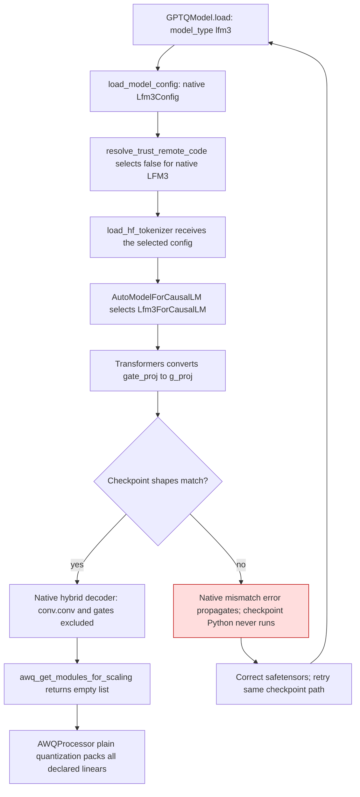

<!-- SPDX-FileCopyrightText: 2026 ModelCloud.ai -->
<!-- SPDX-License-Identifier: Apache-2.0 -->

# GPT-QModel native LFM3 loading qualification

Text LFM3 uses Transformers 5's native `Lfm3Config` and `Lfm3ForCausalLM`,
not a duplicate modeling implementation. This follow-up removes the stale
remote-trust requirement and changes the trained-model test default. The
existing [decoder/AWQ coverage](COVERAGE.md), including its VL/Omni scope,
remains intact. No VL/Omni definition or shared loader is changed here.

## Provenance

- Inspected checkpoint: [LiquidAI/LFM3-1.7B at
  `1da06bec6a819da10b54c67e5c90972b46d81871`](https://huggingface.co/LiquidAI/LFM3-1.7B/tree/1da06bec6a819da10b54c67e5c90972b46d81871).
- Reviewed `config.json`, `configuration_lfm3.py`, `modeling_lfm3.py` and
  the header only of `model.safetensors`. No trained tensors were downloaded
  and checkpoint Python was not imported or copied into this package.
- Native runtime reviewed: Transformers 5.23.0,
  `models/lfm3/modeling_lfm3.py`: `Lfm3Attention`, `Lfm3ShortConv`,
  `Lfm3DecoderLayer`, `Lfm3Model.forward`; its `conversion_mapping.py`
  LFM3 `WeightRenaming` converts checkpoint `self_attn.gate_proj` to native
  `self_attn.g_proj`. Source licensing remains with the installed dependency;
  no upstream modeling implementation is vendored or relicensed here.
- [checkpoint_manifest.json](checkpoint_manifest.json) records the pinned
  config and all **286 checkpoint tensor shapes**. A real full-size meta
  model matches them exactly after the gate rename; its additional
  `lm_head.weight` is the tied embedding alias. Runtime-only rotary tables
  are not treated as checkpoint-owned tensors.

The pinned checkpoint has 24 layers: short convolutions, full attention
with partial RoPE, and sliding attention. Tiny tests retain all three
operators, distinct rotary configurations, and the width-7 convolution.

## Native selection and failure flow

| Mechanism | Before this follow-up | After |
| --- | --- | --- |
| Definition trust | `lfm3.py:38-45` claimed remote code was required | Inherited native default; no remote requirement |
| Trained-model test | `tests/models/test_lfm3.py:10-13` enabled remote trust | Explicit `TRUST_REMOTE_CODE = False` |
| Checkpoint gate | Checkpoint calls its gate `gate_proj` | Native conversion to `g_proj` verified through public loading |
| Existing ownership/AWQ | Explicit depthwise owner, both excluded gate names, no scaling groups | Unchanged; real public checkpoint and AWQ coverage added |



Both API trust values and the existing security bypass (unset, `0`, `1`)
leave native selection unchanged. A hostile checkpoint module writes an
execution marker then raises; the marker must remain absent, even after
a failed shape load followed by a corrected same-path retry. The shared
tokenizer config forwarding fix is required and owned centrally.

## Additional real native coverage

| Test | Contract |
| --- | --- |
| `tests/module_tree/test_lfm3_local_port.py` | Exact checkpoint shapes/owners and tied head; 48 MQA/GQA/MHA, gate, sandwich and independent conv/attention bias combinations; normal Defuser conversion; undeclared descendants rejected |
| `test_public_native_load_ignores_auto_map_and_converts_gate` | Six trust/bypass combinations; exact loaded state/logits; two live loaded convolution layers' weight/bias owners bound through `wrapper.module_plan()` and real `nn.Conv1d`; no hostile Python |
| `test_native_cache_continuation_generation_and_safetensors` | FP32/FP16/BF16 and MQA/GQA/MHA; padded 3/2/3/1 chunk continuation across convolution/sliding windows; greedy generation; valid-token causality; exact safetensors reload |
| `test_hybrid_replay_matches_native_context_across_batches` | Fresh padding/positions across batches; default/explicit positions; native masks, RoPE and outputs in all three dtypes |
| `test_public_plain_awq_quantizes_every_linear_and_roundtrips` | Twelve public CPU quantize/pack/infer/save/reload cases: head layout, bias, gate/sandwich toggles; `fallback=None`; all 19 decoder linears packed; dense gates/convolution/non-unit norms unchanged |
| `test_public_native_load_failure_then_retry_does_not_execute_checkpoint_code` | Malformed gate shape fails natively; corrected same path reloads exactly without Python execution |

**AWQ is plain quantization only**, not scale-search/folding qualified.
`operator_norm` also feeds a non-quantized gate; convolution splits B/C/x,
convolves B*x, and multiplies C before its output projection; sandwich
post-norms sit before residual additions. No safe folds are inferred from
widths or declared order. No shared AWQ math is changed. The existing
`gate_proj:!` compatibility alias remains excluded; native state owns only
`g_proj`, independently checked against the checkpoint metadata.

## Detection evidence and limits

Reintroducing the original text definition from `22bea1201` yields three
intended failures, not collection/import errors:

1. `test_native_definition_does_not_require_checkpoint_code`: stale required trust.
2. `test_awq_is_explicitly_plain_quantization_for_every_hybrid_layer`: inherited scaling groups.
3. `test_native_state_dict_owners_and_quantization_plan[False-False-False-False-mqa]`: unowned `0.conv.conv.weight`.

The first defect is repaired here; the other two were repaired by the prior
central ownership/AWQ fix and remain covered. Original tokenizer tripwire
failure with trust and bypass both enabled was repaired by the shared
policy-selected config forwarding fix, not by a model-specific shim.

Validated on Python 3.14.6t, `PYTHON_GIL=0` (verified disabled),
Torch 2.15.0+cpu, Transformers 5.23.0. These bounded CPU/meta tests do not
qualify trained-weight quality, GPU/FlashAttention/fused convolution,
compilation, multi-GPU/threaded execution, arbitrary beams or
static/offloaded/quantized caches. Fusion remains unqualified. VL/Omni
media behavior is outside this follow-up. No remote fallback is introduced.

The parent owns central fixtures/tests and copying this diagram into the
central docs/README and PR description; this follow-up edits none of them.

## Reproduction

From the repository root, using the isolated environment:

```bash
PYTHON=/home/ubuntu/.venvs/gptqmodel-tf5/bin/python
PYTHON_GIL=0 "$PYTHON" -s -m pytest -q \
  tests/test_lfm3_local_port.py \
  tests/module_tree/test_lfm3_local_port.py \
  gptqmodel/models/ports/lfm3/tests/test_native_coverage.py --tb=short
```

The owned additions contain 85 cases; the prior native-ownership suite adds
54. The same command plus the following files exercises the required AWQ,
loader, sibling and registry baseline:

```text
tests/test_lfm3_support.py
tests/test_local_model_loading.py
tests/test_awq_scale_search_safety.py
tests/test_awq_moe_router_scaling.py
tests/test_awq_empty_groups.py
tests/test_awq_position_kwargs.py
tests/test_awq_scale_search_memory.py
tests/test_bloom_awq_replay.py
tests/module_tree/test_awq_relationships.py
tests/module_tree/test_bloom_awq_relationships.py
tests/module_tree/test_registered_module_plans.py
tests/module_tree/test_definition_subset_ordering.py
```

Parent integration must adapt the stale assertion in
`tests/test_lfm3_support.py` to
`assert bool(definition.require_trust_remote_code) is (definition is not LFM3QModel)`.
The native inherited default is `None`, not literal `False`. For isolated
qualification this shared assertion was temporarily corrected and restored;
no shared-file change is part of this follow-up. The combined run passed
757 tests with nine existing unavailable-checkpoint skips: six LFM3/VL/Omni
cases and three DeciLM/EXAONE/Nanbeige replay fixtures. Existing warnings are
unknown `cpu` markers and deprecated `rope_scaling` in sibling fixtures.
