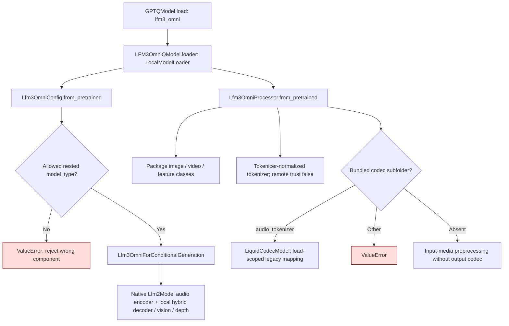

# LFM3 Omni local execution

GPT-QModel owns the LFM3 Omni wrapper, component configurations, media processor
and codec. `LFM3OmniQModel.loader` selects these classes directly. The checkpoint
is data; its Python classes and `auto_map` entries do not select implementations.

## Source and compatibility

- Source: [LiquidAI/LFM3-Omni-2B](https://huggingface.co/LiquidAI/LFM3-Omni-2B/tree/21d75123f86c1f7ffb4bef1ea202710c4e7ebe67).
- Pinned revision: `21d75123f86c1f7ffb4bef1ea202710c4e7ebe67`.
- `PROVENANCE.json` records the SHA-256 of each original source file and license,
  plus the safetensors header ranges used for the shape inventories. The fixtures
  contain configuration, parameter names and dimensions, never trained weights.
- Original Python copyright/Apache-2.0 headers are preserved. `LICENSE` is the
  upstream repository's **LFM Open License v1.0**, with its title's trailing
  space removed. `NOTICE`
  identifies modifications and attribution; the repository license does not
  replace upstream terms.
- Qualified environment: Python 3.14.6 free-threaded, `PYTHON_GIL=0`, Torch
  2.15.0 CPU, Transformers 5.23.0, released Tokenicer 0.0.17.

Transformers 5.23.0 has no `lfm3_omni` config or exact
`AutoModelForImageTextToText` mapping. Its native LFM3/LFM3-VL implementations
also rename text `self_attn.gate_proj` to `g_proj` and vision
`patch_embed.proj` to `patch_embed.linear_proj`. This wrapper retains the
checkpoint's exact names, gated hybrid operations, depth decoder, codebook,
audio projectors, vision packing and multimodal replacement semantics. The
audio encoder's embedded LFM2 is the native Transformers implementation;
its whole-checkpoint parameter ownership is covered by the meta audit.

The text implementation uses Transformers 5 cache/mask/RoPE APIs. Portable
PyTorch convolution replaces optional kernel-hub/Triton execution. Component
configs form a closed allowlist; a misleading nested `model_type` fails before
construction. There is no global AutoConfig registration or global codec key
conversion registration. The codec applies legacy `_frontend.`/`quantizer.fsq.`
key mapping only during its own load. Package components use relative imports.

## Ownership and AWQ policy

`model.language_model.layers` is the decoder root. Norms, attention head gates
and `conv.conv` are explicitly non-quantized. Quantizable owners are
`conv.in_proj`, `conv.out_proj`, attention Q/K/V/O and FFN W1/W3/W2.
The vision/audio encoders, projectors, depth decoder and codebook remain dense.

`awq_get_modules_for_scaling()` returns `[]`. This is **plain AWQ quantization**:
hybrid convolution/gates and sandwich norms have no qualified fold/search
relationship. Matching widths do not establish one. Six public CPU AWQ runs
exercise MHA/GQA/MQA with and without bias, `fallback=None`, real packing,
inference and safetensors reload. Each tiny hybrid owns exactly 19 quantized
decoder linears; all excluded parameters are compared before/after, including
the convolution kernel, gates, norms and non-text components.

## Tests and red/green evidence

Owned tests are `tests/test_lfm3_omni_local_port.py` and
`tests/module_tree/test_lfm3_omni_local_port.py`.

- Full pinned meta inventory: 665 checkpoint model tensors plus the tied
  `lm_head.weight` alias, and 203 codec tensors after the two explicit owner
  renames. Shapes and exact key sets must agree.
- Actual meta decoder owners: MHA/GQA/MQA, both convolution/attention/FFN bias
  choices and all four bias/sandwich combinations. Every checkpoint-owned
  layer entry resolves through `ModulePlan.find()` and either a quantizable
  owner or an explicit exclusion. `conv.conv` is a deepest-owner exclusion.
- Independent text equations: float32 attention/rotary oracle, grouped KV heads,
  depthwise gated convolution, RMSNorm, SiLU FFN, sandwich norms, padding,
  causality and multi-token cache continuation across FP32/FP16/BF16. This
  checks outputs against independent equations, not a second port invocation.
- Real image, audio and video preprocessing; actual native encoder/projector
  scatter; malformed placeholder and video-metadata failure followed by retry;
  media + text safetensors save/reload; text/audio/interleaved generation and
  rejection of multi-continuation generation followed by a valid retry.
- Codec encode/decode, safetensors reload, load-scoped legacy key conversion,
  cached chunked decode; processor codec persistence and reload.
- All six public malicious `config.json`, tokenizer and processor `auto_map`
  combinations (`trust_remote_code=False/True` x bypass unset/0/1) must select
  the local classes, run a real forward and leave checkpoint Python unexecuted.
  Direct processor loading has the same six-case boundary.
- Wrong nested LFM3, LFM2 encoder, depth and vision component configs reject,
  and the original correct config then constructs and runs successfully.

The final owned suites passed **73 tests, no skips**. An additional manual
offline processor check used the pinned real 17,908,634-byte tokenizer JSON,
tokenizer config, processor config and chat template with a tiny saved codec
payload. `Hello, world!` produced `[35808, 20, 1530, 9]` and decoded exactly.
Real image/audio tensors had shapes `[256, 1536]` and `[1, 128, 9]`; after
processor save/reload all returned tensors agreed exactly. This checks real
asset compatibility without downloading trained model or codec weights.

Combined owned + local loader/processor + trust isolation + InternLM sibling +
LFM3 support + complete registry-plan and fusion-admission checks passed
**568 tests, 6 skipped**, in 16.17 seconds. The six existing skips require
unavailable local trained LFM3-family checkpoints. This run temporarily applied
the proposed Omni registry/trust expectations and the parent's existing
`load_model_config` test-double update, then restored all shared files.

The broader legacy-branch `test_hf_config_compat.py` family is separate: its
old GGUF test still selects a removed environment variable, while the parent's
updated test needs its newer `KernelConfig(gguf_torch_dequant_loader=True)`.
That shared-version mismatch is outside this owned port; no shared fix or
excluded test is hidden in the green command above.

Reproduction from the repository root:

```sh
PYTHON_GIL=0 /home/ubuntu/.venvs/gptqmodel-tf5/bin/python -m pytest -q \
  tests/test_lfm3_omni_local_port.py \
  tests/module_tree/test_lfm3_omni_local_port.py
ruff check gptqmodel/models/definitions/lfm3_omni.py \
  gptqmodel/models/ports/lfm3_omni tests/test_lfm3_omni_local_port.py \
  tests/module_tree/test_lfm3_omni_local_port.py
git diff --check
```

Two focused regressions were run against the original definition at
`22bea120181e739161ee2969b260fe94f5b4e791` while retaining the tests/runtime:

| Exact node | Broken result | Port result |
| --- | --- | --- |
| `test_public_load_owns_config_model_processor_despite_hostile_metadata[None-False]` | `ValueError`: repository contains custom code which must be executed | Package config/model/processor, valid logits, no marker |
| `test_real_decoder_weight_owners_quantization_and_plan_tags[False-True-2]` | `AssertionError: conv.conv.weight`, missing deepest owner | Explicit `conv.conv:!`, every real owner resolved |

The initial strict public `[1-True]` test also exposed a shared generic-tokenizer
trust leak; it stayed strict. Parent tokenizer isolation through `5de766e7`
and Tokenicer 0.0.17 make all six cases pass. That shared prerequisite is not
an Omni port-owned patch.

## Explicit limits

No trained checkpoint weights or quality scores, accelerator execution,
FlashAttention/fused convolution, multi-device placement, compile, concurrent
PyTorch execution, training/backward or long-context extrapolation were
qualified. Free-threaded single-thread tests do not claim thread safety.
Only the architecture-specific dynamic text cache and codec streaming cache
were tested; static/offloaded/quantized caches are unqualified. The generic
fusion executor is unqualified. AWQ folding/search remains disabled.

Text/audio/interleaved continuation and cached multimodal forward are qualified
on tiny real models. Beam or multiple-return generation is explicitly rejected.
The retained streaming/live transcription entry points, full task quality,
vocoder quality and complete upstream conversation/media template combinations
remain unqualified. The upstream Omni processor uses its pinned defaults when
there is no serialized template; reusable tokenizer normalization remains in
Tokenicer. Processor ownership includes image/video/feature components and
codec, not checkpoint code discovery.

## Loading flow



| Mechanism | Before | After |
| --- | --- | --- |
| Model selection | `lfm3_omni.py:29`: `AutoModelForImageTextToText`, checkpoint `auto_map`, trust required | Definition-owned `LocalModelLoader`, package config/model, trust ignored |
| Processor selection | `lfm3_omni.py:119`: `AutoProcessor.from_pretrained(..., trust_remote_code=...)` | Package processor and components, codec-owned key conversion |
| Decoder ownership | `lfm3_omni.py:42`: `conv` only listed projections | Nested `conv` lists `conv.conv:!` |
| AWQ | Implicit inherited grouping | Explicit `[]` plain policy |
| Calibration | Always render conversations | Shared `prepare_vlm_calibration_dataset`, preserves tokenized rows |

Before pointers refer to the definition at
`22bea120181e739161ee2969b260fe94f5b4e791`.

Code evidence: `lfm3_omni.py:30-65` and `:128-162` (definition loader, owners,
processor, AWQ and calibration); `configuration_lfm3_omni.py:_subconfig_dict`
and `_config_class` (failure path); `processing_lfm3_omni.py:228-306`
(class selection and codec failure path); `modeling_liquid_codec.py:from_pretrained`
(scoped key mapping). Parent integration mirrors this flow into central docs
and README and applies the shared registry/fusion fixture updates.
