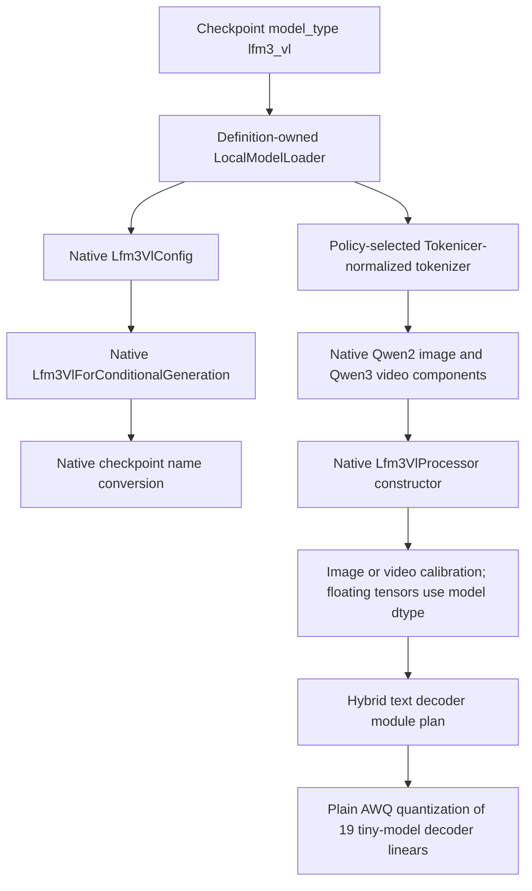

<!-- SPDX-FileCopyrightText: 2026 ModelCloud.ai -->
<!-- SPDX-License-Identifier: Apache-2.0 -->

# Native LFM3-VL selection

GPT-QModel selects the exact native Transformers `Lfm3VlConfig` and
`Lfm3VlForConditionalGeneration` through definition-owned `LocalModelLoader`
paths. No checkpoint modeling Python is copied or executed. The only model
type owned here is `lfm3_vl` (`LFM3VLQModel`); text LFM3 and LFM3-Omni are
separate definitions.

## Provenance

The structural and processor metadata fixtures come from
[LiquidAI/LFM3-VL-2B at 23387beda43c60310348e83e25f78f33c3140d3a](https://huggingface.co/LiquidAI/LFM3-VL-2B/tree/23387beda43c60310348e83e25f78f33c3140d3a).
`checkpoint_shapes.json` records all 424 tensor names/shapes from the header
of that revision's `model.safetensors`; trained weight payloads were not
downloaded. The native meta shell exactly matches these shapes after native
conversion and omission of the tied `lm_head.weight` alias. `LICENSE` preserves
the checkpoint's LFM Open License v1.0; `NOTICE` distinguishes metadata from
the native Transformers Apache-2.0 implementation.

Reviewed checkpoint source files at that revision were `configuration_lfm3_vl.py`,
`modeling_lfm3_vl.py`, `modeling_lfm3.py`, `processing_lfm3_vl.py`,
`image_processing_lfm3_vl.py` and `video_processing_lfm3_vl.py`.
They were inspected as text. Modeling and media execution use installed native
Transformers 5.23.0 source in `models/lfm3`, `models/lfm3_vl`,
`models/qwen2_vl/image_processing_qwen2_vl.py` and
`models/qwen3_vl/video_processing_qwen3_vl.py` plus the native conversion registry.

| Pinned upstream asset | SHA-256 |
| --- | --- |
| config.json | 18a02e8b5963e38c98683e2c948705ea45220d75f017e9b4bdd9cf54692e6dc3 |
| processor_config.json | d3d5c3f9dc3d3f25c3177ba8bb05938b53c51799244af1ca6406cde78924b84e |
| modeling_lfm3_vl.py | a41cbe7242f379808bcc005207ee0d7b1709528966c1e4da46baa7c41827ac79 |
| modeling_lfm3.py | 4a676bee2cf184d51a9dacbb9d7c4abae85515a042a920f8e2578b22bba3d6e8 |
| processing_lfm3_vl.py | d770011e71c8b8e94ea9436d4f6768b42db60c5db70145d47f326f5d76f633f6 |
| image_processing_lfm3_vl.py | 57db0cfa668bf89a6ff898874e1321e78c257d200f25c98e0ea52b30b8740088 |
| video_processing_lfm3_vl.py | 9a6b7804c520b59ae6a20bff4814196c187ef5b3ed8c93cbd7d0a9a66c413478 |
| LICENSE | 30adf9d6478191fb87f2424f63ba0728598335aaf99cd2848ef17e8e545fe94b |

## Ownership and loading flow

| Before | Native selection |
| --- | --- |
| Definition requires remote trust and uses AutoModel/AutoProcessor | Definition owns config, model and processor class paths; trust and bypass cannot change them |
| Legacy text `self_attn.gate_proj` | Native conversion to `self_attn.g_proj`; sigmoid gate is excluded from quantization |
| Vision `patchifier`, `q_layernorm`, `k_layernorm` | Native conversion to `patch_embed`, `q_norm`, `k_norm` |
| Untagged text depthwise convolution | Explicit `conv.conv:!` checkpoint owner, including optional convolution bias |
| Processor-produced FP32 calibration pixels | Floating media inputs cast to model dtype; integer IDs and grids stay integer |

The processor adapter reads the checkpoint's media parameters with explicitly
selected native media classes. It keeps the selected tokenizer and saved chat
template, ignores processor discovery maps, and rejects checkpoint-selected
audio-tokenizer components because this architecture has none. Missing
tokenizer, malformed metadata and unsupported components fail before processor
construction and permit a clean retry after correction. No corrective tokenizer
normalization is implemented here.

The vision tower, multimodal projector, text depthwise convolution, sigmoid
gates, embedding norm and Q/K/sandwich norms stay unquantized. AWQ explicitly
returns no scaling groups: folds across sigmoid gates, head norms, the hybrid
convolution and sandwich norms have not been qualified. The existing plain
AWQ path still quantizes every declared decoder linear; no shared AWQ math or
fallback policy is changed. Fusion remains unqualified.

## Validation and limits

The owned CPU tests are `tests/test_lfm3_vl_local_port.py` and
`tests/module_tree/test_lfm3_vl_local_port.py`. They cover:

- Hostile config/model/tokenizer/processor discovery maps for both API trust
  values and bypass unset/0/1, with a checkpoint-code execution sentinel.
- Real native conv/full/sliding decoder and conv/attention vision layers:
  MHA/GQA/MQA, projection and convolution bias, independent attention-gate and
  sandwich-norm settings; exact live checkpoint owners and exclusions.
- All 424 pinned checkpoint tensor shapes on meta and complete legacy-name
  safetensors conversion with exact native tensors and image logits.
- FP32/BF16 image/video forwards, image/video sensitivity, continuation through
  native dynamic cache, generation and exact safetensors reload logits. Low
  precision references use native `from_pretrained(dtype=...)` so native strict
  FP32 norm storage is preserved; blanket `model.to(bfloat16)` is different.
- Independent pixel/grid/token-count oracles using the pinned media metadata,
  plus three processor failure/repair/retry transitions.
- Six public CPU FP16 AWQ runs (MHA/GQA/MQA times bias): actual image-chat
  calibration, all 19 decoder linears packed, `fallback=None`, every excluded
  tensor unchanged, finite image inference and exact packed/dense tensors and
  image logits after safetensors reload.

The runtime used Python 3.14t with `PYTHON_GIL=0`, Transformers 5.23.0 and
Torch 2.15.0+cpu. Separately, the five real pinned config/tokenizer/processor/
template assets loaded with the policy-selected tokenizer: a 256-square image
produced 64 image tokens, four 64-square frames produced 8 video tokens, image
chat rendered, and native processor save/reload preserved tensors and template.
The offline tests require no Hub access.

The FP16 calibration regression was also run with only its dtype cast removed:
native vision failed with `float != c10::Half` before packing. Restoring the
cast made the same public calibration/pack/inference/reload test pass. Earlier
trust and live-owner regressions detected the stale remote-trust requirement,
missing native gate ownership and missing/exposed depthwise convolution.

No trained-weight numerical/quality claim is made. Trained LFM3-VL-2B weights,
GPU and FlashAttention execution, multi-GPU placement, static/offloaded caches,
arbitrary beam search, compiled or concurrent PyTorch execution and AWQ scaling
folds remain unqualified. CPU free-threaded validation does not establish
threaded PyTorch safety. Native processor behavior is qualified at the stated
version; checkpoint custom Python is never a fallback.
