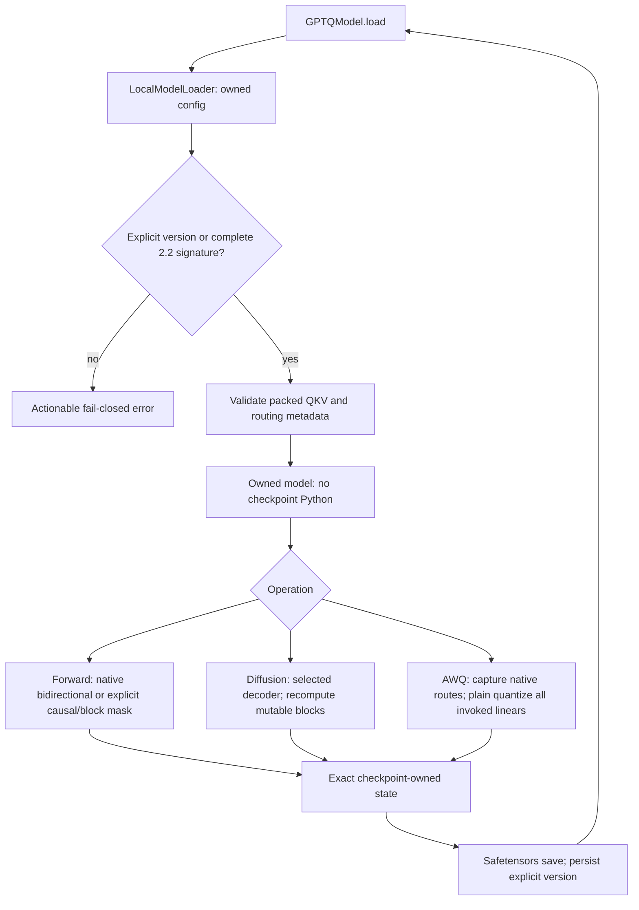

# LLaDA2 diffusion MoE: package-owned Transformers 5 port

GPT-QModel owns the config, packed-QKV model, MoE routing and diffusion decoders.
No checkpoint Python, dynamic import, remote registration or checkpoint
`auto_map` is consulted, even when both trust and the security bypass are enabled.
The definition no longer monkey-patches model classes process-wide.

## Explicit version selection

Released 2.0/2.1 configs have indistinguishable version metadata. Loading an
ambiguous config fails with an actionable error; names and repository paths are
never version signals. Use `GPTQModel.load(path, llada_version="2.1", ...)`, or
persist `"llada_version": "2.1"` in config.json. The choice is retained by ordinary
and quantized save/reload. The constructor explicitly consumes the same public
argument that the shared loader forwards to config and model factories.

| Choice | Released checkpoints | Native decoding behavior |
| --- | --- | --- |
| `2.0` | mini, flash | Scheduled M2T, threshold/top-k transfer, multinomial sampler |
| `2.0-mini-preview` | mini-preview | Greedy unfiltered temperature-zero path; prompt-inclusive return |
| `2.0-flash-preview` | flash-preview | CAP decoder; multinomial sampler and continuation return |
| `2.0-cap` | flash-CAP | CAP decoder; multinomial sampler and continuation return |
| `2.1` | mini, flash | Confidence-based M2T plus T2T editing and bounded post-refinement |
| `2.2` | flash | Block-capacity routing, joint M2T/T2T, delete/split editing, anti-loop resampling |

Only the complete 2.2 signature (`expert_capacity`, `block_size`,
`delete_token_id`, `split_token_id`) permits structural auto-selection.
Partial, conflicting, unknown and ambiguous `2.0-preview` metadata fail closed.
The two preview checkpoints have genuinely different source behavior, not aliases.

For source fidelity, 2.0/CAP/flash-preview retain multinomial sampling even at
temperature zero. Use `top_k=1` for deterministic decoding on those variants.
The legacy 2.0-family early-EOS path returns the prompt too; ordinary completion
returns only generated tokens except mini-preview. Explicit EOS tests pin both.

## Computation and adaptation

* Exact `model.word_embeddings`, `attention.query_key_value` (Q then K then V),
  Q/K per-head norms, `attention.dense`, dense/shared/routed MLP and gate keys.
* Partial RoPE uses current Transformers 5 `rope_parameters` and helpers.
  Default, linear and dynamic helpers are available; crossing-context parity
  with trained checkpoints is not claimed.
* Group-limited routing uses sigmoid scores plus correction bias for selection;
  unbiased gathered scores determine normalized routing weights and scale.
  2.2 selects a per-block expert-capacity set using the maximum token score.
* The correction buffer is explicitly constructed FP32, including dtype-scoped
  meta shells, and declared strict FP32. Implicit-default zeros round the bias
  during lazy calibration; the separate FP16/BF16 regression detects that loss.
* Native unmasked forward remains bidirectional. Two-dimensional tokenizer masks
  are explicitly causal for calibration/cache use; four-dimensional bool/0-1
  keep masks and nonpositive additive block masks preserve diffusion visibility.
  Additive all-zero masks are bidirectional, never interpreted as all-masked.
* Eager and SDPA are CPU-qualified. FlashAttention is not silently substituted.
* DynamicCache append/continuation is supported with causal masks. Diffusion
  explicitly recomputes mutable blocks with `use_cache=False`, without changing
  the caller's config. Static/legacy caches fail explicitly.
* `eos_id=None` disables EOS truncation. LLaDA2.1 has an explicit
  `max_steps_per_block=1000` failure budget rather than an unbounded mask loop.
  2.2 retains its source budget/residual-token warning.
* No checkpoint tensor renaming, transposition, split-QKV conversion or fused
  expert substitution is required. Split-QKV metadata fails explicitly.

| Before | After |
| --- | --- |
| Checkpoint AutoConfig/AutoModel dispatch | Definition-owned lazy local classes |
| Global forward-class mask patch | Per-call owned mask normalization |
| One unqualified legacy generation implementation | Six explicit source-backed decoder policies |
| Implicit dtype for router correction | FP32 construction and FP32 reload policy |
| Inferred AWQ relationships | Explicit plain-quantization-only policy |



## Source provenance and license

All source was inspected as text/AST; no downloaded checkpoint module was
imported or executed. Source headers credit Antgroup, Hugging Face, EleutherAI,
OPT and Meta AI and license the code Apache-2.0. LICENSE contains the full text;
NOTICE preserves attribution. The pinned mini model card also declares Apache-2.0.
The upstream pinned repository contains no separate LICENSE file.

| Repository | Pinned revision |
| --- | --- |
| [inclusionAI/LLaDA2.0-mini](https://huggingface.co/inclusionAI/LLaDA2.0-mini/tree/dad945cac317da394b390f82c7b40691d8a881ed) | `dad945cac317da394b390f82c7b40691d8a881ed` |
| [inclusionAI/LLaDA2.0-flash](https://huggingface.co/inclusionAI/LLaDA2.0-flash/tree/744c3f8c6c8317d2377d6d16d8a3d4be2caef563) | `744c3f8c6c8317d2377d6d16d8a3d4be2caef563` |
| [inclusionAI/LLaDA2.0-mini-preview](https://huggingface.co/inclusionAI/LLaDA2.0-mini-preview/tree/98062a17531adc03f0334d1e81d9be24b3865b2b) | `98062a17531adc03f0334d1e81d9be24b3865b2b` |
| [inclusionAI/LLaDA2.0-flash-preview](https://huggingface.co/inclusionAI/LLaDA2.0-flash-preview/tree/93fa841e025bcb1974e9b62612fa2d8f699a8f75) | `93fa841e025bcb1974e9b62612fa2d8f699a8f75` |
| [inclusionAI/LLaDA2.0-flash-CAP](https://huggingface.co/inclusionAI/LLaDA2.0-flash-CAP/tree/3e65ff386063c389ca498d5ca862a687252d75c6) | `3e65ff386063c389ca498d5ca862a687252d75c6` |
| [inclusionAI/LLaDA2.1-mini](https://huggingface.co/inclusionAI/LLaDA2.1-mini/tree/20e64e2ad21644d0e5248586ed9c942cdd45de0f) | `20e64e2ad21644d0e5248586ed9c942cdd45de0f` |
| [inclusionAI/LLaDA2.1-flash](https://huggingface.co/inclusionAI/LLaDA2.1-flash/tree/2bf95e86ade33c1adb5c1e223b7db2a76dc3bdd6) | `2bf95e86ade33c1adb5c1e223b7db2a76dc3bdd6` |
| [inclusionAI/LLaDA2.2-flash](https://huggingface.co/inclusionAI/LLaDA2.2-flash/tree/9b78da3f9149f1e239fb6d15f20a326fde574b9f) | `9b78da3f9149f1e239fb6d15f20a326fde574b9f` |

checkpoint_audits.json records each original config, SHA-256 for config/modeling/
configuration/index files, exact key count and SHA-256 of sorted checkpoint keys
joined with newlines. Tiny/full-meta tests validate the live model against all
eight independently downloaded indexes: mini has 14,813 keys, flash 24,161.
The shared ordinary/mini/flash generation differs only in documentation;
flash-preview and CAP generation have identical inspected ASTs.

## Qualification and reproduction

From the repository root in the isolated Transformers 5 environment:

```sh
PYTHON_GIL=0 /home/ubuntu/.venvs/gptqmodel-tf5/bin/python -m pytest \
  tests/test_llada2_local_port.py tests/module_tree/test_llada2_local_port.py -q
ruff check gptqmodel/models/definitions/llada2.py gptqmodel/models/ports/llada2 \
  tests/test_llada2_local_port.py tests/module_tree/test_llada2_local_port.py
git diff --check
```

Validated environment: Python 3.14.6t with the GIL disabled, Transformers 5.23.0,
Torch 2.15.0+cpu. The tests use tiny random weights, never trained tensor payloads.
The final owned model/module-plan run passed 205 tests without skips in 30.83s.
The local-loader/InternLM/AWQ/native-FP32 sibling run passed 100 tests with three
existing skips; two ERNIE public cases were deselected because that independently
owned port is not in this checkout. Full format/check.sh and compileall passed.
Coverage includes full independent forward equations, every decoder's native
generation versus an independent equation oracle, sampling RNG/probabilities,
EOS conventions, 2.1 edits, 2.2 delete/split/final resampling/loop escape, eager/
SDPA causality and block visibility, real cache continuation/failure retry, all
public trust/bypass combinations, explicit version persistence, FP32/FP16/BF16
safetensors save/load/corruption repair, real module-plan owners and exclusions.

Plain AWQ is explicit: no fold/search/scaling-group eligibility is advertised.
Native calibration invokes every routed/shared/dense projection with
`fallback=None`; public tests pack, infer, save and reload twice with exact packed
and dense state, logits and version metadata in both disk-offload modes.
Every packed linear retains INT32 qweight, not a persistent dense weight cache.
The explicit strict-FP32 default-offload regression uses non-round source values.

Red/green evidence:

1. Original definition fails the no-forward-class-mutation regression; local
   loading no longer mutates either model class.
2. Implicit-dtype routing-buffer construction loses precision in default lazy
   calibration; explicit FP32 construction preserves it for FP16/BF16.
3. Source EOS truncation crashes on `eos_id=None`; all six real decoder oracles
   now cover EOS-disabled completion.

module_plan_cases.json contains the exact parent-owned registry/fusion proposals.
The port itself does not edit those shared fixtures. The parent owns central
docs, README, and package-data inclusion of LICENSE/NOTICE/provenance assets.

## Unqualified limits

No trained-weight quality/perplexity, GPU, FlashAttention, fused/custom kernels,
multi-GPU, threaded execution, compile, training/gradient checkpointing,
static/offloaded/quantized caches, arbitrary batched diffusion, fusion, or AWQ
fold/search eligibility is claimed. Cache equivalence is causal-mask continuation,
not caching across diffusion refinements. Quantized execution is CPU Torch AWQ;
the default-offload strict-buffer smoke additionally covers BF16, not general
BF16 quantization quality or accelerated kernels.
