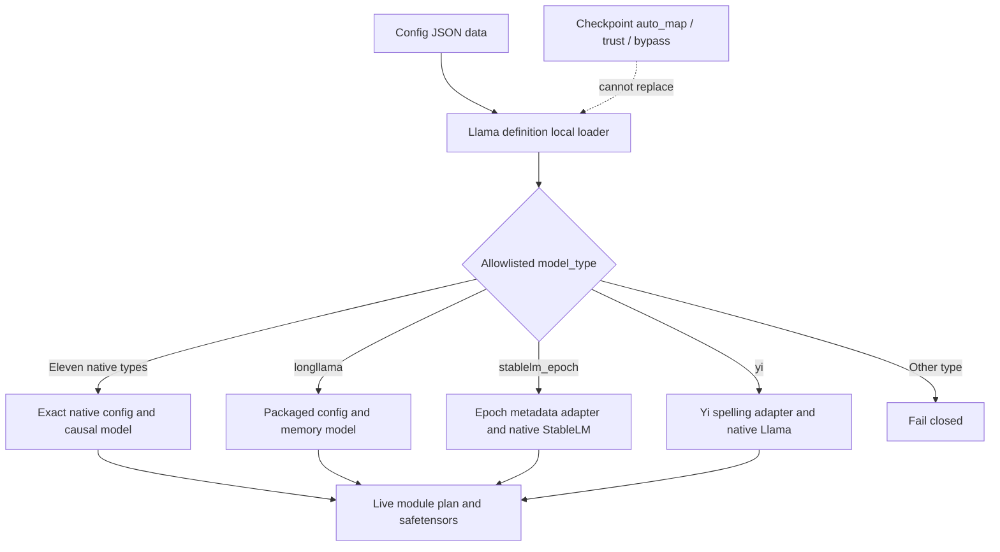
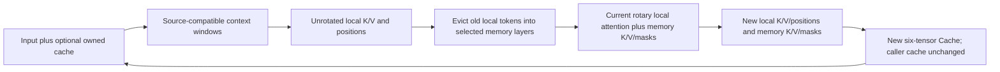

<!-- SPDX-License-Identifier: Apache-2.0 -->

# Llama definition: native aliases and LongLLaMA

This package owns config/model selection for the fourteen aliases registered to
`LlamaQModel`. It never imports checkpoint Python or registers checkpoint classes
globally. Config JSON is data; `auto_map`, API trust and the safety bypass cannot
replace these classes. Derived definitions retain their own loader (or native
AutoModel); inheriting the Llama module tree does not inherit this allowlist.

## Selection and source provenance

| Checkpoint `model_type` | Selected implementation | Evidence |
| --- | --- | --- |
| `cohere`, `cohere2`, `gemma`, `granite`, `helium`, `llama`, `mistral`, `olmo`, `seed_oss`, `smollm3`, `stablelm` | Exact native Transformers 5 config and causal model mapping | All eleven actual native classes instantiated on CPU/meta; no copied native model |
| `longllama` | Local `LongLlamaConfig` / `LongLlamaForCausalLM` | Inspected LongLLaMA source; actual local and memory-cache equations |
| `stablelm_epoch` | Local metadata adapter / native `StableLmForCausalLM` | Inspected Epoch equations, exact parameter inventory and independent forward oracle |
| `yi` | Local registry-spelling adapter / native `LlamaForCausalLM` | Original Yi-Coder checkpoint actually serializes `llama`; that spelling remains native |

Pinned sources (links select immutable revisions):

- [LongLLaMA checkpoint/source](https://huggingface.co/syzymon/long_llama_3b_instruct/tree/8805cbd788e0c76fcd388569596e401d9590f6f5), revision `8805cbd788e0c76fcd388569596e401d9590f6f5`.
  `configuration_longllama.py`, `modeling_longllama.py`, `longllama_utils.py`
  supply the adapted code. Their Apache headers and authorship are retained;
  see `NOTICE` and `LICENSE`.
- [StableLM Epoch checkpoint/source](https://huggingface.co/stabilityai/japanese-stablelm-3b-4e1t-base/tree/e7d2ebdd200a28be321058be9a67514780073736), revision `e7d2ebdd200a28be321058be9a67514780073736`.
  Inspected `configuration_stablelm_epoch.py` and `modeling_stablelm_epoch.py`;
  no checkpoint Python executes at runtime. The source uses sequential
  LayerNorm residuals, partial RoPE, bias-free GQA and SiLU, exactly available
  natively. The adapter translates `rope_pct` / `norm_eps`, disables native-only
  parallel residual, Q/K norm, bias and dropout alternatives, and preserves the
  legacy metadata spelling. The source does not read `rotary_scaling_factor`
  or `num_heads`; neither field becomes a new runtime control here.
- [Yi-Coder config and safetensors metadata](https://huggingface.co/01-ai/Yi-Coder-1.5B-Chat/tree/92fdd1b2f1539ac990e7f4a921db5601da2f0299), revision `92fdd1b2f1539ac990e7f4a921db5601da2f0299`.
  `model_type=llama`, `architectures=[LlamaForCausalLM]`; no Yi model is vendored.

SHA256 of inspected upstream files, before adaptation:

| File | SHA256 |
| --- | --- |
| LongLLaMA configuration | `cce4358bce5fc3d3230be374c585b471afe25e8c41f15520aad9f09b3484e384` |
| LongLLaMA modeling | `d6b708850dbdb1fa560e45f878bc58b5ac727009475ceeb887e1984b5e7e7b91` |
| LongLLaMA utilities | `a815abee92ec9a0dcb398066f274c2de66ddd0ee55a3c05e8ef3f6cffa1f8c6c` |
| Epoch configuration | `77b9bad64af26e73d146de4496e5babbb2c215c07d85121b11d56cc23ff6ccd4` |
| Epoch modeling | `23ad1ada4faebae3cb3ce209f1e9e8e1ea02d4d26c620bba8aee1cffda7d3026` |

`checkpoint_inventory.json` records the pinned config, key-set and shape-map
hashes from independently inspected checkpoint metadata: LongLLaMA 263 keys,
Epoch 356 keys, Yi-Coder 219 keys. Tests construct full-size meta models and
compare every shape/key against these hashes, without downloading trained
multi-GB tensor payloads. Legacy LongLLaMA pickle metadata was inspected using
pickle opcodes, not unpickled/executed; all newly saved tensors are safetensors.

## Flow change

| Concern | Before | After |
| --- | --- | --- |
| Legacy configs | Missing native mapping / checkpoint Python | Definition-owned allowlist |
| Native aliases | Native AutoModel | Same exact native model classes |
| LongLLaMA context | Remote Transformers 4 implementation | Local FoT memory and six-tensor cache |
| Epoch | Remote source selected | Source-matched native equations with metadata adapter |
| Parameter ownership | Rotary/QK-norm variants incomplete | Explicit excluded owners; seven quantizable projections |
| AWQ on legacy/QK-norm layouts | Unqualified inference from generic layout | Explicit no-fold plain quantization |
| Derived definitions | Inherited generic native loader | Still generic native unless they explicitly own a loader |





## LongLLaMA cache and precision

The six tensors in each layer are local unrotated K/V, local positions, memory
K/V, and memory padding mask. Memory positionals, selected memory layers,
memory dtype, source-compatible grouping, context-window eviction and eager/
Torch SDPA are preserved. Ordinary Llama rotated-K/V caches cannot substitute.
Rotary frequencies are persistent checkpoint owners, calculated in FP32;
the native strict-FP32 policy also protects them through quantized reload.
This uses the shared native-FP32 checkpoint loader, not a port-specific loader
repair. Forward updates do not mutate caller-owned cache tensors. Explicit
beam reorder, batch repeat/select and reset operate on all six tensors.
Speculative rollback/cropping fails explicitly because memory eviction cannot
be reversed from a local suffix. Foreign/static cache classes fail closed.

## AWQ policy

`longllama`, `stablelm_epoch`, legacy `yi`, Cohere with Q/K normalization and
StableLM with per-head Q/K LayerNorm return no scaling groups. There is no
qualified source/consumer folding or scale search across their memory, partial
rotary or normalized Q/K boundaries. Actual AWQ plain quantization remains
available for every decoder projection, with `fallback=None`. Nine public CPU
cases exercise pack, inference and **two** safetensors save/reload cycles,
including Epoch/normalized StableLM MHA/GQA/MQA. Packed tensors, untouched dense
owners and rotary FP32 buffers survive both cycles exactly. Default native
layouts retain existing generic AWQ behavior; shared algorithms are unchanged.
This is plain-quantization qualification, not an AWQ scaling-quality claim.

## Reproduction and limits

Tested with Python 3.14.6t, `PYTHON_GIL=0`, Transformers 5.23.0, Torch 2.15 CPU.

```sh
PYTHON_GIL=0 python -m pytest -q \
  tests/test_llama_local_port.py tests/module_tree/test_llama_local_port.py
```

The owned suites cover hostile `auto_map` with both trust values and bypass
unset/0/1 for all aliases (direct and public load), live CPU/meta layouts,
MHA/GQA/MQA where supported, bias/norm variants, exact checkpoint inventories,
cache/generation, independent attention/memory and Epoch numerical oracles,
FP32/BF16/FP16 safetensors, malformed payload failure/repair/retry, state-dict
assignment, subfolders, left padding, causality and actual memory influence.
LongLLaMA remains source-compatible MHA, not fabricated GQA/MQA support.

Combined loader/security/InternLM/model-plan/AWQ regression run: **1061 passed,
3 skipped** (existing DeciLM/EXAONE/Nanbeige opt-in remote-family fixtures).
Separate fusion admission/control suite (`tests/module_tree/test_fusable_models.py`
and `tests/module_tree/test_llama_fusion.py`): **164 passed, 485 skipped**;
the skips require NVIDIA CUDA/Marlin hardware. This does not qualify fusion
execution for the three legacy aliases. Repository `format/check.sh`, targeted
Ruff 0.14.2, compileall and `git diff --check` pass.
Defect-reintroduction probes separately confirm real failures when native
AutoModel replaces the local loader, when memory K/V is discarded, and when
the alias allowlist leaks to derived definitions. Unmodified tests pass.
An additional real red/green Epoch regression verifies that native-only
`partial_rotary_factor` metadata cannot override the source's `rope_pct`.

Combined command (the two owned suites alone contain 430 passing cases):

```sh
PYTHON_GIL=0 python -m pytest -q \
  tests/test_llama_local_port.py tests/module_tree/test_llama_local_port.py \
  tests/test_local_model_loading.py tests/test_trust_remote_code_isolation.py \
  tests/test_internlm_local_port.py tests/module_tree/test_internlm_local_port.py \
  tests/test_awq_scale_search_safety.py tests/test_awq_moe_router_scaling.py \
  tests/test_awq_empty_groups.py tests/test_awq_position_kwargs.py \
  tests/test_awq_scale_search_memory.py tests/test_bloom_awq_replay.py \
  tests/module_tree/test_awq_relationships.py \
  tests/module_tree/test_bloom_awq_relationships.py \
  tests/module_tree/test_registered_module_plans.py \
  tests/module_tree/test_definition_subset_ordering.py
```

No trained multi-GB tensor payload, quality/perplexity, GPU, FlashAttention,
multi-GPU, concurrent model execution, compilation, training, static/offloaded/
quantized cache, speculative rollback, or fused executor qualification is
claimed. Attention reporting retains the upstream last-window/group behavior.
The existing trained-checkpoint LongLLaMA test now requests no remote trust but
was not executed on this CPU fixture machine. Fusion remains unqualified.

Parent integration owns central docs/README and packaging of license/notices.
The registered-plan baseline is unchanged. Replace only the three existing
fusion reasons with:

```json
{
  "longllama": "Package-owned LongLLaMA memory/cache port; fusion executor has not been qualified.",
  "stablelm_epoch": "Source-matched native Transformers 5 StableLM Epoch adapter; fusion executor has not been qualified.",
  "yi": "Native Transformers 5 Llama-backed Yi legacy alias; fusion executor has not been qualified."
}
```
