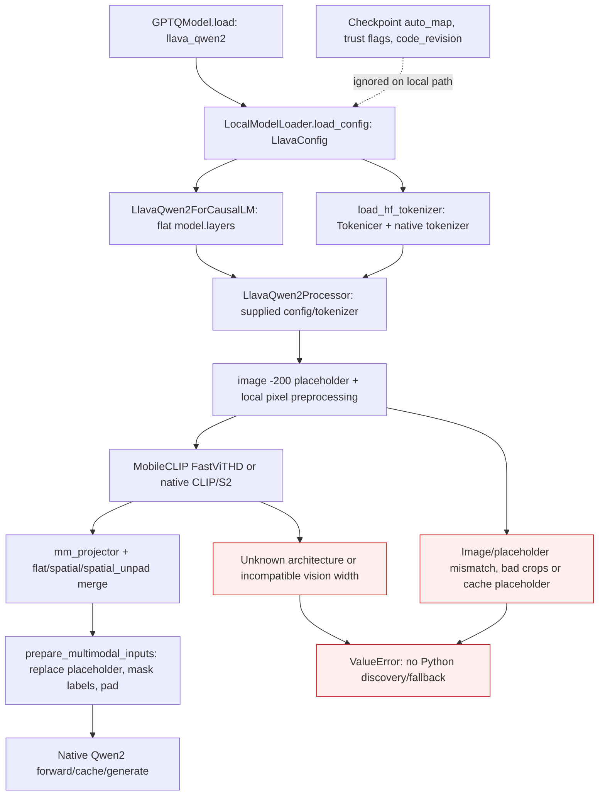
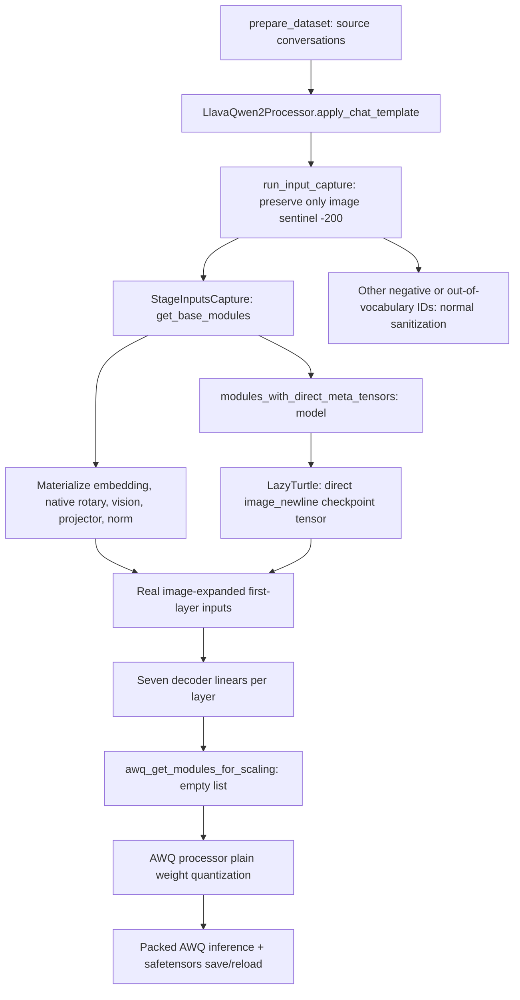

<!-- SPDX-FileCopyrightText: 2026 ModelCloud.ai
SPDX-License-Identifier: Apache-2.0 -->

# Flat LLaVA-Qwen2 on Transformers 5

`LlavaQwen2QModel` binds `LlavaConfig`, `LlavaQwen2ForCausalLM` and
`LlavaQwen2Processor` through `LocalModelLoader`. Transformers **5.23.0** has
neither the `llava_qwen2` config nor its causal-LM mapping. Its native `llava`
and `fast_vlm` composite architectures are not flat-checkpoint substitutes.
This is a real image-consuming wrapper around the native Qwen2 decoder, not a
text-only model with a renamed config. Introducing integration: PR #4620.

## Sources and licenses

Source files were fetched as text and inspected, **not imported or executed**.

| Component | Pinned source | Adaptation |
| --- | --- | --- |
| Flat wrapper / multimodal insertion | [Apple ml-fastvlm](https://github.com/apple/ml-fastvlm/tree/6f7b13179bbc81e6aa7d921bc7c6335c43904778), `llava/model/language_model/llava_qwen.py` and `llava/model/llava_arch.py` | Native TF5 Qwen2 cache/generation APIs; retain `model.layers`, `model.mm_projector`, `model.image_newline`, `lm_head` |
| FastViTHD / MCi | [Pinned FastVLM-0.5B source](https://huggingface.co/apple/FastVLM-0.5B/blob/16375720c2d673fa583e57e9876afde27549c7d0/llava_qwen.py), also Apple `llava/model/multimodal_encoder/mobileclip/mci.py` | Preserve the inference/training-layout classes and reparameterized checkpoint keys; remove registration/download hooks and unrelated architectures |
| CLIP/image utilities | Same Apple revision, `llava/model/multimodal_encoder/clip_encoder.py`, `llava/mm_utils.py` | Explicit native CLIP config, local weights only; owned image placeholder/any-resolution processing |
| S2 spatial resampling | [scaling_on_scales](https://github.com/bfshi/scaling_on_scales/tree/188b59d8a331a7d0ac2f072ddeebd6e650b6e48e), `s2wrapper/core.py` | Implement its bicubic resize, chessboard split/merge, area downsample and channel concatenation directly, without a runtime `s2wrapper` dependency |
| Decoder | Installed Transformers 5.23.0 `Qwen2Model` / `Qwen2ForCausalLM` | No copy of Qwen2 attention, RoPE, cache or generation internals |

Inspected source SHA-256:

```text
FastVLM-0.5B/llava_qwen.py
  eacb8fd7ad0f1fe66a8ac95be817bfd229fea647a38781af3fb3fe7104a40d89
ml-fastvlm/llava/model/llava_arch.py
  f65b1d34b2be3cd7e1e230a5b27e49fab0c10d539a4693379a215128e4db017d
ml-fastvlm/llava/model/multimodal_encoder/mobileclip/mci.py
  f8655a05a423531a903bfd22824eeb744d9c43e5a0500f5b511bfcba009ca7e1
ml-fastvlm/llava/mm_utils.py
  ad84ff401d7bbdb7978a0ec51ce93d1c8a2da48934dcc1db6354b89a2df9d2bc
```

See `LICENSE-Apple`, upstream `ACKNOWLEDGEMENTS`, `LICENSE-S2` and `NOTICE`.
Apple-derived code keeps its original license; LLaVA-derived code and this
adaptation retain Apache-2.0 attribution. No trained weights are included.

The three pinned configuration fixtures are:

| Apple checkpoint | Revision | Qualification |
| --- | --- | --- |
| FastVLM-0.5B | `16375720c2d673fa583e57e9876afde27549c7d0` | All **924** real safetensors keys/shapes equal meta state; all **629** vision keys/shapes exact |
| FastVLM-1.5B | `dd6608dfa0e17b050e1dde2856c3437fcba197ac` | Full configured meta model and identical 629-key vision inventory; trained decoder tensors not downloaded |
| FastVLM-7B | `e6b907da2d6ef4218cdb9f6f9d721b3e55a0a8f8` | Full configured meta model and identical 629-key vision inventory; trained decoder tensors not downloaded |

`checkpoint_shapes.json` records the 0.5B safetensors-header inventory and
SHA-256 `04f7abbf0d3fad23baa2c3631ee05888a596067a12bb6f8327747ad9932a913b`.
Only header metadata was retrieved, not the trained tensor payload.

## Control flow and ownership





| Before / original location | After |
| --- | --- |
| `definitions/llava_qwen2.py:4`: inherited `AutoModelForCausalLM`; checkpoint mapping required | Direct package class paths; caller trust and checkpoint `auto_map` cannot replace them |
| Checkpoint `llava_qwen.py`: global HF/timm registrations and remote-code import graph | Relative package imports, native Qwen2, lazy `timm` and owned vision classes |
| Generic `BaseQModel._sanitize_input_ids_for_embeddings`: all negative IDs become pad IDs | Definition override preserves **only** `-200` for multimodal expansion; other invalid IDs are still sanitized |
| Raw `model.image_newline` is outside child-module traversal | Explicit direct-meta owner `model`; checkpoint data materializes before image calibration |
| Inherited AWQ scale grouping does not establish multimodal replay/folding safety | Explicit empty scale groups; all decoder linears still plain-quantize |

No global HF registration, runtime checkpoint-Python imports, code downloads,
new behavior environment flags, or reusable tokenizer corrections are added.
Tokenicer remains the sole reusable normalization owner.

## Supported layouts and failure contract

- Flat Qwen2 MHA/GQA/MQA decoder; native biases and tied embeddings preserved.
- `mobileclip_l_<resolution>` FastViTHD checkpoint layout, including the exact
  `model.vision_tower.vision_tower.model.*` hierarchy and `head.proj` buffer.
- Native CLIP `patch`/`cls_patch` and S2 multiscale patch features. Known OpenAI
  CLIP configurations are constructed locally; other CLIP towers require an
  explicit serialized `vision_config`, not implicit remote config discovery.
- Legacy `vision_tower` alias, with `mm_vision_tower` taking precedence.
- Linear, identity and `mlpNx_gelu` projectors; flat, spatial and spatial-unpad
  merging; square, pad and anyres preprocessing; left/right text/image batches.
- Processor consumes PIL images (also local chat image paths), emits `-200`
  image slots, masks expanded labels with `-100`, and supports asset save/reload.
- Native dynamic cache, eager/SDPA, greedy and beam generation. A cached
  continuation cannot introduce a new image placeholder. Image encoding is
  done for the prompt; later cache steps contain only ordinary token IDs.

Unknown tower types, invalid projector depth/width, incorrect spatial grids,
unsupported image feature selection, placeholder/image mismatches and malformed
input tensors fail explicitly. There is no text-only fallback for a bad image.
S2 class-plus-patch output is rejected rather than incorrectly reshaped as a
square patch grid. Training-time image adapter/delimiter tuning and video are
not implemented by this port. These checks leave the model usable for a later
valid request.

`timm==1.0.22` was tested; **`timm>=1.0.22` must be declared centrally**.
Only its `timm.layers.DropPath` and `SqueezeExcite` APIs are used, imported lazily
with the MobileCLIP implementation. No `flash_attn`, `s2wrapper`, CUDA or new
native extension is required for this CPU path.

## Qualification and red/green evidence

Environment: Python **3.14.6t**, `PYTHON_GIL=0` (GIL verified disabled), Torch
**2.15.0+cpu**, Transformers **5.23.0**, Tokenicer **0.0.17**, timm **1.0.22**.

The owned suites have **73 real CPU/meta cases**, no skip marker. Their oracles
include an independent float64 FastViTHD (convolution, LayerNorm, MHSA and
ConvFFN), projector and Qwen2 RMSNorm/RoPE/GQA/MLP/lm-head equation path, exact
checkpoint metadata, and explicit S2 chessboard operations. FP32/FP16/BF16,
eager/SDPA image cache continuation, greedy/beam generation, labels/padding,
safetensors equivalence and nondegenerate image dependence are exercised.

Six public malicious-checkpoint cases cross API trust false/true with bypass
unset/0/1 and poison model, tokenizer and processor `auto_map` entries. Native
tokenizer IDs and owned processor/image output are checked, and no sentinel
Python payload executes. Processor save/reload and malformed-image retry are
real operations, not mocks of the dispatched implementation.

Four public AWQ cases cross MobileCLIP/CLIP with flat/spatial-unpad, using real
PIL-image conversations, first-layer image-expanded capture, all **14** decoder
linears, `fallback=None`, TORCH packed inference and safetensors save/reload.
They compare **every** packed/dense saved tensor exactly and require finite,
equivalent logits. No AWQ scale search/folding objective is declared qualified.

Meaningful failures observed before the corresponding fixes:

| Probe | Red | Green |
| --- | --- | --- |
| Definition ownership | Original definition resolves to `AutoModelForCausalLM` | Local config/model/processor with hostile maps |
| Calibration sentinel | Generic sanitizer replaces `-200` with padding, so the image consumer is never reached | Only `-200` survives; measured decoder length grows by the exact image feature count |
| Spatial-unpad lazy capture | `NotImplementedError: Cannot copy out of meta tensor` for `image_newline` | Direct-meta metadata loads the saved newline before first-layer capture |
| New tiny spatial model | Uninitialized newline included a finite FP32 value near `-1.7e38`, became FP16 `-inf`, and produced NaN reload logits | Constructor uses the original Gaussian scale; all four AWQ cases require finite outputs and exact saved state |

Run from the repository root:

```bash
PYTHON_GIL=0 /home/ubuntu/.venvs/gptqmodel-tf5/bin/python -m pytest \
  tests/test_llava_qwen2_local_port.py \
  tests/module_tree/test_llava_qwen2_local_port.py -q --disable-warnings
format/check.sh
git diff --check
```

Final combined validation on released Tokenicer **0.0.17**: **846 passed,
478 skipped in 52.48s**. The owned 73 cases all pass; a separate owned-only
run before the Tokenicer upgrade passed in 21.71s. The same combined run on
Tokenicer **0.0.14** passed **844**, with two additional serialized-tokenizer
preference skips. Exact final combined command:

```bash
PYTHON_GIL=0 /home/ubuntu/.venvs/gptqmodel-tf5/bin/python -m pytest \
  tests/test_llava_qwen2_local_port.py \
  tests/module_tree/test_llava_qwen2_local_port.py \
  tests/test_local_model_loading.py tests/test_local_tokenizer_loading.py \
  tests/test_local_processor_loading.py \
  tests/module_tree/test_registered_module_plans.py \
  tests/module_tree/test_fusable_models.py \
  tests/test_awq_empty_groups.py tests/test_awq_scaling_groups.py \
  tests/test_awq_scale_search_safety.py tests/test_awq_scale_folding.py \
  tests/test_awq_position_kwargs.py tests/test_awq_rotary_device.py \
  tests/test_awq_gptq_lifecycle.py -q --disable-warnings -rs
```

The 478 skips are 468 NVIDIA Marlin hardware cases, one CUDA AWQ math case,
seven unavailable trained-fixture cases (Pangu twice, Instella, K2-Horizon,
DeciLM, EXAONE and Nanbeige), and two existing non-buildable CausalLM families
(OPT-350M and Muse Glimmer). An additional attempted
`tests/test_awq_rank_and_empty.py` collection failed because its unrelated
ParoQuant import needs optional `triton`; it is not part of the successful
combined command. `format/check.sh`, `compileall` for all owned Python files
and `git diff --check` pass. The default static check command
`pyright --pythonpath /home/ubuntu/.venvs/gptqmodel-tf5/bin/python gptqmodel/models/ports/llava_qwen2 --level error --outputjson`
reported **103** diagnostics (60 in retained FastViT code); it did not pass.

Actual pinned 0.5B tokenizer assets were additionally fetched as data and tested
manually through `load_hf_tokenizer`/Tokenicer and the owned processor. The
native Qwen2 tokenizer has 151646 entries; `Hello 世界!` produces
`[9707, 220, 99489, 0]`. The prompt `USER: <image>\nDescribe this image. ASSISTANT:`
produces `[6448, 25, 220, -200, 198, 74785, 419, 2168, 13, 35560, 3846, 2821, 25]`
and `[1,3,1024,1024]` pixels, without downloading trained weights or executing
checkpoint Python. These assets are not committed or required by the offline
owned suites. Vocab SHA-256:
`87a257b04b17642a0688c98cd1df89c398bda4fee532d6f88b38a659ecb4ac8d`;
merges SHA-256:
`455e0caaa06abffc663e9282dfe71dde07fd1991eaf24146bf08793c4dba4497`.

## Integration and limits

The registered `LlavaQwen2QModel/gptq` module-plan fixture is unchanged and is
asserted exactly by the owned module-tree test. The parent owns central docs,
README, license/provenance packaging and dependency declarations, and should
update only the fusion exclusion reason to:

> Package-owned flat LLaVA-Qwen2 multimodal decoder with MobileCLIP/CLIP vision tower; fusion executor has not been qualified.

The model is not in the generic `test_awq_scaling_groups.py` family table; its
owned real public plain-AWQ tests cover its declared conservative policy. Do not
add scale-folding groups or admit fusion based only on these layout tests.

No trained tensor payload, image quality/evaluation, NVIDIA/AMD/Apple GPU,
FlashAttention, fused vision kernels, multi-GPU, concurrently threaded PyTorch
execution, `torch.compile`, training, long-context extrapolation, static/offloaded/
quantized cache, or fusion qualification is claimed. Free-threaded CPU execution
does not prove arbitrary PyTorch worker-thread safety. Runtime tests and Ruff
are green; a default port-wide Pyright run reports dynamic PyTorch/native-TF
annotation diagnostics (including retained upstream FastViT training/reparameterization
helpers), not a clean static type-check. No suppressions were added to hide them.
