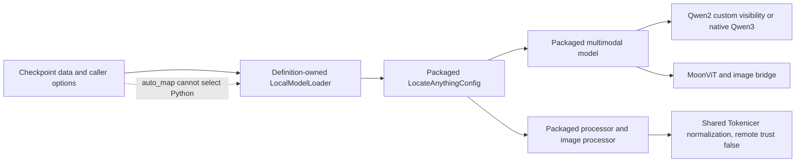
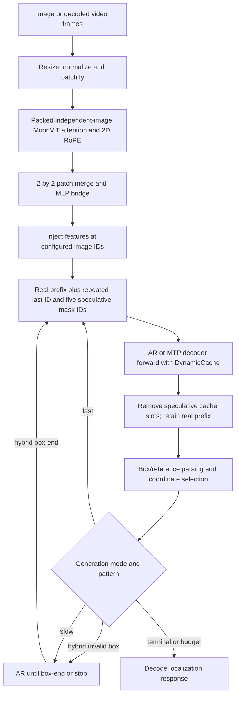

# LocateAnything: package-owned Transformers 5 port

**License: NVIDIA noncommercial research/evaluation restriction.** Read the full
unmodified [LICENSE](LICENSE), particularly sections 3.1–3.3, and [NOTICE](NOTICE).
The original source-file MIT/Apache headers are preserved; they do not override
the source repository's NVIDIA License. Central integration must retain this
qualification in the model coverage table, main README and PR description.

## Source and architecture

Authoritative source: [nvidia/LocateAnything-3B](https://huggingface.co/nvidia/LocateAnything-3B/tree/c32291ca5e996f5a7a485845b4f57a233936bba0),
revision `c32291ca5e996f5a7a485845b4f57a233936bba0`, linked by the existing
`tests/models/test_locateanything.py` support test. Upstream links the
[NVlabs/Eagle Embodied project](https://github.com/NVlabs/Eagle/tree/main/Embodied).
[SOURCE_MANIFEST.json](SOURCE_MANIFEST.json) records the inspected files and
SHA-256 digests. No checkpoint Python was executed to establish the oracles.

Transformers 5.23.0 has no exact `locateanything` config/model mapping. Native
Qwen2 alone does not implement this model. The port owns its composition config,
MoonViT vision encoder, patch merger, image injection, block-diffusion attention
visibility and localization sampler. Native Transformers 5 decoder layers supply
Qwen2 RMSNorm/RoPE/GQA/SwiGLU equations with the exact checkpoint projection names.
The source's Qwen3 alternative retains native Qwen3 causal attention and Q/K
normalization, with package-owned image and sampler API adapters.

`checkpoint_config.json` is the pinned released config. `checkpoint_shapes.json`
contains all **770** tensor names/shapes/dtypes read from the two safetensors
headers; no tensor payloads were loaded. A full-size meta instance matches
every key and shape exactly, including both stored embedding/head keys and their
configured tied parameter identity. The 36 decoder and 27 vision layers retain
their original prefixes. Tiny tests additionally cover tied/untied heads,
MHA/GQA/MQA and Qwen3 attention bias variants.

## Model and media resolution

| Concern | Before | After |
| --- | --- | --- |
| Model/config | AutoModel and checkpoint Python selected with trust | Definition-owned LocalModelLoader, packaged classes |
| Caller trust / bypass | Could authorize checkpoint model discovery | Cannot select checkpoint config/model/processor Python |
| Decoder | Bundled old Qwen2 APIs and custom masks | TF5 native layers with owned visibility and cache lifecycle |
| Media | Checkpoint AutoProcessor discovery | Packaged processor/image processor; shared Tokenicer tokenizer loading |
| Cache | Legacy slicing / crop target length | DynamicCache; remove speculative slots using a negative crop count |
| AWQ | Inherited grouping lacked custom replay qualification | Explicit empty fold/search groups; plain decoder quantization |





Only eager/SDPA wrapper attention is admitted. Legacy `magi` metadata maps to
SDPA with the same explicit visibility; optional GPU kernels are not imported
for this path. MoonViT RoPE frequencies are created per call/device rather than
kept in a mutable device cache. Processor metadata remains JSON, with both the
TF5 embedded representation and independently loadable image metadata saved.
`return_tensors='pt'` also converts image-grid metadata. Direct processor loads
use the shared tokenizer loader; normalization stays in Tokenicer.

The released BPE assets were separately loaded through the owned processor:
`<IMG_CONTEXT>` is **151665** (the released config value, distinct from the
source constructor default), and `<box><0><1000></box>` encodes to
`[151668, 151677, 152677, 151669]`. A 56×28 image produces eight 14×14 patches,
grid `[2,4]`, two merged image tokens, and an exact processor save/reload.
Regular offline tests use a small native tokenizer fixture and patch size 2.

## AWQ policy and verification

The custom block visibility, image bridge and localization replay have **not**
been qualified for AWQ scale search/folding. `awq_get_modules_for_scaling()`
returns no groups. Both Qwen2 and Qwen3 are exercised through public
`GPTQModel.load`, actual image-conversation calibration, `AWQConfig(fallback=None)`,
packing, image inference, safetensors saving and quantized reload. All 14 tiny
decoder linears quantize; vision, bridge, norms, embedding/head and native Qwen3
Q/K norms retain their dense values. No shared AWQ algorithm changes are needed.

The default Qwen2 ordered module-plan fixture is unchanged. The effective Qwen3
tree additionally excludes `self_attn.q_norm` and `self_attn.k_norm`. Both layouts
are checked against every real decoder state owner and live consumer on meta,
after normal Defuser conversion. Fusion is not admitted. The parent should set
`fusable_models.models.locateanything.reason` to:

> Package-owned LocateAnything block-diffusion/MoonViT/localization wrapper;
> fusion executor has not been qualified.

## Reproducible checks

From the repository root, with Python 3.14.6t / GIL disabled, Transformers 5.23.0,
Torch 2.15.0 CPU and the existing isolated environment: **78 owned cases** and
**810 combined cases, zero skips**, passed with Tokenicer 0.0.14 and released
Tokenicer 0.0.17. The final 0.0.17 combined run took 20.05 seconds. The real
pinned BPE/chat/patch-14 processor roundtrip also passed on both versions.

```sh
PYTHON_GIL=0 /home/ubuntu/.venvs/gptqmodel-tf5/bin/python -s -m pytest \
  tests/test_locateanything_local_port.py \
  tests/module_tree/test_locateanything_local_port.py -q

PYTHON_GIL=0 /home/ubuntu/.venvs/gptqmodel-tf5/bin/python -s -m pytest \
  tests/test_locateanything_local_port.py \
  tests/module_tree/test_locateanything_local_port.py \
  tests/test_local_model_loading.py \
  tests/module_tree/test_registered_module_plans.py -q

/home/ubuntu/.venvs/gptqmodel-tf5/bin/ruff check \
  gptqmodel/models/ports/locateanything \
  gptqmodel/models/definitions/locateanything.py \
  tests/test_locateanything_local_port.py \
  tests/module_tree/test_locateanything_local_port.py \
  tests/models/test_locateanything.py
git diff --check
```

Owned qualification includes independent double-precision decoder attention
arithmetic, functional MoonViT and image injection, scalar training/uncached
visibility oracles, two speculative cache windows, actual multi-round
slow/fast/hybrid sampling, hostile checkpoint config/model/tokenizer/processor
maps across `trust=False/True × bypass=unset/0/1`, partial failure/repair/retry,
and FP32/FP16/BF16 safetensors state/cache equivalence. The final exact counts
are provided with the integration handoff.

Observed red/green repairs:

1. The old definition fails the owned-loader assertion (`AutoModel`).
2. Copied eager MoonViT incorrectly added a Boolean visibility mask as a bias:
   the independent packed-image oracle failed (max error 0.00341034). Boolean
   masking with negative infinity matches independent per-image equations.
3. Old positive-target `DynamicCache.crop(prefix_length)` raises under TF5.23;
   removing the negative speculative-token count passes multi-round sampling.
4. Native Qwen3's new prepare-input positional signature treated the old cache
   argument as a sequence length (`TypeError`); the owned sampler adapter
   preserves the source call contract and current cache semantics.
5. Processor image grids left as NumPy despite `return_tensors='pt'` failed real
   packed-vision inference. Converting the full BatchFeature fixes the public
   processor/model and AWQ image-inference path.
6. An explicit defect probe replaced custom diffusion visibility with ordinary
   native causal visibility. The independent MTP oracle failed on 384/576
   elements (max absolute error 0.12074); the packaged visibility passes.

## Limits and central handoff

No trained multi-GB tensors, localization quality, GPU, FlashAttention/Magi,
multiGPU, compilation, concurrent execution, LoRA training, long-context RoPE
extension, foreign/static/offloaded/quantized caches or fusion qualification is
claimed. Video tests use actual decoded PIL frames, not container decoders,
decord/OpenCV/LMDB installations or live streams. Legacy pickle-backed LMDB
records are rejected rather than deserialized. Localization generation retains
the source's single-example dynamic-cache protocol and can finish its last
six-token block up to five tokens beyond `max_new_tokens` in fast mode.

The parent owns central docs/README/PR, wheel/sdist license inclusion, the fusion
reason, and migration of stale `tests/test_locateanything_support.py` assertions
that still demand `AutoModel`, trust true and remote compatibility shims. The
generic processor suite imports the separately owned InternLM port, absent from
this isolated base; it must be rerun on the integrated target. No shared files
or central fixtures are part of the owned port commit.
