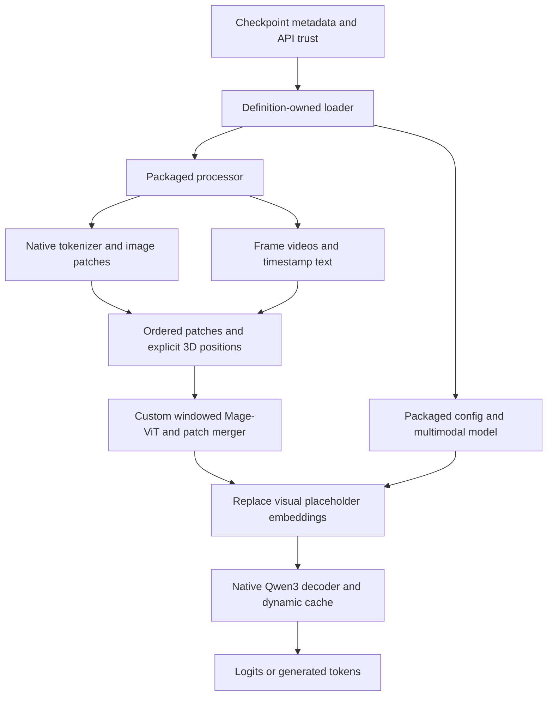
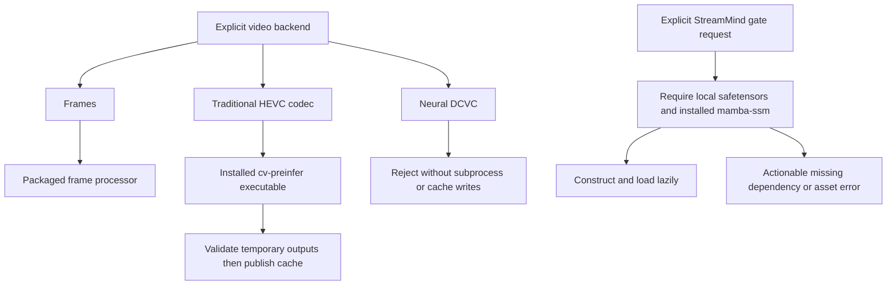

# Mage-VL local implementation

GPT-QModel owns Mage-VL's configuration, custom Mage-ViT/Qwen3 multimodal
wrapper and processor. Checkpoint `auto_map`, API `trust_remote_code` and
the security bypass cannot replace these classes. No global HF registration
or runtime checkpoint Python import is used. The text backbone is selected
from installed native Transformers configs with remote code disabled.

## Provenance and licenses

Authoritative source: [microsoft/Mage-VL at the pinned revision](https://huggingface.co/microsoft/Mage-VL/tree/d88b153285f1633a61b2f693c59c8576693af185).
Exact native `mage_vl` config and image-text model mappings were absent in
Transformers 5.23.0. Native Qwen3 alone is not the Mage-VL architecture:
the custom patch embedding, interleaved 4:6:6 temporal/height/width rotary
attention, windowed vision encoder, patch merger and outer placeholder
replacement are necessary.

The checkpoint model card declares Apache-2.0. Microsoft's linked
[Mage source repository](https://github.com/microsoft/Mage/tree/ebe8581c2b28581ee204e94685b23dc5f65b3437)
contains an MIT license. Both license texts and source attribution are
preserved in `LICENSE`, `LICENSE.MIT` and `NOTICE`. No checkpoint tensors
are shipped here.

Upstream bytes inspected before adaptation (SHA-256):

| Source | SHA-256 |
| --- | --- |
| `configuration_mage_vl.py` | `7e3da0c90726ef33da4f0362b3c71dc28650003f1cc11e061d3e99404a8bfed8` |
| `modeling_mage_vl.py` | `3fe8bb1e40fa38db4ae08da097ee1238aa4258c4d454e66fe93a44d08ab641ec` |
| `processing_mage_vl.py` | `c755ac93a161377cbe15f4d6dc30fae6460ef90e6d156d1bff7df82f3dd828cf` |
| `video_processing_mage_vl.py` | `67f28ea772c260b131983e8a90ad15948134a1baa769bfe6adbf0dd383541acb` |
| `codec_video_processing_mage_vl.py` | `f3bff7fe00f84a91d542e08561d5d819dd6a4b4192cf075858eb8c495f9e0b02` |
| `streammind_gate.py` | `5d9a9d7525aeecc0360ffd43f891ce9d2220297df5092a293a98e2fd31e9d99d` |
| `config.json` | `fd4621212569e893ce2caa110431fde73f3cc1a1d92e1b8320bb4e0cfbcad34a` |
| `model.safetensors.index.json` | `2cad26f4364750d9b0551dff11e776837b9ef822fe29e068f68d935a8e65cc54` |

## Selection and tensor flow

| Boundary | Before | Now |
| --- | --- | --- |
| Config/model | HF auto classes and required checkpoint trust | Definition-owned `LocalModelLoader` |
| Processor | Checkpoint `AutoProcessor` with trust enabled | Packaged processor, installed native tokenizer and PIL image processor |
| Video frames | Checkpoint processor | Packaged frame/timestamp/patch-position processing |
| Vision rotary buffers | Missing lazy init-only buffer owner metadata | Constructor config retained; buffers restored without checkpoint keys |
| AWQ | Inherited generic replay/fold policy | Explicit plain quantization; no scale-search/fold groups |
| Neural DCVC | Bundled Python subprocess pipeline | Explicit rejection before subprocess/cache mutation |
| StreamMind | Optional gate with remote asset fallback | Lazy installed dependency and local safetensors only |





The decoder remains at `model.language_model.layers`; the dense vision tower
remains at `model.visual`. The complete pinned checkpoint index contains
696 keys, including 36 Qwen3 decoder layers and 24 vision layers. The owned
module-tree test's independent shape inventory was checked against both
actual safetensors shard headers using bounded header reads, without trained
tensor payload downloads. State names and all shapes match exactly.

## AWQ contract

All seven decoder projections per layer remain quantizable. Norms, Q/K norms
and the vision tower are excluded from quantization. `awq_get_modules_for_scaling`
returns an empty list: vision-dependent decoder replay and folding/search
relationships are not qualified. This is intentional plain quantization,
not a claim that Qwen-shaped weights imply safe fold groups.

Three public CPU AWQ tests use real image conversations for MHA/GQA/MQA,
including attention bias, with `fallback=None`. Captured first-decoder inputs
match independently computed image-conditioned embeddings. Tests then check
all 14 packed decoder linears, untouched dense vision tensors, multimodal
inference and two exact packed-state/safetensors save/reload cycles.

## Validation

Environment: Transformers 5.23.0, Torch 2.15.0 CPU, Python 3.14.6t,
`PYTHON_GIL=0`. These are serial execution tests, not threaded qualification.

Run from the repository root with the repository environment active:

```bash
PYTHON_GIL=0 python -m pytest -q \
  tests/test_mage_vl_local_port.py \
  tests/module_tree/test_mage_vl_local_port.py \
  tests/models/test_mage_vl.py
ruff check gptqmodel/models/ports/mage_vl gptqmodel/models/definitions/mage_vl.py \
  tests/test_mage_vl_local_port.py tests/module_tree/test_mage_vl_local_port.py \
  tests/models/test_mage_vl.py
pyright --pythonpath "$(command -v python)" gptqmodel/models/ports/mage_vl
git diff --check
```

Coverage includes CPU/meta live weight owners; MHA/GQA/MQA and attention bias;
independent vision equations plus a separate native Qwen3 decoder oracle;
FP32/FP16/BF16 eager/SDPA forward, cache continuation and exact dense-state
reload; causal outputs, greedy decoding and ragged-image batch beam search;
image/frame-video prompt order and timestamp positions; NumPy/PIL frames;
processor save/reload; and six actual public-load hostile config/model/
tokenizer/image/video-processor map cases (`trust=False/True` crossed with
bypass unset/0/1). Visual count errors are repaired and retried without
advancing the text cache. Per-call frame overrides do not mutate defaults.

Pinned real tokenizer/image/video assets were also loaded offline after
download, without source-code dispatch. `Hello, 世界!` produced IDs
`[9707, 11, 220, 99489, 0]`. A nonuniform 64-square image produced 16
16-square patches and four merged tokens; two predecoded frames produced
32 patches and eight merged tokens. The real chat template and processor
save/reload outputs matched exactly. This asset check is not a trained-model
quality evaluation.

Meaningful regression evidence:

- Old definition fails package-owned loader/model/processor assertions.
- Initial copied processor fails public load on removed `min_pixels` attributes;
  the port reads the native Transformers 5 `size` dictionary.
- Lazy image AWQ fails on meta 3D rotary buffers without the owner's config;
  retaining it makes materialization, packing and inference work.
- Cache continuation without an explicit mask needs the cached length as its
  position offset; the port matches full-sequence native decoder outputs.
- A negative probe restoring unmasked optional encoder outputs fails the
  `None`/one-element-tuple contract assertion; the corrected encoder passes.
- Neural DCVC selection fails explicitly before any subprocess or cache write.
  A subprocess tripwire and successful subsequent frame processing cover it.

## Explicit boundaries

Traditional codec preprocessing requires an independently installed
`codec-video-prep`/`cv-preinfer`, `ffmpeg`, and the video metadata/decoding
dependencies. Only that allowlisted executable is invoked; no configurable
checkpoint command or bundled Python script is executed. The tests use an
explicitly synthetic executable ABI fixture for missing dependency, failed
job cleanup, repaired retry and cached replay. They do **not** qualify actual
codec output numerics. Use `video_backend="frames"` with predecoded frames
to avoid this dependency. Neural `engine="dcvc-rt"` always raises an actionable
`NotImplementedError`, even if old codec cache files exist.

Codec asset paths and cache location come from explicit `codec_config` values;
legacy `DCVC_INTRA_TAR`, `DCVC_INTER_TAR`, `ONLINE_CODEC_CACHE_DIR` and `HF_HOME`
do not choose codec behavior. The default cache is
`Path.home() / ".cache/huggingface/online_codec"`, and string `cache_root`
values from JSON/API arguments are normalized to `Path`. Metadata validation
runs before temporary-directory creation. The parent regression first fails
for environment-dependent defaults/string-path use, then passes after the
repair; it also injects metadata and subprocess failures and checks that the
same-key repaired retry and cached replay leave no temporary or partial output.

StreamMind remains optional and lazy. It requires an installed `mamba-ssm`
and its device kernels plus a local `streammind_gate.safetensors`. Missing
dependencies/assets are checked before vision execution or gate assignment;
ordinary text/image/video inference remains usable afterward. No automatic
gate asset download is attempted. Gate execution, streaming decisions and
training-time gate numerics have not been qualified.

No trained checkpoint payload, GPU, FlashAttention, real codec execution,
neural DCVC, StreamMind, multi-GPU, threaded inference, compilation, training,
fusion executor, static/offloaded/quantized cache or long-context quality claim
is made. Three tests requiring `/monster/data/model/Mage-VL` remain precise
absent-trained-checkpoint skips. The central decoder module-plan fixture is
unchanged; the fusion fixture should identify this package-owned binding
while retaining unqualified fusion status.
