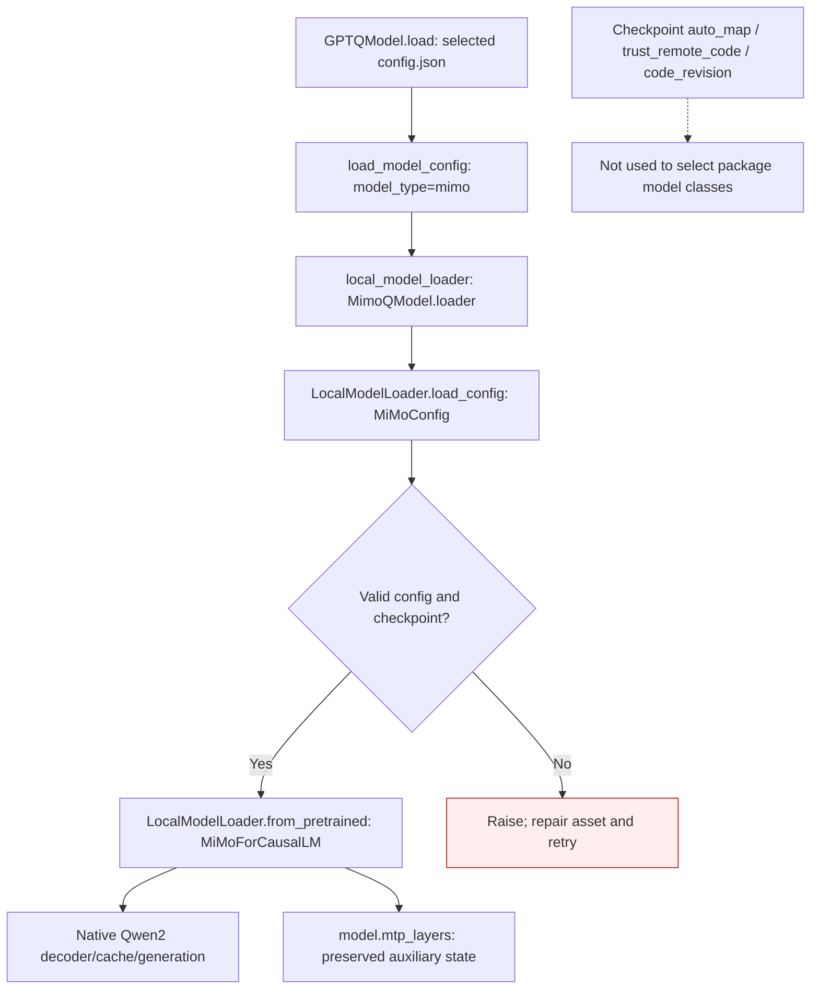
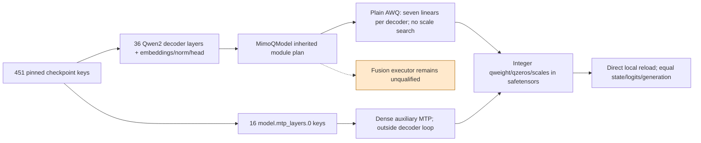

<!-- SPDX-FileCopyrightText: 2026 ModelCloud.ai -->
<!-- SPDX-License-Identifier: Apache-2.0 -->

# MiMo local model selection and auxiliary weight ownership

GPT-QModel loads `mimo` through package-owned `MiMoConfig` and
`MiMoForCausalLM`. The inspected MiMo-7B implementation extends Qwen2 with
auxiliary multi-token-prediction (MTP) weights. Its ordinary causal-LM forward
and generation use the Qwen2 decoder, without running MTP. Transformers 5.23.0
has native `mimo_v2_flash`, but no exact `mimo` config/model mapping;
MiMo-V2-Flash is a different architecture.

## Provenance and licensing

The authoritative implementation is
[XiaomiMiMo/MiMo-7B-RL](https://huggingface.co/XiaomiMiMo/MiMo-7B-RL/tree/7c7707596b0ef1032ef82970d7a4a484ca457c4d),
revision `7c7707596b0ef1032ef82970d7a4a484ca457c4d`. Its Python source was
inspected before execution; runtime imports use only this package and installed
Transformers. All five inspected variants have identical extension source and
the same set of 451 checkpoint keys. The variant metadata is retained in
`fixtures/`; no trained tensor payload was downloaded.

| Repository under XiaomiMiMo | Inspected revision | Config fixture |
| --- | --- | --- |
| MiMo-7B-RL | `7c7707596b0ef1032ef82970d7a4a484ca457c4d` | `config.json` |
| MiMo-7B-Base | `d892dcc601b8a242e7b3e7d3bb9f55abbe72c0ad` | `base_config.json` |
| MiMo-7B-SFT | `0a9f1180d99e686ce56b75fee637db62407ceb1b` | `sft_config.json` |
| MiMo-7B-RL-Zero | `da0bde6fbbc8d1cb9afad15fab947db628a22014` | `rl_zero_config.json` |
| MiMo-7B-RL-0530 | `ee8dd14ecd59a1655ebe2ede9f7a06b40a8c8c5b` | `rl_0530_config.json` |

SHA-256 of the inspected upstream files, before adaptation:

| MiMo-7B-RL asset | SHA-256 |
| --- | --- |
| `configuration_mimo.py` | `edd6493ff4a2f782f82b032b7b07c871aa79d53cbd7d382f555ac27dc695b9d0` |
| `modeling_mimo.py` | `10c39e48c2390a1ccf919d66428d003d40df83ed6322608684f119a1e07d7030` |
| `config.json` | `f4a571bdc52a5aaba9023673994c6b5d0ceb31118b6f7ea5beb8a22cee705a8e` |
| `model.safetensors.index.json` | `e794b4547dba36902eacea753e4084b85e848d8cee0f64735111ee992d0fb9bc` |
| `README.md` | `51d689bd2c68bc0bfb271ae4ca16719ee68c5b6244fce459e1ecd0ebdeb71e01` |

The pinned model card declares MIT. `LICENSE` retains that grant and Xiaomi
Corporation attribution. The official
[XiaomiMiMo/MiMo repository](https://github.com/XiaomiMiMo/MiMo/tree/5c806835bb3746808baf99c52040d6d29d58118d)
separately uses Apache-2.0; its unmodified license is retained as
`LICENSE.upstream-repository` (SHA-256
`539327f43d0a84438f006fadf77a651daa9ca29429286a46e69cb6b2594d8a4c`).
`NOTICE` explains this distinction and the ModelCloud changes. Native Qwen2
components retain their installed Transformers attribution.

## Model selection and failure paths



| Previous mechanism | Replacement |
| --- | --- |
| `definitions/mimo.py:14` at base `22bea1201` required checkpoint code. | `definitions/mimo.py:15-19` selects trusted package classes with `LocalModelLoader`. |
| Checkpoint `auto_map` offered `configuration_mimo` and `modeling_mimo`. | `models/local.py:33-48` strips trust/code-revision kwargs; imports come from definition-owned package paths. |
| Upstream `MiMoMTPLayers.forward` supplied singular `position_embedding` to Qwen2 attention. | Local `modeling_mimo.py:56-77` accepts the old auxiliary API and supplies Transformers 5 `position_embeddings`; absent rotary pairs raise. |
| Inherited Llama AWQ scaling relationships did not describe the auxiliary concatenation. | `MimoQModel.awq_get_modules_for_scaling` returns no groups; decoder linears still quantize. |

Both caller trust values and bypass unset/`0`/`1` select these same model
classes. Invalid MTP counts, corrupt config and corrupt safetensors fail; tests
repair the assets and retry successfully in the same process. No new
environment switch or global Hugging Face registration is introduced.

## Checkpoint and quantization lifecycle



The native checkpoint has 36 decoder layers, QKV bias, hidden size 4096,
32 attention heads, eight KV heads, intermediate size 11008 and vocabulary
151680. The 16 MTP tensors include four extra norm/projection owners beyond
the ordinary decoder block. They must survive loading and serialization even
though ordinary forward does not consume them. Auxiliary MTP calls require
their own cache and prepared mask/rotary inputs; sharing the decoder cache
would address the same layer index and is not a speculative-decoding API.

Plain AWQ is the explicit policy for all variants. No fold, scale search or
replay relationship is claimed. Six public tests cover MHA/GQA/MQA with both
`fallback=None` and an empty fallback map; all 14 linears in a two-layer model
become packed modules, while norms/embedding/head/MTP remain dense. Integer
state persists through inference and safetensors reload without a retained
dense inference-weight cache. Fusion remains unqualified.

## Validation

112 model-owned tests cover independent float64 attention/MLP/MTP equations,
non-unit norms and nonzero biases, exact live CPU/meta ownership for all five
config variants, MHA/GQA/MQA, MTP 0/1/2, FP32/FP16/BF16, eager/SDPA,
left padding/causality, cache continuation with a four-token chunk,
greedy/beam generation, optional full/sliding attention, tied/untied
safetensors, corruption/repair/retry, hostile config/model/tokenizer maps,
subfolder selection, and real public plain AWQ pack/inference/reload.

Red evidence: the pre-port config-selection regression failed because
`AutoConfig` required checkpoint code. The inspected old MTP implementation
failed against Transformers 5 with
`Qwen2Attention.forward() missing 1 required positional argument: 'position_embeddings'`.
The owned config-selection and MTP-equation tests pass after the changes.

Final combined run: **764 passed, 3 skipped, 8 deprecation warnings in 23.90s**
on Python 3.14.6t (`PYTHON_GIL=0`, GIL disabled), Torch 2.15.0+cpu,
Transformers 5.23.0 and released Tokenicer 0.0.17. Skips were the existing
DeciLM, EXAONE and Nanbeige AWQ replay cases whose external model fixtures are
absent. No MiMo test skipped.

```bash
PYTHON_GIL=0 /home/ubuntu/.venvs/gptqmodel-tf5/bin/python -m pytest -q -rs \
  tests/test_mimo_local_port.py tests/module_tree/test_mimo_local_port.py \
  tests/test_awq_scale_search_safety.py tests/test_awq_moe_router_scaling.py \
  tests/test_awq_empty_groups.py tests/test_awq_position_kwargs.py \
  tests/test_awq_scale_search_memory.py tests/test_bloom_awq_replay.py \
  tests/module_tree/test_awq_relationships.py tests/module_tree/test_bloom_awq_relationships.py \
  tests/module_tree/test_registered_module_plans.py tests/module_tree/test_definition_subset_ordering.py \
  tests/test_local_model_loading.py tests/test_local_model_paths.py \
  tests/test_internlm_local_port.py tests/module_tree/test_internlm_local_port.py
PATH=/home/ubuntu/.venvs/gptqmodel-tf5/bin:$PATH ./format/check.sh
/home/ubuntu/.venvs/gptqmodel-tf5/bin/python -m compileall -q gptqmodel/models/ports/mimo
git diff --check
```

Ruff 0.14.2, compileall and diff checks passed. Integration into the existing
model-port PR owns the central `docs/` reference/README link, copying these
diagrams to the PR body, and package-data inclusion for provenance/licenses.
The registered `MimoQModel/gptq` decoder plan is unchanged. The central
`fusable_models.models.mimo.reason` should become:

> Package-owned MiMo-7B Qwen2 extension with full-precision auxiliary MTP;
> fusion executor has not been qualified.

Unqualified: trained tensor payloads and quality, GPU/FlashAttention,
multi-GPU/offload, model-specific concurrent execution, compilation, training,
static/offloaded/quantized caches, dynamic-RoPE extension beyond original
context, speculative MTP decoding and fusion. The existing trained-model
support/evaluation test was not executed. No model-specific tokenizer behavior
was changed.
