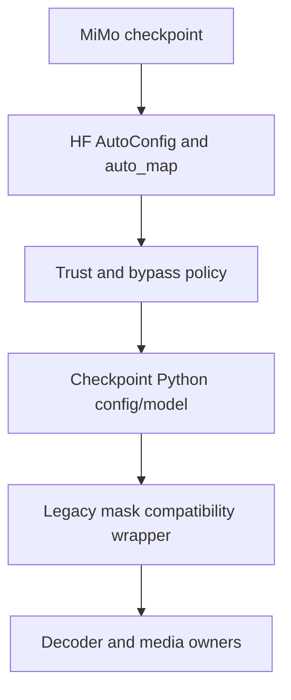
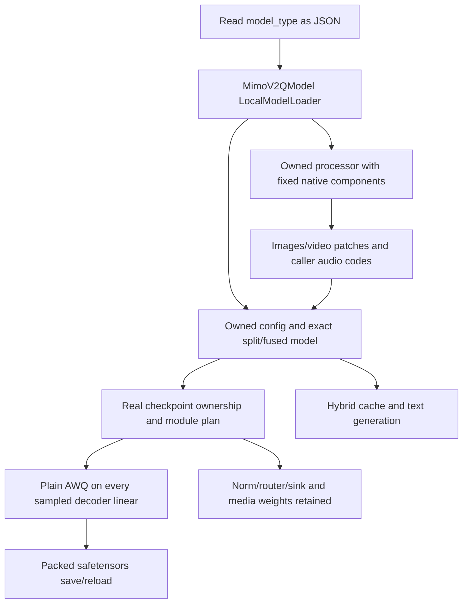

# MiMo-V2 package-owned Transformers 5 port

`MimoV2QModel` selects this exact `mimo_v2` implementation directly through
`LocalModelLoader`. Checkpoint `auto_map`, API trust and the existing security
bypass do not select config, model, tokenizer Python or processor Python.
Tokenizer normalization still belongs to Tokenicer. No global HF registration,
downloaded runtime Python, new environment switch or kernel-hub decorator is used.

Transformers 5.23 maps `mimo_v2_flash` to `MiMoV2FlashForCausalLM` but has no
`mimo_v2` config or causal-model mapping. MiMo-V2.5 Base is not that native
class: its source uses fused QKV, distinct QK/V head widths, hybrid full/SWA
attention with sinks, individually named routed experts, and vision/audio
owners. The port keeps the checkpoint's exact `model.layers.*`, `visual.*`,
`speech_embeddings.*`, `audio_encoder.*` and `lm_head.*` names. Split Q/K/V
is also preserved as a supported source layout, without redirecting the alias.
The separately inspected MiMo-V2.5-ASR checkpoint declares `model_type=qwen2`
and `MiMoV2ASRForCausalLM`; it is not an alias of this `mimo_v2` definition.

## Provenance and license

The inspected implementation is
[XiaomiMiMo/MiMo-V2.5-Base](https://huggingface.co/XiaomiMiMo/MiMo-V2.5-Base/tree/199e5d1d0113b3fa886b29da54eb276b9c54d58e),
revision `199e5d1d0113b3fa886b29da54eb276b9c54d58e`.
It was inspected as text before adaptation. The original Python files explicitly
declare Apache-2.0 and retain Xiaomi and Hugging Face copyright notices.
See LICENSE and NOTICE, including the separate upstream README's MIT statement
and the upstream audio-codec attribution.

| Pinned asset | Original SHA-256 |
| --- | --- |
| `configuration_mimo_v2.py` | `773062ac9850b908eb54751b3e4dbe00e653c0e80595599409e97d0c1af2ce3e` |
| `modeling_mimo_v2.py` | `a8c3cb3aae473bcc15f023010547c919f15eba6546e6ed7efb61a8937b12f3ad` |
| `config.json` | `425a1c96326d17e6dcff952896e64d395c194a35c8c64705a0960adee244fbc9` |
| `preprocessor_config.json` | `b269e51bdc1c53ef7c82522984378513f462869cf83c4c75ec3f98bd92aa7972` |

The test JSON fixtures contain public configs and independent checkpoint index
keys, not tensor payloads or executable checkpoint code. Each stores its source
repository, immutable revision and original index SHA-256. Inventories:

| Checkpoint | Revision | Keys | Auxiliary MTP keys |
| --- | --- | ---: | ---: |
| MiMo-V2.5-Base | `199e5d1d0113b3fa886b29da54eb276b9c54d58e` | 73,081 | 48 |
| MiMo-V2.5-Pro-Base | `69360d34da46e58af26fee63faabfb02a9118099` | 159,581 | 48 |
| MiMo-V2.6-Pro-RL | `a066ba0057192126bd5d255f37138265fc1a435e` | 160,040 | 48 |
| MiMo-V2.6-Flash-RL | `f657ba2f7d24c9adc5730675baaa2d34de878a49` | 73,081 | 48 |

Base also has 1,674 independently read safetensors header shapes from
`model_pp0_ep0_shard1.safetensors`; only the header byte ranges were fetched.
The shape fixture records the normalized header JSON SHA-256. No trained weight
payload was downloaded. Source quantization scales are checkpoint encoding
metadata, not new dense-model owners. Existing mixed-source loading owns their
decoding; the port does not claim a newly qualified trained FP8/MXFP4 pipeline.

## Adaptations and execution

| Boundary | Before | After |
| --- | --- | --- |
| Selection | HF checkpoint config/model Python, trust required | Definition-owned config/model/processor classes |
| Mask API | Legacy `input_embeds` / `cache_position` kwargs | Current `inputs_embeds` mask API |
| KV cache | Legacy cache kwargs | Transformers 5 `DynamicCache.update(key,value,layer)` |
| Sink + SDPA | SDPA can omit a mask before eager fallback | Explicit causal/SWA masks retained when sinks use eager |
| RoPE metadata | Deprecated `rope_scaling` validation | Current `rope_parameters`, legacy input accepted |
| Initialization | Direct router/sink parameters not initialized by generic HF rules | Owned initialization for tiny/missing-key models |
| Buffer lifecycle | Init-only vision/codec frequencies could be lost on reload | Explicit HF initialization and reconstructible scalar constructor attributes |
| Processor | Checkpoint processor discovery | Fixed native Qwen2-VL image/video components declared by pinned assets |

The numerical core remains the inspected Xiaomi implementation: contiguous
Q/K/V fused row blocks (not KV-interleaved packing), unequal V width, leading
partial RoPE, per-layer SWA geometry, QK scaling, value scaling, sink softmax,
sigmoid grouped `noaux_tc` routing, correction-bias selection with original
probability weighting, normalized top-k and routed coefficient, SwiGLU and
serial residuals. `model.mtp.*` remains an explicitly preserved out-of-model
checkpoint payload because the source base decoder does not instantiate MTP.

The public definition's existing checkpoint-aware omission rules remove absent
visual merger biases and unused audio-local input embeddings. The inventory
test executes these rules on real meta owners and asserts exact remaining keys;
it does not generate its oracle from the module tree. Decoder norms, router
weights/correction bias and direct attention sink bias are explicitly excluded
from quantization. Runtime RoPE buffers are nonpersistent.

The native processor expands image and video placeholder tokens and renames
native `pixel_values_videos` to MiMo `video_pixel_values`. It uses the supplied
Tokenicer-normalized tokenizer and never chooses checkpoint Python. Raw
waveform frontend processing is not claimed: callers can supply `audio_codes`
or `audio_embeds`; the package contains the source mel-to-code encoder and
an explicit local `load_audio_tokenizer()` API for separately provided weights.
Video timestamp/budget behavior beyond the native Qwen2-VL processor is not
qualified. The source model is text-generative with media inputs, not an audio
waveform decoder. Text beam search and greedy media generation are covered;
arbitrary media beam expansion is not qualified.

The pinned Base vision config and native processor both use patch size 16,
temporal patch size 2 and merge size 2; the tiny automated fixtures scale only
the spatial patch size to 2. Production patch size is read from the checkpoint's
native preprocessing assets, without an inferred architecture substitution.

### Selection before



### Selection and quantization now



## AWQ policy

Every layout explicitly returns no scaling groups. Norm outputs feed projection
branches and routing; QKV crosses unequal-width packed projections, RoPE,
masking, softmax/sinks and head repetition before `o_proj`. Expert weighting is
input-dependent and residual boundaries are not foldable affine producers.
No fold/search/replay-scaling proof has been established for those combined
consumers, so plain quantization is deliberate. It does not infer safety from
matching widths or from module order. Generic AWQ algorithms are unchanged.

Six real public AWQ cases cover split/fused QKV with dense, mixed and all-MoE
layers, `fallback=None`, actual input capture and packing, exact excluded state,
finite inference and **two** safetensors save/reload cycles. Mixed cases include
real image/video patches and grouped audio codes during capture. Tiny AWQ
fixtures route to all experts so `fallback=None` has samples for each target;
normal sparse calibration still needs representative expert coverage or the
existing configured missing-sample fallback. No scaling/folding/search or
fusion qualification is claimed.

## Validation

Run in the isolated environment with Python 3.14t/GIL disabled, Transformers
5.23.0 and CPU Torch 2.15.0:

```bash
PYTHON_GIL=0 /home/ubuntu/.venvs/gptqmodel-tf5/bin/python -m pytest -q \
  tests/test_mimo_v2_local_port.py tests/module_tree/test_mimo_v2_local_port.py
ruff check gptqmodel/models/ports/mimo_v2 gptqmodel/models/definitions/mimo_v2.py \
  tests/test_mimo_v2_local_port.py tests/module_tree/test_mimo_v2_local_port.py \
  tests/models/test_mimo_v2.py
git diff --check
```

Coverage includes hostile config/model/tokenizer/processor maps for both trust
values and bypass unset/0/1; real CPU/meta construction; complete source-index
ownership and sampled real tensor shapes; split/fused MHA/GQA/MQA with biases;
independent float64 decoder/router and segmented vision-attention equations;
FP32/FP16/BF16 eager/SDPA cache continuation (one and four tokens), causality,
greedy text/media generation, text beam search, exact state/logit safetensors
roundtrips; image/frame-video processing and processor roundtrip; native Qwen2
audio-local-transformer comparison, grouped-code padding, mel-codec/codebook
and safetensors checks; malformed assets/modal counts/weights then repaired
retry; hybrid replay after rotary offload; actual public plain AWQ.

Observed regressions before the repairs: original public load failed requiring
checkpoint Python; unadapted masks raised `unexpected keyword cache_position`;
sink SDPA continuation disagreed by 0.01246 in FP32 because prefill lacked an
explicit causal mask; vision rotary differed by 1.0 after pretrained reload
and changed image-conditioned logits until init-only frequencies were restored.
The corresponding permanent tests pass with those owner fixes.

No trained checkpoint payload/quality/perplexity, GPU, FlashAttention, fused
kernels, multi-GPU, threading/concurrency, compilation, training, long-context
dynamic-RoPE parity, speculative MTP decoding, static/offloaded/quantized cache,
fusion executor, raw-waveform frontend or arbitrary media beam qualification
is claimed. The existing `/monster` trained-model acceptance remains for a
machine with that checkpoint and suitable hardware.
