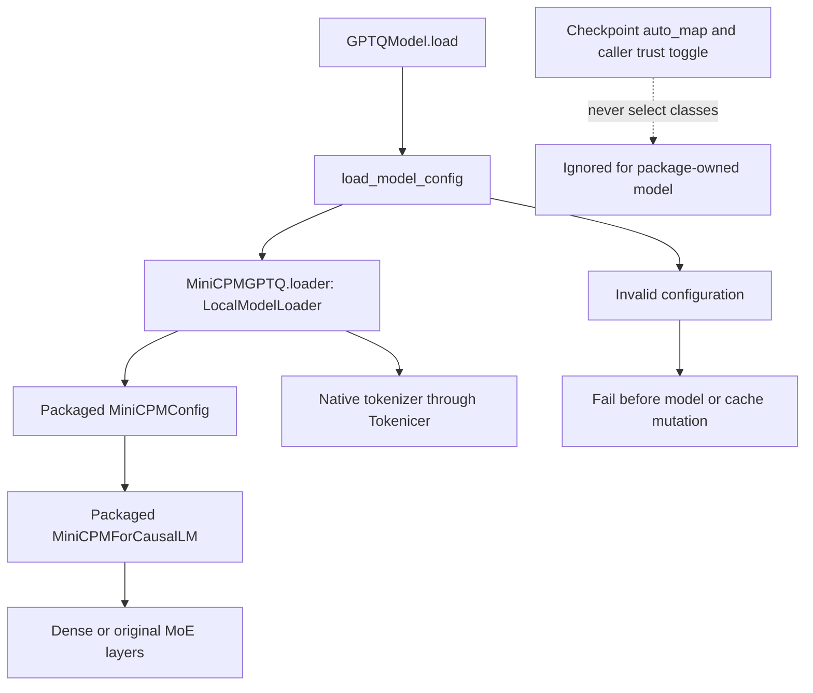
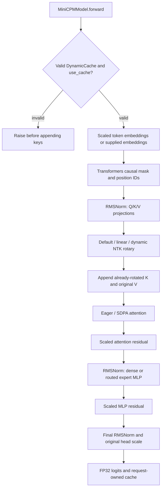

# Original MiniCPM on Transformers 5

GPT-QModel selects its own original MiniCPM config and decoder directly. This
is **not** the native MiniCPM3 architecture. Transformers 5.23.0 has no original
`minicpm` config or causal-LM mapping. The port preserves dense 1B/2B, SFT/DPO,
128k dynamic-NTK and original 8x2B MoE checkpoint layouts without checkpoint
Python, global AutoClass registration or runtime source downloads.

## Source and redistribution

The inspected OpenBMB sources are immutable revisions listed below. Exact
source/config/model-card SHA-256 digests, original configs, and archive-header
digests are in `source_manifest.json`. No checkpoint Python was executed to
discover the implementation, and no trained tensor payload is redistributed.

| OpenBMB checkpoint | Revision | Independent released-key inventory |
| --- | --- | --- |
| MiniCPM-2B-128k | `6011acb51acf3e8c0cb10c428d7064dc39431720` | 363 keys |
| MiniCPM-2B-dpo-bf16 | `9d6de77274c9f364037bf8506b4a831d3520ae79` | 362 keys |
| MiniCPM-1B-sft-bf16 | `85252935bfc9acb3ee93dcea4b793fb87a0b43e8` | 470 keys |
| MiniCPM-MoE-8x2B | `7495286593bc56a524a42e26eeaee5e185cb7f9c` | 1,242 keys |
| MiniCPM-2B-dpo-fp32 | `22f2b49d6425e1528548fe5c6c2ee379b80ff0ac` | Same dense topology; config/source inspected |
| MiniCPM-2B-sft-bf16 | `4ec16344ac13e6ef5010aeecaa533369ac8eb53c` | Same dense topology; config/source inspected |
| MiniCPM-2B-sft-fp32 | `bff9bcef7649d3442482110632b11e36a1fbda4d` | Same dense topology; config/source inspected |

Source URL pattern:
`https://huggingface.co/openbmb/<checkpoint>/tree/<revision>`.
All seven configurations are meta-instantiated against the independent
inventories. The four inventories (2,437 released entries, shapes and storage
dtypes) were read from ZIP/pickle **metadata**, not generated from this port.
They are compressed as JSON, not executable pickle. Tied checkpoints omit the
duplicate `lm_head.weight`; tests explicitly restore that alias when comparing
the complete model state dict.

The code is derived from Apache-2.0 OpenBMB modeling/configuration files, with
EleutherAI, Hugging Face and original RoPE attribution preserved in `NOTICE`.
`LICENSE` is the byte-preserved OpenBMB Apache-2.0 license fetched at
[`f4293a1a7bde05d1acce99488235792615fc241b`](https://github.com/OpenBMB/MiniCPM/tree/f4293a1a7bde05d1acce99488235792615fc241b).
The model cards separately require the OpenBMB General Model License for
**trained weights**. This port does not relicense or redistribute those weights.

## Definition-owned loading



| Mechanism | Before | Now |
| --- | --- | --- |
| Model selection | Checkpoint `auto_map` could request legacy Python | Fixed package classes from the definition |
| Cache/generation | Legacy usable-length/`seen_tokens` assumptions | Transformers 5 `DynamicCache` and `GenerationMixin` |
| Dense/MoE tree | Dense-only declaration | Request-local dense or `w1/w3/w2` expert tree; router excluded |
| RoPE lifetime | Mutable model-wide cached frequency tables | Request-local frequency construction; no cross-request residue |
| AWQ | No original-MiniCPM folding qualification | Explicit empty scaling groups; supported projections still plain-quantize |

The shared loader strips remote-code options; the shared tokenizer policy also
denies checkpoint Python for package-owned definitions, including when the
caller enables both trust and the security bypass. There is no model-local
tokenizer correction or new environment switch. Invalid configs fail closed.

## Equations, ownership and cache contract

Dense keys retain `model.embed_tokens`, `model.layers.<n>.self_attn.*`, both
layer norms, `mlp.gate_proj/up_proj/down_proj`, `model.norm` and `lm_head`.
MoE instead retains `mlp.gate` and `mlp.experts.<n>.w1/w3/w2`; the learned
router stays dense. The definition uses `W1W3W2MoELifecycleHooks` and tags the
expert gate/up/down roles. The class-level dense tree is never mutated.

Embeddings are multiplied by `scale_emb`; both residual branches use
`scale_depth / sqrt(num_hidden_layers)`. The ordinary output head consumes
`hidden / (hidden_size / dim_model_base)`. The unusual original
`pretraining_tp > 1` branch deliberately omits that last scale and, in eager
attention, omits projection biases while splitting linear operations.
Inputs supplied as `inputs_embeds` are already scaled, matching the source.

RMSNorm computes its variance in FP32. Original eager attention rotates Q/K
in FP32 using FP32 trig; original SDPA uses V-dtype trig before the FP32
rotation. Stateless FP32 frequency construction avoids narrowing persistent
buffers during dtype conversion. MHA/GQA/MQA use the original repeated-KV
mapping. Dense and MoE expert activations use the configured activation.
MoE computes FP32 router softmax, normalized top-k weights and expert sums;
its original auxiliary balancing gradient is retained but training is not
qualified.



Dynamic NTK uses the **current** sequence length and retains already-rotated
historical keys, matching the source's incremental equations; full-prefill
and incremental logits are not asserted identical after changing NTK base.
A fresh short request returns to the original base rather than inheriting a
previous request's long-context frequencies. Cache reuse assumes the caller
keeps the same model, batch and position semantics. Legacy tuple, static and
offloaded caches are rejected. Speculative crop/rollback is not qualified.

## AWQ policy

`awq_get_modules_for_scaling()` returns `[]`: original MiniCPM scaled residuals
and sparse expert consumers have not been qualified for scale search/folding.
No shared AWQ algorithm is changed. A disabled scaling optimization is not a
disabled quantizer: public CPU tests quantize all seven dense decoder linears
or all thirteen tiny-MoE linears. Norms, embeddings, router and head stay dense.
Eight actual public pack/infer/two-save-reload cases cross dense/MoE,
`fallback=None`/plain, and ordinary/all-expert calibration routing; all-expert
overrides restore the original top-k before inference. AWQ qualification is
for `pretraining_tp=1`; split-TP quantized execution is not qualified.

## Qualification and reproducibility

Environment: Python 3.14.6t, `PYTHON_GIL=0`, Transformers 5.23.0, CPU Torch
2.15.0 and released Tokenicer 0.0.17. The earlier Tokenicer 0.0.14 run also
passed the then-current 104-case suite; final qualification uses 0.0.17.

```bash
PYTHON_GIL=0 /home/ubuntu/.venvs/gptqmodel-tf5/bin/python -s -m pytest -q \
  tests/test_minicpm_local_port.py \
  tests/module_tree/test_minicpm_local_port.py
```

Owned suites: **129 passed, no skips, 9.11s**. These execute independent
functional dense/MoE attention/residual/RoPE equations; FP32 SDPA is also
checked against explicit eager equations. Low-precision SDPA is checked with
an independently assembled mask/head mapping around the native SDPA operator,
not by loosening the eager-versus-SDPA error bound. Exact first-layer
FP16/BF16 eager rotary keys detect premature trig narrowing. Other checks
include hostile config/model/tokenizer maps with every trust/bypass setting,
FP32/FP16/BF16 eager/SDPA cache continuation, causality, greedy/beam generation,
dynamic-NTK context crossing, tied/untied safetensors round trips, failed
safetensors repair/retry and all live module-plan owners.

Combined checks (same interpreter/prefix):

```bash
python -s -m pytest -q \
  tests/test_minicpm_local_port.py tests/module_tree/test_minicpm_local_port.py \
  tests/test_local_model_loading.py tests/test_local_tokenizer_loading.py \
  tests/test_local_processor_loading.py tests/test_hf_config_compat.py \
  tests/test_local_model_paths.py tests/test_internlm_local_port.py \
  tests/module_tree/test_internlm_local_port.py tests/test_awq_scaling_groups.py \
  tests/test_awq_empty_groups.py tests/module_tree/test_registered_module_plans.py \
  tests/module_tree/test_fusable_models.py tests/module_tree/test_definition_subset_ordering.py
PATH=/home/ubuntu/.venvs/gptqmodel-tf5/bin:$PATH format/check.sh
git diff --check
```

Combined result: **935 passed, 475 existing skips, 10 warnings, 30.71s**.
The skips are 468 NVIDIA/CUDA Marlin numerical-fusion cases plus seven
existing optional dependency/checkpoint/definition fixture cases. The full
repository Ruff 0.14.2 gate and changed-path Ruff/diff checks pass.

### Deliberate red/green probes

| Injected defect | Executed regression | Observed red |
| --- | --- | --- |
| Narrow eager trig to V dtype | `test_eager_fp32_rotary_trig_reaches_first_layer_cache_without_narrowing` | Both FP16/BF16 cases fail exact K checks; BF16 max difference 0.0078125 |
| Omit residual depth normalization | Dense MQA independent-equation case | 640/640 logits differ; max absolute error 0.22019887 |
| Read `DynamicCache.seen_tokens` | Eager FP32 cache/generation lifecycle case | Trap raises `legacy seen_tokens cache API was read` |

All mutations were removed before the green combined run. These are detection
probes, not alternative runtime modes or claims of a trained-checkpoint run.

## Integration and limits

### Required shared follow-ups discovered with real assets

The core green counts above precede thirteen additional integration
regressions. These expose two shared preconditions, not modeling failures:

1. All seven original source configs omit `model_type` and identify
   `MiniCPMForCausalLM` via `architectures`. The shared config/trust preflight
   must infer a package-owned definition from exact allowlisted architecture
   metadata **only when the model type is absent**. Filename guessing or a
   native MiniCPM3 substitution is not valid. Twelve owned public regressions
   cover dense/MoE, caller trust and bypass settings with malicious auto maps.
2. Released Tokenicer 0.0.17 defaults `fix_mistral_regex=True`. Transformers
   rereads the old config without `model_type`, mistakes the 122k-vocabulary
   SentencePiece-style BPE for Mistral, and changes correct token IDs. For
   `Hello GPT-QModel! 你好，世界。`, pinned 128k raw/native IDs are
   `[21045, 1527, 7809, 63, 95544, 3709, 73, 95320, 23523, 65, 2925, 66]`;
   Tokenicer instead produces 27 IDs. A self-contained 100,001-token synthetic
   BPE regression reproduces this without downloading assets. Corrective
   normalization must be fixed upstream in Tokenicer, **not** in this port.

Until both shared follow-ups are integrated and the added regressions are
green, this port is not ready for default loading of the original checkpoints.
No per-model tokenizer flag, wrapper or normalization shim is included.

The dense `MiniCPMGPTQ/gptq` registered-plan fixture is unchanged. The owned
module-tree suite independently checks the request-local MoE variant. Central
fusion metadata should replace `models.minicpm.reason` with:

> Package-owned original MiniCPM scaled decoder and w1/w3/w2 MoE; fusion executor has not been qualified.

The parent integration owns central docs/README/PR diagrams and package-data
inclusion of the license, notice, source manifest and compressed JSON fixture.
The local package adds no dependency. No separate PR, merge or PR-state change
is needed.

Not qualified: trained tensor payloads or quality/evaluation, actual 128k
context execution, GPU/FlashAttention/fused kernels, fusion execution,
multi-GPU/device offload, concurrent model execution, compilation, training,
static/offloaded/quantized/foreign caches or speculative rollback. Existing
trained-checkpoint tests under `tests/models/test_minicpm.py` require absent
`/monster` checkpoints and CUDA and were not run. The free-threaded CPU run
is not a claim that concurrent PyTorch model calls are safe.
