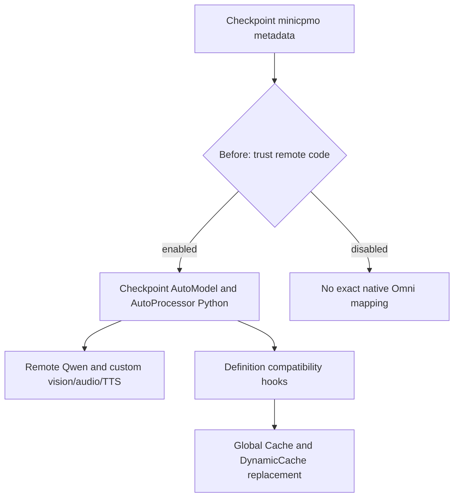
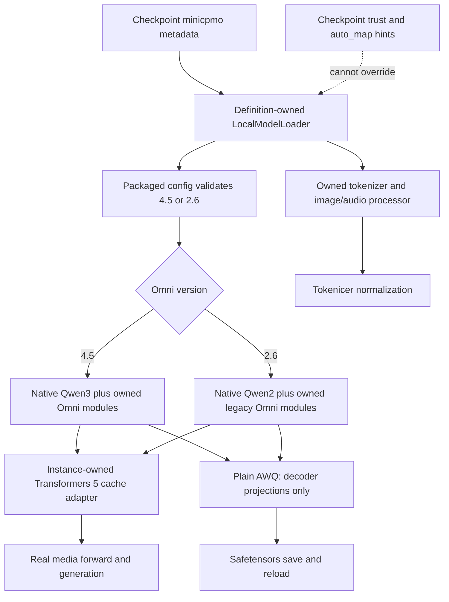

# MiniCPM-o local Transformers 5 port

**Integration hold:** the inherited TTS code has a historical ChatTTS
licensing boundary that has not been cleared. Functional qualification is
not permission to integrate or redistribute this as Apache-only code.
See [NOTICE](NOTICE) and [third-party evidence](third_party_provenance.json).

This GPT-QModel port owns the exact `minicpmo` Omni architecture, not the
unrelated native MiniCPM-V-4.6 architecture. Transformers 5.23.0 has no
native `minicpmo` config/model mapping.

| Snapshot | Language decoder | Preserved Omni owners | Pinned inventory |
| --- | --- | --- | --- |
| [4.5](https://huggingface.co/openbmb/MiniCPM-o-4_5/tree/fb09628e98b1f55d8d5b863e0eccfcdd11bff499) | Native Qwen3 | NaViT SigLIP, resampler, Whisper, projection, MiniCPMTTS | 1,414 keys/shapes |
| [2.6](https://huggingface.co/openbmb/MiniCPM-o-2_6/tree/cf0b69a6118cd3b2c90bb37f3f4366e2fba802ab) | Native Qwen2 | NaViT SigLIP, resampler, Whisper, projection, ConditionalChatTTS/DVAE | 1,599 keys/shapes |

The complete inventories were independently read from all eight released
safetensors shard headers using byte-range requests. No trained tensor
payloads were downloaded. Tests instantiate the actual complete released
architectures on meta and require exact key/shape equality, including the
TTS owners. The configs, inventories, source SHA-256 values and header
hashes are included beside this document.

## Ownership and loading

`MiniCPMOQModel.loader` selects the packaged config, model, tokenizer and
processor through `LocalModelLoader`. There is no global Auto registry
registration and no global Transformers cache monkeypatch. Both API trust
values and all tested bypass settings leave the package-owned selection
unchanged. Tokenicer normalizes the owned tokenizer once through the shared
loader; the port adds no corrective tokenizer normalization.





| Behavior | Before | Local port |
| --- | --- | --- |
| Runtime ownership | Checkpoint Python | Packaged config/model/processor/tokenizer |
| Trust/bypass | Could select remote implementation | Cannot replace local ownership |
| Decoder | Legacy Qwen source assumptions | Exact native Qwen3/Qwen2 owners |
| Cache | Global legacy replacements | Instance-owned TF5 DynamicCache adapter |
| 2.6 media tags | Shared 4.5-style placeholders | Version-specific parenthesized tags |
| Serialization | Unqualified derived buffers | Deterministic resampler and FSQ reconstruction |
| AWQ | Generic inherited folding assumptions | Explicit plain quantization, no scaling groups |
| TTS licensing | Inherited Apache header only | Historical third-party boundary disclosed; integration held |

## Adaptations and evidence

- Preserve `llm.*`, `vpm.*`, `resampler.*`, `apm.*`,
  `audio_projection_layer.*` and `tts.*` checkpoint names.
- Construct nested TTS Llama using its own 32,000-entry vocabulary,
  not the outer Qwen vocabulary.
- Convert only instance cache representations; never mutate
  `transformers.cache_utils.Cache` or `DynamicCache`.
- Use local relative imports, including processor setup in chat/duplex helpers.
  Optional external codec/audio dependencies are imported only on demand.
- Rebuild deterministic nonpersistent resampler positions after materialization.
  FSQ layers retain constructor levels so LazyTurtle can rebuild their
  nonpersistent buffers after offload; shared loading code is unchanged.
- Preserve original OpenBMB/Google/Hugging Face headers and borrowed-code
  comments. No clean-room or relicensing claim is made.

### CPU qualification

Validated with Python 3.14.6t, `PYTHON_GIL=0`, Torch 2.15.0+cpu,
Transformers 5.23.0, released Tokenicer 0.0.17, safetensors 0.8.0,
vector-quantize-pytorch 1.27.15 and einops 0.8.1.
Tokenicer 0.0.14 also passed the earlier 81-case owned run.

The final owned suite passed **83 tests, no skips**, in 17.39 seconds:

- Actual public package-owned loading with hostile config/tokenizer/image/audio
  processor maps; trust false/true and bypass unset/`0`/`1`.
- MHA/GQA/MQA and bias/no-bias decoder layouts for both versions.
- Native decoder numerical oracle, eager/SDPA, cache 2+4 continuation,
  greedy and beam generation.
- Independent float64 equations for NaViT vision, Whisper audio and
  resampler attention in FP32/FP16/BF16.
- Real image/audio/mixed-media conditioning and generation; image/audio
  chat using chunk attention, version-specific processor syntax.
- Media safetensors round trips in all three floating dtypes; exact state
  and logits; native TTS Llama 1+3 cache continuation and serialization.
- Invalid config, malformed processor metadata and wrong-shaped tensor
  failure followed by repaired public-load retry.
- Four actual public plain-AWQ image-calibration runs: both versions,
  offload false/true, `fallback=None`, 14 packed decoder linears,
  independent image-expanded first-decoder-input comparison, exact dense
  exclusions, inference and two exact safetensors save/reload cycles.

The combined owned/local-loader/processor/tokenizer/trust/InternLM/registry/
fusion-admission/AWQ-scaling run passed **875 tests**, with **473 skips**,
in 39.29 seconds. The proposed MiniCPM-o registry/fusion entries were
substituted in memory for this check; no parent-owned fixture was edited.
The skips are 468 NVIDIA CUDA/Marlin numerical cases, three absent Pangu
fixtures, and the two non-buildable `opt350`/`muse_glimmer` fixture families;
none are owned MiniCPM-o tests. The unrelated trained
`test_quant_trust_remote.py` requires absent
`/monster/data/model/MiniCPM-2B-dpo-bf16`; it could not run locally.

Pinned real checkpoint tokenizer/preprocessor assets were also checked
offline for both releases, outside the tiny fixture suite: IDs for Latin,
CJK and media/control tokens match direct raw `tokenizers.Tokenizer`
results, and real image/audio inputs survive processor save/reload exactly.
Those large tokenizer assets are not committed.

### Red/green checks

1. Original definition selected `AutoModel`, failing the owned-loader
   regression; the direct definition binding makes it pass.
2. A nonzero resampler query exposed uninitialized derived positions after
   safetensors reload: 6,144/11,776 differing logits, maximum absolute error
   0.28322792. Rebuilding deterministic positions makes all 18 media/dtype/
   version cases exact after reload.
3. 2.6 public AWQ with TTS and offload left all four FSQ codebook owners on
   meta. Retaining constructor levels fixes restoration; all four AWQ
   version/offload combinations now pass without shared loader edits.

## Reproduction

From the repository root:

```sh
PATH=/home/ubuntu/.venvs/gptqmodel-tf5/bin:$PATH ./format/check.sh
/home/ubuntu/.venvs/gptqmodel-tf5/bin/python -m compileall -q \
  gptqmodel/models/ports/minicpm_o \
  gptqmodel/models/definitions/minicpm_o.py \
  tests/test_minicpm_o_local_port.py \
  tests/module_tree/test_minicpm_o_local_port.py
git diff --check
```

From `tests/`:

```sh
PYTHON_GIL=0 /home/ubuntu/.venvs/gptqmodel-tf5/bin/python -m pytest \
  test_minicpm_o_local_port.py module_tree/test_minicpm_o_local_port.py \
  -xq --disable-warnings
```

To reproduce the combined run without editing parent-owned fixtures,
also from `tests/`:

```sh
PYTHON_GIL=0 /home/ubuntu/.venvs/gptqmodel-tf5/bin/python - <<'PY'
import json
import sys
from pathlib import Path
import pytest

sys.path.insert(0, str(Path("..").resolve()))
import tests.conftest
from tests.module_tree import test_registered_module_plans as plans
from tests.module_tree import test_fusable_models as fusion

proposal = json.loads(Path(
    "../gptqmodel/models/ports/minicpm_o/central_fixture_proposals.json"
).read_text())
plans.INVENTORY["cases"].update(proposal["registered_module_plans"]["cases"])
fusion.INVENTORY.update(proposal["fusable_models"]["models"])
sys.exit(pytest.main([
    "test_minicpm_o_local_port.py",
    "module_tree/test_minicpm_o_local_port.py",
    "test_local_model_loading.py",
    "test_local_processor_loading.py",
    "test_local_tokenizer_loading.py",
    "test_trust_remote_code_isolation.py",
    "test_internlm_local_port.py",
    "module_tree/test_registered_module_plans.py",
    "module_tree/test_fusable_models.py",
    "test_awq_scaling_groups.py",
    "-xq", "-rs", "--disable-warnings",
]))
PY
```

Full Ruff 0.14.2, compileall and diff checks pass.
Port-wide default Pyright was also run: **826 errors and 7 warnings**,
including inherited dynamic module/output typing and missing optional
codec/audio imports. The port is **not type-check clean**.

## AWQ and parent integration

No source/consumer folding, scale search or Omni replay safety is claimed.
`awq_get_modules_for_scaling` deliberately returns `[]`. Real quantization,
packing and inference are tested through the public API with `fallback=None`.
Only the seven decoder projections per layer are quantized; Q/K norms,
vision, audio, resampler and TTS remain dense. Fusion is not admitted.

If the licensing hold is cleared, the parent should apply
`central_fixture_proposals.json`: add the Q/K norm exclusions in the
registered plan and update the non-admission reason. The parent also owns
central documentation, main README, packaging of license/provenance files,
and declaration of the legacy `vector-quantize-pytorch>=1.27.15` dependency
(validated with einops 0.8.1). No shared file is modified by this unit.

## Unqualified boundaries

No trained weight payload, output quality, GPU, FlashAttention, fused kernel,
multi-GPU, compile, training, long-context or concurrent model execution was
qualified. GIL=0 CPU tests are not evidence of threaded PyTorch safety.

Text/image/audio forward and text generation are qualified, not complete
streaming duplex behavior or speech waveform generation. TTS state owners
and native Llama continuation are tested; neural codecs, StepAudio2,
BigVGAN, 2.6 Vocos assets and DVAE codec numerics are not qualified.
Legacy Vocos loading and container video decoding fail explicitly rather
than importing unowned checkpoint helpers. Decoded PIL frames/waveform
arrays may be supplied where supported; arbitrary container decoding,
foreign/static/offloaded/quantized caches and arbitrary media beam
expansion have no qualification claim.

The trained `tests/models/test_minicpm_o_4_5.py` now requests
`trust_remote_code=False` and retains its real image-chat test when the
checkpoint exists; absence of that payload is an explicit skip.
