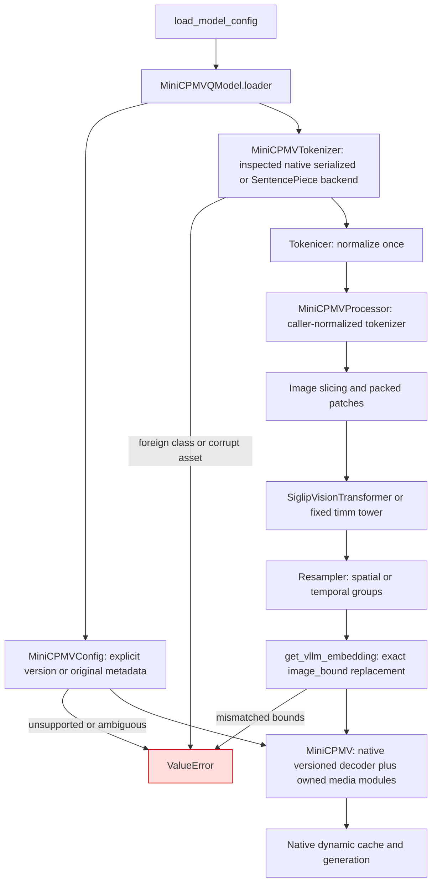
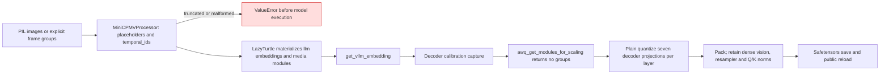
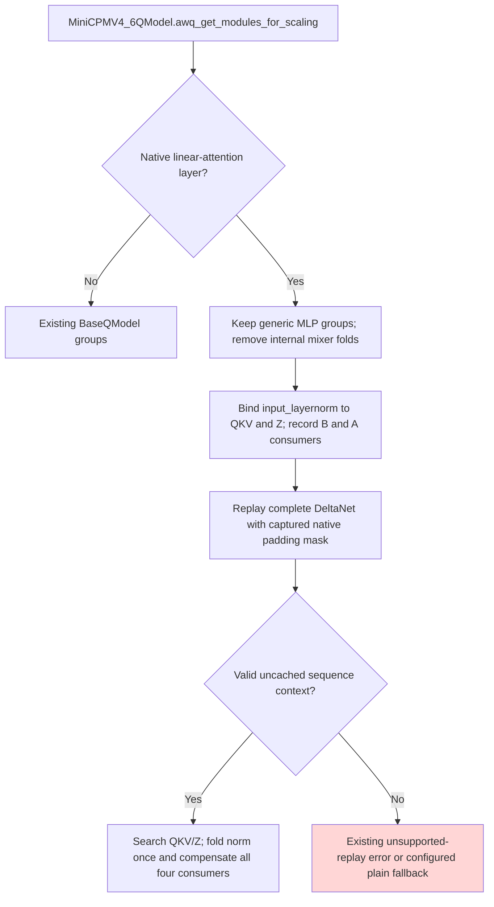

# Legacy MiniCPM-V local loading

GPT-QModel binds `minicpmv` directly to this package through
`MiniCPMVQModel.loader`. Transformers 5.23.0 has no exact `minicpmv` mapping.
Its native `minicpmv4_6` is a different wrapper and remains separate.

## Architecture and provenance

| Version | Decoder | Vision and resampler |
| --- | --- | --- |
| Original 1.0 | MiniCPM muP scaling over native Llama primitives | Fixed timm SigLIP, square-query spatial positions |
| 2.0 | MiniCPM muP scaling over native Llama primitives | Same timm SigLIP, image slicing and spatial resampling |
| Llama3 2.5 | Native Llama | NaViT SigLIP with packed patches, adaptive spatial resampler |
| 2.6 | Native Qwen2 | NaViT SigLIP, adaptive spatial resampler |
| 4.0 | Native Llama | NaViT SigLIP, adaptive spatial resampler |
| 4.5 | Native Qwen3 including Q/K norms | NaViT SigLIP, temporal-group-aware spatial/temporal resampler |

All native decoder classes are library imports; custom wrapper, vision,
MiniCPM scaling, resampler and media behavior are package-owned. Parameter
prefixes remain `llm.*`, `vpm.*`, and `resampler.*`. The original scaling is
`embedding * scale_emb`, each attention/MLP residual times
`scale_depth / sqrt(num_hidden_layers)`, and final hidden states divided by
`hidden_size / dim_model_base` before the LM head. Resampler position tables
are invocation-local, including the 4.5 temporal indices, rather than a
mutable shared 72,000-entry temporal cache.

`PROVENANCE.json` records exact upstream commits and SHA-256 hashes of every
inspected modeling/configuration/processor/tokenizer source. Source URLs are
`https://huggingface.co/<repo>/resolve/<revision>/<filename>` using those fields.
OpenBMB's complete Apache-2.0 license and attribution are preserved here.
The primary `openbmb/MiniCPM-V-2_6` endpoint returned HTTP 401; the authoritative
`openbmb/MiniCPM-V-2_6-int4` revision provides inspected architecture source.
Its bitsandbytes tensor payload has not been loaded or qualified.

`checkpoint_inventory.json` independently pins all 3,719 actual key/shape
pairs across original MiniCPM-V, V-2, Llama3-V-2.5, V-4 and V-4.5, taken from
pinned safetensors index/header metadata. Real full-size meta constructors
must match each inventory exactly. This checks complete checkpoint ownership
without downloading multi-GB trained tensor payloads.

Native `SiglipVisionConfig` is only the configuration container. Its stored
fields match the inspected custom configuration (`hidden_size`, patch/image
sizes, attention/layer counts, MLP width, activation, norm epsilon and channels).
The NaViT model and position assignment are implemented here; native standard
SigLIP modeling is never substituted. The two original variants lazily import
`timm>=1.0.22` for the fixed inspected `vit_so400m_patch14_siglip_384.webli`
tower with `pretrained=False`; no dynamic encoder name or weight download is
allowed. Original SentencePiece tokenizer assets need `sentencepiece`.

## Resolution and media lifecycle

Before this port, `minicpmv.py` selected `AutoModel` and `AutoProcessor`,
required remote trust, and removed MiniCPM-V from Transformers' incompatible
tokenizer class set. These paths now use `LocalModelLoader`; the global
tokenizer mutation is removed.



The tokenizer binding selects the actual native asset implementation for
the inspected wrappers, whose custom tokenizer classes only add marker
aliases. The processor uses exact marker strings; it does not need those
aliases. No tokenizer recovery/normalization or chat-template rewrite is
implemented here. Outer Tokenicer remains responsible for normalization.
Checkpoint `auto_map`, processor class maps, trust and code revision never
choose Python classes, with either trust value or bypass setting.



| Mechanism | Before | After |
| --- | --- | --- |
| Definition `loader` | `AutoModel` plus remote trust | Explicit package config/model/processor/tokenizer |
| `load_processor` | Checkpoint `AutoProcessor` discovery | Package-owned processor with normalized tokenizer |
| Tokenizer compatibility | Global incompatible-class set mutation | Exact inspected local wrapper binding |
| AWQ scaling | Inferred generic groups | Conservative explicit empty groups |
| Q/K norm ownership | Undeclared on Qwen3 4.5 | Explicit excluded `q_norm:!`, `k_norm:!` |
| Temporal positions | Shared growing source cache | Invocation-local deterministic sine positions |

## Validation and failure evidence

Tests run with Python 3.14.6t, GIL disabled, Torch 2.15.0 CPU and Transformers
5.23.0. No worker-thread PyTorch execution is claimed.

```sh
PYTHON_GIL=0 /home/ubuntu/.venvs/gptqmodel-tf5/bin/python -m pytest \
  tests/test_minicpmv_local_port.py \
  tests/module_tree/test_minicpmv_local_port.py -q --tb=short
ruff check gptqmodel docs/eora tests setup.py
git diff --check
```

Coverage includes real CPU/meta MHA/GQA/MQA and bias variants; complete
checkpoint inventories; independent float64 vision, patch-position,
spatial/temporal resampler and MiniCPM decoder equations; nonconstant PIL
images; eager/SDPA FP32/FP16/BF16 cache continuation, greedy/beam generation
and exact safetensors round trips; frame-video/chat; hostile config/model/
tokenizer/image-processor/processor maps with trust false/true and bypass
unset/0/1; malformed asset and media failure/repair/retry; and subfolders.

The complete owned suites pass 171 cases without skips. The broader loader,
processor, paths, AWQ CPU/scaling, registry and fusion-admission run passes
902 cases with the proposed two-entry registry fixture applied only in
memory (before the final 30 extra hostile-layout cases were added).
Its 473 skips are 468 NVIDIA Marlin hardware cases, three absent PanGu
checkpoint cases, and two native causal-model fixture exclusions (opt350
and muse_glimmer). Without the proposed fixture it has one expected
MiniCPM-V registry mismatch; all other 901 cases pass. Central fixtures
remain unmodified. The full pinned Ruff 0.14.2 gate, compileall,
setuptools package discovery, Mermaid fences and diff whitespace checks pass.

Twelve actual public image-calibrated plain-AWQ cases cover six versions
times offload false/true with `fallback=None`: quantize, pack seven decoder
projections, infer, save/reload twice, and compare every packed/dense tensor
and logits exactly. This policy qualifies plain quantization only. It makes
no fold/search/replay or fusion claim. Dense vision/resampler/QK norms remain
unchanged. Trained 4.5 tokenizer/image assets were manually round-tripped:
`hello world 中文` produces `[14990, 1879, 72858, 16744]`; the single-image
64-query prompt has bounds `[6,70]`. Real V-2 SentencePiece assets were also
loaded and verified to insert exactly one BOS, preserving source behavior.

The initial malicious-config regression failed because checkpoint `AutoConfig`
required remote dispatch; direct ownership makes it pass. Eager half/BF16
image execution originally failed with FP32/half resampler positional matmul;
casting positions to the query/input dtype repairs it. The independent
original MiniCPM oracle pins all three muP scaling factors. A deliberately
incorrect residual gain (`gain=1`) makes all six MHA/GQA/MQA and bias oracle
cases fail; the intact implementation passes all six. Real SentencePiece
assets detected a duplicate BOS in the first processor adaptation; the port
now follows the inspected original `add_bos_token` branch. Truncation that
removes every image marker now fails before inference and retries successfully
with the intact prompt. Explicit attention policy is passed through config
construction so eager save/reload requests retain eager execution.

## Integration and limits

The integrator owns central docs/README/PR diagrams and license package-data
inclusion. No central fixtures are edited by this unit. Required changes:

- `registered_module_plans.json`: append `self_attn.q_norm:!` and
  `self_attn.k_norm:!` to `cases["MiniCPMVQModel/gptq"].blocks[1]`.
- `fusable_models.json`: set `models.minicpmv.reason` to
  `Package-owned legacy MiniCPM-V wrapper with versioned decoder/vision/resampler layouts; fusion executor has not been qualified.`
- `test_awq_fold_safety_4175.py`: migrate the stale generic-scaling assertion
  for `minicpmv` to explicit plain-policy coverage; keep `minicpmo` unchanged.
  `test_awq_scaling_groups.py` currently does not list `minicpmv`, so no
  mandatory generic family-list change is needed.

No trained tensor payload/quality, GPU/FlashAttention/fused vision, multi-GPU,
threaded model execution, compile, training, fusion, arbitrary remote vision
encoder, codec/container decoding, original long-context rotary crossing,
or static/offloaded/quantized inference-cache qualification is claimed.
Video input means PIL frames with explicit temporal groups. Streaming is
buffered output, with no asynchronous worker or latency claim. Original
source image slicing and native decoder cache semantics are qualified on
tiny models; real trained checkpoint evaluation remains a separate check.
The existing `/monster/data/model/MiniCPM-V-4_5` trained test could not be run
because that checkpoint is absent on this VM.

## Native MiniCPM-V 4.6 AWQ follow-up

This separate definition-owned follow-up repairs the native `minicpmv4_6`
AWQ input edge. The six legacy layouts above retain their plain policy.
The native loader, processor, trust policy, module tree and fusion declaration
are unchanged. No shared AWQ algorithm or absent-block barrier is changed.

### Native source evidence

The inspected Transformers **5.23.0** sources are:

- `transformers/models/minicpmv4_6/modeling_minicpmv4_6.py`,
  `MiniCPMV4_6Model.__init__`, lines 593–600: its `language_model` is the
  native `Qwen3_5TextModel` selected from the native text config.
  SHA256 `fe18aa35920ed4c8e0dcf081e564a95290c2af400092eb6fc211770f119e13d6`.
- `transformers/models/qwen3_5/modeling_qwen3_5.py`,
  `Qwen3_5DecoderLayer.forward`, lines 867–907, and
  `Qwen3_5GatedDeltaNet.forward`, lines 545–654.
  SHA256 `1a475c45d900e0bfb06b9b245257d7f3234fd247474fcbd3363b03430e504a68`.
  The decoder applies `input_layernorm` before the mixer; the mixer masks
  padding before four parallel projections and then applies convolution,
  recurrent delta mixing and gated per-value-head RMS normalization.

| Source / boundary | Exact consumers | AWQ decision |
| --- | --- | --- |
| `input_layernorm`, gain `1 + weight` | `linear_attn.in_proj_qkv`, `in_proj_z`, `in_proj_b`, `in_proj_a` | One fold. Quantize QKV/Z; compensate excluded B/A columns only at final application. Score the complete native DeltaNet. |
| Internal `linear_attn.norm` | Per-head recurrent output multiplied by SiLU of Z before `out_proj` | No internal fold is admitted, including one value head and accidental head-width/hidden-width collisions. |
| `post_attention_layernorm`, MLP up/down and full-attention layout | Existing generic groups | Retain the existing generic policy. |

The mask multiplication commutes with the per-channel scale. No fold crosses
the decoder residual. During candidate replay QKV/Z use `Q(W*s)/s` in the
original input coordinates; B/A stay unchanged. The final fold divides the
effective norm gain once and multiplies all four input matrices' columns.
Dropping B compensation changes tiny full-model logits by max **0.0185142**;
dropping A changes them by **0.0247176** in the pinned regression fixture.



| Before | After |
| --- | --- |
| Missing alternative `self_attn` blocks stop generic source inference; input-norm group disappears. | Definition explicitly binds the inspected native input edge without relaxing the shared barrier. |
| Internal norm dimensions can collide with hidden width. | Internal mixer candidates are excluded regardless of width/head count. |
| `run_input_capture` ignores `use_cache=False`; generation injects a mutable cache into repeated AWQ replays. | Capture forwards that argument. Normal calibration is an uncached native prefill. |
| Flat/stale mixer context or a mutable cache can fail in native code or silently advance state. | Replay rejects those through the existing unsupported-replay contract. |

### Follow-up qualification

`tests/test_minicpmv46_awq_port.py` contains **42** native CPU cases, with
zero skips. They cover live converted model-plan owners; one/two value heads
and gated-norm width collisions; every emitted group's neutral full-model
and cached-continuation outputs; all four source consumers; FP32/FP16/BF16
padding/causality and partial final microbatches; all twenty identity-quantizer
candidates; an independently folded four-branch quantized search objective;
legacy/chunked search parity; reference/quantizer/candidate failure rollback,
hook cleanup and retry; incomplete branch rejection; stale mask, flat row
and active-cache rejection; and configured fallback versus `fallback=None`.

Four actual public `GPTQModel.load -> quantize -> pack -> infer -> save ->
reload -> re-save -> reload` cases cover FP16/BF16 times one/two value heads.
They use native image/video processor metadata, pretokenized text calibration
and `fallback=None`; all **13** declared decoder linears pack, the real input
norm changes, every packed/dense state tensor reloads exactly, and inference
matches after both safetensors cycles. This is text calibration of the native
multimodal wrapper; no new image/video numerical claim is made here.

Red evidence: the original
`tests/module_tree/test_awq_fold_safety_4175.py::test_minicpmv_4_6_linear_attn_tags_preserve_layer_output`
fails before the fix (**1 failed**, 2.38 s). Four new source/head-layout cases
also fail specifically because the input-norm group is absent. Four invalid
context cases fail before adding the replay guard. The original test and all
owned cases pass after the fix. With the source fix alone, public hybrid AWQ
still fails because a cache advances from 8 to 16 keys against an 8-token
mask; forwarding `use_cache=False` repairs the actual pack/reload path.

Final required AWQ baseline plus owned cases and original regression:
**617 passed, 3 skipped, 5 warnings, 14.78 s** on Python 3.14.6t,
`PYTHON_GIL=0`, Transformers 5.23.0, Torch 2.15.0+cpu. The three existing
remote-checkpoint skips are decilm/exaone/nanbeige. This branch predates the
parent's already-proposed legacy fixture update, so its two legacy Q/K norm
exclusions were applied to the imported registry inventory **in memory only**.
Without that adjustment: 614 passed, 3 skipped, one known legacy fixture
failure before the final two fallback cases were added. No fixture files
were edited; native 4.6 needs no central fixture change.

Reproduce the native follow-up directly:

```bash
PYTHON_GIL=0 python -m pytest -q tests/test_minicpmv46_awq_port.py \
  tests/module_tree/test_awq_fold_safety_4175.py::test_minicpmv_4_6_linear_attn_tags_preserve_layer_output
```

The full baseline additionally runs `test_awq_scale_search_safety`,
`test_awq_moe_router_scaling`, `test_awq_empty_groups`,
`test_awq_position_kwargs`, `test_awq_scale_search_memory`,
`test_bloom_awq_replay`, and module-tree `test_awq_relationships`,
`test_bloom_awq_relationships`, `test_registered_module_plans`,
`test_definition_subset_ordering`. Full pinned `format/check.sh`
(Ruff 0.14.2), compileall and diff whitespace checks pass.

Scale replay requires uncached, sequence-preserving calibration. Populated
KV/recurrent cache replay is deliberately rejected rather than mutated;
ordinary cached model inference after the neutral folds is covered. No trained
weights/quality, GPU, FlashAttention/FLA kernels, multimodal calibration,
compile, concurrent model execution, performance or new fusion claim is made.
