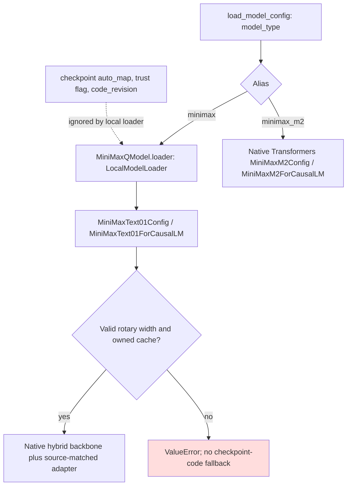
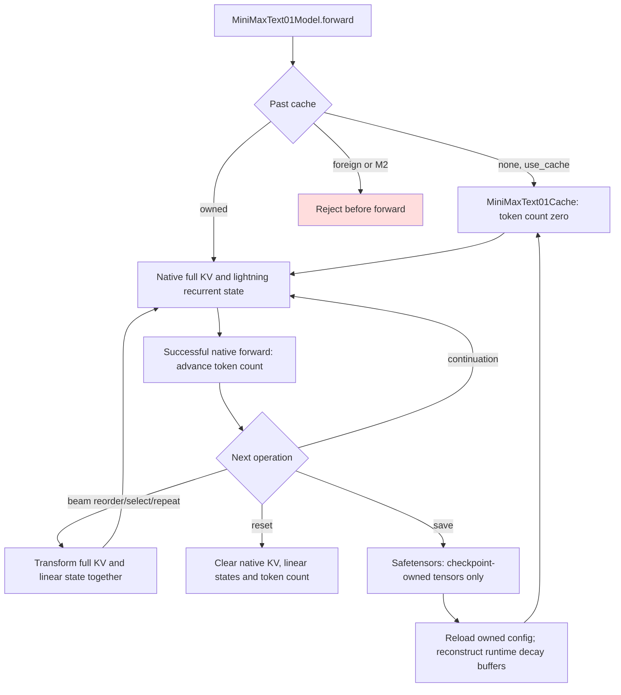

# MiniMax: native M2 and owned original Text-01 adapter

This package belongs to the `minimax_m2.py` definition unit, **not** to a
duplicate M2 architecture. `MiniMaxM2GPTQ` uses the installed Transformers 5
`MiniMaxM2Config` / `MiniMaxM2ForCausalLM` directly. The legacy
`gptqmodel.hf_minimax_m2` package is not selected by either definition.

`MiniMaxQModel` selects `MiniMaxText01Config` / `MiniMaxText01ForCausalLM`
through `LocalModelLoader`. Its native Text-01 backbone retains hybrid
full/lightning attention and packed MoE experts. The owned adapter changes
only behavior where the inspected original source and released metadata
require it: partial FP32 rotary evaluation, runtime-only decay buffers,
hybrid cache accounting/reordering, and the original optional shared-expert
and pre/postnorm branches. It does not replace Text-01 with M2 or Llama.

## Source and ownership

Exact revisions and SHA-256 digests are in `provenance.json`:

| Source | Revision | Evidence |
| --- | --- | --- |
| [MiniMax-Text-01-hf](https://huggingface.co/MiniMaxAI/MiniMax-Text-01-hf/tree/f7ce01366e8585a8948f19aedc8e20628c6965e5) | `f7ce01366e8585a8948f19aedc8e20628c6965e5` | Released config and 8,243 checkpoint-index keys |
| [MiniMax-M2](https://huggingface.co/MiniMaxAI/MiniMax-M2/tree/04312f0cfbdeefb912575595b7c045512a29293c) | `04312f0cfbdeefb912575595b7c045512a29293c` | Released config and 96,103 checkpoint-index keys |
| [Original equations](https://huggingface.co/MiniMaxAI/MiniMax-Text-01/blob/a7351bf2bee0e1253919d349f1ad304e6dac13e9/modeling_minimax_text_01.py) | `a7351bf2bee0e1253919d349f1ad304e6dac13e9` | Partial rotary, hybrid attention, residual factors, optional shared expert |
| Transformers | `5.23.0` | Native model/config source digests for both families |

Only inspected source informed this adapter; checkpoint Python is never
downloaded or imported at runtime. `LICENSE-MINIMAX-CODE` preserves the
original MIT code license; Apache-2.0 and attribution are included separately.
No trained weights are included. The inventories preserve source names;
tests independently enumerate every expected meta-model key, including
separately identified M2 FP8 scale metadata. This is not a real trained FP8
payload or numerical qualification.

## Selection boundary



Returning `False` from the owned model's `is_custom_code()` opts only this
native-layout adapter into Transformers' existing `minimax` weight conversion
mapping. That mapping translates source `block_sparse_moe` / `w1,w2,w3`
into native `mlp` / packed experts and reverses the conversion on save.
It performs no code selection, global registration, download, or remote
execution. Source-named hostile checkpoints, actual public quantization,
and two safetensors save/reload cycles qualify that exact boundary.

| Prior mechanism | This binding |
| --- | --- |
| `minimax_m2.py`: both aliases use generic AutoModel loading | M2 remains exact native; original has definition-owned local classes |
| Native `MiniMaxRotaryEmbedding`: full-head default width | Released `rotary_dim=64`, `head_dim=128`; unchanged tail |
| Native `MiniMaxCache`: layer-zero KV length | Owned count works with linear-first/all-linear layouts |
| Constructor decay tensors appear in native state dict | Non-persistent runtime buffers; absent from released ownership |
| Native original decoder always uses normalized residual, no shared branch | Explicit source `postnorm` and `shared_intermediate_size > 0` branches |
| M2 routing bias absent from explicit module tree | Checkpoint-owned `mlp.e_score_correction_bias:!` |
| Generic AWQ scaling and unqualified fusion advertisement | Explicit plain-AWQ policy and `fusable=None` for both aliases |

The source shared-expert enable flag does not set its projection width:
the original `MiniMaxText01MLP` uses `intermediate_size`, which is preserved.
Its coefficient is an excluded dense projection evaluated in FP32 then cast
back, matching the inspected source. Native M2 declares no strict-FP32
retention rule for its correction-bias buffer; tests preserve native
requested-dtype behavior rather than inventing such a policy.

## Cache and tensor lifecycle



Full/linear/mixed layouts, 1+4+1 continuation, repeat/select/reorder/reset,
greedy and cached-versus-uncached beam generation are tested. Foreign caches
are rejected; no static/offloaded/quantized cache, speculative crop, or
concurrent use of one mutable cache is qualified.

## Numerical and public-API evidence

Run from `tests/` using the isolated environment:

```bash
PYTHON_GIL=0 /home/ubuntu/.venvs/gptqmodel-tf5/bin/python -s -m pytest -q \
  test_minimax_m2_local_port.py module_tree/test_minimax_m2_local_port.py
```

Coverage includes independent float64 full/lightning attention, routing and
complete decoder equations; MHA/GQA/MQA; original shared/no-shared and
pre/postnorm variants; CPU/meta live owners and module tags; FP32/FP16/BF16;
eager/SDPA; hostile source-format checkpoints under both API trust values and
bypass unset/0/1; missing/corrupt tensor payload repair-and-retry; and two
unquantized safetensors cycles. The released rotary-width test compares
source equations at 64/128 directly against native full-head equations.

Six real `GPTQModel.load -> quantize -> inference -> save -> reload` cases
cover both aliases, original shared/pre-norm, and `offload_to_disk` false/true.
`AWQConfig(fallback=None)` still produces actual packed AWQ linears under the
explicit plain policy. All 25 original, 31 shared-original, or 26 M2 decoder
linears are packed; excluded tensors and all packed state are exact through
two saves/reloads. This does **not** qualify AWQ scale-search/folding/replay.

Intentional defect probes were run in isolated Python processes:

| Injected defect | Intended failing assertion |
| --- | --- |
| Replace owned rotary initializer and full-attention forward with native full-head versions | 64/128 source oracle fails: 384/448 logits differ, maximum absolute error 0.0039318 |
| Restore native layer-zero cache sequence/mask-size methods | Three original eager dtype cases fail continuation; three M2 cases still pass |

The normal implementation passes the same tests. No file patches are needed
to run a probe: assign the native methods to the owned classes in an isolated
Python process before `pytest.main(...)` and discard that process afterward.

## Parent integration contract

This unit deliberately does not edit shared loaders/security or central
fixtures. The parent applies these exact changes and reruns the shared suite:

1. Replace `registered_module_plans.json.cases["MiniMaxQModel/gptq"]` and
   `cases["MiniMaxM2GPTQ/gptq"]` with `module_plan_cases.json`. This includes
   original linear norm/shared/coeff ownership and M2 routing-bias exclusion.
2. Replace the entire `fusable_models.json.models.minimax` entry with
   `{"definition":"MiniMaxQModel","reason":"Package-owned original MiniMax-Text-01 partial-RoPE/hybrid-cache adapter; fusion executor has not been qualified."}`.
3. Replace the entire `models.minimax_m2` entry with
   `{"definition":"MiniMaxM2GPTQ","reason":"Native Transformers 5 MiniMax-M2 attention/MoE; fusion executor has not been qualified."}`.
4. Add `minimax_m2` to `test_awq_scaling_groups.py`'s
   `PLAIN_QUANTIZATION_FAMILIES`; original `minimax` is already present.
5. In `test_minimax_m2_support.py`, patch `auto.load_model_config` instead of
   `auto.AutoConfig.from_pretrained` in the dispatch mock. Replace the obsolete
   absence assertion with
   `assert moe_tree["e_score_correction_bias"] == ("e_score_correction_bias:!",)`.
6. Preserve the parent's shared `ports/__init__.py`, include this package and
   its licenses/NOTICE/provenance in distribution data, and integrate the
   diagrams/coverage into central docs and the existing PR. No dependencies
   are added by this unit.

Validation commands after those proposed central changes:

```bash
cd tests
PYTHON_GIL=0 /home/ubuntu/.venvs/gptqmodel-tf5/bin/python -s -m pytest -q \
  test_minimax_m2_local_port.py module_tree/test_minimax_m2_local_port.py \
  test_minimax_m2_support.py test_local_model_loading.py \
  module_tree/test_registered_module_plans.py \
  module_tree/test_definition_subset_ordering.py test_awq_scaling_groups.py \
  module_tree/test_fusable_models.py
```

Also run root `format/check.sh`, port Pyright, `compileall`, and
`git diff --check`. The two owned test files do not need central edits.

## Limits

Python 3.14t with `PYTHON_GIL=0`, Transformers 5.23.0, Torch 2.15.0 CPU.
This is not threaded-execution safety qualification. No trained payloads,
quality measurements, GPU/FlashAttention/Lightning kernels, multi-GPU,
training, `torch.compile`, long-context dynamic-RoPE transitions, static or
foreign caches, speculative decoding, AWQ fold/search, or fused QKV/MLP
executor qualification is claimed. CPU reference lightning attention is used.
Production checkpoint tokenizer assets and trained FP8/dequantization must
be qualified separately; no tokenizer normalization shim is introduced.
