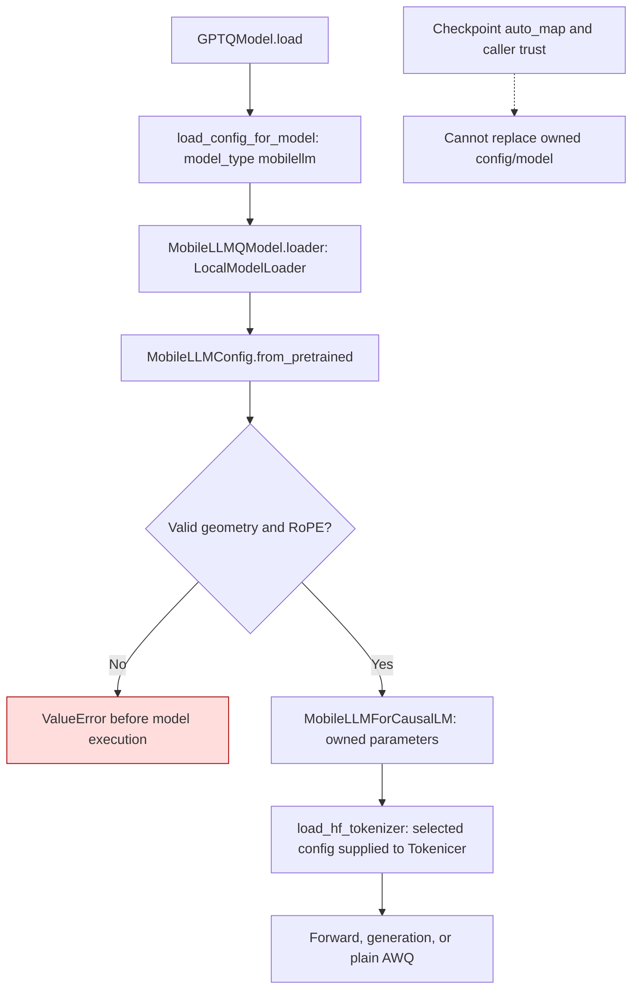
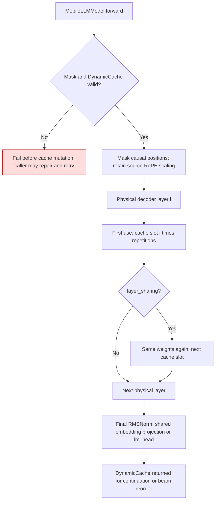

# MobileLLM package-owned Transformers 5 port

## License and provenance

**FAIR Noncommercial Research License and FAIR Acceptable Use Policy apply.**
This port is derived from Meta's public training implementation, not a generic
Llama replacement. Its derivative code is not covered solely by GPT-QModel's
root Apache-2.0 license. See the byte-preserved [LICENSE](LICENSE), accompanying
[NOTICE](NOTICE), and the original Transformers [Apache license](LICENSE-APACHE-2.0).
Commercial use is not granted by the upstream FAIR license.

Authoritative source: [facebookresearch/MobileLLM at
6cb80c4064183622a64105c875cdd8a35fc8c56b](https://github.com/facebookresearch/MobileLLM/tree/6cb80c4064183622a64105c875cdd8a35fc8c56b).
The inspected files are pinned in [PROVENANCE.json](PROVENANCE.json). No checkpoint
Python is downloaded or imported by this package.

Official `facebook/MobileLLM-125M` config/source requests returned HTTP 401.
There were no authorized local official artifacts. The tests below establish
**public-source architecture/equation coverage**, not independently inspected
released-checkpoint tensor inventory, tokenizer behavior, trained-weight
quality, or permission to access gated repositories. Unofficial mirrors were
not used as an authoritative schema or numerical oracle. No weights or real
tokenizer assets are redistributed.

## Binding and behavior

Transformers 5.23.0 has no exact `mobilellm` native config/causal-LM mapping.
`MobileLLMQModel.loader` selects `MobileLLMConfig` and `MobileLLMForCausalLM`
directly. Checkpoint `auto_map`, `trust_remote_code`, and `code_revision` cannot
replace this selection, including when the global security bypass is enabled.
Tokenizer normalization remains in Tokenicer; this port adds no tokenizer shim.

| Aspect | Previous path | Package-owned path |
| --- | --- | --- |
| Config/model | Remote modeling required by definition | LocalModelLoader package classes |
| Serialized RoPE | Compatibility normalization without a model | Default/linear/dynamic source equations |
| Embedding head | Checkpoint implementation | Optional source `share_embedding`, no extra head owner |
| Layer sharing | Checkpoint implementation | Each physical layer runs twice; weights remain single-owned |
| Cache | Legacy cache APIs and repeated physical indices | Transformers 5 DynamicCache slot per executed use |
| AWQ | Inherited Llama scaling assumptions | Explicit empty folding/search groups, plain INT4 quantization |
| TP slicing | Checkpoint implementation | Source dense split/sum projection arithmetic; TP quantization rejects |
| Published payload | Loader-dependent | Safetensors-only tested save/reload paths |





The public training source repeats the same decoder layer and its physical
cache index. That duplicates a step's keys in one slot and cannot represent
the second use independently. The port repairs this API incompatibility with
separate per-use slots, verified against independently unrolled source
equations and cached rotated keys/values; it does not duplicate parameters.
A fixed cache sized only for physical layers is rejected before mutation.

Dynamic NTK uses the source's rotated-key cache, not raw-key rerotation. When
positions exceed the original context, each new step uses its own NTK base;
already cached keys are not rerotated. A later short call retains the last
frequencies, matching the pinned source's nonpersistent-buffer semantics.
Saving serializes the original config, not a warmed runtime NTK base.
FP32 rotary metadata is reconstructed on dtype/device moves and loads so a
half-precision save/reload cannot silently change rotary numerics.

`pretraining_tp > 1` preserves source dense projection slicing, including the
source eager-attention/MLP bias omission and SDPA attention bias behavior.
The shared embedding can supply the TP output projection too; unlike the old
source, it does not require a nonexistent `lm_head`. Quantization of dense TP
slices is explicitly unqualified and fails before packing.

## Quantization contract

No AWQ scale-fold/search group is claimed. The repeated shared decoder is a
second consumer of the same weights with different activations, so inheriting
Llama's scale-fold assumptions is not justified. Plain quantization still
packs every physical Q/K/V/O and gate/up/down projection once. The 24 public
CPU cases use `fallback=None`, MHA/GQA/MQA, biases, shared/unshared heads and
layers, and disk offload on/off. Each executes `GPTQModel.load -> quantize ->
packed forward/generate -> save -> reload -> save -> reload`, asserting all
14 packed linear owners, every packed/dense tensor, and exact reloaded logits.
Quantization quality and fold/search optimization are not qualified.
Fusion remains explicitly unqualified (`fusable = None`).

## Coverage and reproduction

Tests live in `tests/test_mobilellm_local_port.py` and
`tests/module_tree/test_mobilellm_local_port.py`.

| Coverage | Independent basis |
| --- | --- |
| State keys, owners and module roles | Source parameter definitions; real CPU/meta model and Defuser boundary |
| 125M/350M/600M/1B/1.5B geometry | Five pinned public GitHub training configs; both sharing modes |
| Forward, norms, masks and GQA layout | Direct tensor equations without port attention/rotary/cache helpers |
| Cache, NTK and shared execution | Independent rotated-K/V cache oracle, chunks 1+4+1+1, left padding |
| FP32/FP16/BF16 eager/SDPA | Causality, greedy generation, beam/cache continuation, two safetensors cycles |
| Trust boundary | Actual public hostile auto_map, both trust flags and bypass unset/0/1 |
| Failure/retry and ownership | Invalid mask/cache, broken/restored safetensors, fresh/warm state assignment |
| Plain AWQ | Actual public CPU quantizer, exact packed/dense tensors across two reloads |

```bash
PYTHON_GIL=0 /home/ubuntu/.venvs/gptqmodel-tf5/bin/python -m pytest -q \
  tests/test_mobilellm_local_port.py tests/module_tree/test_mobilellm_local_port.py

PYTHON_GIL=0 /home/ubuntu/.venvs/gptqmodel-tf5/bin/python -m pytest -q \
  tests/test_local_model_loading.py tests/test_local_model_paths.py \
  tests/test_hf_config_compat.py tests/test_internlm_local_port.py \
  tests/module_tree/test_internlm_local_port.py \
  tests/module_tree/test_registered_module_plans.py tests/test_awq_scaling_groups.py \
  tests/test_awq_empty_groups.py tests/test_awq_scale_folding.py \
  tests/test_awq_scale_search_safety.py
```

Measured with Python 3.14.6t, `PYTHON_GIL=0`, Transformers 5.23.0,
Torch 2.15.0+cpu. Final combined runs passed with both released Tokenicer
0.0.14 and 0.0.17; earlier focused runs below used 0.0.14:

| Command scope | Result |
| --- | --- |
| Both final owned MobileLLM suites, Tokenicer 0.0.17 | 192 passed, no skips, 30.30 s |
| Shared suites in the second command above | 715 passed, 7 skipped, 19.76 s |
| Final owned + shared suites + `tests/module_tree/test_fusable_models.py`, Tokenicer 0.0.17 | 1010 passed, 475 skipped, 55.44 s |
| Same final combined command, Tokenicer 0.0.14 | 1010 passed, 475 skipped, 59.72 s |
| `format/check.sh`, pinned Ruff 0.14.2 | Passed for the full repository paths checked by the script |
| `python -m compileall -q` on owned Python paths | Passed |
| `pyright --pythonpath /home/ubuntu/.venvs/gptqmodel-tf5/bin/python gptqmodel/models/ports/mobilellm` | Zero errors and warnings |

The seven existing shared-suite skips are: missing `peft.tuners.lora.awq` (1),
missing trained `gpt_pangu` (2), `instella` (1), and `k2_horizon` (1) fixtures,
and non-buildable generic-fixture families `opt350` (1) and `muse_glimmer` (1).
Fusion adds 468 NVIDIA CUDA/Marlin numerical cases unavailable on this CPU VM.
There are no owned skips. Ten combined warnings concern deprecated RoPE config
aliases and an unrelated native Gemma3n zero-element tensor.

Intentional defects were injected separately, then removed before the green
run. No mock replaced model execution:

| Defect | Behavioral red evidence |
| --- | --- |
| Reuse physical cache index for both shared uses | Independent cached oracle failed: 47/48 logits mismatch, maximum absolute error 0.01631255 |
| Do not retain dynamic NTK buffer for the next short request | Independent NTK lifecycle oracle failed: 61/192 logits mismatch, maximum absolute error 0.0000222623 |
| Bypass FP32 rotary reconstruction on dtype moves | BF16 safetensors roundtrip failed exact equality: 24/576 logits mismatch, maximum absolute error 0.0009765625 |
| Tie a nonexistent lm_head when share_embedding and tie_word_embeddings are both true | Real construction failed; repaired source-shared and standard-tied head save/reload cases both passed |

Restoring the implementation passes all 38 cache/rotary regression cases in
4.96 s. The original missing local binding also failed the definition-ownership
regression. Hostile public loading additionally needs the shared tokenizer
security fix from parent commit `5423ad629`; the MobileLLM port does not
reimplement that shared fix.

The shared registered plan is unchanged. The integrator must update only
`fusable_models.models.mobilellm.reason` to:

> Package-owned MobileLLM shared embedding/repeated-decoder cache port; fusion executor has not been qualified.

Parent-owned central documentation and README links must preserve the license
restriction and absent official-checkpoint qualification. The two diagrams
above are supplied for the central `docs/` reference page and existing PR
description; this port's license, notice and provenance must ship as package
data. No central fixture, README or documentation ownership is taken here.

## Limits

No official released-checkpoint schema, actual tokenizer, trained tensor payload,
perplexity or task-quality claim. CPU-only inference and meta construction were
tested with Python 3.14t, GIL disabled, Transformers 5.23.0 and Torch 2.15 CPU;
this is not threaded PyTorch qualification. No GPU, FlashAttention, fused
kernels, multi-GPU, compilation, training, speculative decoding or foreign,
static, offloaded or quantized cache qualification. Later R1/R1.5 families are
not admitted merely because their names contain MobileLLM. No extra dependency
is introduced by this port.
