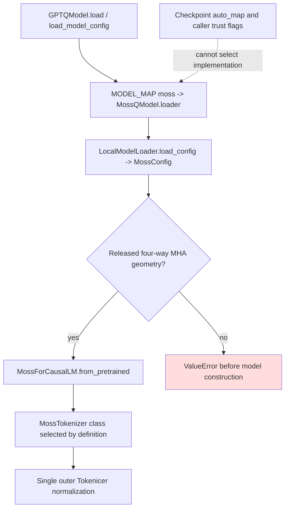
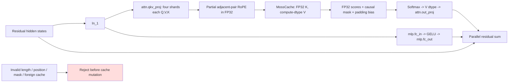

<!-- SPDX-FileCopyrightText: 2026 ModelCloud.ai
SPDX-License-Identifier: Apache-2.0 -->

# MOSS Moon-003 package implementation

`MossQModel.loader` selects the package-owned `MossConfig`, `MossForCausalLM`
and `MossTokenizer`. Transformers 5.23.0 has neither an exact `moss` config
mapping nor a causal-LM mapping. This is the MOSS implementation, preserving
its four-way packed Q/V/K ordering; substituting GPT-J or CodeGen changes the
checkpoint interpretation.

## Source and licenses

The authoritative source is [OpenMOSS/MOSS at
24bc88737d83fa5561bf3c284b2895b8ac41bff6](https://github.com/OpenMOSS/MOSS/tree/24bc88737d83fa5561bf3c284b2895b8ac41bff6).
The release sources and index JSON were inspected as data without executing
checkpoint Python. `source_inventory.json` records each config, all 311
checkpoint keys, and SHA256 values for every inspected config, index and
configuration/model/tokenizer source file:

| Released variant | Exact revision |
| --- | --- |
| `fnlp/moss-moon-003-base` | `ea9e13408a4fef2f6b996b46a34e3eaaf100e732` |
| `fnlp/moss-moon-003-sft` | `3c06a7a241cef41caa9c339b149e9931d6b3deaa` |
| `fnlp/moss-moon-003-sft-plugin` | `e04cc85bb5cd9803c52266d8fd4599c749519c61` |

All three inspected modeling files have SHA256
`75f19cf816ec855f7fba60ec19e67280767ea8971e03fe2df1e021ba993488b8`.
`LICENSE` preserves the upstream Apache 2.0 source license; see `NOTICE` and
the source headers for attribution. Upstream separately licenses trained
weights under GNU AGPL 3.0 and data under CC BY-NC 4.0 and states additional
commercial/public-serving conditions. This port ships neither weights nor
training data and makes no claim to relicense them.

## Selection and failure boundaries



| Boundary | Before | Package implementation |
| --- | --- | --- |
| Definition selection (`definitions/moss.py`) | No exact native TF5 implementation; metadata could request checkpoint code | Definition-owned `LocalModelLoader` class paths |
| Packed attention | Old checkpoint `modeling_moss.py` | Owned four-shard Q/V/K, adjacent-pair partial RoPE and FP32 scores |
| Cache (`MossModel.forward`) | Legacy stacked tuple cache | `MossCache` with independent FP32 K and compute-dtype V storage |
| Calibration mask | Early additive conversion hides raw keep-mask semantics | Raw 2-D mask reaches decoder capture/replay; additive bias created by `MossAttention` |
| AWQ scaling (`MossQModel.awq_get_modules_for_scaling`) | Unqualified generic relationship guesses | Explicit empty groups, all four decoder linears still quantized |
| Save | Historical upstream pickle weights | Current dense and quantized saves use safetensors |

The model never dispatches checkpoint Python, even with API trust enabled and
`GPTQ_BYPASS_SAFETY_CHECKS=1`. GQA/MQA, heads not divisible by four, invalid
rotary dimensions, and the source converter's `wbits != 32` format fail
explicitly. Full-head rotary (`rotary_dim=None`) is implemented with the head
dimension, correcting the source branch's erroneous full-embedding table.
Existing source metadata is preserved by the config; no global HF
registration or optional CUDA import is needed.

## Tensor and cache flow



The shared `ln_1` feeds both nonlinear attention and GELU MLP branches. No
conservative sequential affine scaling boundary is qualified. Plain AWQ
quantizes `attn.qkv_proj`, `attn.out_proj`, `mlp.fc_in` and `mlp.fc_out` in each
layer; it does not run scale search/folding. Persistent `attn.causal_mask` is
owned by the excluded `attn:!` container and is saved as a Boolean tensor.
Embedding, final norm and the biased, untied language head retain the source
checkpoint paths and requested dense dtype. `tie_word_embeddings=False` is
the released policy; the HF optional tying metadata is inactive under it.

## Tokenizer assets

The source tokenizer uses GPT-2 byte BPE, its original regex, special
whitespace tokens and opt-in BOS/pair and code-completion truncation rules.
The owned class uses the native TF5 GPT2 tokenizer backend and a source BOS
template; a saved native post-processor is preserved on reload. Positional
truncation arguments and Unicode patterns retain the source `regex` API. No Mistral
regex substitution is part of this model port.

`tokenizer_oracle.json` pins the five real SFT asset hashes and six independent
source-regex/byte-mapping/ranked-BPE expected-ID cases, including Latin/CJK,
code indentation, emoji and `<eoh>`/`<eom>` chat delimiters. The original
`special_tokens_map.json` has `additional_special_tokens` entries serialized
as dictionaries without `__type`; unprepared TF5.23 native and owned
constructors reject them. Reusable preload correction belongs upstream in
Tokenicer, before the definition-owned constructor, not in this port.
All six cases also match the inspected base and SFT-plugin assets: the three
variants share vocabulary, merges, and added-token hashes. Base EOS is 106028;
SFT and SFT-plugin EOS is 106068. Variant metadata hashes are in the oracle
fixture. Unmodified original metadata now loads through the generic
`Tokenicer.prepare_load_kwargs(path, **kwargs)` API before the definition-owned
constructor, then the existing single outer Tokenicer normalization. This uses
unreleased Tokenicer 0.0.19 source
[`c14e1c8c062c7b7cc9a981054366f98bde015fa1`](https://github.com/ModelCloud/Tokenicer/commit/c14e1c8c062c7b7cc9a981054366f98bde015fa1)
from [upstream PR 66](https://github.com/ModelCloud/Tokenicer/pull/66).
Released 0.0.18 lacks this API. There are no caller `AddedToken` overrides in
the final public qualification.

## Qualification and reproduction

Run in an installed GPT-QModel CPU environment with Transformers 5.23.0 and
the Tokenicer candidate above (until its release is available):

```bash
PYTHON_GIL=0 python -m pytest -q tests/test_moss_local_port.py tests/module_tree/test_moss_local_port.py
format/check.sh
python -m compileall -q gptqmodel/models/ports/moss
git diff --check
```

The always-run tests construct real CPU/meta modules and compare all 311
released checkpoint keys for each of the three variants. Released shapes
are checked on meta; no trained payload is downloaded. Independent source
equations cover packed head ownership, partial/full-head RoPE, FP32 scores,
parallel block residuals, attention outputs, labels and cache continuation.
FP32/FP16/BF16, cache chunking/reorder/beam/repeat/select/crop/reset/read-only
use, left padding, generation, two dense safetensors cycles, malformed-file
repair/retry, and public hostile metadata/trust/bypass cases run on CPU.
Synthetic tokenizer tests independently check ranked BPE, BOS, pairs,
padding, truncation and modern/legacy reload.
The twelve original-layout public regressions cross base/SFT EOS with API
trust false/true and bypass unset/0/1. They check exact IDs, ordinary added
whitespace surviving special-token removal, immutable original JSON, public
model/tokenizer selection, native tokenizer save/reload, then corrupt-vocabulary
failure and restored-file retry. All twelve fail at the native constructor's
list-of-dictionaries error before shared preload wiring.

Four public AWQ cases cover partial/full-head rotary and offload false/true,
with `fallback=None`, actual calibration/packing/inference, all eight tiny
decoder linears, unchanged dense exclusions, exact packed/dense state, and
two quantized safetensors save/reload cycles. This is plain quantization
qualification, not AWQ fold/search qualification.

Red/green evidence includes the original missing local config selection,
the calibration-mask bug that converted zero linears, and BOS serialized
reload losing its template before the owned constructor fix. The numerical
oracle separately detects source-layout and cache-dtype defects: reversing
the Q/V/K shard axis fails all 12 numerical cases; narrowing rotated K to
the compute dtype fails eight FP16/BF16 cases while four FP32 controls pass.
A source-API probe additionally fails all four BOS/prefix cases when the fourth
positional decode argument is forwarded to the native backend. The repaired
owned signature and Unicode patterns pass. The released 64/256 rotary fraction
is checked at positions 2043–2047 in FP32/FP16/BF16 without allocating 16B weights.

Measured on Python 3.14.6t / GIL disabled, CPU Torch 2.15.0 and Transformers
5.23.0 with Tokenicer 0.0.19 at the pinned source above: 75 owned cases passed
with no skips in 6.62 seconds. A separate offline check loads all three original
real tokenizer bundles through public `load_hf_tokenizer`: 18 selections
(three variants × trust false/true × bypass unset/0/1) each match all six
independent exact-ID/decode cases and padded batches. Ordinary added whitespace,
variant EOS, unchanged source JSON, and native save/reload also pass.
The final owned suite plus shared local-loader/path/processor/config, AWQ
relationships, registered plans and fusion family passed 842 cases with 475
skips and 11 warnings in 19.99 seconds on the same Tokenicer candidate, using
only the proposed MOSS registry entry and fusion reason in memory. Skips are
468 NVIDIA Marlin hardware cases, four missing remote checkpoint fixtures,
two non-buildable CausalLM fixture families (OPT350/Muse Glimmer), and one
missing optional PEFT import. All 75 MOSS cases run. `format/check.sh` passed with
pinned Ruff 0.14.2; compileall and `git diff --check` were clean.

## Explicit limits

No trained-weight quality, GPU, FlashAttention, SDPA, fusion, multi-GPU,
concurrent execution, compile, training, static/offloaded/quantized foreign
cache, or longer-than-configured-context qualification is claimed. The
source's MHA-only geometry is intentional. An empty native `DynamicCache`
from current generation is converted to `MossCache`; populated foreign caches
are rejected. There is no dense weight cache in the port. The older
`fnlp/moss2-2_5b-chat` artifact returned HTTP 401 during source discovery and
is not qualified or silently mapped to Moon-003. Legacy source int4/int8
converter payloads are not accepted as GPT-QModel checkpoints.

Parent integration owns shared loader wiring, module-plan/fusion fixtures,
central docs/README and package-data inclusion of this license/provenance.
