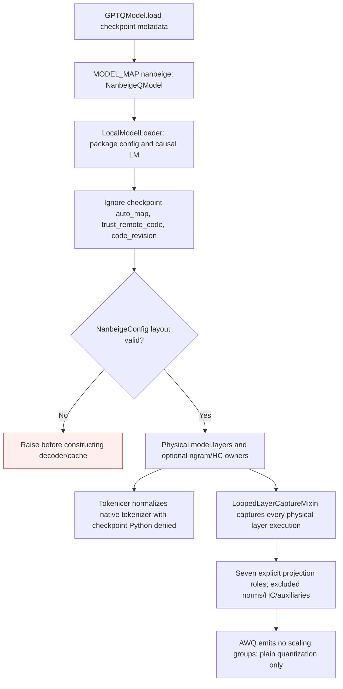
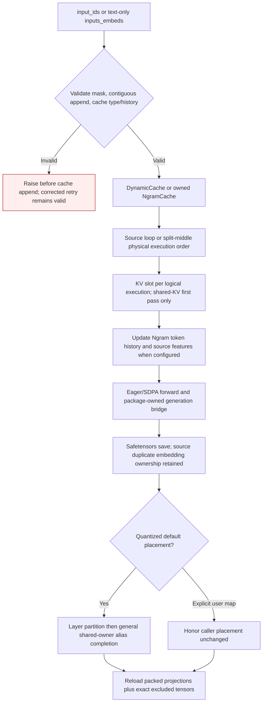

<!-- SPDX-FileCopyrightText: 2026 ModelCloud.ai -->
<!-- SPDX-License-Identifier: Apache-2.0 -->

# Nanbeige Transformers 5 local port

GPT-QModel owns `NanbeigeConfig`, `NanbeigeModel` and `NanbeigeForCausalLM`.
Transformers 5.23.0 has no native `nanbeige` config or causal-LM mapping.
This is the actual looped Nanbeige architecture, not a Llama substitution.

## Sources and licensing

The inspected authoritative source is
[Nanbeige/Nanbeige4.2-3B at b82e54bd609793562a75cbf9337970a93369eab5](https://huggingface.co/Nanbeige/Nanbeige4.2-3B/tree/b82e54bd609793562a75cbf9337970a93369eab5).
Its `configuration_nanbeige.py` and `modeling_nanbeige.py` explicitly carry
Apache-2.0 notices, retained in the adapted files. `LICENSE` is the Apache-2.0
license; `NOTICE` identifies upstream and the Transformers 5 modifications.
No trained weights or tokenizer assets are vendored. Only inspected source
was adapted; checkpoint Python is never downloaded or imported at runtime.

`checkpoint_contract.json` contains pinned revisions, complete source configs,
SHA-256 source/header-inventory digests, tokenizer-asset digests, and an
independent full 201-tensor name/shape inventory. Both standard and Base
safetensors headers were read; both exactly match the packaged meta model.
The standard checkpoint uses sharded safetensors, Base a single safetensors
file. No tensor payload was downloaded for these inventories.

| Repository | Pinned revision | Qualified contract |
| --- | --- | --- |
| `Nanbeige/Nanbeige4.2-3B` | `b82e54bd609793562a75cbf9337970a93369eab5` | Full dense inventory/config |
| `Nanbeige/Nanbeige4.2-3B-Base` | `4a38e817c14b9f2c4b69b1e05cbda90395872f6b` | Full dense inventory/config |
| `Nanbeige/Nanbeige4.2-3B-FP8` | `e0c88bc0a9a0e3003f91884da33daccffff8e712` | Metadata/dense architecture only |
| `Nanbeige/Nanbeige4.2-3B-GPTQ-Int8` | `e8c6ccdb655bbcf410952686026d3fcbf4c07392` | Metadata/dense architecture only |

The two compressed checkpoints advertise `compressed-tensors`. Retaining
their quantization metadata and exact dense module geometry is **not** a
claim that their trained FP8/Int8 payloads have been loaded or evaluated.

## Dispatch and physical ownership



| Before | Package-owned behavior |
| --- | --- |
| Definition selected `AutoModelForCausalLM` and required remote trust | `LocalModelLoader` selects owned classes for both API trust values |
| Remote model finalizer repaired rotary buffers and monkeypatched generation inputs | Owned rotary construction/materialization and generation bridge |
| Projection-tree resemblance could obscure the real execution graph | 22 physical released layers execute in two loops with separate KV slots |
| Checkpoint source used Transformers 4 masking/cache interfaces | Transformers 5 `create_causal_mask`, `DynamicCache`, `GenerationMixin` |
| Checkpoint backend-specific vLLM/FlashAttention dispatch | Eager and SDPA only; no optional CUDA import at module import time |

The real config has hidden size 3072, 48 query heads and explicit head size
128: Q is `(6144, 3072)`, O `(3072, 6144)`, not a Llama-shaped hidden-size
projection. Physical weight names remain `model.layers.*.self_attn.{q,k,v,o}_proj`
and `mlp.{gate,up,down}_proj`, with `model.embed_tokens`, `model.norm`, `lm_head`.

The source's optional paths are retained: MHA/GQA/MQA and projection biases,
per-head Q/K norms, loop-output weighting, split middle-layer execution,
shared-KV split loops, cross-depth attention, HC/MHC including identity and
loop-specific/stream-count variants, hashed N-gram embeddings and per-layer
fusion, compressed-token lookup, EOS-boundary resets and prime hash policies.
Legacy expanded-depth metadata carrying `num_physical_layers` is normalized
to the physical checkpoint depth; ambiguous expansions fail explicitly.

## Cache and checkpoint lifecycle



The general alias-aware map fix is a **separate shared commit**, not a
Nanbeige root-CPU workaround. The source registers the same embedding at
`model.embed_tokens` and `model.ngram_embeddings.word_embeddings`. Both
state-dict names survive. Default placement now maps every physical owner
consistently, as do explicit-map controls. No LazyTurtle structure/strict-FP32
shared paths were modified by that fix.

## Qualification

Tests run on Python 3.14.6t with `PYTHON_GIL=0`, Torch 2.15.0+cpu,
Transformers 5.23.0. Initial runs used Tokenicer 0.0.14; final qualification
uses released 0.0.17. CPU checks do not establish threaded PyTorch safety.

| Tests | Invariant |
| --- | --- |
| `tests/module_tree/test_nanbeige_local_port.py` | Two exact real inventories; FP8/Int8 metadata round trips; CPU/meta owners and q/k/v/o/gate/up/down roles across layouts; excluded norm/HC owners |
| `test_independent_float64_source_equations` | Independent linear/RMS/RoPE/attention/depth/HC/MHC equations for eager and SDPA, MHA/GQA/MQA and bias |
| `test_independent_ngram_hash_eos_embedding_and_layer_fusion` | Independent hash arithmetic, prime policy, EOS reset, lookup, average/concat and input/layer fusion; cached continuation |
| `test_cache_prefill_single_chunk_generation_and_safetensors` | FP32/FP16/BF16, eager/SDPA, 1+4+1 continuation, slot counts, greedy oracle, beam path and exact dense safetensors reload |
| `test_public_hostile_config_model_tokenizer_and_repaired_safetensors_retry` | Actual public loader, trust false/true × bypass unset/0/1; malicious config/model/tokenizer Python never executes; corrupt-payload repair/retry |
| `test_public_plain_awq_all_physical_owners_capture_pack_two_safetensors_cycles` | Twelve actual public CPU AWQ cases, fallback=None, offload false/true; independently checked calibration Q inputs for every original execution; all 14 or 28 decoder linears packed, no unsafe scale groups; excluded tensors exact; two exact packed/dense reload cycles and generation |
| `tests/test_nanbeige_support.py` | Real local dispatch/constructor, physical projection groups, rotary rematerialization and generation-input/cache bridge replace stale TF4 helper assertions |
| `tests/test_shared_module_placement.py` | Separate shared fix: real tiny native Llama tied embeddings with an additional physical-module alias; public AWQ default/explicit reload and non-alias controls; metadata-only CUDA/XPU ordinal/partition controls |

Real pinned tokenizer assets were also checked manually, offline after the
small asset fetch: raw `tokenizers.Tokenizer`, native `LlamaTokenizer`, and
`load_hf_tokenizer(..., model_config=owned_config)` agree on 19 Latin/CJK
sample IDs and a 39-token Chinese chat prompt. All four trust/bypass-0-or-1
cases survive tokenizer save/reload on Tokenicer 0.0.17 (also verified 0.0.14).
No reusable tokenizer correction or model-specific normalization shim exists.
The exact asset SHA-256 values are in `checkpoint_contract.json`.

### Regression detection evidence

* Before the shared alias fix, the self-contained native Llama public AWQ
  default reload failed in Accelerate with `device_map does not contain the
  module .`; default/explicit and alias/non-alias controls pass after repair.
  Actual Nanbeige N-gram default reload independently reproduced the same
  failure; all twelve default-placement AWQ cases now pass without root maps.
* Intentionally changing cache slot selection to physical-layer-only indexing
  makes the first real continuation test fail (cached key length 10 vs mask
  length 6). Restoring per-execution slots makes all continuation cases pass.
* Intentionally treating an external Boolean keep-mask as additive bias fails
  the independent eager oracle: 768/768 logits differ, maximum absolute error
  0.235792. Restoring Boolean masking passes the same test. This specifically
  tests 4D Boolean input; ordinary Transformers eager masks are additive.

### Reproduce

From the repository root, with the isolated environment activated:

```bash
PYTHON_GIL=0 python -s -m pytest -xq \
  tests/test_nanbeige_local_port.py \
  tests/module_tree/test_nanbeige_local_port.py \
  tests/test_nanbeige_support.py

PYTHON_GIL=0 python -s -m pytest -xq \
  tests/test_shared_module_placement.py tests/test_layerwise_device_placement.py \
  tests/test_local_model_loading.py tests/test_local_model_paths.py \
  tests/test_local_tokenizer_loading.py tests/test_hf_config_compat.py \
  tests/module_tree/test_registered_module_plans.py tests/test_awq_scaling_groups.py \
  tests/module_tree/test_llama_fusion.py

format/check.sh
python -s -m compileall -q gptqmodel/models/ports/nanbeige
pyright --pythonpath "$(command -v python)" gptqmodel/models/ports/nanbeige
git diff --check
```

Final released-Tokenicer-0.0.17 results: **352 passed, no skips in 15.80s**
for the three owned files. Running owned plus shared/layerwise/loader/tokenizer/
config/registry/AWQ/fusion siblings in one process: **1116 passed, 24 skipped,
9 warnings in 31.98s**. Seventeen skips require NVIDIA CUDA/Marlin; the other
seven are pre-existing absent remote fixtures or non-buildable generic fixtures
(`gpt_pangu`, `instella`, `k2_horizon`, `opt350`, `muse_glimmer`, and the optional
remote peft/AWQ probe). No owned Nanbeige check is skipped.

Ruff 0.14.2 and compileall pass. Default Pyright 1.1.407 currently reports
**70 errors, 0 warnings** in the source-adapted dynamic/cache/Transformers type
annotations; it is not clean and no broad suppression is added.

## Limits and central integration

No trained multi-GB tensor payload, quality score, released compressed-tensors
FP8/Int8 payload, GPU/ROCm/XPU execution, FlashAttention, vLLM, fused kernels,
multi-GPU movement, concurrent model execution, compile, training, static/
offloaded/quantized/foreign caches, speculative decoding or fusion executor
is qualified. Dynamic-NTK tests cover the source's context formula, not
cache parity while crossing the original context boundary. N-gram cached
hidden-state-only inputs fail explicitly because token history is required.
Depth-attention plus split shared-KV caching is explicitly rejected as in
the inspected source; dense uncached behavior is retained.

No dependency is added by the port. All-source imports are Torch/Transformers
and package-relative modules; existing Tokenicer owns native tokenizer loading.
`setuptools.find_packages` discovers the port. The integrator owns package-data
inclusion of this directory's LICENSE, NOTICE, JSON and Markdown provenance,
central `docs/` and main README/PR diagrams. The default registered
`NanbeigeQModel/gptq` plan is unchanged; no AWQ family-set edit is required
(Nanbeige is not in that generic scaling-group family list). Fusion remains
unqualified; proposed central JSON is:

```json
{
  "models": {
    "nanbeige": {
      "definition": "NanbeigeQModel",
      "reason": "Package-owned Nanbeige looped decoder with per-execution KV slots; fusion executor has not been qualified."
    }
  }
}
```
