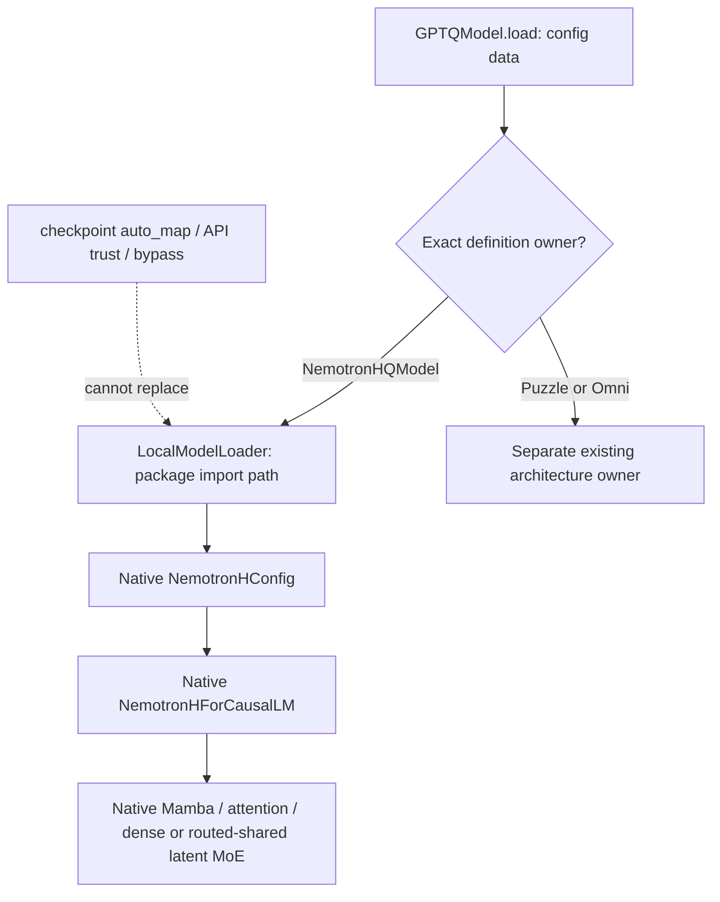
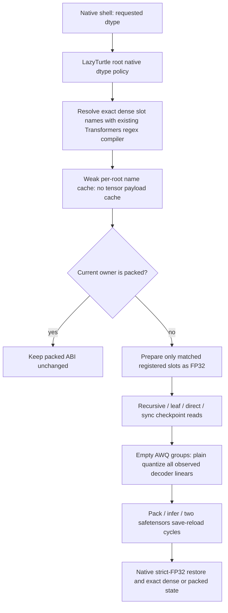

# Nemotron-H: exact native Transformers 5 binding

`NemotronHQModel` selects the exact native Transformers 5.23.0
`NemotronHConfig` / `NemotronHForCausalLM`, not a copied implementation or a
similarly shaped substitute. The native AutoModel mapping is tested. This
package supplies only the definition-owned import path and provenance.
Puzzle and Omni keep their distinct loaders, trust/patch policies and trees.

## Selection and quantization

| Boundary | Before | After |
| --- | --- | --- |
| Configuration/model code | Stale required remote trust | Definition-owned native classes; checkpoint maps never select code |
| Mamba dispatch | Optional legacy class-wide forward replacement | Native reference/optional-kernel dispatch; no global mutation |
| Tree | Mixer projections and exclusions | Same static sibling inventory; native effective tree also excludes SSM state and gated RMS norm |
| AWQ | Generic unqualified fold discovery | Explicit empty-group plain quantization, including `fallback=None` |
| Native strict-FP32 offload | Shell buffer dtype could override native policy | General LazyTurtle policy handling before checkpoint materialization |
| Super MTP payload | Native does not instantiate auxiliary MTP | Still not executed; source `mtp.*` tensors pass through both quantized saves |





The shared LazyTurtle fix reuses `_native_fp32_checkpoint_names` from the
parent's existing reload helper. It does not preserve all checkpoint FP32
tensors: ordinary dense weights follow the requested dtype, regular native
FP32 rules apply only to FP16 requests, strict rules apply to FP16/BF16,
integer/nonpersistent buffers and packed AWQ/EXL3 metadata keep their ABI.
The root policy is cached weakly once, and current packed ancestors are
checked again after quantization replaces a dense owner. No change to
`utils/model.py`, shared AWQ algorithms, remote trust gates, or CI workflows.

## Independently inspected sources

- [Native Transformers 5.23.0](https://github.com/huggingface/transformers/tree/52b080b6416a7897e2af90febeb4dfad22b84d19/src/transformers/models/nemotron_h),
  commit `52b080b6416a7897e2af90febeb4dfad22b84d19`.
  Installed configuration/model source SHA-256 equals the pinned upstream
  source, byte for byte; digests are in `PROVENANCE.json`.
- [Original 8B](https://huggingface.co/nvidia/Nemotron-H-8B-Base-8K/tree/94ea861e008c2dfced3e8e1302094024077aa04e),
  revision `94ea861e008c2dfced3e8e1302094024077aa04e`.
- [Nemotron 3 Nano](https://huggingface.co/nvidia/NVIDIA-Nemotron-3-Nano-30B-A3B-BF16/tree/bf77c3174f68ad409e1c2aa60daeb46e32d1c606),
  revision `bf77c3174f68ad409e1c2aa60daeb46e32d1c606`.
- [Nemotron 3 Super](https://huggingface.co/nvidia/NVIDIA-Nemotron-3-Super-120B-A12B-BF16/tree/2dc98e2afe4face0e4ce40972a915c45368bd34a),
  revision `2dc98e2afe4face0e4ce40972a915c45368bd34a`.

Inspected checkpoint config, Python source, model card and complete safetensors
index; read only the binary length/header ranges of all 67 shards, never
trained tensor payloads. `checkpoint_shapes.json` pins every released name
and shape: original **311**, Nano **6243**, Super **42683** (including **1040**
auxiliary MTP tensors). Native full-size meta owners exactly match all non-MTP
names and shapes after documented `backbone` to `model` conversion and native
expert tensor splitting. The independent fixture is SHA-checked, not generated
from the model under test. Source/header SHA-256 manifests are committed.

Architecture sources and the native implementation carry Apache-2.0 notices;
see `LICENSE` and `NOTICE`. Checkpoint weights have separate NVIDIA licenses:
the original 8B card names the Internal Scientific Research and Development
Model License; Nano/Super name the Nemotron Open Model License. No weight
license is replaced or broadened by this native binding.

## Qualification and meaningful negative probes

- Tiny CPU/meta MHA/GQA/MQA, bias, dense, routed/shared MoE, latent bottlenecks,
  exact live tensor owners, router/convolution/norm exclusions and projection order.
- Independent float64 source equations implement scalar SSM recurrence, grouped
  causal convolution, gating/norm, causal grouped attention, squared-ReLU MLP,
  routing correction/group selection/coefficient, shared experts and latent maps.
  Expected outputs never call native attention/SSM/MoE helpers.
- FP32/FP16/BF16 eager/SDPA, batch two, cache continuations of 1 and multiple
  tokens across a chunk boundary, fresh-request isolation, greedy generation,
  valid padded-token and future-token causality, exact safetensors tensor state,
  two reload cycles, assign/replacement and corrupted-file repair/retry.
- Public malicious config/model `auto_map`, trust false/true and existing
  bypass unset/0/1 must leave the hostile Python marker absent and load native
  config/model. Actual public AWQ loads also start with hostile maps.
- Eight real public plain-AWQ quantize/pack/infer/two-save-reload cases cover
  hybrid/dense/MoE/latent layouts with disk offload false/true and `fallback=None`.
  All expected decoder linears pack, every excluded tensor remains exact, and
  nonzero strict-FP32 correction values survive. Latent cases preserve MTP
  safetensors payloads without claiming MTP execution. Calibration spans the
  tiny vocabulary so every routed expert is observed; unsampled experts are
  not falsely counted as quantized or covered by this qualification.
- The old native-definition trust flag and class-wide mixer patch failed the
  intended selection/identity regressions before this change. Expanded strong
  offload tests found three real failures: router bias narrowed to FP16.
  Separate generic LazyTurtle tests reproduced **19 failures / 8 passes**
  before the fix, including strict dense parameters and buffers, sharded
  aliases, repeated eviction, direct and recursive reads and retry/save.
  The general fix makes the three native offload regressions pass without
  changing their exact-value or dtype assertions. Further controls cover
  real-storage slots, invalid-policy repair and packed ABI preservation.

AWQ scaling/folding/search and fusion remain **unqualified**. Empty groups are
an explicit plain policy, not an output-preserving-fold proof. Activation
replay/packing still runs; tests assert no layer is silently finalized dense.
No GPU or trained quality claim follows from these CPU tests.

## Reproduce

Verified environment: Python 3.14.6 free-threaded (`PYTHON_GIL=0`),
Transformers 5.23.0, Torch 2.15.0+cpu. Initial evidence used Tokenicer 0.0.14;
the final full owned run explicitly verifies released Tokenicer **0.0.17** via
`importlib.metadata.version`: **123 passed, no skips, 23.32 seconds** (94 owned
native cases plus 29 new general dtype-policy cases). From the repository root:

```sh
PYTHON_GIL=0 /home/ubuntu/.venvs/gptqmodel-tf5/bin/python -m pytest -q \
  tests/test_nemotron_h_local_port.py tests/module_tree/test_nemotron_h_local_port.py
PYTHON_GIL=0 /home/ubuntu/.venvs/gptqmodel-tf5/bin/python -m pytest -q \
  tests/test_lazy_turtle_native_fp32.py tests/test_lazy_turtle_materialize_map.py \
  tests/test_lazy_sync_packed_modules.py tests/test_native_fp32_checkpoint_loading.py
```

Full native-FP32 controls require the parent branch's independently owned
ERNIE port. Klear/LLaDA2/ERNIE plus shared native-FP32 and the initial generic
LazyTurtle suite were also run on a detached parent worktree with only this
shared patch and Tokenicer 0.0.14: **344 passed, no skips**. Exact final commands/counts are supplied
in the parent handoff. Central AWQ, registry, loader, subset-order and fusion
admission checks complement, not replace, model-specific tests.

Released Tokenicer 0.0.17 also manually passed all three pinned real tokenizers
(131072 entries each): exact source-native IDs for Latin, CJK, accents, emoji,
whitespace and special tokens; actual generation chat templates; local
save/reload with the same ID sequences. `load_hf_tokenizer` is compared with
native `AutoTokenizer` given the exact native config and trust disabled. Asset
digests (including Nano/Super external Jinja templates) are in the provenance
manifest. No normalization shim or checkpoint Python is needed; this is asset
behavior qualification, not trained model quality measurement.

## Limits and integration ownership

- No trained tensor payload, real-tokenizer quality, perplexity or GPU numerical
  qualification. No `mamba_ssm`, `causal_conv1d`, FlashAttention, fused kernels,
  multi-GPU, concurrent model execution, training or compile qualification.
- Native reference PyTorch Mamba kernels actually execute on CPU. Optional
  kernel dispatch remains Transformers-owned; the old global patch is gone.
- Dynamic native hybrid cache only. Static/offloaded/quantized/foreign caches,
  long-context performance, beam handling and arbitrary speculative cache
  rollback are not qualified here.
- Native Transformers 5.23 cannot construct a cache for degenerate layouts
  with no full-attention layer: `get_seq_length` raises a `ValueError` naming
  Attention layers. Negative tests pin this real upstream limit; non-cached
  forward/generation still run. All three inspected released patterns include
  attention and pass structural binding. No native method was monkey-patched
  to conceal that limit.
- Native Super MTP modules are intentionally absent and ignored on load.
  Autoregressive main-decoder loading is structurally checked; auxiliary
  `mtp.*` payloads are preserved in quantized saves, not executed/quantized.
- Parent owns central README/docs, packaging of licenses/provenance/shape
  fixture, PR and central fixtures. Static registered module plan is unchanged.
  Update `fusable_models.models.nemotron_h.reason` to:
  `Native Transformers 5 Nemotron-H hybrid Mamba/attention/dense or routed/shared latent MoE; fusion executor has not been qualified.`
  Add `nemotron_h` to `tests/test_awq_scaling_groups.py`'s
  `PLAIN_QUANTIZATION_FAMILIES`. Preserve Puzzle/Omni entries unchanged.
