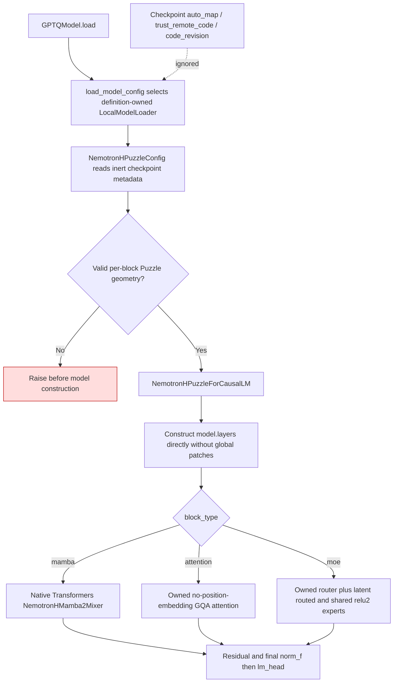
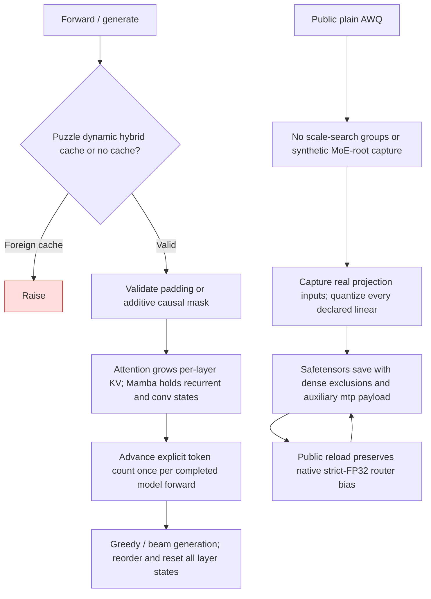

<!-- SPDX-FileCopyrightText: 2026 ModelCloud.ai -->
<!-- SPDX-License-Identifier: Apache-2.0 -->

# Nemotron-Labs-3 Puzzle local decoder

GPT-QModel selects this package directly through `NemotronHPuzzleQModel.loader`.
Transformers 5.23.0 has native `nemotron_h`, but **not** `nemotron_h_puzzle`.
Native Nemotron-H alone is not a replacement for Puzzle's heterogeneous expert
widths/top-k counts, latent projections, checkpoint owners and decoder root.

Introduced as part of [PR 4620](https://github.com/ModelCloud/GPTQModel/pull/4620).
The parent integrator owns the central docs/README links and PR diagrams; this
port-local page supplies their reference content without editing shared files.

## Selection and execution





| Mechanism | Before | Now |
| --- | --- | --- |
| Model selection | Inherited remote trust and AutoModel dispatch (`definitions/nemotron_h_puzzle.py:12` at base `22bea1201`) | Definition-owned config/model; checkpoint code cannot replace either |
| Heterogeneous blocks | Source temporarily replaces a process-global block class (`modeling_nemotron_h_puzzle.py:17-37`) | Explicit per-layer configs and constructors |
| Calibration compatibility | Runtime monkey patch visits remote MoE objects (`definitions/nemotron_h_puzzle.py:120` at base) | Owned MoE calls unsampled experts with zero contribution; real packed execution tested |
| Cache | Old checkpoint-specific cache API | Transformers 5 attention/linear cache layers plus explicit shared token count |
| AWQ | Generic inherited MoE folding/capture assumptions | Explicit plain quantization, no fold/search qualification |
| Auxiliary MTP | Source decoder ignores `mtp.*` at load (`modeling_nemotron_h.py:1595`) | Same execution boundary; GPT-QModel quantized saves preserve all source `mtp.*` tensors |

## Checkpoint and source ownership

Authoritative source:
[NVIDIA-Nemotron-Labs-3-Puzzle-75B-A9B-BF16](https://huggingface.co/nvidia/NVIDIA-Nemotron-Labs-3-Puzzle-75B-A9B-BF16/tree/8fe5546888e9bd03fdbf52d808adebdfca901b52),
pinned at `8fe5546888e9bd03fdbf52d808adebdfca901b52`. No checkpoint Python was
executed. `source_manifest.json` records SHA-256 of the inspected source/config/
index/license. The unchanged pinned config is `checkpoint_config.json`.

`checkpoint_shapes.json` contains independently range-read safetensors names
and shapes, with SHA-256 for each of the 32 headers. All **41,643 decoder keys
and shapes** match a real full-size meta model exactly (88 layers: 40 Mamba,
40 MoE, 8 attention). The remaining **1,040 `mtp.*` keys** are auxiliary payload,
not decoder-owned tensors. MTP execution/speculative decoding is not implemented
by the inspected source decoder and is not claimed here. Quantized wrapper
saves preserve this payload instead of silently dropping it.

Run `python scripts/read_nemotron_h_puzzle_checkpoint_headers.py /tmp/checkpoint_shapes.json` from the
repository root to export the expanded inventory from
the pinned Hub index and headers; it never fetches trained tensor bodies. Normal
runtime and offline tests neither import nor run that script.

Source changes are limited to per-layer native config adaptation, explicit
heterogeneous construction, native Mamba/RMS primitives, attention and causal
mask adaptation, Transformers 5 cache/generation APIs and calibration-safe MoE
invocation. Checkpoint owners remain `model.embeddings`, `model.layers`,
`model.norm_f`, `lm_head`; `fc1_latent_proj` and `fc2_latent_proj` stay inside each
MoE mixer. No native fused-expert conversion or weight renaming is used.

Licenses are **OpenMDW-1.1 and Apache-2.0**, not an Apache-only relicense. `LICENSE`
is the complete byte-identical NVIDIA model license; `LICENSE-APACHE-2.0` is the
installed Transformers Apache license. Preserve both, `NOTICE`, and source
metadata in distributions. The narrowly scoped `.gitattributes` preserves only
the upstream license's CRLF bytes/checksum; source whitespace checks stay enabled.
No optional `mamba-ssm`/CUDA dependency is required
for the validated native reference path; accelerator kernels remain unqualified.

## AWQ source/consumer boundary

| Producer | Actual consumers / transformations | Policy |
| --- | --- | --- |
| Block RMS norm | Mamba input projection, or Q/K/V, or router + shared up + latent fc1 | No fold: hybrid/multi-branch scoring not qualified |
| Mamba input projection | Split gate, conv, dt; selective state update, grouped norm, gate, output projection | No cross-state-space fold |
| Routed latent fc1 | Top-k expert up projections; relu2; down projections; weighted accumulation; latent fc2 | Plain quantize all affine projections; router excluded |
| Shared up projection | Nonhomogeneous relu2 then shared down and residual sum | `nosrc`; no fold/search |
| Attention V | Per-head weighting and GQA replication then output projection | No shape-only fold inference |

`awq_get_modules_for_scaling()` returns no groups. This is a deliberate,
unqualified **plain quantization** policy, tested with `fallback=None`, not a
silent recovery from a failed group. `awq_input_feature_aggregation()` returns
`None` because the shared `mixer` prefix also names sequence-sensitive Mamba/
attention; treating it as a pointwise MoE root creates a false missing-feature
failure. Neither override changes shared AWQ algorithms.

## Qualification and reproduction

Use Python 3.14.6t with `PYTHON_GIL=0`, Transformers 5.23.0, Torch 2.15.0 CPU,
released Tokenicer 0.0.17 and safetensors 0.8.0. The Tokenicer 0.0.14 consumer
run also exercised packing/inference/two reload cycles before its final MTP
assertion expansion. CPU checks run single-threaded except existing packer
implementation details; these results do not qualify concurrent model use.

From `tests/`:

```bash
PYTHON_GIL=0 /home/ubuntu/.venvs/gptqmodel-tf5/bin/python -m pytest -q \
  test_nemotron_h_puzzle_local_port.py \
  module_tree/test_nemotron_h_puzzle_local_port.py \
  test_nemotron_h_puzzle_support.py
```

Coverage includes:

- MHA/GQA/MQA, attention/MLP/Mamba bias, latent/non-latent routed experts,
  heterogeneous widths and top-k, single-type and mixed decoder layouts.
- Independent float64 full decoder equations: explicit no-RoPE attention,
  scalar-in-time selective recurrence and grouped gated Mamba norm, corrected
  top-k group selection and routed/shared relu2 experts. No port forward helper
  is used to construct these numerical expectations.
- FP32/FP16/BF16 eager/SDPA forward, causality and left padding, real replay,
  `1 + 4 + 1` cache continuation, reset, greedy and beam parity with uncached
  decoding, independent-oracle token generation, two exact safetensors cycles.
- All six public trust/bypass combinations with hostile checkpoint config/model
  maps; corrupt safetensors failure followed by restored-file retry.
- Three actual public plain-AWQ `pack -> infer -> save -> reload -> infer ->
  save -> reload` cases, offload on/off, `fallback=None`, all 16/18 physical
  decoder linears, deliberately unsampled experts, every packed/dense checkpoint
  tensor exact, strict-FP32 correction bias and auxiliary MTP payload retained.
- Full released checkpoint meta inventory and live `module_plan()` ownership
  for direct Mamba parameters, all persistent buffers and affine leaves;
  invalid/similar-prefix owners rejected and explicit fusion rejection.

Detection evidence:

| Defect | Intended regression |
| --- | --- |
| Injected 10% gain only on the latent routed branch | Six latent-oracle cases fail at numerical assertions (up to 0.0665 absolute logit error); six non-latent controls pass; restored model passes |
| Config-level `return_dict=False` reaches the inner decoder | Real causal-LM forward failed on tuple attribute access; the LM now explicitly requests its inner model output object and preserves outer tuple API behavior |
| Generic all-Mamba generation produces a mask dictionary after prefill | Real generation failed on the second step; retaining the caller padding mask for owned mask creation repairs it |
| Generic `:moe` root capture applied to a Mamba mixer | Public AWQ with `fallback=None` failed on missing `mixer` features before the model-specific policy |
| Parent-base tokenizer loader re-reads hostile AutoConfig when trust+bypass are both set | Actual public failure entered the marker-raising checkpoint code; parent security commit `5423ad629` fixes it |
| Parent-base quantized reload narrows correction bias | Exact persisted FP32 bias comparison failed with loaded FP16; parent `1df387890` fixes it |

The two parent commits are prerequisites, not port-owned work. Parent integration
must not duplicate their patches.

Final owned result: **96 passed, zero skips**, 17.88 seconds. `bash
format/check.sh` (Ruff 0.14.2), port/definition Pyright (zero errors), compileall
and `git diff --check` pass. The existing trained-model test was collected
(`models/test_nemotron_h_puzzle.py::TestNemotronHPuzzle::test_nemotron_ultra`),
not executed or reported as qualified.

Combined result: **890 passed, 479 skipped, 2 deselected**, 49.78 seconds,
with only the exact central JSON proposal substituted **in memory** by a
pytest collection hook. No shared fixture file was edited. The unpatched
central-fixture run has its one expected Puzzle plan mismatch; all other
tests passed. After the integrator applies the proposal, the equivalent test
selection is:

```bash
PYTHON_GIL=0 /home/ubuntu/.venvs/gptqmodel-tf5/bin/python -m pytest -q -rs \
  test_nemotron_h_puzzle_local_port.py test_nemotron_h_puzzle_support.py \
  module_tree/test_nemotron_h_puzzle_local_port.py \
  test_local_model_loading.py test_local_model_paths.py test_checkpoint_local_model.py \
  test_hf_config_compat.py test_internlm_local_port.py \
  module_tree/test_internlm_local_port.py module_tree/test_registered_module_plans.py \
  module_tree/test_fusable_models.py module_tree/test_nemotron_h_model_tree.py \
  test_awq_empty_groups.py test_awq_scaling_groups.py test_native_fp32_checkpoint_loading.py \
  -k 'not test_public_awq_reload_preserves_nonzero_native_router_bias_after_failure'
```

The deselection excludes two independently owned ERNIE public consumer cases
whose source fixture is absent in this branch; Puzzle's real public consumer
cases exercise the same strict-FP32 policy without that dependency. Skips are:
468 NVIDIA Marlin cases; two two-CUDA-checkpoint cases; one optional PEFT AWQ
import; two unavailable Nemotron Omni checkpoints; two unavailable Pangu and
one each Instella/K2-Horizon fixture; nonbuildable opt350/muse_glimmer sentinels.
None of the port-owned tests skips. The combined run reports 11 existing
warnings; no new warning suppression or skip was added.

## Integration-owned central expectations

`central_fixture_proposals.json` contains the exact two central JSON updates.
Replace `registered_module_plans.cases["NemotronHPuzzleQModel/gptq"]` with its
case, pinned independently by `EXPECTED_PLAN` in the module-tree test. It adds explicit
`mixer.A_log:!`, `mixer.D:!`, `mixer.dt_bias:!`, `mixer.conv1d:!`, `mixer.norm:!`,
`mixer.gate:!` exclusions; quantizable consumer order is unchanged. Set
`fusable_models.models.nemotron_h_puzzle.reason` to:

> Package-owned Nemotron-Labs-3 Puzzle heterogeneous Mamba/attention/latent-MoE decoder; fusion executor has not been qualified.

The existing generic AWQ `FAMILIES` does not list Puzzle, so no mandatory plain
family fixture edit is needed. The port's public consumer suite is the plain
AWQ qualification. Parent owns central docs, README, PR description, packaging
license/NOTICE/source metadata inclusion and any broad registry fixture edits.

## Explicit limits

No trained tensor payload or trained quality/perplexity evaluation was run.
No GPU, optimized Mamba kernels, FlashAttention, fused MoE/linear kernels,
multi-GPU/offload-device execution, threaded model execution, `torch.compile`,
training/gradients, arbitrarily long contexts or fusion qualification is claimed.
Only the owned dynamic cache is accepted; static/offloaded/quantized/foreign
caches and speculative crop are explicitly rejected. Attention weight outputs
are explicitly unsupported; hidden-state outputs are supported. No real released
tokenizer semantic qualification is claimed by the synthetic consumer fixture.
