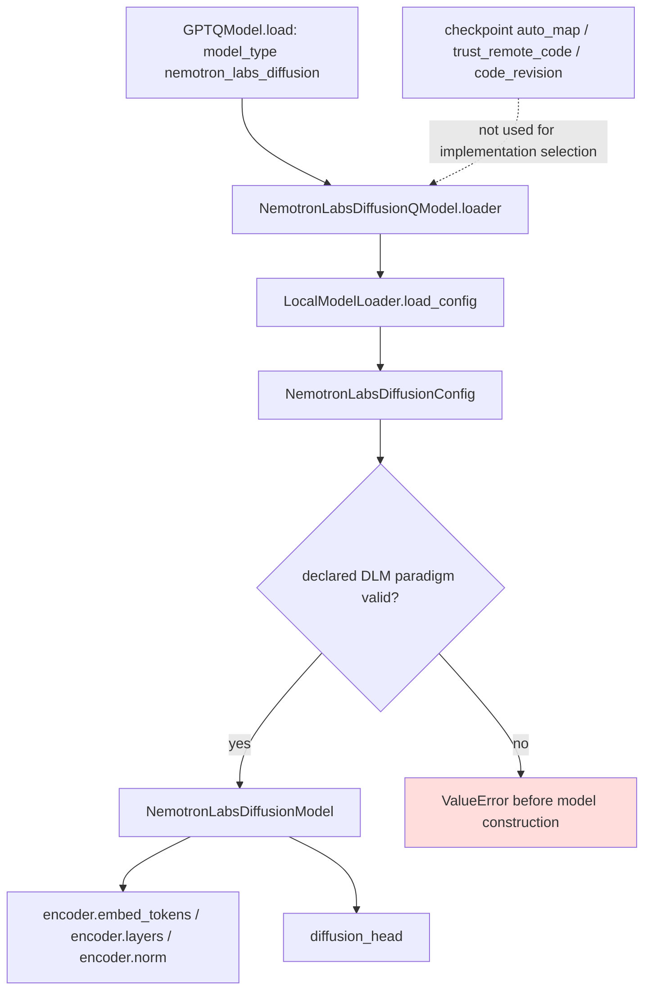
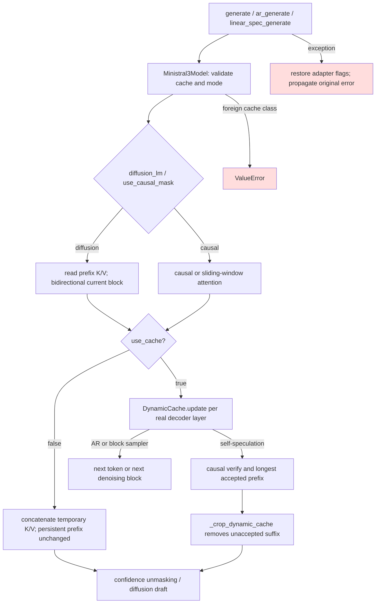

# Nemotron Labs Diffusion: package-owned Transformers 5 runtime

The `nemotron_labs_diffusion` definition loads NVIDIA's actual tri-mode decoder,
not native causal Nemotron, Nemotron-H or a generic Ministral substitute.
Transformers 5.23.0 has no exact native configuration/model mapping for this
model type. `LocalModelLoader` binds this package without global HF registration
or checkpoint Python execution, including when API trust and the safety bypass
are both enabled.

## Sources and licensing

* Model/code: [NVIDIA 3B checkpoint](https://huggingface.co/nvidia/Nemotron-Labs-Diffusion-3B/tree/0d51902da1f8869f83413ce642fab402fa5641e0),
  revision `0d51902da1f8869f83413ce642fab402fa5641e0`.
* Source license: [NVlabs repository](https://github.com/NVlabs/Nemotron-Labs-Diffusion/blob/2aabcf75ecf70264d4047ff090d842450853f2e4/LICENSE),
  revision `2aabcf75ecf70264d4047ff090d842450853f2e4`.
* `LICENSE` is byte-identical to that upstream dual-license notice; source code
  is Apache-2.0. `LICENSE-APACHE-2.0.txt` provides its full text. Trained weights
  have the separate NVIDIA Open Model License, not Apache-2.0. No weights ship
  here. Preserve `NOTICE`, both license files and `source_manifest.json` in
  distributions.

`source_manifest.json` pins inspected source/asset SHA-256 values. The complete
237-key released safetensors header was range-read without downloading tensor
payloads. `checkpoint_shapes.json` is the independently extracted key/shape
inventory, compared against the full released model constructed on meta.
`checkpoint_config.json` retains the released configuration as an audit fixture,
not a source of executable dispatch.

## Loading and weight ownership



| Before | Now |
| --- | --- |
| Definition's `AutoModel` and `require_trust_remote_code=True` (pre-port definition lines 4–10) | Lazy package-owned config/model and `require_trust_remote_code=False` |
| Checkpoint modeling/import APIs determine implementation | Definition-owned selection, no checkpoint Python dispatch |
| Layer-level mutable `self_attn.diffusion_lm` flags | Call-local mode passed down to real decoder layers |
| Obsolete cache crop target-length assumption | Transformers 5 negative removal count; retained prefix is verified numerically |
| Source CUDA compiled flex-attention training mask | Equivalent explicit mask using eager or SDPA, no import-time compilation |
| Shape-derived/default AWQ folding | Explicit empty scaling groups; every decoder linear still plain-quantizes |

Checkpoint names remain `encoder.embed_tokens`, `encoder.layers.N` (Q/K/V/O,
gate/up/down and two norms), `encoder.norm`, and `diffusion_head`. The released
Q width is 4096 even though hidden width is 3072. Bias flags are intentionally
ignored as in the inspected source's bias-free projection constructors. Optional
embedding/head tying is retained. There is one registered model-type alias;
the three config paradigms are not aliases for unrelated model families.

## Diffusion, causal decoding and verification cache



The three source paradigms are `bidirectional`, `autoregressive`, and
`block_diff`. Block-diff labeled forward uses the source noisy/clean two-half
mask: noisy block diagonal, offset clean-prefix visibility, and clean causal
attention, with RoPE applied independently to each half. Loss equations remain
available but this does not qualify distributed training.

Default RoPE and the released YaRN + Llama-4 query scaling are covered. Rotary
buffers are runtime-only FP32, including casts and lazy checkpoint loading.
Diffusion drafts read a full `DynamicCache` without changing it; causal commits
append K/V, and self-speculation crops rejected draft entries. Attention modes
do not mutate model/config flags. Attached adapter disable flags are restored
after success/failure; real trained LoRA payloads are not qualified.

The source block sampler allocates complete blocks (`max_new_tokens` must be
divisible by `block_length`) and retains its confidence, sampling, EOS and
thinking-budget rules. Self-speculation remains single-batch and can return a
whole accepted prefix beyond the requested budget, as upstream does; callers
requiring an exact ceiling should slice the returned continuation. Its draft
tracks finalized positions separately from token IDs, so predicting the mask
token cannot overwrite a committed seed or loop forever.

`generate()` retains `(output_ids, nfe)` and the source positional `prompt_ids`
API. It also accepts exactly one of `inputs` or `input_ids` for the public
GPT-QModel wrapper, including tokenizer-produced unpadded batches. Padded
generation is rejected rather than silently changing source cache positions;
ordinary padded forward attention remains supported. Generic HF beam/search
arguments are not implemented by this diffusion-specific sampler.

## AWQ policy

`awq_get_modules_for_scaling()` returns `[]`. Folding/search/replay across the
diffusion/causal mode boundary is **not qualified**. Plain AWQ is tested through
the actual public quantizer with `fallback=None`, not a fallback mock: MHA/GQA/MQA
× three paradigms × disk offload false/true, all fourteen physical projections
in a two-layer model, inference and AR generation, two safetensors save/reload
cycles, exact packed integer words/scales/zeros, and exact excluded dense
embedding/norm/head tensors. No shared AWQ algorithm is changed.

## Validation

Environment: CPython 3.14.6t (`sys._is_gil_enabled() == False`, `PYTHON_GIL=0`),
Transformers 5.23.0, Torch 2.15.0+cpu. Released Tokenicer 0.0.17 is used for final
public-loader tests; 0.0.14 also passed the earlier 66-case owned suite. No
claim of concurrent PyTorch safety follows from single-model CPU execution.

From the repository root, `PY` below is the isolated interpreter:

```bash
PY=/home/ubuntu/.venvs/gptqmodel-tf5/bin/python
PYTHON_GIL=0 "$PY" -m pytest -q --disable-warnings \
  tests/test_nemotron_labs_diffusion_local_port.py \
  tests/module_tree/test_nemotron_labs_diffusion_local_port.py

PYTHON_GIL=0 "$PY" -m pytest -q --disable-warnings \
  tests/test_awq_scale_search_safety.py tests/test_awq_moe_router_scaling.py \
  tests/test_awq_empty_groups.py tests/test_awq_position_kwargs.py \
  tests/test_awq_scale_search_memory.py tests/test_bloom_awq_replay.py \
  tests/module_tree/test_awq_relationships.py \
  tests/module_tree/test_bloom_awq_relationships.py \
  tests/module_tree/test_registered_module_plans.py \
  tests/module_tree/test_definition_subset_ordering.py \
  tests/test_local_model_loading.py tests/test_local_model_paths.py \
  tests/test_internlm_local_port.py \
  tests/test_nemotron_labs_diffusion_local_port.py \
  tests/module_tree/test_nemotron_labs_diffusion_local_port.py \
  tests/module_tree/test_fusable_models.py

bash format/check.sh
pyright --pythonpath "$PY" gptqmodel/models/ports/nemotron_labs_diffusion
"$PY" -m compileall -q gptqmodel/models/ports/nemotron_labs_diffusion
git diff --check
```

| Final validation | Result |
| --- | --- |
| Owned runtime/module-tree suites | 112 passed, zero skips, one warning, 27.17 s |
| Combined loader/InternLM/AWQ/registry/fusion suites above | 865 passed, 471 skipped, ten warnings, 63.91 s |
| `format/check.sh` with Ruff 0.14.2 | Passed |
| Port Pyright / compileall / diff whitespace | Passed |

Combined skips are 468 existing NVIDIA/CUDA/Marlin numerical fusion cases on
this CPU VM and three existing absent remote-model AWQ fixtures (DeciLM,
EXAONE, Nanbeige). None is an owned port skip. The trained-checkpoint evaluation
test is deliberately not included in these commands.

The runtime tests include an independent float64 decoder/YaRN/block-mask oracle,
FP32/FP16/BF16 eager/SDPA execution, causal continuation `1 + 4 + 1`, repeated
read-only drafts, scalar confidence-based diffusion generation, full-recompute
AR/self-speculation, stochastic AR, EOS/budget rules, partial failure/retry,
subfolder corruption/repair, and hostile model/tokenizer maps under public
trust false/true × bypass unset/0/1 × three dtypes. Exact persisted tensor
values/dtypes are checked, not merely finite logits.

Defect-detection experiments inject one wrong operation into the real runtime
in a separate Python process, without editing source files:

| Injected defect | Tests that fail for the intended reason |
| --- | --- |
| Replace diffusion keep-mask with causal mask | Three independent forward cases reject changed logits |
| Set `use_cache=True` for read-only drafts | Six prefix cases reject cache length/content mutation |
| Replace rotary `_apply` with ordinary `nn.Module._apply` | Six eager low-precision cases detect narrowed rotary buffers |
| Omit speculative cache crop | Full-recompute AR/speculation equality fails |

All four normal implementations pass those regressions. An earlier real red
with trust+bypass executed hostile tokenizer config code on the base loader;
the parent-owned tokenizer/config security prerequisite fixes it. Do not
integrate the prerequisite copy as an owned Nemotron change.

Separately, the pinned real 17 MB tokenizer asset was loaded offline through
`load_hf_tokenizer(..., model_config=<owned config>, trust_remote_code=False)`.
Latin, CJK, emoji, and special-token rows match raw serialized Tokenizers IDs
exactly; row IDs and asset hashes are in `source_manifest.json`. No tokenizer
normalization shim is added. This manual check is not a trained-model quality
or chat-template qualification.

## Integration owned by the parent

The registered module-plan fixture is unchanged and the owned tests assert its
exact ordering. No generic AWQ `PLAIN_QUANTIZATION_FAMILIES` update is needed:
this model is not in that suite's `FAMILIES` set. Replace only this fusion reason,
without admitting a fusion profile:

```json
{
  "models.nemotron_labs_diffusion.reason": "Package-owned Nemotron Labs Diffusion tri-mode decoder with read-only diffusion drafting and causal verification; fusion executor has not been qualified."
}
```

Per the exclusive file-ownership contract, the integrator owns the central
`docs/` reference page, README support/coverage tables, PR diagrams and package
data for licenses/notices/provenance. Reuse both diagrams and the before/after
table above there. No central fixture, loader, security, workflow or dependency
file is changed by this port.

## Deliberate limits

No trained tensor payloads, generation quality/perplexity, trained speculative
LoRA, GPU/CUDA, FlashAttention, flex/fused kernels, multi-GPU, concurrent model
execution, compilation, distributed training, full trained long-context behavior,
static/offloaded/quantized foreign caches or fusion qualification. Only full
DynamicCache execution is supported here; other cache classes fail explicitly.
The existing trained-checkpoint model evaluation test is not run. NVIDIA's
other 8B/14B, VLM and SGLang acceleration families are not this definition.
