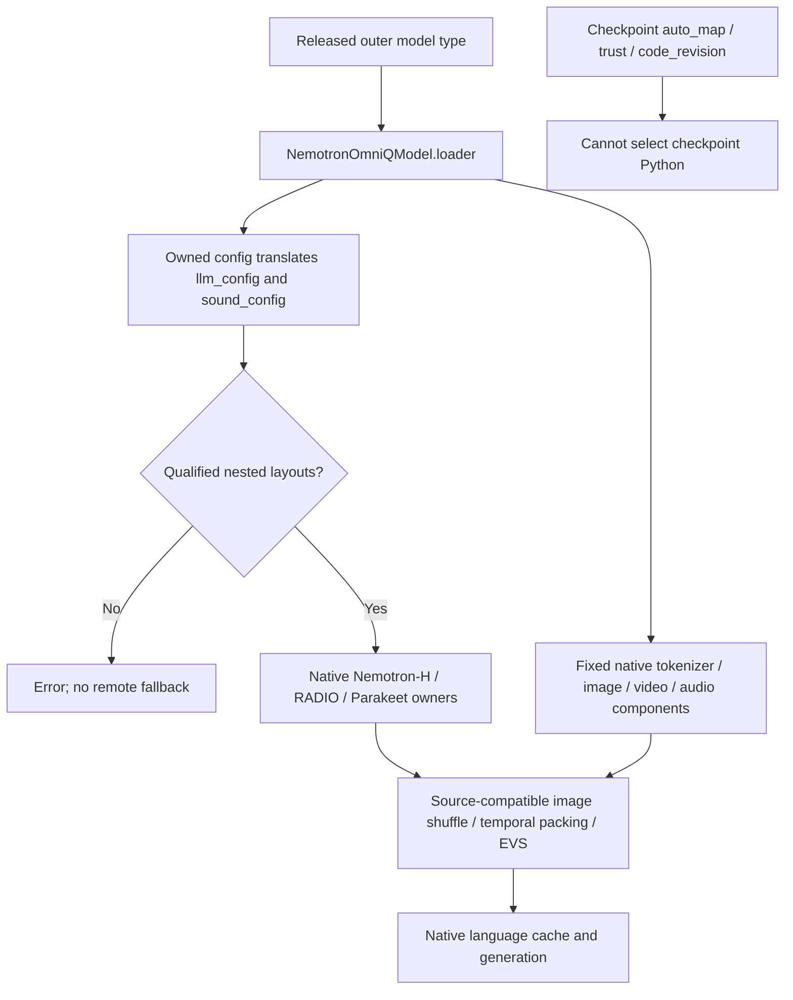
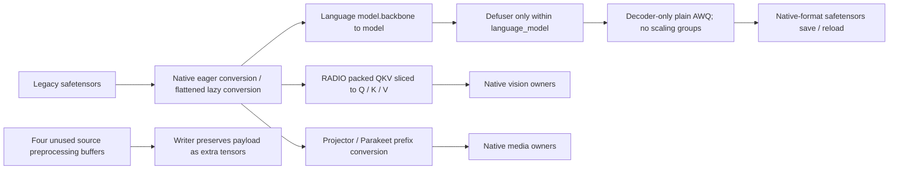
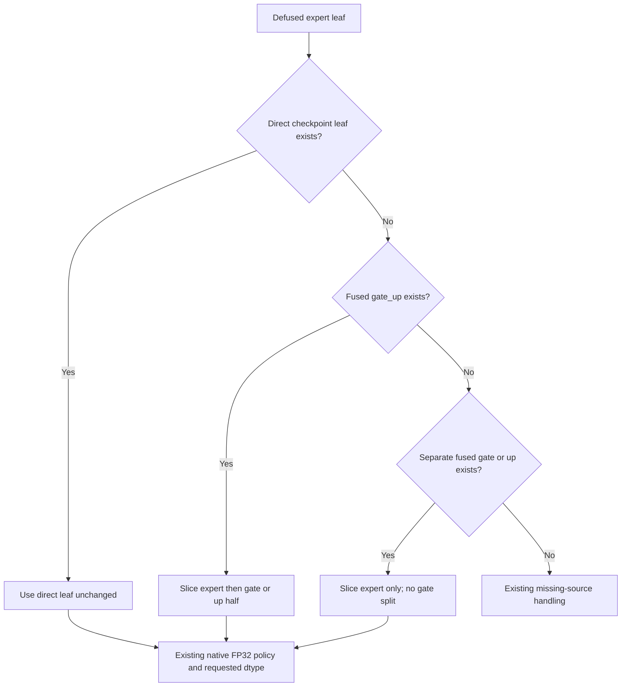

# Nemotron Nano Omni: native-first Transformers 5 binding

`NemotronOmniQModel` owns the released case-insensitive
`NemotronH_Nano_Omni_Reasoning_V3` outer type. Transformers **5.23.0** already
provides `nemotron_h_omni`, but its type and fields differ from the release;
its video merge also fails for a tensor returned by its own video encoder.
The binding reuses native Nemotron-H, RADIO, Parakeet, projectors and caches.
It does not vendor these models or register a global AutoModel override.

## Selection and lifecycle



| Before | After |
| --- | --- |
| Trust-required remote outer configuration/model | Definition-owned config/model descriptor; API trust does not change it |
| Legacy `language_model.backbone.layers` runtime | Native `language_model.model.layers`; checkpoint names convert |
| Checkpoint processor and tokenizer discovery | Fixed native components; serialized tokenizer data only; Tokenicer normalizes once |
| Native tensor passed to `torch.cat` on video path | Explicit temporal grid, padding and EVS before language generation |
| RADIO forward-time embedder swapping | Native separate image/video projections; no shared module mutation |
| Unqualified fusion | `fusable=None`; decoder plain AWQ only, no fold/search claim |



## Exact layout and numerical boundary

The 17 pinned safetensors headers contain **7,349** tensors. An independent
source-to-runtime shape oracle checks every key against a real meta model
after decoder expert defusion: **7,473** matching tensor owners, plus the
native deterministic two-element `vision_model.summary_idxs` buffer. RADIO's
32 packed QKV pairs become separate native projections. Four source buffers
(external input normalization and external audio featurizer) are not executed
inside the model; the definition declares them for writer preservation.
Legacy RADIO has no trained LayerScale: only the identity-valued native
LayerScale owners are removed for that explicit layout, not native-format
models which contain learned LayerScale. No missing learned source weight
is replaced by an architecture guess.

Supported configuration forms include legacy `llm_config` / `sound_config`
and native `text_config` / `audio_config`, image-only or audio-enabled towers,
RADIO `ps_version` v1/v2, MHA/GQA/MQA and attention/projection biases. Native
Nemotron-H's separate descriptor remains scoped to that sibling definition.
Unknown nested types, ambiguous aliases, unqualified RADIO adaptors/window
attention, invalid shuffle geometry and incompatible media counts fail closed.

The adapter changes native video behavior deliberately: source temporal padding
repeats the last frame; frame/channel packing is stable; EVS retains the first
spatial grid and a stable cosine-similarity top-k thereafter. Image/video
features are merged before beam expansion; native text cache state remains
request-local. Images and videos in one call, ragged/multirow video, and
generation from media without `input_ids` are not qualified. Image+audio is
qualified by the tiny suite. Source float32 normalization semantics are retained;
the source's hardcoded BF16 vision cast is generalized to the requested dtype.

## Reproduction

Run from the repository root, using the isolated CPU environment:

```sh
PYTHON_GIL=0 /home/ubuntu/.venvs/gptqmodel-tf5/bin/python -m pytest \
  tests/test_nemotron_omni_local_port.py \
  tests/module_tree/test_nemotron_omni_local_port.py -q
PATH=/home/ubuntu/.venvs/gptqmodel-tf5/bin:$PATH bash format/check.sh
git diff --check
```

The tests use real tiny native models, source-derived shuffle/temporal/EVS
equations, independent state-name conversion and malicious checkpoint Python
sentinels. They cover native cache continuation, greedy/beam generation,
FP32/FP16/BF16, eager/SDPA, safetensors and repair/retry. Plain-AWQ tests use
the actual public loader, image processor/calibration, quantizer and Torch
packed kernel with `fallback=None`, disk offload both ways, all 18 decoder
linears, dense exclusions and two exact packed-state safetensors reloads.

Meaningful negative controls were captured before repairs: legacy outer config
fell through AutoConfig; native video concatenated a Tensor incorrectly;
legacy RADIO had unowned learned LayerScale and a meta summary buffer;
nested native experts were not defused until the language-only path was
declared. The module-tree inventory rejects these ownership defects.

Final combined validation: **869 passed, 5 skipped, 11 deselected** in 52.39s.
This includes 51 owned model/module-tree cases and 28 isolated shared regressions,
plus loader, processor, path/security, native FP32, native sibling, generic AWQ
and registry suites. The Omni registry proposal and already-required native
Nemotron-H plain-AWQ admission were applied **in memory only** for that run;
the shared fixture files are unchanged. Three skips are an absent local Pangu
checkpoint, two are nonbuildable opt350/muse_glimmer CausalLM fixtures. Eleven
ERNIE cases are deselected because that independent port is absent here.
The full Ruff 0.14.2 gate, compileall and `git diff --check` pass. A separate
source `return_dict=False` regression fails before the wrapper repair and
passes with exact tuple logits afterward.

Pinned real tokenizer IDs/decode/chat match `tokenizer_oracle.json` through
GPT-QModel's Tokenicer-normalized public helper. A real image processor round
trip reproduces every output tensor exactly (1,120 packed patches, 280 image
placeholders); the small synthetic model tests do not imply trained-tokenizer
quality. The 17 MB real tokenizer data is not vendored; its pinned SHA-256
and manual oracle are retained for offline asset qualification.

## Separate expert checkpoint prerequisite

The isolated shared LazyTurtle change is not an Omni-specific shim. Native
Nemotron-H saves `experts.up_proj` as a three-dimensional tensor, while its
defused runtime uses `experts.<index>.up_proj.weight`. Gated models save
`experts.gate_up_proj` instead. The fallback keeps that gated pair first,
then tries an indexed slice of the separate projection without a gate split.
Direct indexed checkpoint leaves keep their existing first priority.



| Before | After |
| --- | --- |
| Missing `gate_up_proj` leaves separate-up experts on meta | Separate projection fallback slices its expert axis |
| Public native-source disk-offloaded AWQ cannot replay | Actual calibration, pack and two exact safetensors cycles pass |
| Gated, direct-indexed and FP32 policies | Same precedence and policies; independently tested controls |

The intended old-candidate-order probe fails eight cases (seven focused
materialization checks plus actual public modern-source `offload=True` AWQ),
with 21 gated/indexed/public controls passing. The fixed shared suite adds
real native Nemotron-H, Qwen3-MoE and Inkling shared-expert forward oracles;
28 shared cases pass. No FP32 policy helper is changed. Missing source shard
failure and same-reader repair/retry are exercised with real safetensors.

## Attribution and limits

See LICENSE (Apache-2.0 source), NOTICE, PROVENANCE.json, pinned source config,
compressed complete checkpoint header inventory, and tokenizer_oracle.json.
No model weights or checkpoint Python are distributed here. The model card's
NVIDIA Open Model Agreement still governs the trained model/weights/assets.

Validation is CPU-only on Python 3.14t with GIL disabled, Torch 2.15.0 and
Transformers 5.23.0. This is not a full trained-checkpoint, quality, throughput,
GPU, optimized Mamba/FlashAttention, multi-GPU, compile, training, concurrent
PyTorch, foreign/static/offloaded/quantized-cache, arbitrary video container
decoding, long-context or fusion qualification. Native MTP behavior is not
extended. Non-attention-only native cache restrictions remain native behavior.
The existing trained-weight support test is retained, not claimed executed.

The parent integrator owns central registry/fusion fixture updates, main docs,
README/PR diagrams, and package-data inclusion for licenses/notices/provenance
and runtime JSON. Exact proposed fixture values are packaged alongside
this README; no shared fixtures are edited by this unit.
