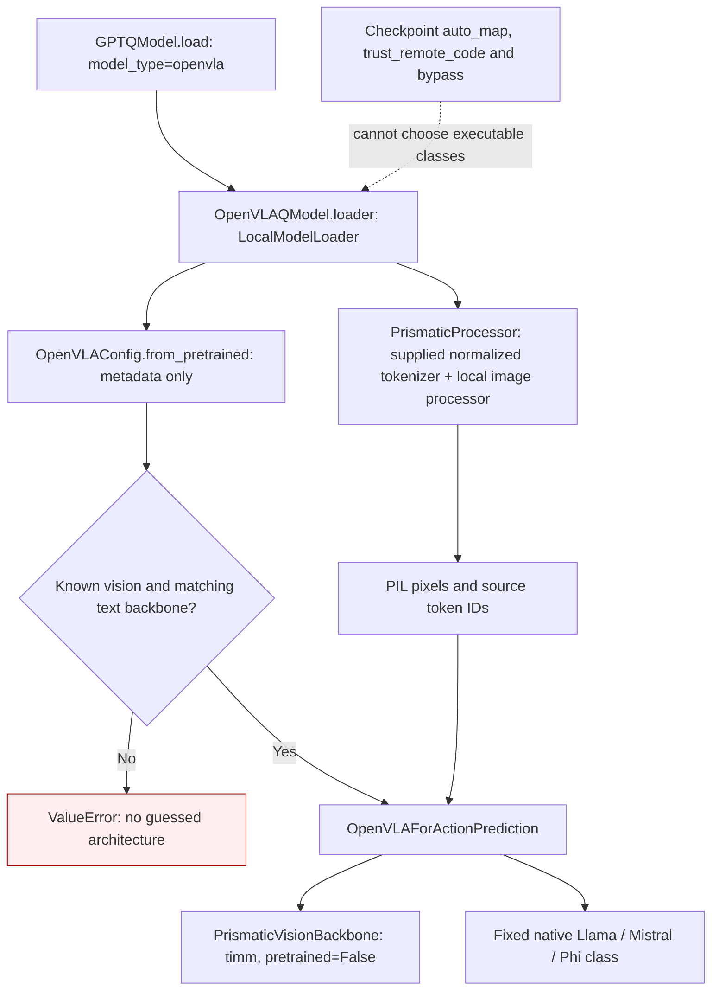
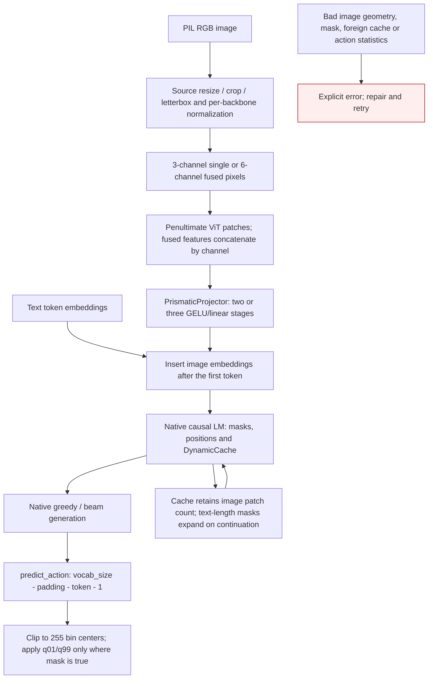

<!-- SPDX-FileCopyrightText: 2026 ModelCloud.ai -->
<!-- SPDX-License-Identifier: Apache-2.0 -->

# Package-owned OpenVLA / Prismatic port

`OpenVLAQModel` now owns its config, actual vision-language-action model and
processor through `LocalModelLoader`. Transformers 5.23.0 has neither an exact
`openvla` config mapping nor an image-text model mapping for this architecture.
This is not a generic native VLM substitution: the Prismatic wrapper, fused
vision features, projector, checkpoint names and action decoder remain local.
Only its actual Llama, Mistral and Phi language backbones use native Transformers.

## Sources and ownership

* Released checkpoint: [openvla/openvla-7b at 47a0ec7](https://huggingface.co/openvla/openvla-7b/tree/47a0ec7fc4ec123775a391911046cf33cf9ed83f).
* Authoritative code: [openvla/openvla at c8f03f4](https://github.com/openvla/openvla/tree/c8f03f48af692657d3060c19588038c7220e9af9), `prismatic/extern/hf/{configuration,modeling,processing}_prismatic.py` and `prismatic/vla/action_tokenizer.py`.
* `PROVENANCE.json` pins inspected code, data, header-rendering and license hashes.
* The full three-shard released inventory is **982 tensors**: 685 vision,
  six projector and 291 language tensors. All keys and shapes match the actual
  full-size meta model, not a tree-generated double. No trained weights were downloaded.

The source code is MIT; its exact license and notices are retained. The released
model card also labels OpenVLA MIT, but explicitly documents Llama-2 lineage.
The bundled released tokenizer data retains that lineage: `LICENSE-LLAMA2` and
`LLAMA2-USE-POLICY.md` preserve Meta's original bytes and terms. The code license
does not relicense underlying models, tokenizers or datasets. The narrow
`.gitattributes` entries preserve license whitespace and terminal blank lines.

## Before and after

| Boundary | Before | Now |
| --- | --- | --- |
| Definition `openvla.py:loader` | `AutoModelForImageTextToText`, mandatory trust | Fixed package-owned config/model/processor classes |
| Model selection | Checkpoint `auto_map` plus legacy vision2seq bridge | Local descriptor; trust/bypass cannot select checkpoint Python |
| Vision | Remote timm 0.9 compatibility patch and tuple-only unwrap | Lazy timm 1.x, actual penultimate patches, list unwrap, exact `scale_factor` keys |
| Text | Remote `AutoModelForCausalLM.from_config` | Explicit native Llama/Mistral/Phi classes, matching the declared backbone |
| Processor | Checkpoint `AutoProcessor` | Owned PIL transforms, native serialized tokenizer through Tokenicer |
| Cache | Legacy tuple and single-step assumptions | Native `DynamicCache`, image-expanded masks and per-cache visual metadata |
| Actions | Remote prompt and action postprocessing | Owned token 29871, 255 bin centers, q01/q99 and mask semantics |
| AWQ | Generic architecture inference | Explicit plain quantization, no unqualified scale groups |





## Supported layouts and numerical boundaries

All nine source vision IDs are kept: CLIP 224/336, SigLIP 224/384,
DINOv2, ImageNet ViT, DINO+CLIP 336 and DINO+SigLIP 224/384. The tests use
the real timm classes at small explicit geometry, not replacement vision modules.
Full release meta validation additionally pins the original 224-pixel fused geometry.
The final vision blocks, output norms and SigLIP attention pool stay checkpoint-owned
even though the reference model deliberately extracts **penultimate** patch features.

All nine source language IDs remain: Llama-2 7B/13B pure/chat, Vicuna 7B/13B,
Mistral pure/instruct and Phi-2. CPU/meta plans cover MHA/GQA/MQA, bias, and Phi's
optional per-head Q/K norms. Phi owns its distinct parallel decoder plan and
`final_layernorm`; no Llama-style gated MLP or final norm is substituted.

Independent float64 ViT/projector and Llama equations verify image insertion,
LayerScale, GQA/MQA and causal masking. The wrapper's Mistral/Phi computations
also match their directly selected native decoder with independently computed
image embeddings. Native eager/SDPA paths, FP32/FP16/BF16, cache continuation
`1 + 4 + 1`, assignment copies and two dense safetensors cycles run on CPU.
Low-precision fixtures are initialized through the native `_from_config(dtype=...)`
path so native FP32 rotary buffers are not accidentally narrowed by a blanket `.to()`.

Action tests use actual model generation, including controlled `LogitsProcessor`
decoding to known first/middle/last action bins. Independent scalar equations pin
prompt-space insertion, attention-mask extension, clipped bin indices, and masked
unnormalization. Invalid statistics, ambiguous datasets and malformed inputs fail
before generation; the same model works after repair. No robot is controlled by tests.

## Conservative AWQ policy

Every OpenVLA layout returns `[]` from `awq_get_modules_for_scaling`. No
source/consumer scale-fold or search qualification is claimed. This is the existing
architecture-level **plain quantization** contract, including `fallback=None`, not
an exception-swallowing fallback.

Twelve public tests calibrate on real PIL conversations through the definition's
processor and LazyTurtle/`StageInputsCapture` path: Llama/Mistral/Phi × single/fused
vision × disk-offload false/true. An independent image equation checks the actual
image-expanded first-decoder inputs. All 14 Llama/Mistral or 12 Phi decoder linears
quantize and pack; every excluded vision/projector/embedding/head/norm tensor stays
exact. Inference and two safetensors save/reload cycles compare every packed and
dense tensor and logits exactly. Phi's Q/K norms are exercised and remain dense.

## Security and data assets

Public loading tests use the real released tokenizer assets, nondegenerate PIL
images and malicious config/tokenizer/image-processor `auto_map` entries plus a
Python sentinel. API trust `None/False/True` × bypass unset/`0`/`1` never executes
checkpoint Python. Real action and multilingual token IDs survive processor saves.
Malformed image metadata and corrupt tokenizer data fail closed, then repair and
retry without changing source JSON bytes. No downstream tokenizer normalization
shim or extra runtime registration is introduced.

## Reproduce

Validated environment: Python 3.14.6t with `PYTHON_GIL=0`, Transformers 5.23.0,
Torch 2.15.0 CPU, timm 1.0.22 and released Tokenicer 0.0.17. `timm>=1.0.22`
is an integration dependency; torchvision/Pillow and serialized native tokenizers
use existing dependencies. No SentencePiece-only conversion is required by this port.

```bash
PYTHON_GIL=0 /home/ubuntu/.venvs/gptqmodel-tf5/bin/python -m pytest -q \
  tests/test_openvla_local_port.py tests/module_tree/test_openvla_local_port.py

PYTHON_GIL=0 /home/ubuntu/.venvs/gptqmodel-tf5/bin/python -m pytest -q \
  tests/test_awq_scale_search_safety.py tests/test_awq_moe_router_scaling.py \
  tests/test_awq_empty_groups.py tests/test_awq_position_kwargs.py \
  tests/test_awq_scale_search_memory.py tests/test_bloom_awq_replay.py \
  tests/module_tree/test_awq_relationships.py tests/module_tree/test_bloom_awq_relationships.py \
  tests/module_tree/test_registered_module_plans.py tests/module_tree/test_definition_subset_ordering.py

PYTHONPATH=tests/models PYTHON_GIL=0 /home/ubuntu/.venvs/gptqmodel-tf5/bin/python -m pytest -q \
  tests/test_local_model_loading.py tests/test_local_model_paths.py \
  tests/test_local_processor_loading.py tests/test_local_tokenizer_loading.py \
  tests/test_hf_config_compat.py tests/test_internlm_local_port.py \
  tests/module_tree/test_internlm_local_port.py tests/models/test_openvla.py -k 'not TestOpenVLA'

bash format/check.sh
git diff --check
```

The required AWQ baseline passed 574 tests, with three absent external checkpoint
fixtures skipped (DeciLM, EXAONE, Nanbeige). Loader/processor/tokenizer/config and
InternLM controls plus the existing small OpenVLA tests passed 170 tests, with one
absent optional PEFT dependency skipped and the trained OpenVLA test deselected.
The owned model and module-plan suites passed **193 tests without skips**. The
combined owned/AWQ/loader/processor/tokenizer/registry/InternLM/existing-OpenVLA
run passed **937 tests**, with those same four skips and one trained-test
deselection. The full pinned Ruff 0.14.2 gate and compileall pass. Default Pyright
over the owned runtime reports **21 diagnostics**, so static typing is **not
clean**; these include Transformers override signatures/class properties,
torchvision's Tensor-only PIL stubs, timm dynamic attributes and cache metadata.

### Defect-detection evidence

* Before retaining generated-cache visual metadata, the generated-cache continuation
  regression failed at `_cached_mask` with a six-token text mask versus ten cached
  multimodal positions. It passes after the per-cache fix.
* Before adding Phi Q/K norm exclusions, the real `qk_layernorm=True` CPU model
  failed ownership at `self_attn.q_layernorm.weight`; the full CPU/meta plan matrix
  passes after the effective-tree correction.
* A process-local defect changing the selected vision block from penultimate to
  final breaks all nine vision-equation cases; the tokenizer control passes.
  Nondegenerate channel-varying LayerScale values in the tiny vision fixtures
  make the DINOv2 block-selection difference observable rather than hiding it
  behind the source initializer's near-identity 1e-5 scales.
* A process-local defect using action-bin upper edges instead of centers breaks
  all six dtype/prompt-bin cases; the tokenizer control still passes.
* These probes modify the actual real-model computations, not a mocked kernel,
  and are not shipped runtime switches.

## Integration and limits

The default `OpenVLAQModel/gptq` registered plan is unchanged. The parent owns
central docs, README, package-data declarations and the fusion fixture reason:
`Package-owned OpenVLA Prismatic vision-language-action wrapper; fusion executor has not been qualified.`
Source distributions include the license and attribution files. No new global AWQ-family fixture entry is needed: the generic
AutoModelForCausalLM AWQ inventory does not enumerate OpenVLA.

Not qualified: trained 7B tensor payloads or robot/task quality; GPU, FlashAttention,
multi-GPU placement, simultaneous model execution, compilation/training, foreign,
static/offloaded/quantized caches, extended context, fusion executors or AWQ scale
fold/search. Native greedy/beam generation from fresh requests and ordinary
DynamicCache forward continuation are covered; arbitrary reused beam caches are
not. Only PIL images are accepted, not video or audio. The existing trained
`tests/models/test_openvla.py::TestOpenVLA` remains an unexecuted hardware/checkpoint
test, not evidence of trained-model qualification.
