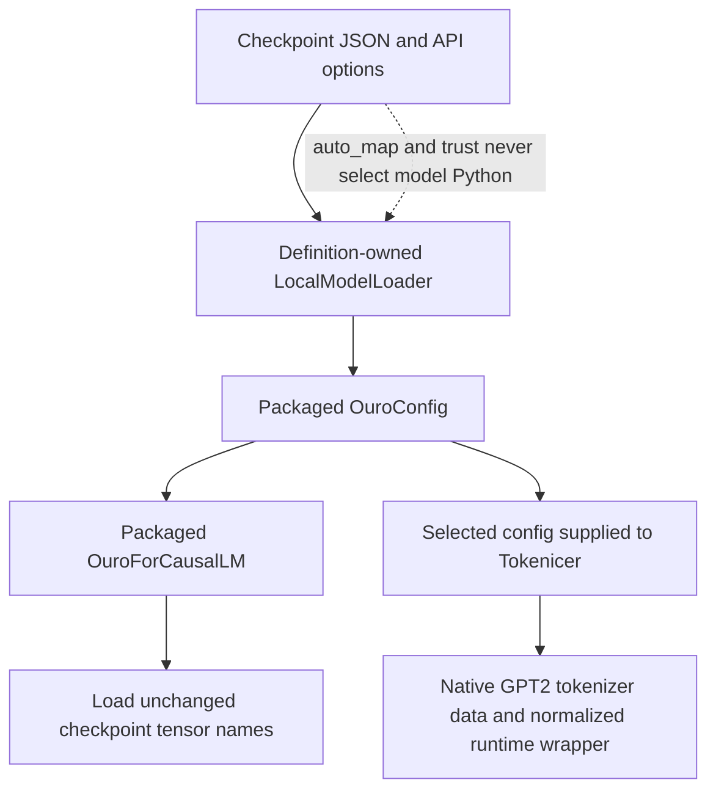
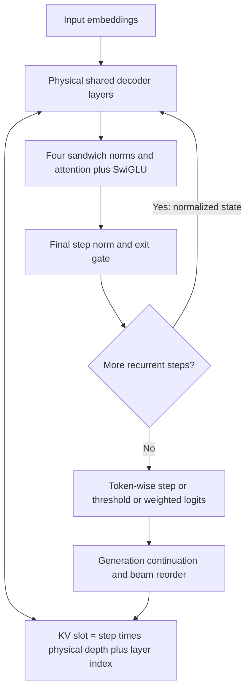

# Ouro on Transformers 5

This package implements ByteDance Ouro's recurrent shared decoder, rather than
substituting an ordinary Qwen2 causal model. Transformers 5.23.0 has no `ouro`
config or causal-LM Auto mapping. `OuroQModel.loader` selects these packaged
classes directly, regardless of checkpoint `auto_map`, caller trust, or the
security bypass. The old checkpoint rotary/mask monkeypatch is removed.

## Pinned source and ownership

| Hugging Face repository | Inspected revision | Header keys | Physical layers |
| --- | --- | ---: | ---: |
| [ByteDance/Ouro-1.4B](https://huggingface.co/ByteDance/Ouro-1.4B/tree/574fa66cb8bf5abdc979642d01cf2b79b16bfab1) | `574fa66cb8bf5abdc979642d01cf2b79b16bfab1` | 269 | 24 |
| [ByteDance/Ouro-2.6B](https://huggingface.co/ByteDance/Ouro-2.6B/tree/1ed04250da1a9936042725d302e81c8fa2ab5abd) | `1ed04250da1a9936042725d302e81c8fa2ab5abd` | 533 | 48 |
| [ByteDance/Ouro-1.4B-Thinking](https://huggingface.co/ByteDance/Ouro-1.4B-Thinking/tree/3aaa2224253a92ca45cf2e3d427c360e1ef9c93d) | `3aaa2224253a92ca45cf2e3d427c360e1ef9c93d` | 269 | 24 |
| [ByteDance/Ouro-2.6B-Thinking](https://huggingface.co/ByteDance/Ouro-2.6B-Thinking/tree/f1edd81e7ac41355db670500ceaf204e0f73af68) | `f1edd81e7ac41355db670500ceaf204e0f73af68` | 533 | 48 |

`source_manifest.json` hashes the inspected configuration, modeling, model-card,
tokenizer data and raw safetensors headers. `checkpoint_inventory.json.gz` stores
all four independent header-derived key/shape inventories plus released configs;
the meta tests compare the complete state dict, not selected projection samples.
Headers were obtained with HTTP range requests; no trained tensor data was needed.

The model cards declare Apache-2.0 and the upstream configuration carries the
Qwen/Hugging Face Apache notice. The inspected checkpoint repositories have no
standalone license file. `LICENSE` contains the canonical Apache-2.0 license text
and `NOTICE` preserves attribution. These files, source metadata, JSON references
and compressed header inventory must accompany package distributions.

## Preserved computation

Each physical layer has four sandwich RMSNorm weights, bias-free Q/K/V/O,
bias-free SwiGLU gate/up/down, and its original checkpoint names. A step runs all
physical layers then `model.norm`; this normalized state feeds the next step.
`model.early_exit_gate` predicts a token-specific exit distribution with the last
step receiving all remaining probability. Explicit valid step takes priority,
then cumulative threshold, then weighted exit, then final state. Labels select
the probability-weighted logits irrespective of the inference exit choice.
An invalid explicit step falls through to the other source policies.

All recurrent steps are computed even when an earlier state supplies logits:
exit selection is not a compute-skipping optimization. Each step/layer owns its
own full-history KV slot at `step * num_hidden_layers + layer_idx`. Sliding masks
do not truncate stored history. Native Transformers 5 DynamicLayer storage
provides correct mask sizes, batch reordering and continuation. Plain growing
native `DynamicCache` inputs are also preserved, and an empty configured native
cache that cannot grow to recurrent depth is replaced as in the source. A
non-dynamic cache, incompatible recurrent depth, or partially written cache is rejected rather
than silently reused. After an interrupted forward, clear or replace the cache
before retrying. Cache objects are request-local and not shared across requests.

The port reuses native Qwen2 config/RoPE primitives, not its decoder. This
preserves full-head rotation and adapts legacy RoPE metadata to Transformers 5.
The released 128-dimensional head and near-65535 rotation are checked after
FP32/FP16/BF16 loading against independent source equations; those inverse
frequencies remain FP32. Eager and SDPA use the same recurrent slot mapping.

| Before | After |
| --- | --- |
| `require_trust_remote_code=True` | Definition-owned packaged model/config |
| Runtime checkpoint rotary/mask imports | Native RoPE/mask API calls |
| Checkpoint-maintained flat KV lists | TF5 DynamicLayer-backed recurrent slots |
| Remote implementation decides exit behavior | Source-matched local token-wise exit policy |
| Generic AWQ norm/projection discovery | Explicit empty scaling policy; plain quantization |





## AWQ policy

`awq_get_modules_for_scaling()` returns `[]`. Sandwich post-norms and shared
recurrent consumers are not admitted to scale folding/search/replay merely
because projection shapes match. This still performs ordinary AWQ packing:
six public `GPTQModel.load`/`quantize` cases cover MHA/GQA/MQA and disk offload
disabled/enabled with `fallback=None`. All fourteen physical decoder linears
are packed; norms, embeddings, final head and early-exit gate remain dense.
Two save/load cycles compare every packed and excluded dense tensor exactly,
then execute inference and generation. Offload-enabled cases enter actual
checkpoint-backed LazyTurtle; offload-disabled CPU cases load directly.
Fusion remains unqualified (`fusable=None`). No shared AWQ algorithm is changed.

## Qualification and reproduction

Environment: Python 3.14.6t with `PYTHON_GIL=0`, Torch 2.15.0+cpu,
Transformers 5.23.0, released Tokenicer 0.0.17. All commands run from repository
root using `/home/ubuntu/.venvs/gptqmodel-tf5/bin/python`.

```sh
PYTHON_GIL=0 python -m pytest -q \
  tests/test_ouro_local_port.py tests/module_tree/test_ouro_local_port.py
PYTHON_GIL=0 python -m pytest -q -rs \
  tests/test_ouro_local_port.py tests/module_tree/test_ouro_local_port.py \
  tests/test_local_model_loading.py tests/test_local_model_paths.py \
  tests/test_trust_remote_code_isolation.py tests/test_hf_config_compat.py \
  tests/test_internlm_local_port.py tests/module_tree/test_internlm_local_port.py \
  tests/test_awq_scaling_groups.py tests/test_awq_empty_groups.py \
  tests/module_tree/test_registered_module_plans.py \
  tests/module_tree/test_fusable_models.py
bash format/check.sh
uv tool run --from ruff==0.14.2 ruff check gptqmodel docs/eora tests setup.py
python -m compileall -q gptqmodel/models/ports/ouro
git diff --check
```

Final owned run: **73 passed, no skips**. Combined loader/security/native-sibling/
AWQ/registry/fusion run on released Tokenicer 0.0.17:
**831 passed, 475 skipped, 11 warnings in 30.59s** (0.0.14 also passed the same
831 cases with identical skips in 23.61s).
Skips are 468 NVIDIA-only Marlin numerical cases, one missing PEFT dependency,
four missing unrelated checkpoint-fixture cases, and two nonbuildable generic
CausalLM families (`opt350` and `muse_glimmer`). Full repository Ruff 0.14.2,
`format/check.sh`, compileall, package discovery and diff whitespace gates pass.

The owned tests use an independent float64 decoder/exit/KV oracle, full header
inventories, MHA/GQA/MQA, recurrent depths 1/3/4, sliding and full masks, FP32/
FP16/BF16 eager/SDPA continuation, padded inputs, greedy/beam generation,
assignment replacement, safetensors roundtrips, hostile model/config/tokenizer
maps with trust False/True and bypass absent/0/1, corrupt-checkpoint repair/retry,
interrupted-cache clear/rebuild, real module owners and capture of every recurrent
layer use. Tests do not depend on multi-GB weights, CUDA or remote Python.

Red/green evidence:
- Before the local definition binding, the owned-loader assertion failed.
- Before the parent config/tokenizer security prerequisite, trust True with
  bypass enabled executed the test-owned checkpoint sentinel. Both shared
  prerequisites are qualification-only and excluded from this port's commits.
- An invalid-step weighted-exit case failed all 256 logits (max absolute error
  1.52955) before fixing fallback precedence, then passed.
- An in-memory 10% RMSNorm gain mutation fails all 18 independent decoder-oracle
  cases; removing it restores the unmodified owned suite. This is a sensitivity
  probe, not a shipped alternate execution path.

Real release tokenizer data were additionally downloaded by the exact pins above
and verified offline: raw serialized Tokenizers IDs versus native GPT2Tokenizer
and Tokenicer for Latin, whitespace, CJK, accented text, emoji and code; decoded
text, EOS, chat rendering/chat IDs and save/reload. All four releases passed all
six trust/bypass combinations (24 manual real-asset cases). The data SHA hashes
and exact prompt/ID references are committed in the two JSON files. The unit
suite's tiny public model fixtures use WordLevel data to avoid committing large
tokenizer assets; those are loader/security tests, not tokenizer-quality tests.
No tokenizer normalization shim was added.

## Explicit limits

No trained tensor payload or quality/perplexity benchmark was run. CUDA,
FlashAttention, optimized/fused kernels, multi-GPU placement, threaded execution,
`torch.compile`, training/gradient checkpointing, fusion and AWQ scale search
are not qualified. The package-owned dynamic cache and plain full-history native
DynamicCache are qualified; static/offloaded/quantized/other cache interoperability
is not qualified.
Near-boundary rotary math is not a full-length context or dynamic-RoPE
crossing-context qualification. The existing GPU/trained-checkpoint model test
was migrated away from remote trust but not executed on this CPU VM.

Integration owns the central docs/README/PR diagrams and package-data inclusion.
The registered module-plan baseline is unchanged. The exact fusion-reason
proposal is in `central_fixture_proposals.json`; stale generic Ouro support tests
that expect checkpoint imports must be migrated by the integrator.
