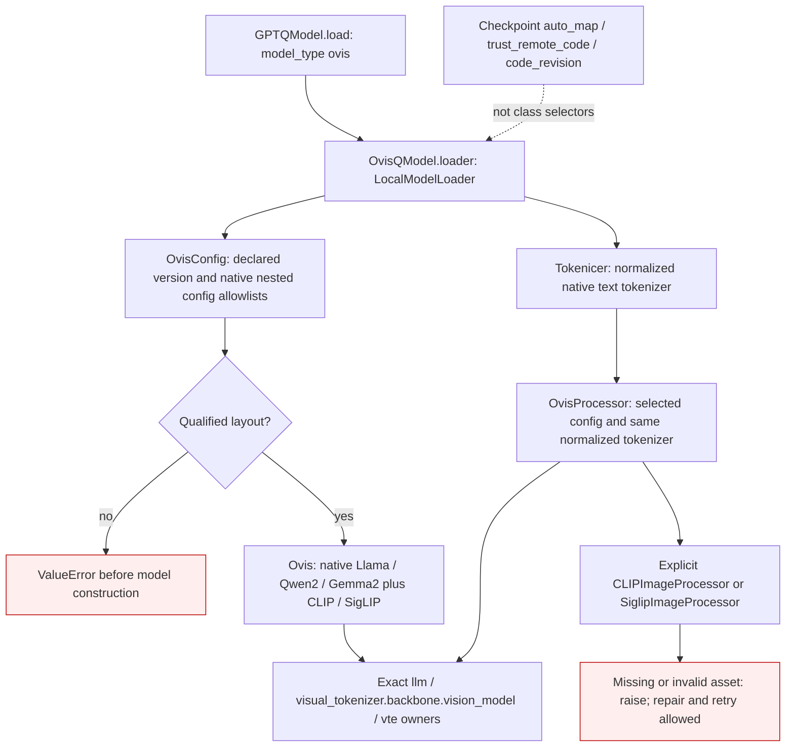
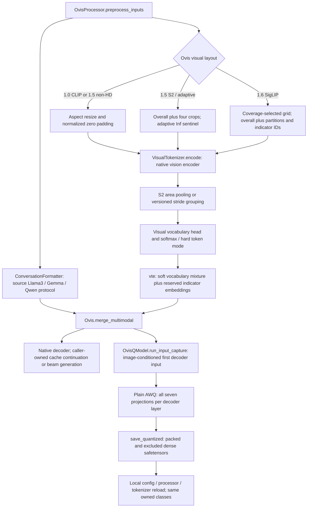

<!-- SPDX-FileCopyrightText: 2026 ModelCloud.ai -->
<!-- SPDX-License-Identifier: Apache-2.0 -->

# Ovis 1.x visual-vocabulary wrapper

GPT-QModel owns the legacy `ovis` configuration, visual tokenizer, multimodal
merge, conversation protocols and processor. The decoder and vision encoder
are the exact native Transformers 5 Llama/Qwen2/Gemma2 and CLIP/SigLIP classes.
Transformers 5.23.0 has **no** `ovis` config or causal-LM mapping. Its native
`ovis2` is a different architecture, not an Ovis 1.x substitute. No global HF
registration, checkpoint Python import or runtime source download is used.

## Source and license boundary

The primary source is the Python/data metadata in the following pinned AIDC-AI
releases. Files were inspected, not imported. `source_manifest.json` records
SHA-256 digests for the inspected model/config/formatter/processor metadata and
indices, plus complete safetensors headers where available. It also pins the
three manually qualified real tokenizer asset sets and generation configs.
`release_inventory.json.gz` contains the independently read full key sets,
configs and available tensor shapes, not weights. Tests compare these with
actual package-owned meta model state, not a tree-generated fake model.

| Release under `https://huggingface.co/AIDC-AI/` | Revision | Keys | Header shapes |
| --- | --- | ---: | ---: |
| Ovis-Clip-Llama3-8B | `82f62bfb08f147934de86012e9137cc557de2dfd` | 686 | index only |
| Ovis-Clip-Qwen1_5-7B | `a77263ae81657e63a4bc67576cebb7ebaaef0130` | 782 | index only |
| Ovis-Clip-Qwen1_5-14B | `5c7f6a334ffa534e5a2f3c3d248b3aac254e56de` | 878 | index only |
| Ovis1.5-Llama3-8B | `96e1ad0c86847b123325b8cad3632014de603133` | 743 | index only |
| Ovis1.5-Gemma2-9B | `f46106687c865757e9f62b86729f03ee9b34e5fd` | 917 | 917 |
| Ovis1.6-Llama3.2-3B | `b8d93d7468f47fd803eb26ec2c1bc2d7e5fba60e` | 706 | 706 |
| Ovis1.6-Gemma2-9B | `12bef7aa20342acad19134979ba275b49ead2523` | 916 | 916 |
| Ovis1.6-Gemma2-27B | `52949012466af8838f133c240bb3c3550dc161db` | 960 | 960 |

The four index-only releases publish legacy pickle indices. Only their JSON
indices were read; their tensor payloads were not downloaded or unpickled.
Four safetensors releases were audited using all 24 shard headers. Native
Gemma2 tied lm-head aliases absent from an index are checked as tied storage,
not treated as missing trained tensors.

Ovis code is Copyright 2024 AIDC-AI, Apache-2.0. `LICENSE` is byte-preserved from
the [authoritative project](https://github.com/AIDC-AI/Ovis) at
`e1916bf3cb0ca123e71ab173ff4463df5c3a71b5`, SHA-256
`01bf9abbb1a19c4c7841bfdd80f0e5953c59a1a4a40fb2d43f2ea2c9101f520c`.
`NOTICE` records adaptation and installed-native ownership. This does not
relicense underlying Llama/Gemma/Qwen or vision/tokenizer weights or datasets.
No trained payload or tokenizer vocabulary is bundled.

## Selection and failure contract



Version selection uses explicit saved `ovis_version` first, then legacy visual
metadata: presence of `hd_booster` selects 1.5 (including null and CLIP); CLIP
without it selects 1.0; otherwise the SigLIP path selects 1.6. Unknown native
nested model types, versions, formatter classes and visual modes fail closed.
The selected processor strips remote-code arguments and constructs concrete
image processor classes. It does not consult checkpoint processor `auto_map`.

| Before, at base `0fdfd2396` | After |
| --- | --- |
| `definitions/ovis.py:23-36`: remote/native wrapper assumed, prefix-remapping shim | Package-owned loader and exact released backbone prefix |
| `definitions/ovis.py:57-65`: TF4 dtype repair and forced generation limit | Native requested dtype; caller generation policy retained |
| Implicit checkpoint wrapper/config/formatter construction | Explicit native owner allowlists and local Ovis formatter/processor |
| Gemma2 embedding gain implicitly in decoder forward | Gain applied once after multimodal merge before TF5 decoder |
| Old Gemma2 HybridCache hint | Native DynamicCache; obsolete hybrid hint normalized on a cloned generation config |
| TF5 no longer mixes generation into PreTrainedModel automatically | Explicit GenerationMixin keeps released generation metadata and two saved policies intact; checkpoint custom generation stays disabled |
| Implicit generic AWQ folding assumptions | Explicit empty scaling groups; actual decoder-only plain quantization |

## Image and tensor lifecycle



The nine tiny layout cases include both 1.0 CLIP decoders, plain/S2/adaptive
1.5 SigLIP, source-declared S2/adaptive CLIP and both 1.6 decoders. The tests
also cover legacy stride three, optional visual indicators and all three
visual tokenization functions. MHA/GQA/MQA and bias variants exercise actual
native projection owners; real-release meta inventories cover all eight
published geometries above.

Only `llm.model.layers.*.self_attn.{q,k,v,o}_proj` and
`llm.model.layers.*.mlp.{gate,up,down}_proj` quantize. Embeddings, visual encoder,
visual head, `vte`, rotary, final norm and decoder norms remain dense. Gemma2
has two additional explicitly excluded feedforward norms in its effective
module tree. No scale-search/fold qualification is inferred from widths or
from a successful module-plan test. Empty groups deliberately choose plain
quantization even with `fallback=None`.

Native Gemma2 does not support SDPA softcapping in Transformers 5.23. The wrapper
advertises that same capability: default/eager is valid and an explicit SDPA
request raises. Llama/Qwen2 eager versus SDPA numerical parity is tested.
Per-call multimodal state is local; native cache objects remain caller-owned.
This is not a parallel-execution or GIL=0 thread-safety qualification.

## Regression evidence and reproducible gates

Environment: Python 3.14.6t with `PYTHON_GIL=0`, Transformers 5.23.0,
Torch 2.15.0+cpu, published Tokenicer 0.0.17, Ruff 0.14.2.

| Test/invariant | Detection evidence |
| --- | --- |
| Independent float64 CLIP/SigLIP attention/MLP, S2 pooling, visual vocabulary and multimodal embedding merge | Removing post-merge Gemma2 gain: 2 fail / 7 controls pass, max absolute difference 0.2918; correct code: 9 pass |
| Same oracle, nontrivial spatial features and 1.6 padded stride grouping | Swapping grid axes: 2 fail / 7 controls pass, max absolute difference 0.2147; correct code: 9 pass |
| Real image calibration reaches first decoder before packing | Clamping negative image IDs in input capture: expected 53 positions becomes 32; target case fails at captured tensor assertion |
| Native CPU/meta state owners | All eight complete release indices and four full header shape inventories match; actual Defuser and ModulePlan consumers |
| Cache and serialization | Three dtypes, 1+4 cache continuation versus fresh full forward, greedy/beam, two safetensors cycles, exact state/logits |
| Public security and retry | Nine layouts x trust false/true x bypass unset/0/1, hostile config/model/tokenizer/image/processor maps; no Python sentinel; model/tokenizer/image asset repair and retry |
| Actual plain AWQ | Four image layouts x offload false/true, independent first-decoder capture oracle, all 14 linears packed, excluded dense state unchanged, two exact packed/dense/logit reloads |
| Released generation policies | Omitting GenerationMixin ignores source BOS/EOS/sampling/cache metadata: 3 intended failures (2.60s); fixed implementation: 3 pass with two real safetensors cycles; 54 hostile custom-generation controls also pass |

```sh
PYTHON_GIL=0 python -m pytest tests/test_ovis_local_port.py tests/module_tree/test_ovis_local_port.py -q --disable-warnings
PATH="/home/ubuntu/.venvs/gptqmodel-tf5/bin:$PATH" format/check.sh
python -m compileall -q gptqmodel/models/ports/ovis gptqmodel/models/definitions/ovis.py tests/test_ovis_local_port.py tests/module_tree/test_ovis_local_port.py
git diff --check
```

Owned suite: **209 passed, no skips** (14.96s); including the existing generation
wrapper regression: **210 passed, no skips** (15.58s).
The preinstalled Tokenicer 0.0.14 also passed the then-current 177-case suite;
the final qualification uses the published 0.0.17 dependency, not an unreleased
candidate or a downstream normalization shim.

Separately, actual pinned Llama3.2, Gemma2 and Qwen1.5 tokenizer assets were
loaded through public GPT-QModel loads with tiny real models at released
vocabulary sizes. Four Latin/whitespace/CJK/Unicode/image-marker strings match
direct native token IDs and decode; source Ovis formatting, PIL image inference,
generation and tokenizer/model/processor save/reload pass on both Tokenicer
0.0.14 and 0.0.17. The final published-0.0.17 run additionally verifies all
three pinned released generation policies. These manual real-asset results are not the synthetic
WordLevel tokenizer fixtures used to keep unit tests offline. No tokenizer
correction or checkpoint-code fallback was needed.

The required AWQ onboarding baseline passed **574 tests**, with three existing
remote-fixture skips (`decilm`, `exaone`, `nanbeige`), in 11.48s:

```sh
PYTHON_GIL=0 python -m pytest -q \
  tests/test_awq_scale_search_safety.py tests/test_awq_moe_router_scaling.py \
  tests/test_awq_empty_groups.py tests/test_awq_position_kwargs.py \
  tests/test_awq_scale_search_memory.py tests/test_bloom_awq_replay.py \
  tests/module_tree/test_awq_relationships.py \
  tests/module_tree/test_bloom_awq_relationships.py \
  tests/module_tree/test_registered_module_plans.py \
  tests/module_tree/test_definition_subset_ordering.py --disable-warnings
```

The broader affected-family gate passed **1335 tests**, with 488 skips, two
explicitly deselected unrelated failures and three existing xfails, in 114.04s:

```sh
PYTHON_GIL=0 python -m pytest \
  tests/test_ovis_local_port.py tests/module_tree/test_ovis_local_port.py \
  tests/test_ovis_generate_wrapper.py tests/test_local_model_loading.py \
  tests/test_local_processor_loading.py tests/test_local_tokenizer_loading.py \
  tests/test_local_model_paths.py tests/module_tree/test_registered_module_plans.py \
  tests/module_tree/test_registry_leaf_coverage.py tests/test_awq_scaling_groups.py \
  tests/module_tree/test_definition_subset_ordering.py tests/test_awq_empty_groups.py \
  tests/module_tree/test_awq_fold_safety_4175.py tests/module_tree/test_fusable_models.py \
  tests/test_vlm_prepare_dataset_contract_4633.py tests/test_vlm_mapping_calibration_4308.py \
  -k 'not test_minicpmv_4_6_linear_attn_tags_preserve_layer_output and not test_intern_s2_preview_linear_attn_tags_preserve_layer_output' \
  -q -rsrx --disable-warnings
```

The two excluded central fold tests were run first and fail their assumption
that unrelated MiniCPMV4.6/InternS2 definitions return nonempty scaling groups;
their plain-quantization policies are outside this unit. No shared test was
changed. Skips are 468 NVIDIA Marlin hardware cases, 15 unrelated configurations
not constructible offline, three absent Pangu checkpoints and two non-CausalLM
fixtures (`opt350`, `muse_glimmer`). Existing xfails cover Mllama cross-attention
and UnlimitedOCR registry gaps. None of these are claimed qualified by Ovis.

## Integration contract and limits

The default `registered_module_plans.json` Ovis case is unchanged. The parent
integrator should replace only `fusable_models.models.ovis.reason` with:

> Package-owned Ovis 1.x visual-vocabulary wrapper with native Llama/Qwen2/Gemma2 decoder; fusion executor has not been qualified.

No generic AWQ plain-family set update is required: `ovis` is not part of that
test's family inventory. The integrator owns central README/docs/PR diagrams
and packaging of this directory's LICENSE/NOTICE/source manifests/fixtures.

Not qualified: trained tensor payloads or generation quality, GPU/FlashAttention,
fused vision or decoder kernels, multi-GPU/offloaded model execution, parallel
PyTorch execution, compile/training/gradients, foreign/static/offloaded/quantized
KV caches, long-context crossing parity or AWQ fold/search. Only native dynamic
cache execution on the tested tiny text/vision models is claimed. The existing
trained Ovis model test was migrated away from remote trust, not executed on
its absent `/monster/data/model` checkpoint.
