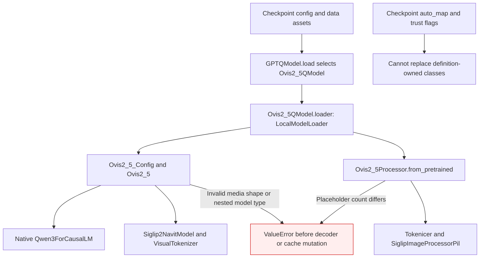
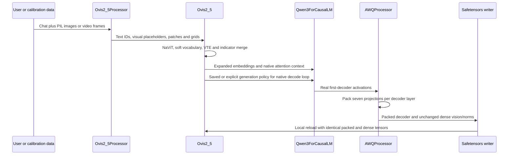

# Ovis2.5 local Transformers 5 port

GPT-QModel owns the `ovis2_5` config, model and processor through `LocalModelLoader`.
Transformers 5.23.0 has no exact `ovis2_5` config or causal-LM mapping. Its native
`ovis2` implementation has a different layout and remains separate.

## Sources and licenses

| Release | Inspected revision | Tensor inventory |
| --- | --- | --- |
| [AIDC-AI/Ovis2.5-2B](https://huggingface.co/AIDC-AI/Ovis2.5-2B/tree/393c932b2a03e28eb9aaa503e3c4ab3ad384d958) | `393c932b2a03e28eb9aaa503e3c4ab3ad384d958` | 751 keys, two safetensors headers |
| [AIDC-AI/Ovis2.5-9B](https://huggingface.co/AIDC-AI/Ovis2.5-9B/tree/d73b2283ae2a930b7762f8d7b8b8a3f0f3b5c3bd) | `d73b2283ae2a930b7762f8d7b8b8a3f0f3b5c3bd` | 840 keys, four safetensors headers |

`source_manifest.json` pins the inspected Python/config/index/license files and
cached header JSON hashes. `released_headers.json.gz` records every key, shape and
dtype read from the six actual safetensors headers by byte ranges. No trained
tensor data was downloaded. The original source was inspected as text, never
imported to construct this port. The runtime uses package-relative imports.

Upstream code and both model releases declare Apache 2.0. The upstream short
`LICENSE`, both release-specific notices, and adaptation `NOTICE` are retained.
The full Apache 2.0 license is at the repository root. The native Qwen3 dependency
and upstream Siglip2/Qwen attribution are identified in those notices.

## Checkpoint layout and computation

Both releases retain `llm.*`, `visual_tokenizer.vit.vision_model.*`,
`visual_tokenizer.head.*` and `vte.weight`. The 2B header omits the tied
`llm.lm_head.weight` alias; the live module owns the same parameter as
`llm.model.embed_tokens.weight`. The 9B header includes that alias. The full meta
tests explicitly account for this difference without deleting checkpoint keys.

The decoder is exact native Qwen3. Custom Siglip2 NaViT performs patch projection,
interpolated absolute positions, two-dimensional RoPE, per-frame window or full
attention, and merged patch groups. The visual tokenizer consumes the source's
final intermediate encoder state **before** the otherwise retained post-layer
norm. A linear/LayerNorm head, FP32 softmax and four zero indicator columns yield
soft visual-vocabulary vectors. Multiplication by `vte.weight` produces decoder
embeddings. Image/video indicator rows remain the final four embedding rows.

Both convolutional and linear patch projection, positional embedding/RoPE on and
off, and window/full attention selections are retained. The source supports
`temporal_patch_size=1`; other values fail explicitly. Native text MHA/GQA/MQA,
optional projection bias, tied/untied embeddings, and eager/SDPA remain available.
Default image budgets match both source variants: minimum `448*448`; maximum
`1344*1792` for 2B and `1792*1792` for 9B. Explicit config/API pixel budgets persist
through serialization, allowing tiny qualification without changing defaults.

Prompt rendering uses the selected native tokenizer plus the released template.
The processor accepts images or one sequence of PIL video frames; the source's
restriction against mixing image and video content is preserved. Generation
precomputes visual embeddings and delegates the complete cache/beam loop to native
Qwen3. It returns newly generated tokens, as the source does. The source's optional
two-stage thinking-budget continuation is retained for one prompt and tensor output.
The wrapper forwards its saved or explicit generation policy to Qwen3, including
the release's sampling/EOS fields and `multimodal_max_length=8192`. Both pinned
`generation_config.json` assets have SHA-256
`f12d4b54c91ffda6a118067044ef4beffae0a500c20a25b5542ea676b0bcfffa`.

## Selection and tensor lifecycle

| Before | Local port |
| --- | --- |
| Checkpoint `AutoConfig`/`AutoModelForCausalLM` needed custom Python | Definition selects packaged classes directly under either trust value |
| Checkpoint processor discovery | Packaged processor with explicit native image/tokenizer asset readers |
| Negative multimodal IDs could be replaced by generic calibration sanitization | Source IDs survive to validated visual-embedding merge |
| Q/K norms absent from the declared decoder plan; incorrect final norm path | Explicit excluded `q_norm`/`k_norm`; final norm is `llm.model.norm` |
| Source nonpersistent root index buffer could remain on a lazy meta shell | Read final four VTE rows directly; vision RoPE initializes from its defining equation |
| Generic AWQ grouping had no qualified multimodal objective | Explicit empty scaling groups; actual decoder plain quantization |
| Delegation could ignore the root saved generation policy | Forward the selected policy to native Qwen3, including explicit overrides |





`Ovis2_5Processor.save_pretrained()` saves enough config for a standalone reload.
It preserves an existing model writer's config so quantization metadata survives.
The packaged processor is selected by GPT-QModel; no global HF registration is
performed. Checkpoint Python cannot replace this model even when both trust and
the documented security bypass are enabled.

## Validation

Environment: Python 3.14.6t with `PYTHON_GIL=0`, Transformers 5.23.0,
Torch 2.15.0+cpu, released Tokenicer 0.0.17, Ruff 0.14.2. Execution is serial CPU;
this does not establish concurrent PyTorch safety.

Final owned result: **58 passed, no skips, 4 warnings, 29.44s**. Final combined loader,
processor, security, HF config, InternLM sibling, required AWQ baseline,
module-plan and fusion admission run:
**1068 passed, 477 skipped, 2 deselected, 20 warnings, 70.89s**.
The explicit exclusions and skip reasons are recorded below. The full
`format/check.sh` gate, compileall, package discovery and diff checks pass.
The final environment was audited from the imported package path and installed
distribution metadata. Earlier runs labeled Tokenicer 0.0.17 actually used
0.0.14; that earlier version also passed all 58 owned and 1068 combined cases
(32.14s and 52.23s respectively). The final counts above were independently rerun
on the installed, released 0.0.17 package; no tokenizer shim was needed.

Run from the repository root with the isolated environment's Python:

```bash
PYTHON_GIL=0 python -m pytest -q tests/test_ovis2_5_local_port.py tests/module_tree/test_ovis2_5_local_port.py
PATH=/home/ubuntu/.venvs/gptqmodel-tf5/bin:$PATH bash format/check.sh
python -m compileall -q gptqmodel/models/ports/ovis2_5 gptqmodel/models/definitions/ovis2_5.py tests/test_ovis2_5_local_port.py tests/module_tree/test_ovis2_5_local_port.py
git diff --check
```

Coverage includes both complete released inventories; actual CPU/meta MHA/GQA/MQA
and bias weight owners; independent float64 vision/merge equations at head widths
8 and 64, multiple windows, padded partial tiles and rounded merged-window geometry;
image/video patch order; ragged images and left-padded beam generation;
FP32/FP16/BF16 eager/SDPA forward/cache/greedy/beam and two dense safetensors cycles;
public malicious model/config/tokenizer/processor maps and checkpoint
`custom_generate/generate.py` sentinels under trust False/True
crossed with bypass absent/0/1; corrupted payload repair/retry; assign False/True;
and standalone processor roundtrips. Saved/overridden sampling, EOS, output scores
and policy immutability match independent native Qwen3 generation for text/image
inputs through two dense reloads. New saved tensor payloads are safetensors.

Six **actual public image-calibrated** plain-AWQ cases cover MHA/GQA/MQA, optional
bias, `fallback=None`, offload False/True, all 14 decoder linears, independent
first-decoder capture, inference/generation, and two packed safetensors reloads.
Every packed tensor and every retained dense tensor is exact across both reloads;
vision, VTE, all norms and biases remain equal to the original dense checkpoint.
Empty AWQ scaling groups are intentional: fold/search/fusion are unqualified.

`released_tokenizer_evidence.json` pins six real data assets and seven frozen
token/chat/media cases. They were independently checked against Rust BPE plus
source added-token metadata: multilingual text, whitespace, specials, code,
Unicode normalization/NUL, thinking templates and image placeholder expansion.
The native tokenizer/processor also saved and reloaded offline. This verifier
requires only the six listed pinned data files, never model weights or checkpoint Python:

```bash
PYTHON_GIL=0 python -m gptqmodel.models.ports.ovis2_5.verify_released_assets /path/to/pinned/data/assets
```

All six 9B tokenizer/image data files were independently fetched at its pinned
revision and match the inspected 2B data byte for byte; these comparisons are in
`source_manifest.json`.

The tiny WordLevel fixtures exercise the model loader and quantization lifecycle;
they do not substitute for that real-asset tokenizer check. No tokenizer
normalization shim is introduced.

Red/green evidence:

- Real public PIL calibration initially failed in URL fetching; retaining PIL
  objects fixes it and all six image-AWQ cases pass.
- The offload=True public run initially failed with an unresolved root meta
  buffer after three offload=False controls passed. Replacing the derived index
  buffer with the source-equivalent VTE slice fixes all offload cases.
- Replacing the source pre-postnorm visual features with postnorm output causes
  all eight original independent vision oracle cases to fail (0.34s). Correct
  source feature selection passes those cases; the final suite adds head-width
  and ragged-media controls.
- Removing window attention causes ten independent oracle cases to fail while
  eight full-attention controls pass (0.54s); the correct source grouping passes
  all cases, including padded partial tiles and image/video frame boundaries.
- A standalone processor reload now needs only its saved directory, without
  manually writing an extra model config. Quantized reload tests guard the
  existing writer-owned config against replacement.
- Restoring the original delegation that omitted the root generation policy
  fails both text/image policy regressions; forwarding the selected policy
  preserves native output/scores and saved metadata through two reloads.

The exact central registry/fusion changes are in `central_fixture_proposals.json`.
They are integration proposals; the shared fixtures remain untouched here. The
parent must apply them and link this port from its central documentation/README.
Packaging must retain the port's LICENSE/NOTICE, README, provenance JSON and gzip
header fixture; setup.py already discovers the Python package.

## Limits

No full trained payload or model-quality evaluation was run; the existing trained
Ovis2.5 test was migrated to trust=False but its multi-GB local path is unavailable.
No GPU, FlashAttention, optimized vision kernels, multi-GPU, threading, compile,
training, speculative decoding, long-context accuracy, foreign/static/offloaded/
quantized cache, or AWQ fold/search/fusion qualification is claimed. Image inputs
and PIL video frames were tested; arbitrary encoded video containers were not.
The source's `inputs_embeds` generation boundary is retained. Native Transformers
warns that repetition penalties at this boundary cover newly generated tokens,
rather than the embedded prompt; the native-reference policy cases preserve
that behavior. This is not a trained-output quality claim.

Two unchanged non-Ovis folding assertions fail on this qualification base in
`test_awq_fold_safety_4175.py`:
`test_minicpmv_4_6_linear_attn_tags_preserve_layer_output` and
`test_intern_s2_preview_linear_attn_tags_preserve_layer_output`. Both still expect
folding for independently selected plain-quantization policies on this base.
The subsequent combined run applies only the Ovis registry proposal in memory
and deselects exactly those two parent-owned assertions; no shared file is edited.
Its 477 skips are 468 NVIDIA Marlin cases, three absent Pangu checkpoint cases,
one absent checkpoint each for DeciLM/Exaone/Nanbeige, two nonbuildable CausalLM
fixtures (opt350/muse_glimmer), and one absent PEFT probe.

Reproduce the combined gate on the qualification base without changing shared
fixtures (apply the same proposal on disk when integrating):

```bash
PYTHON_GIL=0 python - <<'PY'
import json
from pathlib import Path
import pytest
proposal = json.loads(Path('gptqmodel/models/ports/ovis2_5/central_fixture_proposals.json').read_text())
class Proposal:
    def pytest_collection_modifyitems(self, items):
        for item in items:
            if item.module.__name__.endswith('test_registered_module_plans'):
                item.module.INVENTORY['cases']['Ovis2_5QModel/gptq'] = proposal['registered_module_plans.cases.Ovis2_5QModel/gptq']
files = ['tests/test_ovis2_5_local_port.py', 'tests/module_tree/test_ovis2_5_local_port.py',
         'tests/test_local_model_loading.py', 'tests/test_local_model_paths.py',
         'tests/test_local_processor_loading.py', 'tests/test_hf_config_compat.py',
         'tests/test_internlm_local_port.py', 'tests/test_awq_scaling_groups.py',
         'tests/module_tree/test_awq_fold_safety_4175.py',
         'tests/module_tree/test_registered_module_plans.py', 'tests/module_tree/test_fusable_models.py',
         'tests/test_awq_scale_search_safety.py', 'tests/test_awq_moe_router_scaling.py',
         'tests/test_awq_empty_groups.py', 'tests/test_awq_position_kwargs.py',
         'tests/test_awq_scale_search_memory.py', 'tests/test_bloom_awq_replay.py',
         'tests/module_tree/test_awq_relationships.py', 'tests/module_tree/test_bloom_awq_relationships.py',
         'tests/module_tree/test_definition_subset_ordering.py']
exclude = 'not test_minicpmv_4_6_linear_attn_tags_preserve_layer_output and not test_intern_s2_preview_linear_attn_tags_preserve_layer_output'
raise SystemExit(pytest.main(['-q', *files, '-k', exclude], plugins=[Proposal()]))
PY
```
