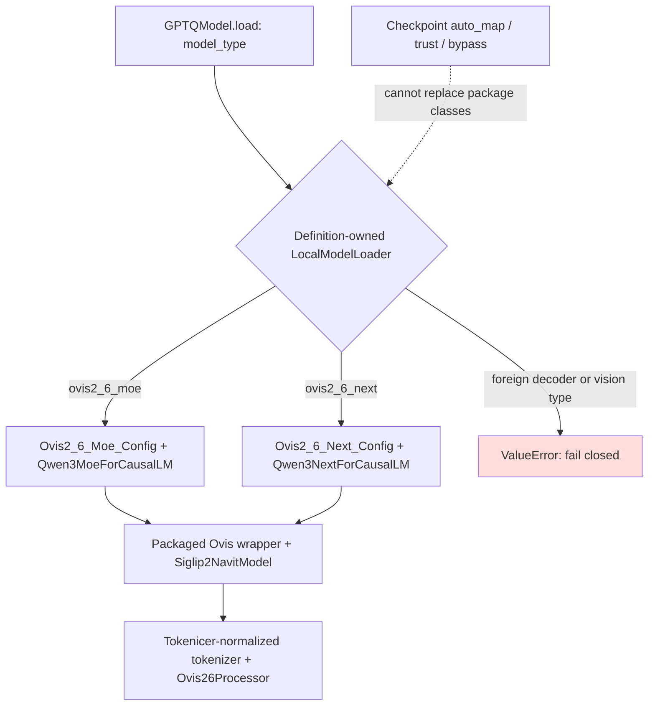
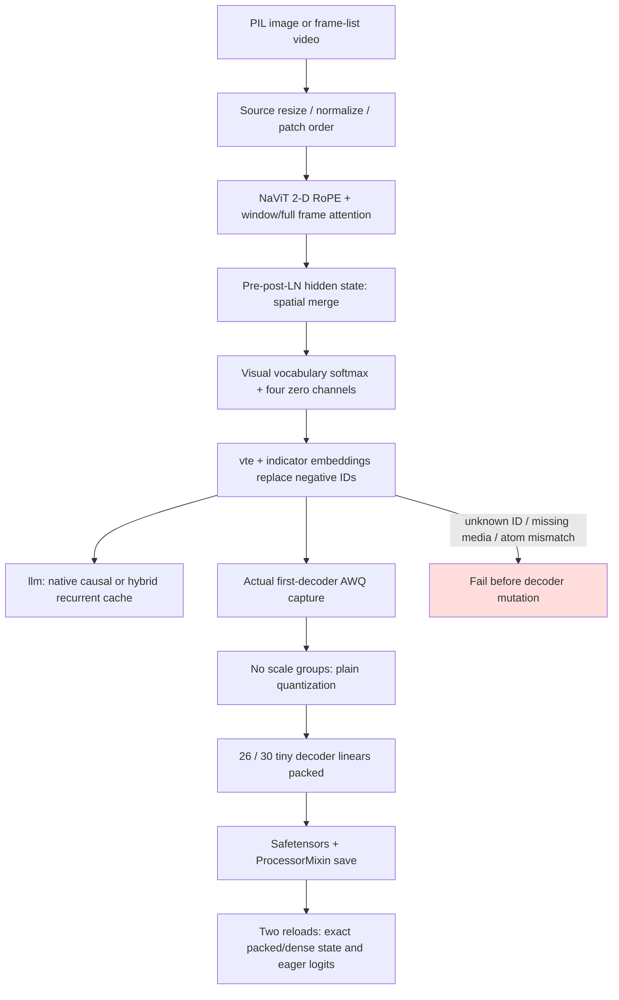
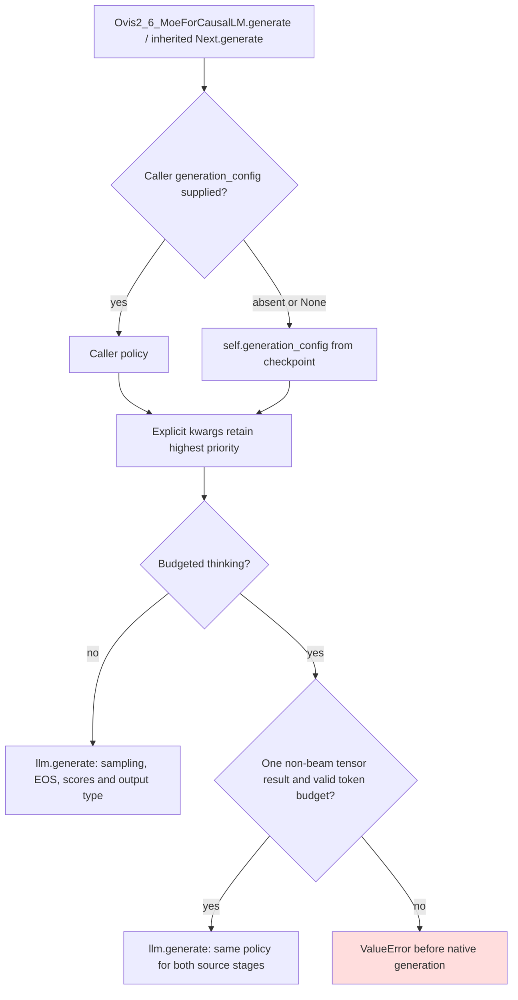

# Ovis2.6 MoE / Next: Transformers 5 local ownership

GPT-QModel owns the Ovis wrapper, configs, NaViT/SigLIP2 vision, soft visual
vocabulary and processor. `ovis2_6_moe` selects native `Qwen3MoeForCausalLM`;
`ovis2_6_next` selects native `Qwen3NextForCausalLM`. Neither exact wrapper has
a native Transformers 5.23 AutoConfig/AutoModel mapping. Native Ovis2 is not
a replacement for either. Checkpoint Python is never selected for these aliases.

## Sources and attribution

| Release | Pinned revision | Actual tensor-header inventory |
| --- | --- | --- |
| [30B](https://huggingface.co/AIDC-AI/Ovis2.6-30B-A3B/tree/44beb8e150b28c7ca537a1673582c64f57d342e3) | `44beb8e150b28c7ca537a1673582c64f57d342e3` | 19,308 keys/shapes |
| [80B](https://huggingface.co/AIDC-AI/Ovis2.6-80B-A3B/tree/96dd72344e17f098ba7cbe108e6872d12ba7cbfb) | `96dd72344e17f098ba7cbe108e6872d12ba7cbfb` | 74,832 keys/shapes |

Inspected source: each release's `configuration_ovis2_6.py`,
`modeling_ovis2_6.py`, config, model card, checkpoint index and every shard
header. `provenance.json` records SHA-256 hashes of the inspected data and
checked-in fixtures. Gzipped shape inventories contain names/shapes only, not
trained tensors. The 30B index omits the two vision post-LayerNorm tensors
present in its actual shard headers; both present and absent cases are tested.
The 80B index and headers agree. Fixtures also include actual pinned tokenizer
and image-processor data; both releases share the identical serialized Qwen BPE.

Both pinned cards declare Apache-2.0. See `LICENSE` and `NOTICE`; retained
vision attribution identifies Qwen2.5-VL rotary/windowing and SigLIP-style
encoder origins. No checkpoint Python is executed to discover behavior.

## Resolution and failure boundaries





| Before | After |
| --- | --- |
| Definition inherited checkpoint AutoModel selection | Explicit lazy package paths for both configs/models/processors |
| Source constructor downloaded tokenizer/image processor | Native decoder construction is offline; normalized assets injected |
| Transformers 4 checkpoint class registration | Explicit native Qwen3 MoE/Next nested configs, no global registration |
| FlashAttention-only vision assumption | Real eager and SDPA frame/window attention, no optional CUDA import |
| Indicator/rotary reload initialization could drift | Computed indicator range and deterministic nonpersistent RoPE reset |
| Requested eager lost on quantized nested reload | Propagate selected root backend only into unset child configs |
| Next AWQ override allowed the router | Explicit plain policy; router/shared gate/linear-attention BA remain dense |
| Generic token sanitization clipped visual IDs | Definition preserves IDs; wrapper rejects unknown negatives |

Original `llm.*`, `visual_tokenizer.*`, `vte.*` tensor names and source
pre-post-LN vision feature selection remain intact. Native caches are not
converted into an invented shared format. The source thinking-budget path
is retained; policy precedence and two-stage token accounting are tested, but
trained thinking quality and exact special-token boundary semantics have not
been independently qualified. Frame-list video is supported; no container
decoder is added. Source temporal patch size is one; other values fail closed.

## Saved generation policy

Both pinned releases ship byte-identical `generation_config.json` (checked in
under `fixtures/`; SHA-256 in `provenance.json`): sampling is enabled with
temperature 0.6, top-k 20, top-p 0.95, repetition penalty 1.05 and two EOS IDs,
151645/151643. Their inspected wrapper source delegates to `llm.generate`
without forwarding the root policy. HF loads that released file onto the
wrapper, not its freshly constructed native decoder; the original local port
therefore silently used the decoder defaults even after dense/quantized reload.
The released model card's ordinary generation calls provide token budgets but
do not repeat all those sampling defaults.

The local wrapper explicitly forwards the caller's `generation_config`, or
its own root policy when absent/`None`, to every native generation stage. Native
Transformers still applies explicit generation kwargs last. Neither the saved
root policy, nested decoder policy nor caller-owned policy is mutated. This
matches the sibling Ovis2.5 repair's precedence, rather than preserving the
source wrapper's lost-policy defect. Budgeted thinking checks the same effective
policy for unsupported beam/multiple-result/dictionary output and reads saved
`max_new_tokens` when no call override exists; existing budget validation and
source continuation text remain unchanged.



| Old owner behavior | Current behavior |
| --- | --- |
| `modeling_ovis2_6.py:generate` delegated only kwargs | Pass caller/root policy to every native generation stage |
| Root EOS/sampling/scores ignored after loading | Public dense and AWQ reloads consume saved root defaults |
| Budget guards inspected only call kwargs | Effective root/caller policy checked; explicit kwargs still win |
| Saved `max_new_tokens` rejected by thinking guard | Saved budget or explicit override used for both stages |

The pre-fix focused command below produced **20 intended failures in 17.84s**:
twelve lost-policy reds (including both aliases after two real AWQ save/reloads
with disk offload false/true), six ignored inherited guard reds, and two saved
token-budget reds. After the narrow repair the same cases passed in 14.81s.
Tests use the actual release sampling policy with only tiny-vocabulary token IDs
and bounded budgets, plus saved score/dictionary-output options. An independent
native-decoder invocation checks seeded sequences and every processed score;
an explicit native logits processor forces the additional EOS to prove real
early stopping. Caller policy replacement, kwargs overriding that policy,
explicit `None`, and exact root/nested/caller policy immutability are checked.
The two-stage thinking control verifies source continuation tokens and exact
remaining-token accounting, not trained reasoning quality. As in source,
`inputs_embeds` generation applies repetition penalties only to newly generated
tokens, not the embedded prompt; this boundary is not silently changed.

## Validation and reproduction

Validated with Python 3.14.6t (`PYTHON_GIL=0`), Transformers 5.23.0,
Torch 2.15.0+cpu, released Tokenicer 0.0.17. No tokenizer shim is present.
The generation-policy follow-up uses independently SHA-verified published
Tokenicer 0.0.19 on the same free-threaded CPU environment.
Follow-up owned result: **127 passed, no skips, 54.33s**. Combined original
loader/security/processor/registry/AWQ/fusion families: **856 passed, 477 skipped,
one deselected, 68.01s**, applying only the original central proposals in memory.
The exclusion is the already-observed unrelated shared Prism-GGUF checkpoint
hook regression. Skips are 468 NVIDIA Marlin cases, two CUDA processor cases,
one absent PEFT dependency, four missing remote-fixture cases and two generic
non-buildable CausalLM families. No new hardware coverage is inferred.

```bash
export PATH=/home/ubuntu/.venvs/gptqmodel-tf5/bin:$PATH
PYTHON_GIL=0 python -m pytest -q tests/test_ovis2_6_moe_local_port.py tests/module_tree/test_ovis2_6_moe_local_port.py
PYTHON_GIL=0 python -m pytest -q tests/test_ovis2_6_moe_local_port.py -k 'public_saved_generation_policy or thinking_guard_resolves or thinking_uses_saved or public_image_calibrated_plain_awq'
bash format/check.sh
uvx --from ruff==0.14.2 ruff check gptqmodel docs/eora tests setup.py
python -m compileall -q gptqmodel/models/ports/ovis2_6_moe gptqmodel/models/definitions/ovis2_6_moe.py
pyright --pythonpath /home/ubuntu/.venvs/gptqmodel-tf5/bin/python gptqmodel/models/ports/ovis2_6_moe/modeling_ovis2_6.py
git diff --check
```

Tests cover real CPU/meta owners, every released header shape, MHA/GQA/MQA
and bias, FP32/FP16/BF16 eager/SDPA media forward, native cache continuation
and causality, greedy/beam parity to an independently instantiated decoder,
assignment and two dense safetensors cycles. Independent float64 equations
cover patchification, interpolated positions, coordinate RoPE, ragged multi-frame
full/window attention, MLP, spatial merge, soft visual vocabulary and embedding
insertion. Processor tests independently check actual pixels/patch order,
image/video IDs, serialization and retry. Public loading tests exercise hostile
model/config/tokenizer/processor maps with trust false/true and bypass absent/0/1.
Pinned released tokenizer cases check multilingual IDs/decode/chat and reload.

Four public image-calibrated AWQ cases cover both aliases, offload false/true,
`fallback=None`, actual first-block capture, all 26/30 tiny decoder linears,
every excluded dense tensor, two exact packed-state/logit reloads and processor
persistence. No scale-search/fold safety is claimed. Mutation evidence: multiplying
eager vision attention scale by 1.1 makes five independent-oracle tests fail;
five SDPA controls stay green. Earlier regressions detect lost nested eager,
missing ProcessorMixin persistence and missing Next container exclusion.

## Integration ownership

`central_fixture_proposals.json` provides exact replacement registry cases and
unqualified fusion reasons. Parent owns central fixture edits, main README,
central docs/reference-page integration and PR diagrams; this port-local page
supplies their diagrams/table. Neither alias is in the generic AWQ numerical
`FAMILIES`, so no generic plain-family set change is proposed. Parent must package
LICENSE/NOTICE/provenance plus JSON/gzip fixtures. Shared qualification baseline
copies are separate commits and must not be integrated as owned port changes.

## Limits

No trained multi-GB payload execution or generation quality claim. No GPU,
FlashAttention, optimized FLA, multi-GPU/device-map qualification, concurrent
PyTorch execution, compile, training, fusion executor, extended-context or
foreign/static/offloaded/quantized-cache claim. CPU disk offload here means
LazyTurtle quantization, not a claim about inference-cache offload. Existing
trained model tests use uncached `/monster/data/model` paths and are not run.
Runtime Pyright is not clean: four `GenerationMixin` override/native protocol
diagnostics remain; the same diagnostics exist on the original port snapshot.
The full Ruff gate, including an explicit pinned 0.14.2 run, passes.
