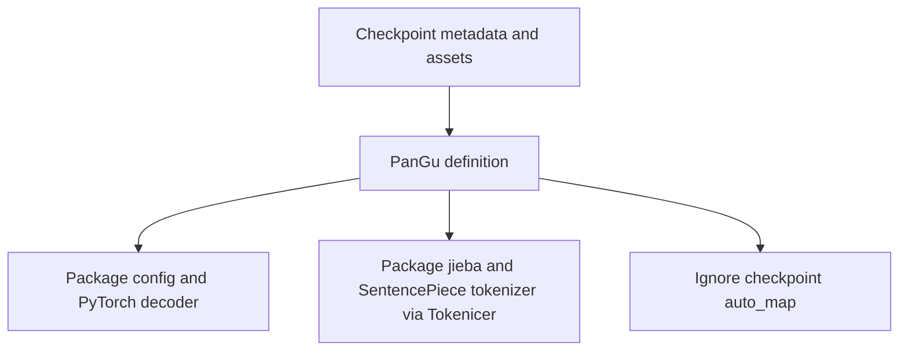
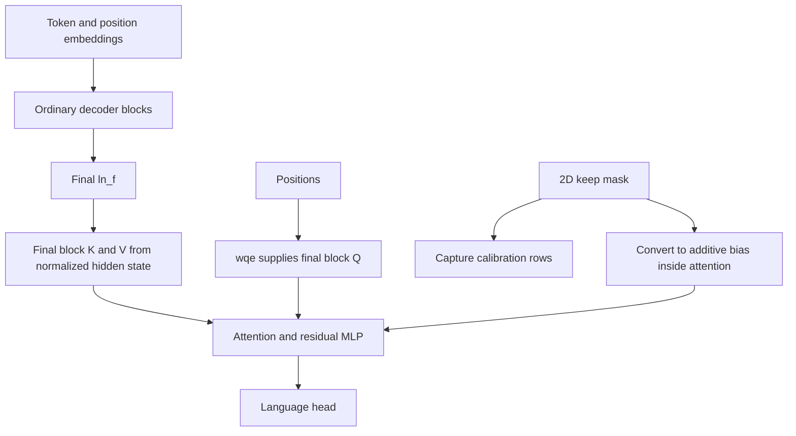

# PanGu-α (Transformers 5)

GPT-QModel owns the `gpt_pangu` configuration, model, and tokenizer. No exact
native config or causal-LM mapping exists in Transformers 5.23.0; a similarly
shaped GPT-2 does not implement the top-query block.

## Provenance

| Reference | Pinned revision | Use |
| --- | --- | --- |
| [Official Huawei PanGu-α implementation](https://github.com/huawei-noah/Pretrained-Language-Model/tree/0598f02d7fc4eaa7b4cbc1e9d7ab18bc875c24f9/PanGu-%CE%B1) | `0598f02d7fc4eaa7b4cbc1e9d7ab18bc875c24f9` | Apache-2.0 architecture, jieba/SentencePiece behavior, and vocabulary fixture. |
| [ModelCloud 2.6B conversion](https://huggingface.co/ModelCloud/pangu_alpha_2_6B/tree/bb1b22082af1dd84984a4f9bcd2343d946c4bc22) | `bb1b22082af1dd84984a4f9bcd2343d946c4bc22` | Config, schema, and numerical compatibility target. |
| [Historical PyTorch conversion](https://github.com/imoneoi/transformers-pangu/tree/b22bcb75a908920170f0cd8035d8fb17adb1da75) | `b22bcb75a908920170f0cd8035d8fb17adb1da75` | Compatibility reference; no Python included from this repository. |

The official directory's Apache-2.0 `LICENSE` and tokenizer attribution are
preserved. The separate conversion's checked Python and original repository
do not declare an explicit license; the official grant does not cover that
fork's code or imply a license for any trained model weights. The decoder is a
Torch implementation of the architecture, with the released conversion's
published key layout and inference behavior. No third-party conversion Python
or trained model weights are included.

| Input to the audit | SHA-256 |
| --- | --- |
| Official directory `LICENSE` | `c71d239df91726fc519c6eb72d318ec65820627232b2f796219e87dcf35d0ab4` |
| Official `pangu_alpha.py` | `d2d60d6b88b6595bd03a775203f8d0e7775e86703f76ac1d649bb425777deb5a` |
| Official `tokenization_jieba.py` | `f747a84698e67d7a894a5e414fde16931d9c24899e3eb945e65851af6b762881` |
| Official and release `vocab.model` | `18857e86783e50cfcaa0bc3c043fb4e9b5f240b885d2870ea593ee69b44f7a3a` |
| Released `config.json` | `1f08fa83f8e7d71f312c689e7ccfe6bda5bdab6cc82b1719d33259ca9f8853c7` |
| Released ZIP `archive/data.pkl` metadata | `d97c9aeddec9da82824f1ec6e50f5eaccebb1ab82679d61485fd90e55694a8fe` |
| Extracted 582-key shape inventory | `8b2dcb39718594b66e2de82373f6aabb496e9f4fde0edb91fc4adf563729a985` |

A 262,144-byte HTTP range read of the legacy archive was enough to extract its
tensor names and shapes. The metadata reader accepted only the expected
structural globals and locally defined shape-recording rebuild functions;
no tensor storage or checkpoint Python was loaded. The independent inventory
includes the persistent attention `bias` and `masked_bias` buffers in every
block. The vocabulary fixture is tokenizer data, not a model weight payload.

## Loader and replay

| Boundary | Before | After |
| --- | --- | --- |
| Config/model/tokenizer | Checkpoint Python | Definition-owned classes; `auto_map` and trust flags cannot select code |
| Last decoder block | Final norm and top-query supplied by checkpoint implementation | `ln_f` before the last block; Q reads `wqe(position_ids)` |
| Cache | Historical tuple API | Transformers `DynamicCache` |
| Calibration mask | Additive mask could be captured as an empty keep mask on unpadded batches | Binary mask crosses the block boundary; attention converts it to additive bias |
| AWQ | Model-specific folding | Explicit plain quantization; no inferred scale folding |





Live replay retains the original position IDs. In a one-block model the
captured input already has `ln_f` and the custom query, so replay does not
apply the norm again. In a deeper model replay reconstructs both for the last
block and broadcasts a shared position row across the batch. Fully masked
padding queries are not compared across full and chunked
forwards: the source finite bias permits their output to depend on the chunk
boundary. Valid query rows, including after left padding, match the full
forward; the full-forward reference also checks padding rows.

## Qualification and limits

- Independent float64 decoder, logits, attention, and KV equations; multiple
  head counts, MLP widths, activation/scaling variants, and tied/untied weights.
- FP32, FP16 and BF16 cache continuation, greedy and beam generation, exact
  repeated safetensors saves, and invalid context/mask recovery without cache
  mutation. Exact released state shapes on meta and tiny CPU/meta owners.
- Exact pinned tokenizer IDs/decode, vocabulary failure and repair, and actual
  public dense loads with hostile metadata under both trust values and bypass
  unset, `0`, or `1`. Install `jieba>=0.42.1` for PanGu-α tokenizer use and
  tests. It and SentencePiece are imported only when the tokenizer is needed;
  no downstream corrective normalization is applied.
- Public plain AWQ with `fallback=None`, FP16/BF16, one or two blocks, and
  direct or checkpoint-backed LazyTurtle materialization. Every one of the six
  projections per block is packed. Excluded dense state and packed tensors,
  logits, and generation survive two public safetensors save/reload cycles.

The unpadded-mask regression failed all original four AWQ cases on the synced
base (zero projections packed in 5.56s); moving bias conversion inside
attention fixed them without changing the shared AWQ algorithm.

The CPU checks used Python 3.14.6t (GIL off), Transformers 5.23.0, Torch
2.15.0+cpu, released Tokenicer 0.0.20, SentencePiece 0.2.3, and jieba 0.42.1:

```sh
PYTHON_GIL=0 python -m pytest -q tests/test_pangu_alpha_local_port.py \
  tests/module_tree/test_pangu_alpha_local_port.py tests/test_pangu_alpha_replay.py
bash format/check.sh
git diff --check
```

The existing trained GPTQ-versus-RTN acceptance test needs the local 2.6B
checkpoint and is not part of the CPU qualification. The tiny-checkpoint
results do not qualify trained weights, model quality, GPU/multi-GPU,
FlashAttention/SDPA, threading, compile, training, long contexts, foreign
static/offloaded/quantized caches, AWQ fold search, or fusion. Source
configuration context length is enforced; this port does not extend it.
