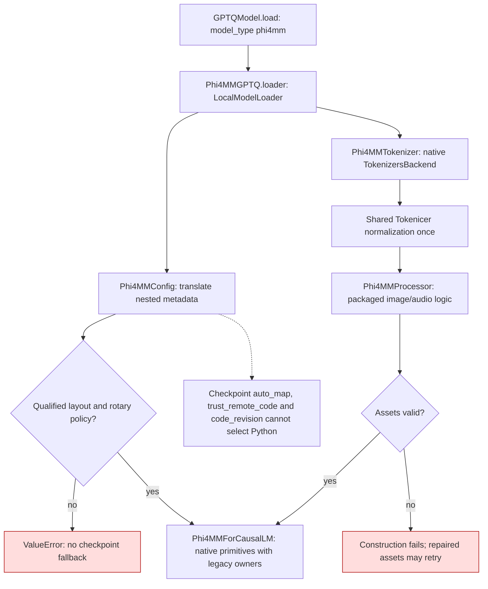
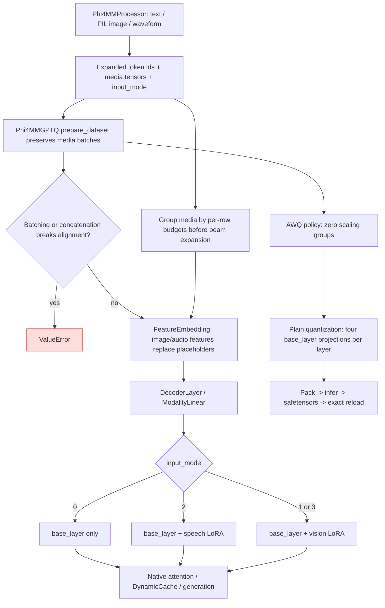

# Legacy Phi-4 multimodal (`phi4mm`)

GPT-QModel owns the legacy `Phi4MMForCausalLM` layout. It is **not** a rename
of the native `phi4_multimodal` checkpoint: native Transformers 5.23.0 is
reused where its computation matches, with explicit owners for Microsoft's
flat decoder, modality-specific LoRA, image bridge and audio namespaces.

## Source, license and native boundary

Authoritative release:
[microsoft/Phi-4-multimodal-instruct](https://huggingface.co/microsoft/Phi-4-multimodal-instruct/tree/93f923e1a7727d1c4f446756212d9d3e8fcc5d81),
revision `93f923e1a7727d1c4f446756212d9d3e8fcc5d81`.
Source files were inspected before adaptation; checkpoint Python is never
downloaded or imported at runtime. `provenance.json` records their SHA-256
hashes, tokenizer/processor asset hashes, the released index and the exact
installed native modeling hash. Microsoft's MIT license is preserved in
`LICENSE-MIT`; see `NOTICE` for Transformers' Apache-2.0 attribution.

| Source / owner | Package implementation | Reused native component |
| --- | --- | --- |
| `configuration_phi4mm.py` nested audio/LoRA metadata | `Phi4MMConfig` | `Phi4MultimodalConfig` and native sub-configs |
| Four decoder projections with vision/speech adapters | `ModalityLinear`, `DecoderLayer` | Native packed QKV, partial RoPE, attention, gated MLP, norm and cache APIs |
| Source default/Su/Yarn/LongRoPE frequencies | `RotaryEmbedding` | Native RoPE application; call-local FP32 frequency derivation |
| Legacy SigLIP names / HD separators | `ImageEmbedding` | Native NaViT/SigLIP, crop pooling, row/global separators and image insertion |
| Cascades audio encoder and projections | `AudioEncoder`, `AudioLayer`, `AudioAttention`, `AudioEmbedding` | Native subsampling, relative bias, convolution and projection primitives |
| Combined modality embedding | `FeatureEmbedding` | Native embedding insertion helpers |
| Source processor | `Phi4MMProcessor`, image/audio processors | Native tokenizer and torchvision operations |
| Released serialized BPE | `Phi4MMTokenizer` alias | Exact `TokenizersBackend`, not a reconstructed GPT2 regex |

All **2047** released tensor keys/shapes from all three safetensors shard
headers match the full model on `meta`. Only tied `lm_head.weight` is an extra
state-dict entry. No trained multi-GB tensor payload was downloaded. Decoder
`base_layer` projections are quantized; both `vision`/`speech` LoRA A/B,
normalizations, image/audio components and tied embeddings/head stay dense.
Native `phi4_multimodal` remains distinct. No global AutoClass registration,
dynamic code dispatcher or checkpoint compatibility import is installed.

## Before and after

The before locations are from parent `022031ba274bb84c12e691217ca104b2f49332cf`.

| Before | After |
| --- | --- |
| `definitions/phi4.py:10-14`: generic loader, obsolete `backoff`/`optimum` requirements | Definition-owned `LocalModelLoader`, explicit config/model/processor/tokenizer selection |
| `definitions/phi4.py:43-57`: mutable instance monkeypatch defaults `input_mode` only before quantization | Owned model defaults mode 0; call-local adapter selection works before/after quantization and resets on failure |
| `definitions/phi4.py:17-41`: decoder base weights only | Exact base weights plus explicitly excluded LoRA owners |
| Generic text calibration drops image/audio tensors | Processor-produced media batches retain fields; concatenation/rebatching that would break alignment raises |
| GPT2 metadata can reconstruct a different TF5 regex | Native serialized-BPE backend selected explicitly, then the shared Tokenicer normalization runs once |
| Default tensor repetition interleaves individual media during beam expansion | Media grouped by per-row image/audio placeholder budgets before beam expansion |

### Definition and security flow



### Media, adapters, cache and quantization flow



Parent integration must copy these diagrams and the table to the shared
`docs/` coverage page and PR description, and link that page from the main
README. Those shared files are deliberately outside this unit's ownership.

## Validation and independent oracles

The owned suites are `tests/test_phi4_local_port.py` and
`tests/module_tree/test_phi4_local_port.py`. They use real model instances,
not trees generated from declarations. The baseline run passed **90** cases
without skips in **93.42 s** before the final public-retry/assertion additions.
The final published-Tokenicer run of the owned suites plus local model/path/
processor/tokenizer consumers passed **206** cases without skips in **79.78 s**.
AWQ consumer checks passed **280**, skipped **8** in **42.00 s**: three absent
Pangu cases, two non-buildable CausalLM families, and absent DeciLM/EXAONE/
Nanbeige fixtures. The broader proposed-inventory run passed **814**, skipped
**460** NVIDIA-only fusion cases, and failed **3** unrelated parent tests in
**39.09 s**. Those failures are the ERNIE fixed-index expert snapshot in
`test_explicit_module_plan.py`, and generic `SimpleNamespace` configs for
`interns1` / `internvl_chat` in `test_shared_input.py`; the parent was informed.
No Phi-4 assertion failed. Shared inventories were amended only in memory
using this port's exact JSON proposal; no shared file was changed.

- Decoder FP64 equations independently implement RMSNorm, QKV ordering,
  partial rotation, causal attention, gated MLP and nonzero modality LoRA.
- CPU/meta MHA/GQA/MQA and modes 0/1/2/3; eager/SDPA; FP32/FP16/BF16;
  multi-token continuation, greedy/beam generation, two exact safetensors cycles.
- Independent vision attention, projection, pool/separator/merge equations;
  independent Conformer subsampling, relative-bias attention and convolution.
- Masked audio, including an empty masked row and a sequence exceeding
  500 subsampled frames; source masked-softmax zeroes all blocked probabilities.
- Su/Yarn/LongRoPE short/long thresholds and source amplitude equations in
  three dtypes, with source-length policy and FP32-derived frequencies.
- Six hostile public model/tokenizer/processor layouts: trust false/true
  crossed with bypass absent/0/1; checkpoint Python sentinel never executes.
  Real BPE IDs/decode, dense generation, two saves/reloads and corrupt-processor
  failure/repair/retry use the public loader.
- Pinned real tokenizer and processor assets; nonconstant PIL images,
  8/16 kHz waveforms, independent SpeechLib FFT/filterbank equations and exact
  processor save/reload. The test reads the pinned release tokenizer and writes its exact bytes.
- Six actual public **plain AWQ** runs with `fallback=None`: image, audio,
  combined media crossed with disk offload false/true; all eight decoder
  linears pack, first-decoder calibration inputs exactly match the dense
  media baseline, all excluded tensors and packed state survive two exact
  reloads, logits/generation remain equal after each reload.

### Red / green evidence

| Defect / probe | Red result | Repair / green assertion |
| --- | --- | --- |
| Old definition ownership | `LocalModelLoader` assertion fails | Explicit owned loader |
| Native/legacy media keyword collision | Generation raises duplicate `image_pixel_values` | Reconcile native and legacy spellings |
| Non-contiguous long-audio unfold | `.view` raises after transpose | Source-compatible `reshape`, long/short masked oracles pass |
| BF16 exact reload | Maximum difference `0.0009765625` | Call-local source FP32 frequency derivation; exact cycles pass |
| Generic text calibration loses media | 17440/17536 image-feature elements mismatch, max `0.104797` | Preserve processor batches; exact first-decoder capture passes in all six public AWQ runs |
| Individual-media beam repetition | 148/384 logits mismatch, max `0.155764` | Per-row grouped expansion matches independent unexpanded logits |
| GPT2 backend reconstruction | `Hello, GPT-QModel!` splits `-Q` into IDs `12,48` | Serialized backend preserves source ID `50456` |

The BF16 symptom was repaired with the frequency implementation; no narrower
claim is made about the root cause of every native BF16 drift.

## Reproduction

Validated environment: Python **3.14.6t**, GIL disabled, Transformers **5.23.0**,
Torch **2.15.0+cpu**. The current parent loader requires Tokenicer API 19
`prepare_load_kwargs`. Initial qualification used the parent-supplied candidate
`4f23746c7aeac3bf054d1d0dd7dc66e951468989`; final qualification uses the
published **Tokenicer 0.0.19** package (no VCS direct URL). Released 0.0.17
does not supply the current parent's required API. No tokenizer normalization
shim was added here. The final parent base is
`b444efaacc1c171c8c103308e61ca0d659ab4a94`; its shared changes are prerequisites,
not Phi-4-owned commits.

```bash
PYTHON_GIL=0 /home/ubuntu/.venvs/gptqmodel-tf5/bin/python -s -m pytest \
  tests/test_phi4_local_port.py tests/module_tree/test_phi4_local_port.py -q
PATH="/home/ubuntu/.venvs/gptqmodel-tf5/bin:$PATH" format/check.sh
/home/ubuntu/.venvs/gptqmodel-tf5/bin/python -m compileall -q \
  gptqmodel/models/ports/phi4 gptqmodel/models/definitions/phi4.py
git diff --check
```

`central_fixture_proposals.json` is an exact proposed replacement for the
registered plan and fusion reason. It is **not** consumed at runtime. Parent
owns shared fixture edits; generic AWQ family lists currently omit `phi4mm`
and need no plain-policy list change for this unit. No shared file was edited.

## Support limits

No claim is made for trained-checkpoint quality, loading all multi-GB payloads,
GPU/FlashAttention/fused kernels, multi-GPU/device-map execution, whole-model
disk offload, parallel-thread PyTorch execution, compilation, training,
foreign/static/offloaded/quantized caches, crossing the original context
boundary during cached generation, extended-context quality or fusion.
Source audio waveform processing is qualified at 8/16 kHz; other sample rates
need optional SciPy and remain unqualified. Real-time streaming, video,
alternate image-encoder architectures and non-`sub_glb` HD order are not
qualified; an explicit non-`sub_glb` order raises. Media calibration accepts
processor-produced batches with `batch_size=1`, never silent text-only
substitution or concatenation of aligned media. Plain AWQ is qualified;
folding/search/replay objectives are intentionally not admitted.
