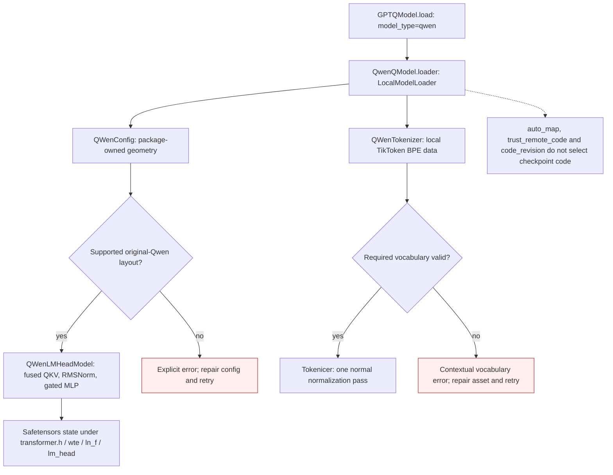
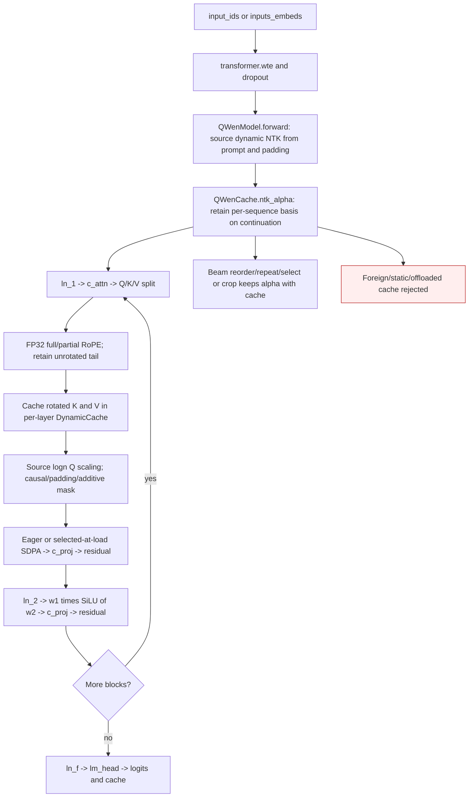

<!-- Copyright (c) Alibaba Cloud. Adaptation: ModelCloud.ai. See the accompanying licenses and NOTICE. -->

# Original Qwen on Transformers 5

This is the original `model_type=qwen` decoder, not Qwen2 or Qwen3. Neither the
configuration nor the causal-LM mapping in Transformers 5.23.0 contains original
Qwen. `QwenQModel.loader` selects the package-owned `QWenConfig`,
`QWenLMHeadModel`, and `QWenTokenizer` directly. Checkpoint Python is never
selected, including when API trust and the security bypass are both enabled.
Native Qwen2/Qwen3 classes and their definitions remain separate.

## Loading and ownership

Before this change, `qwen.py:QwenQModel` inherited the generic AutoModel loader
with no native original-Qwen implementation. Checkpoint `auto_map` could require
legacy modeling code. The module-tree paths are unchanged.



| Behavior | Previous mechanism | Current owner |
| --- | --- | --- |
| Model selection | `QwenQModel` inherited generic AutoModel loading | Definition-owned `LocalModelLoader`; no HF registration |
| QKV layout | Checkpoint `modeling_qwen.py` | `QWenAttention.c_attn`, equal-width fused Q/K/V |
| Rotary basis | Checkpoint rotary module and mutable cached alpha list | Full/partial source rotary equations; `QWenCache.ntk_alpha` belongs to each sequence |
| Token IDs / NFC / ChatML | Checkpoint `tokenization_qwen.py` and generation helper | Inspected package-local TikToken class and `make_context` |
| AWQ optimization | Generic inferred relationships | Explicit no-scaling-groups plain quantization; every declared linear remains a target |
| Tensor serialization | Legacy checkpoint implementation dependent | Native safetensors model saving and GPT-QModel quantized writer |

## Decoder and cache flow



The checkpoint keys are unchanged: `transformer.wte`, `transformer.h.#.ln_1`,
`attn.c_attn`, `attn.c_proj`, `ln_2`, `mlp.w1`, `mlp.w2`, `mlp.c_proj`,
`transformer.ln_f`, and `lm_head`. QKV bias is always present; `no_bias`
controls the other projections. Original Qwen is MHA; mismatched GQA/MQA
metadata raises rather than silently changing the architecture. The MLP uses
half of `intermediate_size` for each gated projection, matching the releases.
The default registered module plan and `w2:0:nosrc` contract are unchanged.

`QWenCache` supports chunked continuation and beam operations; the explicitly
exported `QWenLegacyCache` retains NTK metadata during tuple round trips.
Independent requests cannot change another request's rotary basis. A bare
legacy tuple lacks sequence metadata and uses the original short-context basis;
the named cache wrapper is required for faithful long-context round trips.
Legacy quantized KV storage, custom CUDA cache kernels, and explicitly enabled
FlashAttention raise descriptive errors. Source `use_flash_attn="auto"` is
accepted and uses the selected eager/SDPA implementation. Choose attention at
construction/load time; dynamic `set_attn_implementation` is not advertised.

The zero-rotary source variant is also retained; a two-channel rotary dimension
is invalid in the source NTK exponent and raises explicitly.

The source tokenizer has `eod_id=151643`, `im_start_id=151644`, and
`im_end_id=151645`; it does not declare an EOS alias. The real released metadata
and generic Tokenicer normalization are preserved: Tokenicer supplies padding
and the released generation config supplies EOS, raw/ChatML mode, sampling,
and stop-word defaults. No downstream normalization shim or caller-injected
special-token override is used. `make_context` includes source NFC normalization,
history ordering and window truncation. Saved vocabularies contain all merged
extra vocabulary tokens, so data-only reloads do not need checkpoint code.

## Provenance and licenses

All five pinned releases' independently fetched vocabularies have identical
SHA-256 `b2b1b8dfb5cc5f024bafc373121c6aba3f66f9a5a0269e243470a1de16a33186`.
The offline fixture contains those exact bytes.

All source revisions, source hashes, original release configs, checkpoint-index
keys, and fixture hashes are in `provenance.json`. Source was read before
adaptation; uninspected checkpoint code was not executed. The model equations
follow inspected original Qwen `modeling_qwen.py`, configuration, tokenizer,
and `qwen_generation_utils.py` at Qwen-7B revision
`ef3c5c9c57b252f3149c1408daf4d649ec8b6c85`.
The modeling source SHA-256 is
`7482892d33418bdd543d1ce61e5c8b5b1bd49bd85ff26be185fb3521b73daac7`.

| Pinned release | Revision | Exact header keys/shapes checked on meta |
| --- | --- | ---: |
| Qwen-1_8B | `fa6e214ccbbc6a55235c26ef406355b6bfdf5eed` | 195 |
| Qwen-7B | `ef3c5c9c57b252f3149c1408daf4d649ec8b6c85` | 259 |
| Qwen-14B | `c4051215126d906ac22bb67fe5edb39a921cd831` | 323 |
| Qwen-72B | `b8e18ac61df64d35308695769ff46b976b6a00f4` | 643 |
| Qwen-7B-Chat | `93a65d34827a3cc269b727e67004743b723e2f83` | 259 |

The machine-readable manifest is the hash authority. Header fixtures were
obtained from each pinned safetensors shard header, not inferred from model
code or configuration. No trained multi-GB weight payload was downloaded.

The public Qwen source repository at
`2df8e8ac450fa185c421a08b0090ef81826caa6e` explicitly identifies its code as
Apache 2.0 (`LICENSE-APACHE`). Model-release artifacts carry the separate
Tongyi Qianwen agreement (`LICENSE`, byte-identical across 7B/14B/72B/7B-Chat)
and the 1.8B research agreement (`LICENSE-1.8B-RESEARCH`). These are not an
Apache-only model license: commercial use conditions and the research-only
1.8B terms remain applicable to their respective released artifacts.
`NOTICE-UPSTREAM` preserves upstream third-party attribution; `NOTICE`
identifies this adaptation. The GitHub license does not override the separately
published release terms.

## Qualification and reproduction

Use Python 3.14.6t with `PYTHON_GIL=0`, Transformers 5.23.0, Torch 2.15.0 CPU,
released Tokenicer 0.0.19, and TikToken 0.12.0. The installed public PyPI
Tokenicer sdist SHA-256 was independently verified as
`aa2ca0a70ec1103ccfa98090d9e195417a673206ae142b34ece555e6b1d19bef`.
Earlier exploratory runs used an unreleased candidate; final evidence uses
the published sdist with no editable/VCS installation.

```bash
PYTHON_GIL=0 /home/ubuntu/.venvs/gptqmodel-tf5/bin/python -m pytest -q \
  tests/test_qwen_local_port.py tests/module_tree/test_qwen_local_port.py
```

Tests cover independent float64 decoder, fused QKV, RMSNorm, gated MLP,
partial/full rotary, dynamic NTK/logn, rotary positions near 32767,
FP32/FP16/BF16, causal and padded chunked cache, greedy/beam generation,
independent cache interleaving, two dense safetensors cycles and corruption
repair/retry. Five pinned full checkpoint inventories prove exact meta
ownership. Native Qwen2/Qwen3 forwards and mappings remain native controls.

Public loader cases use actual released base and Chat tokenizer/generation
metadata and real pinned `qwen.tiktoken` bytes, hostile model/tokenizer auto maps,
hostile Python and custom-generation sentinels, both API trust values, and
bypass unset/0/1. Source-generated golden IDs, decodes and ChatML context
windows include NFC, CJK, Cyrillic, Arabic, emoji, NUL and special tokens.
Six public cases remove/corrupt the vocabulary, repair it, and retry safely.
Four public plain-AWQ cases cover projection bias and offload false/true with
`fallback=None`: all ten decoder linears pack and infer, while embeddings,
norms, head and dense biases retain exact requested-dtype state. Two successive
safetensors saves/reloads preserve every packed and dense tensor and logits.
This is plain quantization qualification, not AWQ scaling/fold/search evidence.

The required CPU AWQ baseline is reproduced with:

```bash
PYTHON_GIL=0 /home/ubuntu/.venvs/gptqmodel-tf5/bin/python -m pytest -q \
  tests/test_awq_scale_search_safety.py tests/test_awq_moe_router_scaling.py \
  tests/test_awq_empty_groups.py tests/test_awq_position_kwargs.py \
  tests/test_awq_scale_search_memory.py tests/test_bloom_awq_replay.py \
  tests/module_tree/test_awq_relationships.py \
  tests/module_tree/test_bloom_awq_relationships.py \
  tests/module_tree/test_registered_module_plans.py \
  tests/module_tree/test_definition_subset_ordering.py
```

Port files also pass Ruff 0.14.2, `format/check.sh`, compileall and
`git diff --check`.

Final owned validation: **90 passed, zero skips in 35.90 seconds** on the
published Tokenicer 0.0.19. Before the final asset-integrity test was added,
the combined owned/AWQ baseline/registry/local-loader/
security/config/scaling run passed 868 cases with 12 skips, one unrelated
deselection and 10 deprecation warnings in 56.94 seconds. The required AWQ
baseline independently passed 574 cases with three existing remote-checkpoint
fixture skips in 11.29 seconds. The one deselected test was
`test_patch_transformers_prism_gguf_compat_wraps_load_checkpoint_for_torch_loader`:
it was actually run and failed because this old isolated test still sets a
removed GGUF environment switch, while the approved shared helper now uses a
`KernelConfig` policy. Parent integration already migrated this central test;
the child does not edit it.

Combined skips are three absent remote AWQ fixtures (DeciLM, EXAONE, Nanbeige),
two CUDA/checkpoint recovery prerequisites, one absent PEFT dependency, four
absent scaling fixtures (Pangu twice, Instella, K2-Horizon), and two non-buildable
CausalLM test geometries (opt350, muse_glimmer). None are owned Qwen cases.

Intentional defect probes detect meaningful computation changes: replacing
partial/zero rotary with full-head rotary fails eight independent decoder
cases while four full-head controls pass (3.31 seconds); swapping K and V fails
all twelve independent decoder cases (3.22 seconds). The genuine additive-mask
repair first failed both eager/SDPA finite-bias oracle tests (4.10 seconds), then
passed with biases preserved instead of converted to Boolean masks. The actual
missing-vocabulary public regression first failed five cases with a generic
`Path(None)` TypeError; a contextual vocabulary error permits safe repair/retry
across the full trust/bypass matrix.

## Integration boundary and limits

Parent integration owns central documentation, this flow in PR 4620, package
data (licenses, notices, JSON, compressed data fixtures), dependencies and the
shared `ports/__init__.py`. This older isolated base lacks the parent package
initializer; do not infer wheel discovery from successful namespace imports.
No shared loader/security/AWQ algorithm changes belong to this port's owned
commit. The approved canonical shared prerequisite is excluded from integration.

`registered_module_plans.cases["QwenQModel/gptq"]` remains unchanged:

```json
{"layers":["transformer.h"],"blocks":[["ln_1:!"],["attn.c_attn"],["attn.c_proj"],["ln_2:!"],["mlp.w1","mlp.w2"],["mlp.c_proj"]]}
```

Proposed central fusion reason for `fusable_models.models.qwen.reason`:
`Package-owned original Qwen fused-QKV decoder with cache-owned NTK/logn attention; fusion executor has not been qualified.`
The centralized AWQ scaling-family parametrization currently omits `qwen`;
there is no mandatory PLAIN-family entry to update. The owned public tests
directly qualify the conservative no-group policy.

Unverified: trained-checkpoint payload/quality, GPU/FlashAttention/custom cache
kernels, multi-GPU placement, concurrent PyTorch execution, compile/training,
static/offloaded/foreign caches, cache quantization, streaming chat, extended
trained-context quality, AWQ fold/search and fusion execution. CPU numerical
source parity and tiny-model safetensors/AWQ evidence do not qualify these.
