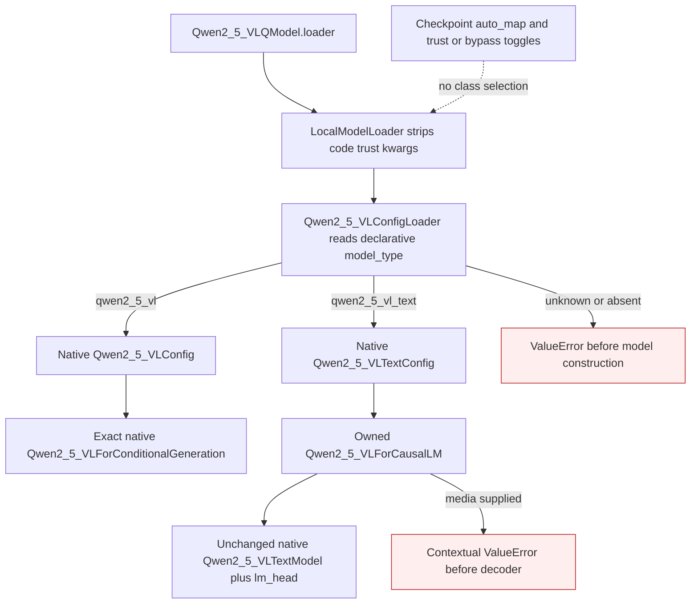
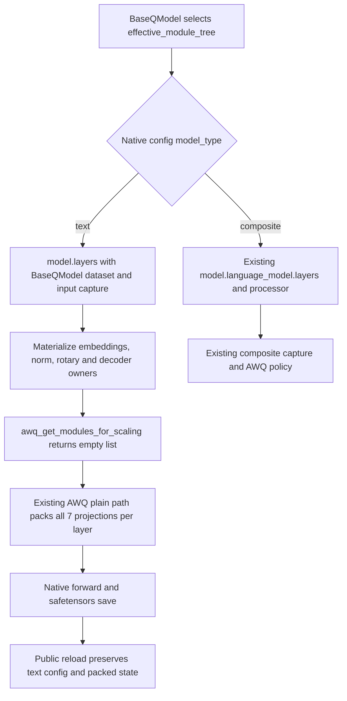

# Qwen2.5-VL native composite and explicit text task

`qwen2_5_vl` keeps the exact Transformers 5.23
`Qwen2_5_VLForConditionalGeneration`. The already registered
`qwen2_5_vl_text` alias gains a GPT-QModel-owned `Qwen2_5_VLForCausalLM`
head over the unchanged native `Qwen2_5_VLTextModel`. There is no copied
vision stack, decoder, attention, rotary implementation or cache.

Transformers maps the composite in `AutoModelForImageTextToText`, but maps
the text config only to its backbone in `AutoModel`; neither the image-text
nor causal-LM auto family supplies its text head. The definition now selects
both tasks explicitly through `LocalModelLoader`. Checkpoint `auto_map`,
`trust_remote_code`, and the safety bypass cannot replace these classes.

## Checkpoint contract and provenance

The text task accepts an **explicit text checkpoint** with
`model_type="qwen2_5_vl_text"`, native text configuration, decoder tensors
under `model.*`, and `lm_head.weight` (or tied embeddings). It does not
silently extract a composite checkpoint or omit vision tensors. Its processor,
calibration capture and module tree use the text path; media inputs fail with
a contextual error before decoder execution. Standard generation metadata,
native DynamicCache continuation and native safetensors serialization remain
available.

Authoritative code is [Transformers v5.23.0 Qwen2.5-VL](https://github.com/huggingface/transformers/tree/52b080b6416a7897e2af90febeb4dfad22b84d19/src/transformers/models/qwen2_5_vl),
commit `52b080b6416a7897e2af90febeb4dfad22b84d19`. Both installed native
modeling/configuration files were byte-compared to that revision. The small
head follows the native composite's linear projection, loss and output
contract. Apache-2.0 attribution and the full license are in `NOTICE` and
`LICENSE`.

Checkpoint inventory comes from [Qwen/Qwen2.5-VL-3B-Instruct](https://huggingface.co/Qwen/Qwen2.5-VL-3B-Instruct/tree/66285546d2b821cf421d4f5eb2576359d3770cd3),
revision `66285546d2b821cf421d4f5eb2576359d3770cd3`. The index and **both
actual safetensors headers** were inspected, without fetching tensor payloads.
All 824 released keys/shapes match the native meta model after its declared
legacy conversion (`visual.* -> model.visual.*`,
`model.* -> model.language_model.*`). The native model has 825 state entries:
the release omits `lm_head.weight` because it is tied to the embeddings.
The test verifies that reconstruction and independently filters the text schema.

The fixture's separate **Qwen Research License** is preserved byte-for-byte
as `LICENSE.Qwen3B`, with a narrow `.gitattributes` exception for its upstream
trailing spaces; it is not an Apache-only checkpoint license. No trained
weight payloads are redistributed. `provenance.json` records source URLs,
revision pins, header hashes, asset hashes and shipped fixture hashes.

## Selection and failure paths





| Mechanism | Before at base `22bea1201` | After |
| --- | --- | --- |
| Task loader | `definitions/qwen2_5_vl.py:10-13` inherits the image-text auto family | `Qwen2_5_VLQModel.loader`, `Qwen2_5_VLModelLoader._model_class` select exact native composite or owned text head |
| Text config | Image-text auto family raises `ValueError` | `Qwen2_5_VLConfigLoader.from_pretrained` selects exact native text config |
| Decoder tree | Inherited multimodal `model.language_model.layers` | `_resolve_effective_module_tree` derives text `model.layers` without mutating the shared class tree |
| Media/capture | Processor and multimodal capture required for both aliases | Composite delegates unchanged; text uses `BaseQModel` and rejects all seven native media kwargs |
| Text AWQ | No task-specific qualification | Explicit plain policy; all 14 decoder linears packed, norm/head/embedding exclusions exact |
| Invalid metadata | No supported text task | Unknown type fails closed; repaired valid metadata loads successfully |

## Qualification

Qualified environment: Python 3.14.6 free-threaded, `PYTHON_GIL=0`,
Transformers 5.23.0, Torch 2.15.0+cpu, released Tokenicer 0.0.17. No threaded
PyTorch execution was introduced or qualified. Initial checks on Tokenicer
0.0.14 are superseded by the released-0.0.17 final run.

Owned tests build real models on CPU/meta, inspect every decoder state owner,
roles, norm exclusions, undeclared descendants and both aliases. They cover
MHA/GQA/MQA, eager/SDPA, FP32/FP16/BF16, full/sliding attention, left padding,
native-composite logit/cache oracles, greedy/three-beam generation, native
mixed image/video generation, loss/logit selection/hidden outputs, tied and
untied embeddings, assignment, two dense safetensors cycles, and invalid
config repair/retry. Eighteen public malicious `auto_map` cases cover both
tasks, trust None/False/True and bypass unset/0/1, with Python execution sentinels.

Text AWQ is **plain quantization only**: no norm fold, scale search or replay
optimization is admitted. Six real public `fallback=None` cases span
MHA/GQA/MQA x disk offload False/True, actual quantization/packing/inference,
every packed and excluded tensor, and TWO exact packed safetensors reloads.
The existing composite AWQ/fusion declarations are preserved; this unit adds
no composite folding or GPU-kernel qualification.

Red/green probes restored the old auto loader (1 intended failure), forced
the wrong composite tree on text (1 intended failure), and shifted head
vocabulary channels (3 intended failures). The unmodified implementation
passes the same assertions. The older base's tokenizer AutoConfig escape
with trust+bypass also failed before the parent's existing security fix
`5423ad629`; local prerequisite copy `2601d9870` is **not an owned port commit**.

From the repository root, using the isolated environment on PATH:

```bash
export PATH=/home/ubuntu/.venvs/gptqmodel-tf5/bin:$PATH
PYTHON_GIL=0 python -m pytest -q \
  tests/test_qwen2_5_vl_local_port.py \
  tests/module_tree/test_qwen2_5_vl_local_port.py -ra

PYTHON_GIL=0 python -m pytest -q \
  tests/test_qwen2_5_vl_local_port.py tests/module_tree/test_qwen2_5_vl_local_port.py \
  tests/test_local_model_loading.py tests/test_internlm_local_port.py \
  tests/module_tree/test_internlm_local_port.py \
  tests/test_awq_scale_search_safety.py tests/test_awq_moe_router_scaling.py \
  tests/test_awq_empty_groups.py tests/test_awq_position_kwargs.py \
  tests/test_awq_scale_search_memory.py tests/test_bloom_awq_replay.py \
  tests/module_tree/test_awq_relationships.py tests/module_tree/test_bloom_awq_relationships.py \
  tests/module_tree/test_registered_module_plans.py tests/module_tree/test_definition_subset_ordering.py \
  tests/module_tree/test_fusable_models.py tests/module_tree/test_fusable_config.py \
  tests/module_tree/test_fusable_merge.py -ra

format/check.sh
pyright --pythonpath /home/ubuntu/.venvs/gptqmodel-tf5/bin/python \
  gptqmodel/models/ports/qwen2_5_vl/modeling_qwen2_5_vl.py
git diff --check
```

The final owned run is 65 passed with no skips. The final combined baseline
is 849 passed, 471 skipped, 9 warnings in 49.69s. Skips are 468 NVIDIA Marlin
hardware cases and three absent DeciLM,
EXAONE and Nanbeige local checkpoint fixtures. Full `format/check.sh` with
Ruff 0.14.2 and the adapter's Pyright check pass.

Pinned real tokenizer qualification separately compared five English/CJK,
whitespace, Unicode and special-token samples against raw serialized-tokenizer
IDs and native Transformers IDs, plus chat rendering/IDs, EOS and three
save/reload cycles. Both composite and text config selection preserve the
reference IDs. The synthetic WordLevel tokenizer in the tiny-model tests
is only a public-loader fixture. The real reference IDs and asset hashes are
in `fixtures/qwen3b_tokenizer_reference.json`; there is no port normalization
shim. To repeat that real-asset check without downloading weights:

```bash
PYTHON_GIL=0 python - <<'PY'
import hashlib, json, tempfile
from pathlib import Path
import requests
from tokenizers import Tokenizer
from transformers import AutoTokenizer
from gptqmodel.models.definitions.qwen2_5_vl import Qwen2_5_VLQModel
from gptqmodel.utils.hf import load_hf_tokenizer

p = Path('gptqmodel/models/ports/qwen2_5_vl')
r = json.loads((p / 'fixtures/qwen3b_tokenizer_reference.json').read_text())
messages = [{'role': 'system', 'content': 'You are helpful.'},
            {'role': 'user', 'content': '中文 test 🙂'}]
with tempfile.TemporaryDirectory() as directory:
    root = Path(directory)
    for name, digest in r['sha256'].items():
        url = f"https://huggingface.co/Qwen/Qwen2.5-VL-3B-Instruct/resolve/{r['revision']}/{name}"
        response = requests.get(url, timeout=60)
        response.raise_for_status()
        assert hashlib.sha256(response.content).hexdigest() == digest
        (root / name).write_bytes(response.content)
    raw = Tokenizer.from_file(str(root / 'tokenizer.json'))
    config = Qwen2_5_VLQModel.loader.load_config(root)
    native = AutoTokenizer.from_pretrained(root, config=config, trust_remote_code=False)
    for selected in (config, config.text_config):
        loaded = load_hf_tokenizer(str(root), model_config=selected, trust_remote_code=False)
        for cycle in range(3):
            for text, ids in zip(r['texts'], r['ids'], strict=True):
                assert raw.encode(text).ids == native.encode(text) == loaded.encode(text) == ids
                assert raw.decode(ids, skip_special_tokens=False) == native.decode(ids) == loaded.decode(ids)
            assert loaded.apply_chat_template(messages, tokenize=False, add_generation_prompt=True) == r['rendered_chat']
            assert loaded.apply_chat_template(messages, tokenize=True, add_generation_prompt=True)['input_ids'] == r['chat_ids']
            assert loaded.eos_token_id == native.eos_token_id == 151645
            destination = root / f'{selected.model_type}-{cycle}'
            loaded.save_pretrained(destination)
            loaded = load_hf_tokenizer(str(destination), model_config=selected, trust_remote_code=False)
    assert all(hashlib.sha256((root / name).read_bytes()).hexdigest() == digest for name, digest in r['sha256'].items())
print('Pinned released tokenizer: IDs, decode, chat, EOS and save/reload PASS')
PY
```

## Integration and limits

`central_fixture_proposals.json` contains the exact parent-owned fusion-reason
update. The registered default module-plan case and aliases stay unchanged;
the runtime text-tree test supplies the separate task coverage. The parent
owns central coverage/main README links, PR diagrams and package-data inclusion
of all licenses, notices, JSON and compressed shape fixtures. No new runtime
dependency, central loader change or generic AWQ-family edit is owned here.

Unqualified: trained checkpoint tensor loading or model quality, GPU kernels,
FlashAttention, multi-GPU, parallel PyTorch execution, compilation, training,
extended-context rotary parity, foreign/static/offloaded/quantized caches,
text fusion, text AWQ norm folding/search, and automatic text extraction from
a composite checkpoint. Native DynamicCache on CPU is the tested cache path.
